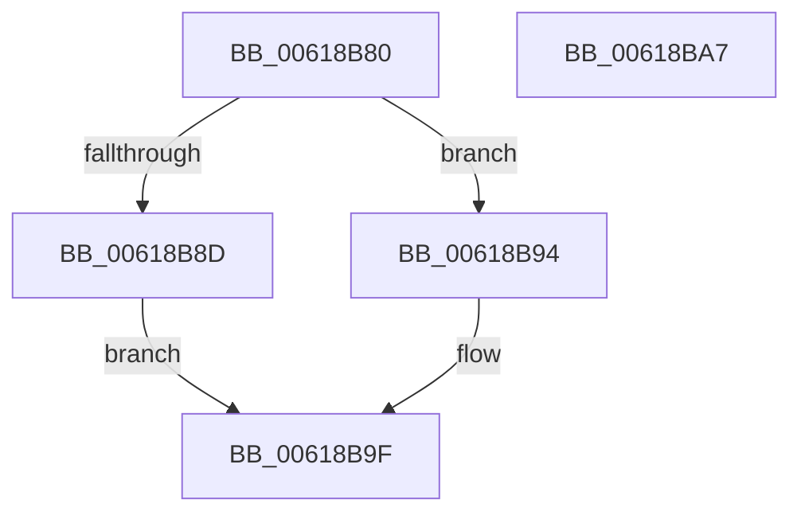

# CarInitializeRuleViolationDetails

- RVA: `0x00618B80`–`0x00618BA8` (길이 `40` bytes)
- VA: `0x0000000140618B80`
- 실행 섹션: `.text`
- PDB 이름 있음: `예`; PDB Function 태그: `아니요`
- unwind 정보 RVA: `0x0005CF00`
- 디코드: `15`개 명령, `40/40` bytes 표시
- 미해석 바이트: `0` (있으면 어셈블리에 `.byte`로 보존)

> 이 문서는 커널 이미지의 기계어와 PDB 기호를 분석해 생성했습니다. 4번과 5번은 함수 원형과 자료형을 바이너리 사용 방식에서 추정한 C 해석이며 원본 소스 복구 결과는 아닙니다.

## 1. Dependencies

- 직접 호출 지점: **1**; 고유 호출 대상: **1**
- 직접 호출자로 확인된 함수: **2**
- RIP 상대 이미지 참조: **0**

### Outgoing calls
- `0x00618B9A` → [memset](../6C/memset_function_006C6C40.md) (function, `0x006C6C40`)

### Direct callers
- [CarCreateRuleViolationDetails](CarCreateRuleViolationDetails_function_00618770.md) at `0x006187AE`
- [CarReportRuleViolationFromNt](../../pagevrfy/B9/CarReportRuleViolationFromNt_function_00B9D904.md) at `0x00B9D943`

### Static image references
- 디코드된 RIP-relative 메모리 참조가 없습니다.

## 2. Other-region calls and transfers

- 다른 실행 섹션으로 향하는 call: **0**
- 별도 외부 분기/꼬리 이동을 확인하지 못했습니다.

## 3. Assembly (complete function range)

```asm
00618B80  40 53                           push rbx
00618B82  48 83 EC 20                     sub rsp, 0x20
00618B86  33 DB                           xor ebx, ebx
00618B88  48 85 C9                        test rcx, rcx
00618B8B  75 07                           jne 0x140618b94
00618B8D  BB 0D 00 00 C0                  mov ebx, 0xc000000d
00618B92  EB 0B                           jmp 0x140618b9f
00618B94  33 D2                           xor edx, edx
00618B96  44 8D 42 58                     lea r8d, [rdx + 0x58]
00618B9A  E8 A1 E0 0A 00                  call 0x1406c6c40
00618B9F  8B C3                           mov eax, ebx
00618BA1  48 83 C4 20                     add rsp, 0x20
00618BA5  5B                              pop rbx
00618BA6  C3                              ret
00618BA7  CC                              int3
```

## 4. C-style interpretation (structured pseudocode)

```c
__int64 __fastcall CarInitializeRuleViolationDetails(__int64 a1, int a2)
{
    __int64 result;
    __int64 v_rbx;
    __int64 v_rsp;

    v_rsp = (v_rsp) - (32);
    v_rbx = 0;
    if (a1 != 0) goto loc_00618B94;
    goto loc_00618B9F;
loc_00618B94:
    a2 = 0;
    result = memset(a1, a2, a2 + 88, a4);
loc_00618B9F:
    v_rsp = (v_rsp) + (32);
    return (unsigned int)((unsigned int)((unsigned int)(0xC000000DULL)));
}
```

## 5. (Beta) C Style

```c
int64_t CarInitializeRuleViolationDetails(int64_t Arg1, int32_t Arg2)
{
    int64_t result;
    int64_t local_rbx;
    int64_t local_rsp;

    local_rsp = (local_rsp) - (32);
    local_rbx = 0;
    if (Arg1 != 0) goto loc_00618B94;
    goto loc_00618B9F;
loc_00618B94:
    Arg2 = 0;
    result = memset(Arg1, Arg2, Arg2 + 88, a4);
loc_00618B9F:
    local_rsp = (local_rsp) + (32);
    return (uint32_t)((uint32_t)((uint32_t)(0xC000000DULL)));
}
```

## 6. Execution-region graph

[열기: 2D/3D 그래프와 함수 탐색 컨트롤 패널](../../../control-panel.html?section=text&rva=0x00618B80&view=graph)

- 2D 그래프는 위에서 아래로 흐르고, 3D 그래프는 빈 공간을 드래그해 회전합니다. Shift+드래그는 이동, 휠은 확대·축소, 함수 노드 선택은 대상 보고서 이동입니다.

### Static fallback


