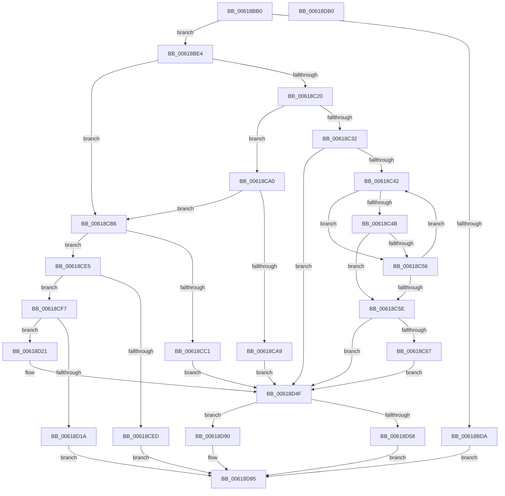

# CarInitializeTelemetryData

- RVA: `0x00618BB0`–`0x00618DB1` (길이 `513` bytes)
- VA: `0x0000000140618BB0`
- 실행 섹션: `.text`
- PDB 이름 있음: `예`; PDB Function 태그: `아니요`
- unwind 정보 RVA: `0x0005D7BC`
- 디코드: `134`개 명령, `513/513` bytes 표시
- 미해석 바이트: `0` (있으면 어셈블리에 `.byte`로 보존)

> 이 문서는 커널 이미지의 기계어와 PDB 기호를 분석해 생성했습니다. 4번과 5번은 함수 원형과 자료형을 바이너리 사용 방식에서 추정한 C 해석이며 원본 소스 복구 결과는 아닙니다.

## 1. Dependencies

- 직접 호출 지점: **10**; 고유 호출 대상: **8**
- 직접 호출자로 확인된 함수: **1**
- RIP 상대 이미지 참조: **2**

### Outgoing calls
- `0x00618C06` → [RtlCaptureStackBackTrace](../2F/RtlCaptureStackBackTrace_function_002F9FF0.md) (function, `0x002F9FF0`)
- `0x00618CAC` → [CarGetDriverInfoFromDriverName](CarGetDriverInfoFromDriverName_function_00617E50.md) (function, `0x00617E50`)
- `0x00618CDE` → [CarGetDriverInfoFromViolationStack](CarGetDriverInfoFromViolationStack_function_00617ED8.md) (function, `0x00617ED8`)
- `0x00618D0D` → [ExAllocatePool2](../../poolcode/B8/ExAllocatePool2_function_00B820F0.md) (function, `0x00B820F0`)
- `0x00618D32` → [wcsncpy_s](../50/wcsncpy_s_function_00506650.md) (function, `0x00506650`)
- `0x00618D3D` → [CarGetDriverInfoFromDriverName](CarGetDriverInfoFromDriverName_function_00617E50.md) (function, `0x00617E50`)
- `0x00618D4A` → [ExFreePoolWithTag](../../poolcode/B8/ExFreePoolWithTag_function_00B82870.md) (function, `0x00B82870`)
- `0x00618D5E` → [AppendUlongAsHexadecimalW](AppendUlongAsHexadecimalW_function_0061B804.md) (function, `0x0061B804`)
- `0x00618D72` → [AppendUlongAsHexadecimalW](AppendUlongAsHexadecimalW_function_0061B804.md) (function, `0x0061B804`)
- `0x00618D89` → [CarEtwCopyDriverName](CarEtwCopyDriverName_function_0061B8BC.md) (function, `0x0061B8BC`)

### Direct callers
- [CarReportDifPluginRuleViolation](CarReportDifPluginRuleViolation_function_00619250.md) at `0x006193A3`

### Static image references
- `0x00618BF1` → RVA `0x00F03DA8` (`.data`; read)
- `0x00618C32` → RVA `0x00E681C8` (`.data`; read)

## 2. Other-region calls and transfers

- 다른 실행 섹션으로 향하는 call: **2**
  - `0x00618D0D` → [ExAllocatePool2](../../poolcode/B8/ExAllocatePool2_function_00B820F0.md) (`.text` → `POOLCODE`)
  - `0x00618D4A` → [ExFreePoolWithTag](../../poolcode/B8/ExFreePoolWithTag_function_00B82870.md) (`.text` → `POOLCODE`)
- 별도 외부 분기/꼬리 이동을 확인하지 못했습니다.

## 3. Assembly (complete function range)

```asm
00618BB0  48 8B C4                        mov rax, rsp
00618BB3  48 89 58 08                     mov qword ptr [rax + 8], rbx
00618BB7  48 89 68 10                     mov qword ptr [rax + 0x10], rbp
00618BBB  48 89 70 18                     mov qword ptr [rax + 0x18], rsi
00618BBF  48 89 78 20                     mov qword ptr [rax + 0x20], rdi
00618BC3  41 56                           push r14
00618BC5  48 83 EC 30                     sub rsp, 0x30
00618BC9  49 8B F9                        mov rdi, r9
00618BCC  41 8B E8                        mov ebp, r8d
00618BCF  44 8B F2                        mov r14d, edx
00618BD2  48 8B D9                        mov rbx, rcx
00618BD5  48 85 C9                        test rcx, rcx
00618BD8  75 0A                           jne 0x140618be4
00618BDA  B8 EF 00 00 C0                  mov eax, 0xc00000ef
00618BDF  E9 B1 01 00 00                  jmp 0x140618d95
00618BE4  89 A9 60 04 00 00               mov dword ptr [rcx + 0x460], ebp
00618BEA  48 8D B1 68 04 00 00            lea rsi, [rcx + 0x468]
00618BF1  8B 05 B1 B1 8E 00               mov eax, dword ptr [rip + 0x8eb1b1]
00618BF7  45 33 C9                        xor r9d, r9d
00618BFA  89 01                           mov dword ptr [rcx], eax
00618BFC  4C 8B C6                        mov r8, rsi
00618BFF  41 8D 51 14                     lea edx, [r9 + 0x14]
00618C03  8D 4A F1                        lea ecx, [rdx - 0xf]
00618C06  E8 E5 13 CE FF                  call 0x1402f9ff0
00618C0B  48 8B 44 24 60                  mov rax, qword ptr [rsp + 0x60]
00618C10  48 89 83 58 04 00 00            mov qword ptr [rbx + 0x458], rax
00618C17  48 85 FF                        test rdi, rdi
00618C1A  0F 84 96 00 00 00               je 0x140618cb6
00618C20  8B 47 4C                        mov eax, dword ptr [rdi + 0x4c]
00618C23  89 83 64 04 00 00               mov dword ptr [rbx + 0x464], eax
00618C29  48 8B 57 30                     mov rdx, qword ptr [rdi + 0x30]
00618C2D  48 85 D2                        test rdx, rdx
00618C30  74 6E                           je 0x140618ca0
00618C32  48 8B 0D 8F F5 84 00            mov rcx, qword ptr [rip + 0x84f58f]
00618C39  48 85 C9                        test rcx, rcx
00618C3C  0F 84 0D 01 00 00               je 0x140618d4f
00618C42  4C 8B 41 48                     mov r8, qword ptr [rcx + 0x48]
00618C46  49 3B D0                        cmp rdx, r8
00618C49  72 0B                           jb 0x140618c56
00618C4B  8B 41 50                        mov eax, dword ptr [rcx + 0x50]
00618C4E  49 03 C0                        add rax, r8
00618C51  48 3B D0                        cmp rdx, rax
00618C54  72 08                           jb 0x140618c5e
00618C56  48 8B 09                        mov rcx, qword ptr [rcx]
00618C59  48 85 C9                        test rcx, rcx
00618C5C  75 E4                           jne 0x140618c42
00618C5E  48 85 C9                        test rcx, rcx
00618C61  0F 84 E8 00 00 00               je 0x140618d4f
00618C67  0F 10 41 08                     movups xmm0, xmmword ptr [rcx + 8]
00618C6B  0F 11 43 04                     movups xmmword ptr [rbx + 4], xmm0
00618C6F  0F 10 49 18                     movups xmm1, xmmword ptr [rcx + 0x18]
00618C73  0F 11 4B 14                     movups xmmword ptr [rbx + 0x14], xmm1
00618C77  0F 10 41 28                     movups xmm0, xmmword ptr [rcx + 0x28]
00618C7B  0F 11 43 24                     movups xmmword ptr [rbx + 0x24], xmm0
00618C7F  0F 10 49 38                     movups xmm1, xmmword ptr [rcx + 0x38]
00618C83  0F 11 4B 34                     movups xmmword ptr [rbx + 0x34], xmm1
00618C87  48 8B 41 48                     mov rax, qword ptr [rcx + 0x48]
00618C8B  48 89 43 48                     mov qword ptr [rbx + 0x48], rax
00618C8F  8B 41 50                        mov eax, dword ptr [rcx + 0x50]
00618C92  89 43 50                        mov dword ptr [rbx + 0x50], eax
00618C95  8B 41 58                        mov eax, dword ptr [rcx + 0x58]
00618C98  89 43 44                        mov dword ptr [rbx + 0x44], eax
00618C9B  E9 AF 00 00 00                  jmp 0x140618d4f
00618CA0  48 8B 4F 38                     mov rcx, qword ptr [rdi + 0x38]
00618CA4  48 85 C9                        test rcx, rcx
00618CA7  74 0D                           je 0x140618cb6
00618CA9  48 8B D3                        mov rdx, rbx
00618CAC  E8 9F F1 FF FF                  call 0x140617e50
00618CB1  E9 99 00 00 00                  jmp 0x140618d4f
00618CB6  8D 85 FD DF FF FF               lea eax, [rbp - 0x2003]
00618CBC  83 F8 02                        cmp eax, 2
00618CBF  76 24                           jbe 0x140618ce5
00618CC1  48 8D 43 44                     lea rax, [rbx + 0x44]
00618CC5  48 8B CE                        mov rcx, rsi
00618CC8  48 8D 53 50                     lea rdx, [rbx + 0x50]
00618CCC  48 89 44 24 28                  mov qword ptr [rsp + 0x28], rax
00618CD1  4C 8D 4B 48                     lea r9, [rbx + 0x48]
00618CD5  48 89 54 24 20                  mov qword ptr [rsp + 0x20], rdx
00618CDA  4C 8D 43 04                     lea r8, [rbx + 4]
00618CDE  E8 F5 F1 FF FF                  call 0x140617ed8
00618CE3  EB 6A                           jmp 0x140618d4f
00618CE5  48 8B 3F                        mov rdi, qword ptr [rdi]
00618CE8  48 85 FF                        test rdi, rdi
00618CEB  75 0A                           jne 0x140618cf7
00618CED  B8 F0 00 00 C0                  mov eax, 0xc00000f0
00618CF2  E9 9E 00 00 00                  jmp 0x140618d95
00618CF7  0F B7 17                        movzx edx, word ptr [rdi]
00618CFA  B9 40 00 00 00                  mov ecx, 0x40
00618CFF  41 B8 43 61 72 4E               mov r8d, 0x4e726143
00618D05  48 8D 14 55 02 00 00 00         lea rdx, [rdx*2 + 2]
00618D0D  E8 DE 93 56 00                  call 0x140b820f0
00618D12  48 8B F0                        mov rsi, rax
00618D15  48 85 C0                        test rax, rax
00618D18  75 07                           jne 0x140618d21
00618D1A  B8 17 00 00 C0                  mov eax, 0xc0000017
00618D1F  EB 74                           jmp 0x140618d95
00618D21  0F B7 17                        movzx edx, word ptr [rdi]
00618D24  49 83 C9 FF                     or r9, 0xffffffffffffffff
00618D28  4C 8B 47 08                     mov r8, qword ptr [rdi + 8]
00618D2C  48 FF C2                        inc rdx
00618D2F  48 8B CE                        mov rcx, rsi
00618D32  E8 19 D9 EE FF                  call 0x140506650
00618D37  48 8B D3                        mov rdx, rbx
00618D3A  48 8B CE                        mov rcx, rsi
00618D3D  E8 0E F1 FF FF                  call 0x140617e50
00618D42  BA 43 61 72 4E                  mov edx, 0x4e726143
00618D47  48 8B CE                        mov rcx, rsi
00618D4A  E8 21 9B 56 00                  call 0x140b82870
00618D4F  48 8D 7B 58                     lea rdi, [rbx + 0x58]
00618D53  48 85 FF                        test rdi, rdi
00618D56  74 38                           je 0x140618d90
00618D58  41 8B D6                        mov edx, r14d
00618D5B  48 8B CF                        mov rcx, rdi
00618D5E  E8 A1 2A 00 00                  call 0x14061b804
00618D63  BE 5F 00 00 00                  mov esi, 0x5f
00618D68  48 8D 4F 12                     lea rcx, [rdi + 0x12]
00618D6C  8B D5                           mov edx, ebp
00618D6E  66 89 77 10                     mov word ptr [rdi + 0x10], si
00618D72  E8 8D 2A 00 00                  call 0x14061b804
00618D77  48 8D 4F 24                     lea rcx, [rdi + 0x24]
00618D7B  66 89 77 22                     mov word ptr [rdi + 0x22], si
00618D7F  41 B8 EE 01 00 00               mov r8d, 0x1ee
00618D85  48 8D 53 04                     lea rdx, [rbx + 4]
00618D89  E8 2E 2B 00 00                  call 0x14061b8bc
00618D8E  EB 05                           jmp 0x140618d95
00618D90  B8 0D 00 00 C0                  mov eax, 0xc000000d
00618D95  48 8B 5C 24 40                  mov rbx, qword ptr [rsp + 0x40]
00618D9A  48 8B 6C 24 48                  mov rbp, qword ptr [rsp + 0x48]
00618D9F  48 8B 74 24 50                  mov rsi, qword ptr [rsp + 0x50]
00618DA4  48 8B 7C 24 58                  mov rdi, qword ptr [rsp + 0x58]
00618DA9  48 83 C4 30                     add rsp, 0x30
00618DAD  41 5E                           pop r14
00618DAF  C3                              ret
00618DB0  CC                              int3
```

## 4. C-style interpretation (structured pseudocode)

```c
__int64 __fastcall CarInitializeTelemetryData(__int64 a1, int a2, int a3, __int64 a4, __int64 a5)
{
    __int64 result;
    __int64 v_rsp;
    unsigned __int64 v_stack_m10;
    unsigned __int64 v_stack_m18;
    unsigned __int64 v_stack_p10;
    unsigned __int64 v_stack_p18;
    unsigned __int64 v_stack_p20;
    unsigned __int64 v_stack_p8;

    *(unsigned __int64 *)(v_rsp + 8) = v_rbx;
    *(unsigned __int64 *)(v_rsp + 16) = v_rbp;
    *(unsigned __int64 *)(v_rsp + 24) = v_rsi;
    *(unsigned __int64 *)(v_rsp + 32) = v_rdi;
    v_rsp = (v_rsp) - (48);
    if (a1 != 0) goto loc_00618BE4;
    goto loc_00618D95;
loc_00618BE4:
    *(unsigned int *)(a1 + 1120) = (unsigned int)((unsigned int)(a3));
    a4 = 0;
    *(unsigned int *)(a1) = (unsigned int)((unsigned int)(*(unsigned int *)(v_rip + 9351601)));
    result = RtlCaptureStackBackTrace(a4 + 20 - 15, a4 + 20, a1 + 1128, a4);
    *(unsigned __int64 *)(a1 + 1112) = a5;
    if (0 == 0) goto loc_00618CB6;
    *(unsigned int *)(a1 + 1124) = (unsigned int)((unsigned int)(*(unsigned int *)(a4 + 76)));
    if (*(unsigned __int64 *)(a4 + 48) == 0) goto loc_00618CA0;
    if (*(unsigned __int64 *)(v_rip + 8713615) == 0) goto loc_00618D4F;
loc_00618C42:
    if ((*(unsigned __int64 *)(a4 + 48)) < (*(unsigned __int64 *)(*(unsigned __int64 *)(v_rip + 8713615) + 72))) goto loc_00618C56;
    result = ((unsigned int)(*(unsigned int *)(*(unsigned __int64 *)(v_rip + 8713615) + 80))) + (*(unsigned __int64 *)(*(unsigned __int64 *)(v_rip + 8713615) + 72));
    if ((*(unsigned __int64 *)(a4 + 48)) < result) goto loc_00618C5E;
loc_00618C56:
    if (*(unsigned __int64 *)(*(unsigned __int64 *)(v_rip + 8713615)) != 0) goto loc_00618C42;
loc_00618C5E:
    if (*(unsigned __int64 *)(*(unsigned __int64 *)(v_rip + 8713615)) == 0) goto loc_00618D4F;
    *(unsigned __int64 *)(a1 + 4) = v_xmm0;
    *(unsigned __int64 *)(a1 + 20) = v_xmm1;
    *(unsigned __int64 *)(a1 + 36) = v_xmm0;
    *(unsigned __int64 *)(a1 + 52) = v_xmm1;
    *(unsigned __int64 *)(a1 + 72) = *(unsigned __int64 *)(*(unsigned __int64 *)(*(unsigned __int64 *)(v_rip + 8713615)) + 72);
    *(unsigned int *)(a1 + 80) = (unsigned int)((unsigned int)(*(unsigned int *)(*(unsigned __int64 *)(*(unsigned __int64 *)(v_rip + 8713615)) + 80)));
    *(unsigned int *)(a1 + 68) = (unsigned int)((unsigned int)(*(unsigned int *)(*(unsigned __int64 *)(*(unsigned __int64 *)(v_rip + 8713615)) + 88)));
    goto loc_00618D4F;
loc_00618CA0:
    if (*(unsigned __int64 *)(a4 + 56) == 0) goto loc_00618CB6;
    result = CarGetDriverInfoFromDriverName(*(unsigned __int64 *)(a4 + 56), a1, *(unsigned __int64 *)(*(unsigned __int64 *)(v_rip + 8713615) + 72), a4);
    goto loc_00618D4F;
loc_00618CB6:
    if (((unsigned int)((unsigned int)(a3) - 8195)) <= 2) goto loc_00618CE5;
    v_stack_m10 = a1 + 68;
    v_stack_m18 = a1 + 80;
    result = CarGetDriverInfoFromViolationStack(a1 + 1128, a1 + 80, a1 + 4, a1 + 72);
    goto loc_00618D4F;
loc_00618CE5:
    if (*(unsigned __int64 *)(a4) != 0) goto loc_00618CF7;
    goto loc_00618D95;
loc_00618CF7:
    result = ExAllocatePool2(64, *(unsigned __int16 *)(*(unsigned __int64 *)(a4)) * 2 + 2, (unsigned int)(0x4E726143ULL), a1 + 72);
    if (result != 0) goto loc_00618D21;
    goto loc_00618D95;
loc_00618D21:
    a4 = (a1 + 72) | (-1);
    a2 = (*(unsigned __int16 *)(*(unsigned __int64 *)(a4))) + 1;
    result = wcsncpy_s(result, a2, *(unsigned __int64 *)(*(unsigned __int64 *)(a4) + 8), a4);
    result = CarGetDriverInfoFromDriverName(result, a1, *(unsigned __int64 *)(*(unsigned __int64 *)(a4) + 8), a4);
    result = ExFreePoolWithTag(result, (unsigned int)(0x4E726143ULL), *(unsigned __int64 *)(*(unsigned __int64 *)(a4) + 8), a4);
loc_00618D4F:
    if (a1 + 88 == 0) goto loc_00618D90;
    result = AppendUlongAsHexadecimalW(a1 + 88, (unsigned int)((unsigned int)((unsigned int)(a2))), *(unsigned __int64 *)(*(unsigned __int64 *)(a4) + 8), a4);
    *(unsigned __int16 *)(a1 + 88 + 16) = 95;
    result = AppendUlongAsHexadecimalW(a1 + 88 + 18, (unsigned int)((unsigned int)((unsigned int)(a3))), *(unsigned __int64 *)(*(unsigned __int64 *)(a4) + 8), a4);
    *(unsigned __int16 *)(a1 + 88 + 34) = 95;
    result = CarEtwCopyDriverName(a1 + 88 + 36, a1 + 4, 494, a4);
    goto loc_00618D95;
loc_00618D90:
loc_00618D95:
    v_rsp = (v_rsp) + (48);
    return (unsigned int)(0xC000000DULL);
}
```

## 5. (Beta) C Style

```c
int64_t CarInitializeTelemetryData(void *Arg1, int32_t Arg2, void *Arg3, int64_t Arg4, int64_t Arg5)
{
    uint8_t *arg1 = (uint8_t *)Arg1;
    uint8_t *arg3 = (uint8_t *)Arg3;

    int64_t result;
    int64_t local_rsp;
    uint64_t v_stack_m10;
    uint64_t v_stack_m18;
    uint64_t v_stack_p10;
    uint64_t v_stack_p18;
    uint64_t v_stack_p20;
    uint64_t v_stack_p8;

    *(uint64_t *)(local_rsp + 0x8) = local_rbx;
    *(uint64_t *)(local_rsp + 0x10) = local_rbp;
    *(uint64_t *)(local_rsp + 0x18) = local_rsi;
    *(uint64_t *)(local_rsp + 0x20) = local_rdi;
    local_rsp = (local_rsp) - (48);
    if (Arg1 != NULL) goto loc_00618BE4;
    goto loc_00618D95;
loc_00618BE4:
    *(uint32_t *)(arg1 + 0x460) = (uint32_t)((uint32_t)(Arg3));
    Arg4 = 0;
    *(uint32_t *)(arg1) = (uint32_t)((uint32_t)(*(uint32_t *)(v_rip + 0x8EB1B1)));
    result = RtlCaptureStackBackTrace(Arg4 + 20 - 15, Arg4 + 20, Arg1 + 1128, Arg4);
    *(uint64_t *)(arg1 + 0x458) = Arg5;
    if (0 == 0) goto loc_00618CB6;
    *(uint32_t *)(arg1 + 0x464) = (uint32_t)((uint32_t)(*(uint32_t *)(Arg4 + 0x4C)));
    if (*(uint64_t *)(Arg4 + 0x30) == 0) goto loc_00618CA0;
    if (*(uint64_t *)(v_rip + 0x84F58F) == 0) goto loc_00618D4F;
loc_00618C42:
    if ((*(uint64_t *)(Arg4 + 0x30)) < (*(uint64_t *)(*(uint64_t *)(v_rip + 0x84F58F) + 0x48))) goto loc_00618C56;
    result = ((uint32_t)(*(uint32_t *)(*(uint64_t *)(v_rip + 0x84F58F) + 0x50))) + (*(uint64_t *)(*(uint64_t *)(v_rip + 0x84F58F) + 0x48));
    if ((*(uint64_t *)(Arg4 + 0x30)) < result) goto loc_00618C5E;
loc_00618C56:
    if (*(uint64_t *)(*(uint64_t *)(v_rip + 0x84F58F)) != 0) goto loc_00618C42;
loc_00618C5E:
    if (*(uint64_t *)(*(uint64_t *)(v_rip + 0x84F58F)) == 0) goto loc_00618D4F;
    *(uint64_t *)(arg1 + 0x4) = v_xmm0;
    *(uint64_t *)(arg1 + 0x14) = v_xmm1;
    *(uint64_t *)(arg1 + 0x24) = v_xmm0;
    *(uint64_t *)(arg1 + 0x34) = v_xmm1;
    *(uint64_t *)(arg1 + 0x48) = *(uint64_t *)(*(uint64_t *)(*(uint64_t *)(v_rip + 0x84F58F)) + 0x48);
    *(uint32_t *)(arg1 + 0x50) = (uint32_t)((uint32_t)(*(uint32_t *)(*(uint64_t *)(*(uint64_t *)(v_rip + 0x84F58F)) + 0x50)));
    *(uint32_t *)(arg1 + 0x44) = (uint32_t)((uint32_t)(*(uint32_t *)(*(uint64_t *)(*(uint64_t *)(v_rip + 0x84F58F)) + 0x58)));
    goto loc_00618D4F;
loc_00618CA0:
    if (*(uint64_t *)(Arg4 + 0x38) == 0) goto loc_00618CB6;
    result = CarGetDriverInfoFromDriverName(*(uint64_t *)(Arg4 + 0x38), Arg1, *(uint64_t *)(*(uint64_t *)(v_rip + 0x84F58F) + 0x48), Arg4);
    goto loc_00618D4F;
loc_00618CB6:
    if (((uint32_t)((uint32_t)(Arg3) - 8195)) <= 2) goto loc_00618CE5;
    v_stack_m10 = Arg1 + 68;
    v_stack_m18 = Arg1 + 80;
    result = CarGetDriverInfoFromViolationStack(Arg1 + 1128, Arg1 + 80, Arg1 + 4, Arg1 + 72);
    goto loc_00618D4F;
loc_00618CE5:
    if (*(uint64_t *)(Arg4) != 0) goto loc_00618CF7;
    goto loc_00618D95;
loc_00618CF7:
    result = ExAllocatePool2(64, *(uint16_t *)(*(uint64_t *)(Arg4)) * 2 + 2, (uint32_t)(0x4E726143ULL), Arg1 + 72);
    if (result != 0) goto loc_00618D21;
    goto loc_00618D95;
loc_00618D21:
    Arg4 = (Arg1 + 72) | (-1);
    Arg2 = (*(uint16_t *)(*(uint64_t *)(Arg4))) + 1;
    result = wcsncpy_s(result, Arg2, *(uint64_t *)(*(uint64_t *)(Arg4) + 0x8), Arg4);
    result = CarGetDriverInfoFromDriverName(result, Arg1, *(uint64_t *)(*(uint64_t *)(Arg4) + 0x8), Arg4);
    result = ExFreePoolWithTag(result, (uint32_t)(0x4E726143ULL), *(uint64_t *)(*(uint64_t *)(Arg4) + 0x8), Arg4);
loc_00618D4F:
    if (Arg1 + 88 == 0) goto loc_00618D90;
    result = AppendUlongAsHexadecimalW(Arg1 + 88, (uint32_t)((uint32_t)((uint32_t)(Arg2))), *(uint64_t *)(*(uint64_t *)(Arg4) + 0x8), Arg4);
    *(uint16_t *)(arg1 + 0x58 + 0x10) = 95;
    result = AppendUlongAsHexadecimalW(Arg1 + 88 + 18, (uint32_t)((uint32_t)((uint32_t)(Arg3))), *(uint64_t *)(*(uint64_t *)(Arg4) + 0x8), Arg4);
    *(uint16_t *)(arg1 + 0x58 + 0x22) = 95;
    result = CarEtwCopyDriverName(Arg1 + 88 + 36, Arg1 + 4, 494, Arg4);
    goto loc_00618D95;
loc_00618D90:
loc_00618D95:
    local_rsp = (local_rsp) + (48);
    return (uint32_t)(0xC000000DULL);
}
```

### 관측된 메모리 오프셋

구조체 형식이 확인되지 않은 접근은 인자 기준의 오프셋으로만 기록했습니다.

| 기준 인자 | 오프셋 표현 | 폭 (bit) | 접근 |
|---|---:|---:|---|
| `Arg1` | `+ 0x4` | `64` | `R` |
| `Arg1` | `+ 0x4` | `128` | `R` |
| `Arg1` | `+ 0x14` | `128` | `R` |
| `Arg1` | `+ 0x24` | `128` | `R` |
| `Arg1` | `+ 0x34` | `128` | `R` |
| `Arg1` | `+ 0x44` | `32` | `W` |
| `Arg1` | `+ 0x44` | `64` | `R` |
| `Arg1` | `+ 0x48` | `64` | `R` |
| `Arg1` | `+ 0x48` | `64` | `W` |
| `Arg1` | `+ 0x50` | `32` | `W` |
| `Arg1` | `+ 0x50` | `64` | `R` |
| `Arg1` | `+ 0x58` | `64` | `R` |
| `Arg1` | `+ 0x458` | `64` | `W` |
| `Arg1` | `+ 0x464` | `32` | `W` |
| `Arg3` | `- 0x2003` | `32` | `R` |

## 6. Execution-region graph

[열기: 2D/3D 그래프와 함수 탐색 컨트롤 패널](../../../control-panel.html?section=text&rva=0x00618BB0&view=graph)

- 2D 그래프는 위에서 아래로 흐르고, 3D 그래프는 빈 공간을 드래그해 회전합니다. Shift+드래그는 이동, 휠은 확대·축소, 함수 노드 선택은 대상 보고서 이동입니다.

### Static fallback


