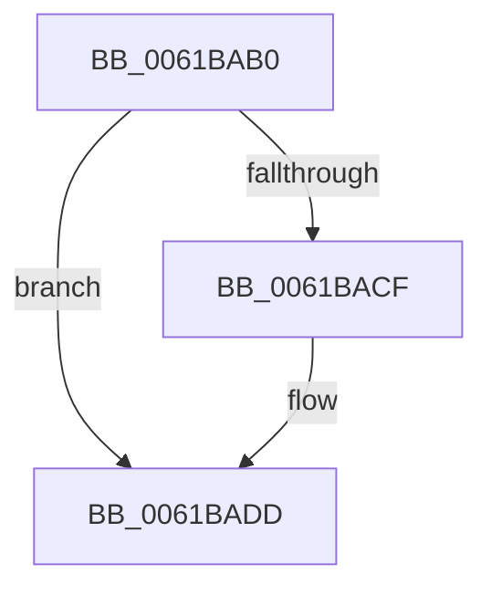

# CarInitiateBugcheck

- RVA: `0x0061BAB0`–`0x0061BAF8` (길이 `72` bytes)
- VA: `0x000000014061BAB0`
- 실행 섹션: `.text`
- PDB 이름 있음: `예`; PDB Function 태그: `아니요`
- unwind 정보 RVA: `0x000CAAA4`
- 디코드: `21`개 명령, `72/72` bytes 표시
- 미해석 바이트: `0` (있으면 어셈블리에 `.byte`로 보존)

> 이 문서는 커널 이미지의 기계어와 PDB 기호를 분석해 생성했습니다. 4번과 5번은 함수 원형과 자료형을 바이너리 사용 방식에서 추정한 C 해석이며 원본 소스 복구 결과는 아닙니다.

## 1. Dependencies

- 직접 호출 지점: **2**; 고유 호출 대상: **2**
- 직접 호출자로 확인된 함수: **1**
- RIP 상대 이미지 참조: **1**

### Outgoing calls
- `0x0061BAD8` → [CarpDbgPrint](CarpDbgPrint_function_0061B7B4.md) (function, `0x0061B7B4`)
- `0x0061BAF2` → [KeBugCheckEx](../4F/KeBugCheckEx_function_004FD660.md) (function, `0x004FD660`)

### Direct callers
- [CarReportDifPluginRuleViolation](CarReportDifPluginRuleViolation_function_00619250.md) at `0x0061947E`
- [CarReportDifPluginRuleViolation](CarReportDifPluginRuleViolation_function_00619250.md) at `0x006194A6`

### Static image references
- `0x0061BAD1` → RVA `0x006CFCB0` (` ?? ::FNODOBFM::`string'`; read)

## 2. Other-region calls and transfers

- 다른 실행 섹션으로 향하는 call: **0**
- 별도 외부 분기/꼬리 이동을 확인하지 못했습니다.

## 3. Assembly (complete function range)

```asm
0061BAB0  48 89 5C 24 08                  mov qword ptr [rsp + 8], rbx
0061BAB5  48 89 74 24 10                  mov qword ptr [rsp + 0x10], rsi
0061BABA  57                              push rdi
0061BABB  48 83 EC 30                     sub rsp, 0x30
0061BABF  49 8B D8                        mov rbx, r8
0061BAC2  8B FA                           mov edi, edx
0061BAC4  4D 8B 40 18                     mov r8, qword ptr [r8 + 0x18]
0061BAC8  8B F1                           mov esi, ecx
0061BACA  4D 85 C0                        test r8, r8
0061BACD  74 0E                           je 0x14061badd
0061BACF  8B D7                           mov edx, edi
0061BAD1  48 8D 0D D8 41 0B 00            lea rcx, [rip + 0xb41d8]
0061BAD8  E8 D7 FC FF FF                  call 0x14061b7b4
0061BADD  48 8B 43 10                     mov rax, qword ptr [rbx + 0x10]
0061BAE1  48 8B D7                        mov rdx, rdi
0061BAE4  4C 8B 4B 08                     mov r9, qword ptr [rbx + 8]
0061BAE8  8B CE                           mov ecx, esi
0061BAEA  4C 8B 03                        mov r8, qword ptr [rbx]
0061BAED  48 89 44 24 20                  mov qword ptr [rsp + 0x20], rax
0061BAF2  E8 69 1B EE FF                  call 0x1404fd660
0061BAF7  CC                              int3
```

## 4. C-style interpretation (structured pseudocode)

```c
__int64 __fastcall CarInitiateBugcheck(int a1, int a2, __int64 a3)
{
    __int64 result;
    __int64 v_rsp;
    unsigned __int64 v_stack_m18;
    unsigned __int64 v_stack_p10;
    unsigned __int64 v_stack_p8;

    v_stack_p8 = v_rbx;
    v_stack_p10 = v_rsi;
    v_rsp = (v_rsp) - (48);
    if (*(unsigned __int64 *)(a3 + 24) != 0) {
        a2 = (unsigned int)((unsigned int)(a2));
        a1 = v_rip + 737752;
        result = CarpDbgPrint(a1, a2, *(unsigned __int64 *)(a3 + 24), a4);
    }
    v_stack_m18 = *(unsigned __int64 *)(a3 + 16);
    result = KeBugCheckEx((unsigned int)((unsigned int)((unsigned int)(a1))), (unsigned int)(a2), *(unsigned __int64 *)(a3), *(unsigned __int64 *)(a3 + 8));
    return result;
}
```

## 5. (Beta) C Style

```c
int64_t CarInitiateBugcheck(int32_t Arg1, int32_t Arg2, void *Arg3)
{
    uint8_t *arg3 = (uint8_t *)Arg3;

    int64_t result;
    int64_t local_rsp;
    uint64_t v_stack_m18;
    uint64_t v_stack_p10;
    uint64_t v_stack_p8;

    v_stack_p8 = local_rbx;
    v_stack_p10 = local_rsi;
    local_rsp = (local_rsp) - (48);
    if (*(uint64_t *)(arg3 + 0x18) != 0) {
        Arg2 = (uint32_t)((uint32_t)(Arg2));
        Arg1 = v_rip + 737752;
        result = CarpDbgPrint(Arg1, Arg2, *(uint64_t *)(arg3 + 0x18), a4);
    }
    v_stack_m18 = *(uint64_t *)(arg3 + 0x10);
    result = KeBugCheckEx((uint32_t)((uint32_t)((uint32_t)(Arg1))), (uint32_t)(Arg2), *(uint64_t *)(arg3), *(uint64_t *)(arg3 + 0x8));
    return result;
}
```

### 관측된 메모리 오프셋

구조체 형식이 확인되지 않은 접근은 인자 기준의 오프셋으로만 기록했습니다.

| 기준 인자 | 오프셋 표현 | 폭 (bit) | 접근 |
|---|---:|---:|---|
| `Arg3` | `+ 0x0` | `64` | `R` |
| `Arg3` | `+ 0x8` | `64` | `R` |
| `Arg3` | `+ 0x10` | `64` | `R` |
| `Arg3` | `+ 0x18` | `64` | `R` |

## 6. Execution-region graph

[열기: 2D/3D 그래프와 함수 탐색 컨트롤 패널](../../../control-panel.html?section=text&rva=0x0061BAB0&view=graph)

- 2D 그래프는 위에서 아래로 흐르고, 3D 그래프는 빈 공간을 드래그해 회전합니다. Shift+드래그는 이동, 휠은 확대·축소, 함수 노드 선택은 대상 보고서 이동입니다.

### Static fallback


