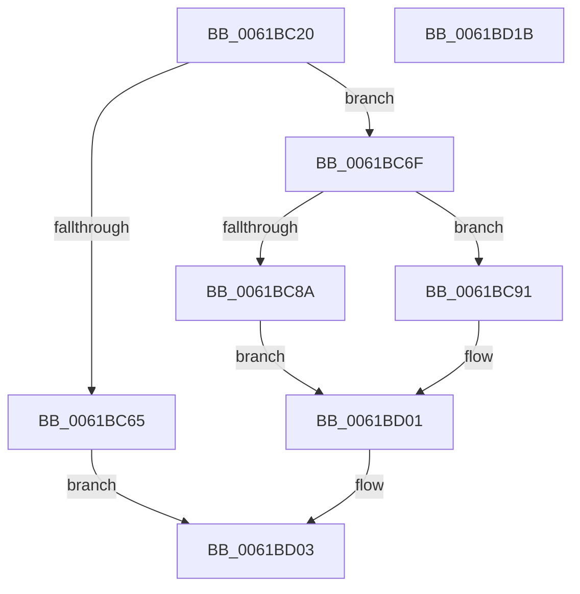

# CarLiveDumpCallBack

- RVA: `0x0061BC20`–`0x0061BD1C` (길이 `252` bytes)
- VA: `0x000000014061BC20`
- 실행 섹션: `.text`
- PDB 이름 있음: `예`; PDB Function 태그: `아니요`
- unwind 정보 RVA: `0x000D2B60`
- 디코드: `68`개 명령, `252/252` bytes 표시
- 미해석 바이트: `0` (있으면 어셈블리에 `.byte`로 보존)

> 이 문서는 커널 이미지의 기계어와 PDB 기호를 분석해 생성했습니다. 4번과 5번은 함수 원형과 자료형을 바이너리 사용 방식에서 추정한 C 해석이며 원본 소스 복구 결과는 아닙니다.

## 1. Dependencies

- 직접 호출 지점: **7**; 고유 호출 대상: **7**
- 직접 호출자로 확인된 함수: **0**
- RIP 상대 이미지 참조: **3**

### Outgoing calls
- `0x0061BC7D` → [ExAllocatePool2](../../poolcode/B8/ExAllocatePool2_function_00B820F0.md) (function, `0x00B820F0`)
- `0x0061BCB0` → [RtlStringCchPrintfW](../48/RtlStringCchPrintfW_function_00482D5C.md) (function, `0x00482D5C`)
- `0x0061BCBD` → [RtlInitUnicodeString](../42/RtlInitUnicodeString_function_0042A780.md) (function, `0x0042A780`)
- `0x0061BCD0` → [RtlHashUnicodeString](../../page/97/RtlHashUnicodeString_function_0097A780.md) (function, `0x0097A780`)
- `0x0061BCED` → [guard_dispatch_icall](../6B/guard_dispatch_icall_function_006BAAD0.md) (function, `0x006BAAD0`)
- `0x0061BCFC` → [ExFreePoolWithTag](../../poolcode/B8/ExFreePoolWithTag_function_00B82870.md) (function, `0x00B82870`)
- `0x0061BD0B` → [_security_check_cookie](../6A/_security_check_cookie_function_006AC640.md) (function, `0x006AC640`)

### Direct callers
- 이 함수 시작 RVA로 연결되는 직접 call은 확인되지 않았습니다. 간접 호출은 완전히 역산할 수 없습니다.

### Static image references
- `0x0061BC2B` → RVA `0x00E0A740` (`.data`; read)
- `0x0061BC3A` → RVA `0x00038338` (`.rdata`; read)
- `0x0061BC9D` → RVA `0x006CFD50` (` ?? ::FNODOBFM::`string'`; read)

## 2. Other-region calls and transfers

- 다른 실행 섹션으로 향하는 call: **3**
  - `0x0061BC7D` → [ExAllocatePool2](../../poolcode/B8/ExAllocatePool2_function_00B820F0.md) (`.text` → `POOLCODE`)
  - `0x0061BCD0` → [RtlHashUnicodeString](../../page/97/RtlHashUnicodeString_function_0097A780.md) (`.text` → `PAGE`)
  - `0x0061BCFC` → [ExFreePoolWithTag](../../poolcode/B8/ExFreePoolWithTag_function_00B82870.md) (`.text` → `POOLCODE`)
- 별도 외부 분기/꼬리 이동을 확인하지 못했습니다.

## 3. Assembly (complete function range)

```asm
0061BC20  40 53                           push rbx
0061BC22  55                              push rbp
0061BC23  56                              push rsi
0061BC24  57                              push rdi
0061BC25  41 56                           push r14
0061BC27  48 83 EC 60                     sub rsp, 0x60
0061BC2B  48 8B 05 0E EB 7E 00            mov rax, qword ptr [rip + 0x7eeb0e]
0061BC32  48 33 C4                        xor rax, rsp
0061BC35  48 89 44 24 50                  mov qword ptr [rsp + 0x50], rax
0061BC3A  0F 10 0D F7 C6 A1 FF            movups xmm1, xmmword ptr [rip - 0x5e3909]
0061BC41  48 8B 9C 24 C8 00 00 00         mov rbx, qword ptr [rsp + 0xc8]
0061BC49  4D 8B F1                        mov r14, r9
0061BC4C  0F 57 C0                        xorps xmm0, xmm0
0061BC4F  48 8B EA                        mov rbp, rdx
0061BC52  48 8B F1                        mov rsi, rcx
0061BC55  F3 0F 7F 4C 24 40               movdqu xmmword ptr [rsp + 0x40], xmm1
0061BC5B  0F 11 44 24 30                  movups xmmword ptr [rsp + 0x30], xmm0
0061BC60  48 85 DB                        test rbx, rbx
0061BC63  75 0A                           jne 0x14061bc6f
0061BC65  B8 0D 00 00 C0                  mov eax, 0xc000000d
0061BC6A  E9 94 00 00 00                  jmp 0x14061bd03
0061BC6F  BA 6E 00 00 00                  mov edx, 0x6e
0061BC74  41 B8 43 61 72 4E               mov r8d, 0x4e726143
0061BC7A  8D 4A D2                        lea ecx, [rdx - 0x2e]
0061BC7D  E8 6E 64 56 00                  call 0x140b820f0
0061BC82  48 8B F8                        mov rdi, rax
0061BC85  48 85 C0                        test rax, rax
0061BC88  75 07                           jne 0x14061bc91
0061BC8A  BB 17 00 00 C0                  mov ebx, 0xc0000017
0061BC8F  EB 70                           jmp 0x14061bd01
0061BC91  8B 43 44                        mov eax, dword ptr [rbx + 0x44]
0061BC94  4C 8D 4B 04                     lea r9, [rbx + 4]
0061BC98  44 89 74 24 28                  mov dword ptr [rsp + 0x28], r14d
0061BC9D  4C 8D 05 AC 40 0B 00            lea r8, [rip + 0xb40ac]
0061BCA4  BA 37 00 00 00                  mov edx, 0x37
0061BCA9  89 44 24 20                     mov dword ptr [rsp + 0x20], eax
0061BCAD  48 8B CF                        mov rcx, rdi
0061BCB0  E8 A7 70 E6 FF                  call 0x140482d5c
0061BCB5  48 8B D7                        mov rdx, rdi
0061BCB8  48 8D 4C 24 30                  lea rcx, [rsp + 0x30]
0061BCBD  E8 BE EA E0 FF                  call 0x14042a780
0061BCC2  4C 8D 4B 54                     lea r9, [rbx + 0x54]
0061BCC6  45 33 C0                        xor r8d, r8d
0061BCC9  B2 01                           mov dl, 1
0061BCCB  48 8D 4C 24 30                  lea rcx, [rsp + 0x30]
0061BCD0  E8 AB EA 35 00                  call 0x14097a780
0061BCD5  4C 8D 83 68 04 00 00            lea r8, [rbx + 0x468]
0061BCDC  41 B9 A0 00 00 00               mov r9d, 0xa0
0061BCE2  48 8D 54 24 40                  lea rdx, [rsp + 0x40]
0061BCE7  48 8B CE                        mov rcx, rsi
0061BCEA  48 8B C5                        mov rax, rbp
0061BCED  E8 DE ED 09 00                  call 0x1406baad0
0061BCF2  8B D8                           mov ebx, eax
0061BCF4  BA 43 61 72 4E                  mov edx, 0x4e726143
0061BCF9  48 8B CF                        mov rcx, rdi
0061BCFC  E8 6F 6B 56 00                  call 0x140b82870
0061BD01  8B C3                           mov eax, ebx
0061BD03  48 8B 4C 24 50                  mov rcx, qword ptr [rsp + 0x50]
0061BD08  48 33 CC                        xor rcx, rsp
0061BD0B  E8 30 09 09 00                  call 0x1406ac640
0061BD10  48 83 C4 60                     add rsp, 0x60
0061BD14  41 5E                           pop r14
0061BD16  5F                              pop rdi
0061BD17  5E                              pop rsi
0061BD18  5D                              pop rbp
0061BD19  5B                              pop rbx
0061BD1A  C3                              ret
0061BD1B  CC                              int3
```

## 4. C-style interpretation (structured pseudocode)

```c
__int64 __fastcall CarLiveDumpCallBack(__int64 a1, __int64 a2, __int64 a3, __int64 a4, __int64 a5, __int64 a6, __int64 a7, __int64 a8)
{
    __int64 result;
    __int64 v_rsp;
    unsigned __int64 v_stack_m38;
    unsigned __int64 v_stack_m48;
    unsigned __int64 v_stack_m58;
    unsigned int v_stack_m60;
    unsigned int v_stack_m68;

    v_rsp = (v_rsp) - (96);
    result = (*(unsigned __int64 *)(v_rip + 8317710)) ^ (v_rsp);
    v_stack_m38 = result;
    v_stack_m48 = v_xmm1;
    v_stack_m58 = v_xmm0;
    if (a8 != 0) goto loc_0061BC6F;
    goto loc_0061BD03;
loc_0061BC6F:
    result = ExAllocatePool2(110 - 46, 110, (unsigned int)(0x4E726143ULL), a4);
    if (result != 0) goto loc_0061BC91;
    goto loc_0061BD01;
loc_0061BC91:
    v_stack_m60 = (unsigned int)(a4);
    v_stack_m68 = (unsigned int)((unsigned int)(*(unsigned int *)((unsigned int)(0xC0000017ULL) + 68)));
    result = RtlStringCchPrintfW(result, 55, v_rip + 737452, (unsigned int)(0xC0000017ULL) + 4);
    result = RtlInitUnicodeString(v_stack_m58, result, v_rip + 737452, (unsigned int)(0xC0000017ULL) + 4);
    a3 = 0;
    result = RtlHashUnicodeString(v_stack_m58, 1, a3, (unsigned int)(0xC0000017ULL) + 84);
    result = guard_dispatch_icall(a1, v_stack_m48, (unsigned int)(0xC0000017ULL) + 1128, 160);
    result = ExFreePoolWithTag(result, (unsigned int)(0x4E726143ULL), (unsigned int)(0xC0000017ULL) + 1128, 160);
loc_0061BD01:
loc_0061BD03:
    a1 = (v_stack_m38) ^ (v_rsp);
    result = _security_check_cookie(a1, (unsigned int)(0x4E726143ULL), (unsigned int)(0xC0000017ULL) + 1128, 160);
    v_rsp = (v_rsp) + (96);
    return result;
}
```

## 5. (Beta) C Style

```c
int64_t CarLiveDumpCallBack(int64_t Arg1, int64_t Arg2, int64_t Arg3, int64_t Arg4, uint64_t Arg5, uint64_t Arg6, uint64_t Arg7, int64_t Arg8)
{
    int64_t result;
    int64_t local_rsp;
    uint64_t v_stack_m38;
    uint64_t v_stack_m48;
    uint64_t v_stack_m58;
    uint32_t v_stack_m60;
    uint32_t v_stack_m68;

    local_rsp = (local_rsp) - (96);
    result = (*(uint64_t *)(v_rip + 0x7EEB0E)) ^ (local_rsp);
    v_stack_m38 = result;
    v_stack_m48 = v_xmm1;
    v_stack_m58 = v_xmm0;
    if (Arg8 != 0) goto loc_0061BC6F;
    goto loc_0061BD03;
loc_0061BC6F:
    result = ExAllocatePool2(110 - 46, 110, (uint32_t)(0x4E726143ULL), Arg4);
    if (result != 0) goto loc_0061BC91;
    goto loc_0061BD01;
loc_0061BC91:
    v_stack_m60 = (uint32_t)(Arg4);
    v_stack_m68 = (uint32_t)((uint32_t)(*(uint32_t *)((uint32_t)(0xC0000017ULL) + 0x44)));
    result = RtlStringCchPrintfW(result, 55, v_rip + 737452, (uint32_t)(0xC0000017ULL) + 4);
    result = RtlInitUnicodeString(v_stack_m58, result, v_rip + 737452, (uint32_t)(0xC0000017ULL) + 4);
    Arg3 = 0;
    result = RtlHashUnicodeString(v_stack_m58, 1, Arg3, (uint32_t)(0xC0000017ULL) + 84);
    result = guard_dispatch_icall(Arg1, v_stack_m48, (uint32_t)(0xC0000017ULL) + 1128, 160);
    result = ExFreePoolWithTag(result, (uint32_t)(0x4E726143ULL), (uint32_t)(0xC0000017ULL) + 1128, 160);
loc_0061BD01:
loc_0061BD03:
    Arg1 = (v_stack_m38) ^ (local_rsp);
    result = _security_check_cookie(Arg1, (uint32_t)(0x4E726143ULL), (uint32_t)(0xC0000017ULL) + 1128, 160);
    local_rsp = (local_rsp) + (96);
    return result;
}
```

## 6. Execution-region graph

[열기: 2D/3D 그래프와 함수 탐색 컨트롤 패널](../../../control-panel.html?section=text&rva=0x0061BC20&view=graph)

- 2D 그래프는 위에서 아래로 흐르고, 3D 그래프는 빈 공간을 드래그해 회전합니다. Shift+드래그는 이동, 휠은 확대·축소, 함수 노드 선택은 대상 보고서 이동입니다.

### Static fallback


