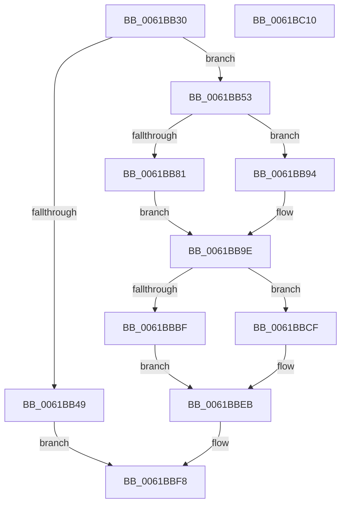

# CarLiveDump

- RVA: `0x0061BB30`–`0x0061BC11` (길이 `225` bytes)
- VA: `0x000000014061BB30`
- 실행 섹션: `.text`
- PDB 이름 있음: `예`; PDB Function 태그: `아니요`
- unwind 정보 RVA: `0x0008A4C8`
- 디코드: `52`개 명령, `225/225` bytes 표시
- 미해석 바이트: `0` (있으면 어셈블리에 `.byte`로 보존)

> 이 문서는 커널 이미지의 기계어와 PDB 기호를 분석해 생성했습니다. 4번과 5번은 함수 원형과 자료형을 바이너리 사용 방식에서 추정한 C 해석이며 원본 소스 복구 결과는 아닙니다.

## 1. Dependencies

- 직접 호출 지점: **4**; 고유 호출 대상: **4**
- 직접 호출자로 확인된 함수: **1**
- RIP 상대 이미지 참조: **5**

### Outgoing calls
- `0x0061BBB4` → [DbgkWerCaptureLiveKernelDump](../../page/AC/DbgkWerCaptureLiveKernelDump_function_00AC1E90.md) (function, `0x00AC1E90`)
- `0x0061BBC8` → [CarpDbgPrint](CarpDbgPrint_function_0061B7B4.md) (function, `0x0061B7B4`)
- `0x0061BBD2` → [CarEtwWriteLiveDumpEvent](CarEtwWriteLiveDumpEvent_function_00617CD8.md) (function, `0x00617CD8`)
- `0x0061BBF3` → [ExFreePoolWithTag](../../poolcode/B8/ExFreePoolWithTag_function_00B82870.md) (function, `0x00B82870`)

### Direct callers
- [CarWriteLivedump](CarWriteLivedump_function_0061BD24.md) at `0x0061BD96`

### Static image references
- `0x0061BB81` → RVA `0x0061BC20` (`CarLiveDumpCallBack`; read)
- `0x0061BBA3` → RVA `0x006CFD30` (` ?? ::FNODOBFM::`string'`; read)
- `0x0061BBC1` → RVA `0x006CFD00` (` ?? ::FNODOBFM::`string'`; read)
- `0x0061BBE4` → RVA `0x00F02470` (`.data`; write)
- `0x0061BBF8` → RVA `0x00F024A0` (`.data`; read/write)

## 2. Other-region calls and transfers

- 다른 실행 섹션으로 향하는 call: **2**
  - `0x0061BBB4` → [DbgkWerCaptureLiveKernelDump](../../page/AC/DbgkWerCaptureLiveKernelDump_function_00AC1E90.md) (`.text` → `PAGE`)
  - `0x0061BBF3` → [ExFreePoolWithTag](../../poolcode/B8/ExFreePoolWithTag_function_00B82870.md) (`.text` → `POOLCODE`)
- 별도 외부 분기/꼬리 이동을 확인하지 못했습니다.

## 3. Assembly (complete function range)

```asm
0061BB30  48 89 5C 24 08                  mov qword ptr [rsp + 8], rbx
0061BB35  48 89 74 24 10                  mov qword ptr [rsp + 0x10], rsi
0061BB3A  57                              push rdi
0061BB3B  48 83 EC 50                     sub rsp, 0x50
0061BB3F  33 FF                           xor edi, edi
0061BB41  48 8B D9                        mov rbx, rcx
0061BB44  48 85 C9                        test rcx, rcx
0061BB47  75 0A                           jne 0x14061bb53
0061BB49  BE 0D 00 00 C0                  mov esi, 0xc000000d
0061BB4E  E9 A5 00 00 00                  jmp 0x14061bbf8
0061BB53  B8 02 00 00 00                  mov eax, 2
0061BB58  48 8B 89 40 05 00 00            mov rcx, qword ptr [rcx + 0x540]
0061BB5F  48 8B 93 38 05 00 00            mov rdx, qword ptr [rbx + 0x538]
0061BB66  4C 8B 8B 30 05 00 00            mov r9, qword ptr [rbx + 0x530]
0061BB6D  4C 8B 83 28 05 00 00            mov r8, qword ptr [rbx + 0x528]
0061BB74  89 44 24 40                     mov dword ptr [rsp + 0x40], eax
0061BB78  40 38 BB 48 05 00 00            cmp byte ptr [rbx + 0x548], dil
0061BB7F  74 13                           je 0x14061bb94
0061BB81  48 8D 05 98 00 00 00            lea rax, [rip + 0x98]
0061BB88  48 89 44 24 38                  mov qword ptr [rsp + 0x38], rax
0061BB8D  48 89 5C 24 30                  mov qword ptr [rsp + 0x30], rbx
0061BB92  EB 0A                           jmp 0x14061bb9e
0061BB94  48 89 7C 24 38                  mov qword ptr [rsp + 0x38], rdi
0061BB99  48 89 7C 24 30                  mov qword ptr [rsp + 0x30], rdi
0061BB9E  48 89 4C 24 28                  mov qword ptr [rsp + 0x28], rcx
0061BBA3  48 8D 0D 86 41 0B 00            lea rcx, [rip + 0xb4186]
0061BBAA  48 89 54 24 20                  mov qword ptr [rsp + 0x20], rdx
0061BBAF  BA C4 01 00 00                  mov edx, 0x1c4
0061BBB4  E8 D7 62 4A 00                  call 0x140ac1e90
0061BBB9  8B F0                           mov esi, eax
0061BBBB  85 C0                           test eax, eax
0061BBBD  79 10                           jns 0x14061bbcf
0061BBBF  8B D0                           mov edx, eax
0061BBC1  48 8D 0D 38 41 0B 00            lea rcx, [rip + 0xb4138]
0061BBC8  E8 E7 FB FF FF                  call 0x14061b7b4
0061BBCD  EB 1C                           jmp 0x14061bbeb
0061BBCF  48 8B CB                        mov rcx, rbx
0061BBD2  E8 01 C1 FF FF                  call 0x140617cd8
0061BBD7  48 B8 14 00 00 00 80 F7 FF FF   movabs rax, 0xfffff78000000014
0061BBE1  48 8B 00                        mov rax, qword ptr [rax]
0061BBE4  48 89 05 85 68 8E 00            mov qword ptr [rip + 0x8e6885], rax
0061BBEB  BA 43 61 72 4E                  mov edx, 0x4e726143
0061BBF0  48 8B CB                        mov rcx, rbx
0061BBF3  E8 78 6C 56 00                  call 0x140b82870
0061BBF8  87 3D A2 68 8E 00               xchg dword ptr [rip + 0x8e68a2], edi
0061BBFE  48 8B 5C 24 60                  mov rbx, qword ptr [rsp + 0x60]
0061BC03  8B C6                           mov eax, esi
0061BC05  48 8B 74 24 68                  mov rsi, qword ptr [rsp + 0x68]
0061BC0A  48 83 C4 50                     add rsp, 0x50
0061BC0E  5F                              pop rdi
0061BC0F  C3                              ret
0061BC10  CC                              int3
```

## 4. C-style interpretation (structured pseudocode)

```c
__int64 __fastcall CarLiveDump(__int64 a1)
{
    __int64 result;
    __int64 v_rdi;
    __int64 v_rsp;
    unsigned int v_stack_m18;
    unsigned __int64 v_stack_m20;
    unsigned __int64 v_stack_m28;
    unsigned __int64 v_stack_m30;
    unsigned __int64 v_stack_m38;
    unsigned __int64 v_stack_p10;
    unsigned __int64 v_stack_p8;

    v_stack_p8 = v_rbx;
    v_stack_p10 = v_rsi;
    v_rsp = (v_rsp) - (80);
    v_rdi = 0;
    if (a1 != 0) goto loc_0061BB53;
    goto loc_0061BBF8;
loc_0061BB53:
    v_stack_m18 = 2;
    if ((*(unsigned __int8 *)(a1 + 1352)) == 0) goto loc_0061BB94;
    v_stack_m20 = v_rip + 152;
    v_stack_m28 = a1;
    goto loc_0061BB9E;
loc_0061BB94:
    v_stack_m20 = 0;
    v_stack_m28 = 0;
loc_0061BB9E:
    v_stack_m30 = *(unsigned __int64 *)(a1 + 1344);
    v_stack_m38 = *(unsigned __int64 *)(a1 + 1336);
    result = DbgkWerCaptureLiveKernelDump(v_rip + 737670, 452, *(unsigned __int64 *)(a1 + 1320), *(unsigned __int64 *)(a1 + 1328));
    if (!sign_flag) goto loc_0061BBCF;
    result = CarpDbgPrint(v_rip + 737592, (unsigned int)((unsigned int)(result)), *(unsigned __int64 *)(a1 + 1320), *(unsigned __int64 *)(a1 + 1328));
    goto loc_0061BBEB;
loc_0061BBCF:
    result = CarEtwWriteLiveDumpEvent(a1, (unsigned int)((unsigned int)(result)), *(unsigned __int64 *)(a1 + 1320), *(unsigned __int64 *)(a1 + 1328));
    *(unsigned __int64 *)(v_rip + 9332869) = *(unsigned __int64 *)(result);
loc_0061BBEB:
    result = ExFreePoolWithTag(a1, (unsigned int)(0x4E726143ULL), *(unsigned __int64 *)(a1 + 1320), *(unsigned __int64 *)(a1 + 1328));
loc_0061BBF8:
    v_rsp = (v_rsp) + (80);
    return (unsigned int)((unsigned int)((unsigned int)((unsigned int)(result))));
}
```

## 5. (Beta) C Style

```c
int64_t CarLiveDump(void *Arg1)
{
    uint8_t *arg1 = (uint8_t *)Arg1;

    int64_t result;
    int64_t local_rdi;
    int64_t local_rsp;
    uint32_t v_stack_m18;
    uint64_t v_stack_m20;
    uint64_t v_stack_m28;
    uint64_t v_stack_m30;
    uint64_t v_stack_m38;
    uint64_t v_stack_p10;
    uint64_t v_stack_p8;

    v_stack_p8 = local_rbx;
    v_stack_p10 = local_rsi;
    local_rsp = (local_rsp) - (80);
    local_rdi = 0;
    if (Arg1 != NULL) goto loc_0061BB53;
    goto loc_0061BBF8;
loc_0061BB53:
    v_stack_m18 = 2;
    if ((*(uint8_t *)(arg1 + 0x548)) == 0) goto loc_0061BB94;
    v_stack_m20 = v_rip + 152;
    v_stack_m28 = Arg1;
    goto loc_0061BB9E;
loc_0061BB94:
    v_stack_m20 = 0;
    v_stack_m28 = 0;
loc_0061BB9E:
    v_stack_m30 = *(uint64_t *)(arg1 + 0x540);
    v_stack_m38 = *(uint64_t *)(arg1 + 0x538);
    result = DbgkWerCaptureLiveKernelDump(v_rip + 737670, 452, *(uint64_t *)(arg1 + 0x528), *(uint64_t *)(arg1 + 0x530));
    if (!sign_flag) goto loc_0061BBCF;
    result = CarpDbgPrint(v_rip + 737592, (uint32_t)((uint32_t)(result)), *(uint64_t *)(arg1 + 0x528), *(uint64_t *)(arg1 + 0x530));
    goto loc_0061BBEB;
loc_0061BBCF:
    result = CarEtwWriteLiveDumpEvent(Arg1, (uint32_t)((uint32_t)(result)), *(uint64_t *)(arg1 + 0x528), *(uint64_t *)(arg1 + 0x530));
    *(uint64_t *)(v_rip + 0x8E6885) = *(uint64_t *)(result);
loc_0061BBEB:
    result = ExFreePoolWithTag(Arg1, (uint32_t)(0x4E726143ULL), *(uint64_t *)(arg1 + 0x528), *(uint64_t *)(arg1 + 0x530));
loc_0061BBF8:
    local_rsp = (local_rsp) + (80);
    return (uint32_t)((uint32_t)((uint32_t)((uint32_t)(result))));
}
```

### 관측된 메모리 오프셋

구조체 형식이 확인되지 않은 접근은 인자 기준의 오프셋으로만 기록했습니다.

| 기준 인자 | 오프셋 표현 | 폭 (bit) | 접근 |
|---|---:|---:|---|
| `Arg1` | `+ 0x528` | `64` | `R` |
| `Arg1` | `+ 0x530` | `64` | `R` |
| `Arg1` | `+ 0x538` | `64` | `R` |
| `Arg1` | `+ 0x548` | `8` | `R` |

## 6. Execution-region graph

[열기: 2D/3D 그래프와 함수 탐색 컨트롤 패널](../../../control-panel.html?section=text&rva=0x0061BB30&view=graph)

- 2D 그래프는 위에서 아래로 흐르고, 3D 그래프는 빈 공간을 드래그해 회전합니다. Shift+드래그는 이동, 휠은 확대·축소, 함수 노드 선택은 대상 보고서 이동입니다.

### Static fallback


