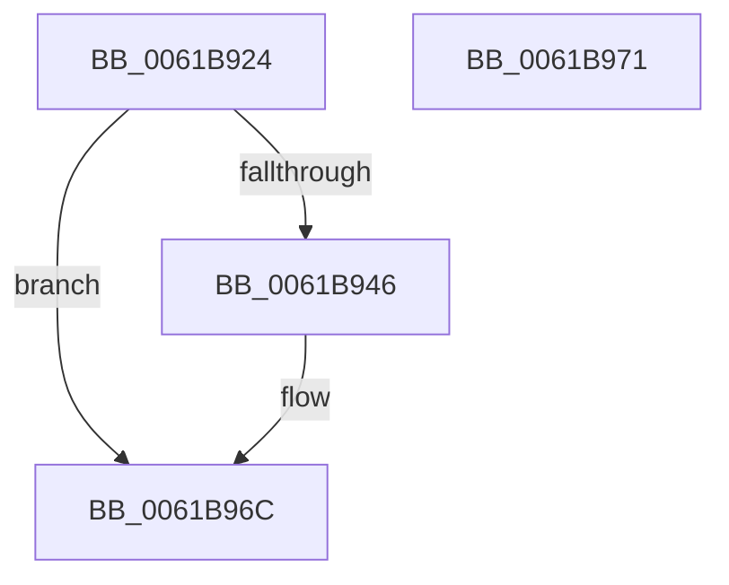

# CarLoadFromDV

- RVA: `0x0061B924`–`0x0061B972` (길이 `78` bytes)
- VA: `0x000000014061B924`
- 실행 섹션: `.text`
- PDB 이름 있음: `예`; PDB Function 태그: `아니요`
- unwind 정보 RVA: `0x0005C788`
- 디코드: `16`개 명령, `78/78` bytes 표시
- 미해석 바이트: `0` (있으면 어셈블리에 `.byte`로 보존)

> 이 문서는 커널 이미지의 기계어와 PDB 기호를 분석해 생성했습니다. 4번과 5번은 함수 원형과 자료형을 바이너리 사용 방식에서 추정한 C 해석이며 원본 소스 복구 결과는 아닙니다.

## 1. Dependencies

- 직접 호출 지점: **1**; 고유 호출 대상: **1**
- 직접 호출자로 확인된 함수: **1**
- RIP 상대 이미지 참조: **9**

### Outgoing calls
- `0x0061B967` → [memcpy](../6C/memcpy_function_006C6840.md) (function, `0x006C6840`)

### Direct callers
- [CarInit](CarInit_function_006189FC.md) at `0x00618AC8`
- [CarInit](CarInit_function_006189FC.md) at `0x00618AD6`

### Static image references
- `0x0061B928` → RVA `0x00E681A0` (`.data`; read)
- `0x0061B92F` → RVA `0x00F03DA0` (`.data`; write)
- `0x0061B936` → RVA `0x00F049D8` (`.data`; read)
- `0x0061B93C` → RVA `0x00F02580` (`.data`; write)
- `0x0061B946` → RVA `0x00F049F0` (`.data`; read)
- `0x0061B94C` → RVA `0x0100B1D0` (`INITDATA`; read)
- `0x0061B953` → RVA `0x01008150` (`INITDATA`; read)
- `0x0061B95A` → RVA `0x00F025A0` (`.data`; read)
- `0x0061B961` → RVA `0x00F02584` (`.data`; write)

## 2. Other-region calls and transfers

- 다른 실행 섹션으로 향하는 call: **0**
- 별도 외부 분기/꼬리 이동을 확인하지 못했습니다.

## 3. Assembly (complete function range)

```asm
0061B924  48 83 EC 28                     sub rsp, 0x28
0061B928  48 8B 05 71 C8 84 00            mov rax, qword ptr [rip + 0x84c871]
0061B92F  48 89 05 6A 84 8E 00            mov qword ptr [rip + 0x8e846a], rax
0061B936  8B 05 9C 90 8E 00               mov eax, dword ptr [rip + 0x8e909c]
0061B93C  89 05 3E 6C 8E 00               mov dword ptr [rip + 0x8e6c3e], eax
0061B942  84 C9                           test cl, cl
0061B944  75 26                           jne 0x14061b96c
0061B946  8B 05 A4 90 8E 00               mov eax, dword ptr [rip + 0x8e90a4]
0061B94C  48 8D 15 7D F8 9E 00            lea rdx, [rip + 0x9ef87d]
0061B953  44 8B 05 F6 C7 9E 00            mov r8d, dword ptr [rip + 0x9ec7f6]
0061B95A  48 8D 0D 3F 6C 8E 00            lea rcx, [rip + 0x8e6c3f]
0061B961  89 05 1D 6C 8E 00               mov dword ptr [rip + 0x8e6c1d], eax
0061B967  E8 D4 AE 0A 00                  call 0x1406c6840
0061B96C  48 83 C4 28                     add rsp, 0x28
0061B970  C3                              ret
0061B971  CC                              int3
```

## 4. C-style interpretation (structured pseudocode)

```c
__int64 __fastcall CarLoadFromDV(unsigned __int8 a1)
{
    __int64 result;
    __int64 v_rsp;

    v_rsp = (v_rsp) - (40);
    *(unsigned __int64 *)(v_rip + 9340010) = *(unsigned __int64 *)(v_rip + 8702065);
    *(unsigned int *)(v_rip + 9333822) = (unsigned int)((unsigned int)(*(unsigned int *)(v_rip + 9343132)));
    result = (unsigned int)(*(unsigned int *)(v_rip + 9343132));
    if (a1 == 0) {
        result = *(unsigned int *)(v_rip + 9343140);
        a2 = v_rip + 10418301;
        a3 = *(unsigned int *)(v_rip + 10405878);
        a1 = v_rip + 9333823;
        *(unsigned int *)(v_rip + 9333789) = (unsigned int)(result);
        result = memcpy(a1, a2, a3, a4);
    }
    v_rsp = (v_rsp) + (40);
    return result;
}
```

## 5. (Beta) C Style

```c
int64_t CarLoadFromDV(uint8_t Arg1)
{
    int64_t result;
    int64_t local_rsp;

    local_rsp = (local_rsp) - (40);
    *(uint64_t *)(v_rip + 0x8E846A) = *(uint64_t *)(v_rip + 0x84C871);
    *(uint32_t *)(v_rip + 0x8E6C3E) = (uint32_t)((uint32_t)(*(uint32_t *)(v_rip + 0x8E909C)));
    result = (uint32_t)(*(uint32_t *)(v_rip + 0x8E909C));
    if (Arg1 == 0) {
        result = *(uint32_t *)(v_rip + 0x8E90A4);
        a2 = v_rip + 10418301;
        a3 = *(uint32_t *)(v_rip + 0x9EC7F6);
        Arg1 = v_rip + 9333823;
        *(uint32_t *)(v_rip + 0x8E6C1D) = (uint32_t)(result);
        result = memcpy(Arg1, a2, a3, a4);
    }
    local_rsp = (local_rsp) + (40);
    return result;
}
```

## 6. Execution-region graph

[열기: 2D/3D 그래프와 함수 탐색 컨트롤 패널](../../../control-panel.html?section=text&rva=0x0061B924&view=graph)

- 2D 그래프는 위에서 아래로 흐르고, 3D 그래프는 빈 공간을 드래그해 회전합니다. Shift+드래그는 이동, 휠은 확대·축소, 함수 노드 선택은 대상 보고서 이동입니다.

### Static fallback


