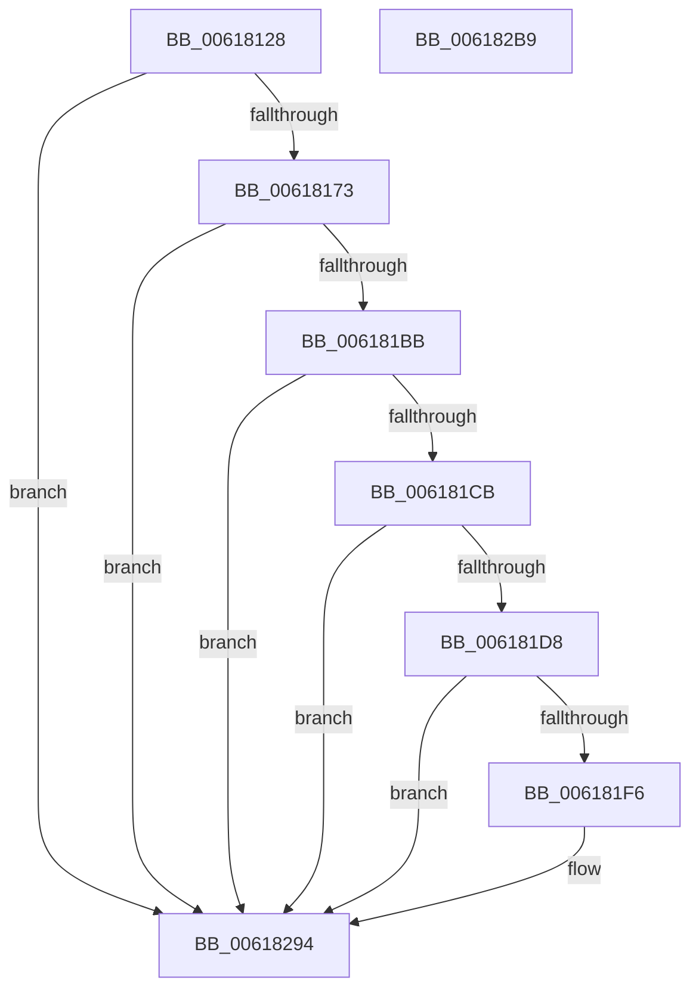

# CarLoadImageHandler

- RVA: `0x00618128`–`0x006182BA` (길이 `402` bytes)
- VA: `0x0000000140618128`
- 실행 섹션: `.text`
- PDB 이름 있음: `예`; PDB Function 태그: `아니요`
- unwind 정보 RVA: `0x000D2A14`
- 디코드: `90`개 명령, `402/402` bytes 표시
- 미해석 바이트: `0` (있으면 어셈블리에 `.byte`로 보존)

> 이 문서는 커널 이미지의 기계어와 PDB 기호를 분석해 생성했습니다. 4번과 5번은 함수 원형과 자료형을 바이너리 사용 방식에서 추정한 C 해석이며 원본 소스 복구 결과는 아닙니다.

## 1. Dependencies

- 직접 호출 지점: **6**; 고유 호출 대상: **6**
- 직접 호출자로 확인된 함수: **1**
- RIP 상대 이미지 참조: **9**

### Outgoing calls
- `0x00618162` → [ExAllocatePool2](../../poolcode/B8/ExAllocatePool2_function_00B820F0.md) (function, `0x00B820F0`)
- `0x006181A2` → [CarCopyDriverName](CarCopyDriverName_function_00617760.md) (function, `0x00617760`)
- `0x006181E9` → [tlgKeywordOn](../42/tlgKeywordOn_function_0042EAA0.md) (function, `0x0042EAA0`)
- `0x0061821A` → [tlgCreate1Sz_wchar_t](../42/tlgCreate1Sz_wchar_t_function_00426198.md) (function, `0x00426198`)
- `0x0061828F` → [tlgWriteTransfer_EtwWriteTransfer](../42/tlgWriteTransfer_EtwWriteTransfer_function_004260E0.md) (function, `0x004260E0`)
- `0x0061829B` → [_security_check_cookie](../6A/_security_check_cookie_function_006AC640.md) (function, `0x006AC640`)

### Direct callers
- [VfSuspectDriversLoadCallback](../../pagevrfy/BA/VfSuspectDriversLoadCallback_function_00BAAB2C.md) at `0x00BAAE2B`

### Static image references
- `0x00618143` → RVA `0x00E0A740` (`.data`; read)
- `0x00618173` → RVA `0x00E681C8` (`.data`; read)
- `0x006181A7` → RVA `0x00F03EE0` (`.data`; read)
- `0x006181AE` → RVA `0x00E681C8` (`.data`; write)
- `0x006181BB` → RVA `0x00E681A0` (`.data`; read)
- `0x006181CB` → RVA `0x00E090C8` (`.data`; read)
- `0x006181F6` → RVA `0x00F03DA8` (`.data`; read)
- `0x0061821F` → RVA `0x00E681D0` (`.data`; read)
- `0x0061827B` → RVA `0x00053207` (`.rdata`; read)

## 2. Other-region calls and transfers

- 다른 실행 섹션으로 향하는 call: **1**
  - `0x00618162` → [ExAllocatePool2](../../poolcode/B8/ExAllocatePool2_function_00B820F0.md) (`.text` → `POOLCODE`)
- 별도 외부 분기/꼬리 이동을 확인하지 못했습니다.

## 3. Assembly (complete function range)

```asm
00618128  48 8B C4                        mov rax, rsp
0061812B  48 89 58 10                     mov qword ptr [rax + 0x10], rbx
0061812F  48 89 70 18                     mov qword ptr [rax + 0x18], rsi
00618133  48 89 78 20                     mov qword ptr [rax + 0x20], rdi
00618137  55                              push rbp
00618138  48 8D 68 A1                     lea rbp, [rax - 0x5f]
0061813C  48 81 EC D0 00 00 00            sub rsp, 0xd0
00618143  48 8B 05 F6 25 7F 00            mov rax, qword ptr [rip + 0x7f25f6]
0061814A  48 33 C4                        xor rax, rsp
0061814D  48 89 45 47                     mov qword ptr [rbp + 0x47], rax
00618151  BA 60 00 00 00                  mov edx, 0x60
00618156  48 8B F9                        mov rdi, rcx
00618159  41 B8 43 61 72 4E               mov r8d, 0x4e726143
0061815F  8D 4A E0                        lea ecx, [rdx - 0x20]
00618162  E8 89 9F 56 00                  call 0x140b820f0
00618167  48 8B D8                        mov rbx, rax
0061816A  48 85 C0                        test rax, rax
0061816D  0F 84 21 01 00 00               je 0x140618294
00618173  48 8B 15 4E 00 85 00            mov rdx, qword ptr [rip + 0x85004e]
0061817A  48 89 10                        mov qword ptr [rax], rdx
0061817D  48 8D 57 58                     lea rdx, [rdi + 0x58]
00618181  48 8B 4F 30                     mov rcx, qword ptr [rdi + 0x30]
00618185  48 89 48 48                     mov qword ptr [rax + 0x48], rcx
00618189  8B 4F 40                        mov ecx, dword ptr [rdi + 0x40]
0061818C  89 48 50                        mov dword ptr [rax + 0x50], ecx
0061818F  8B 8F 9C 00 00 00               mov ecx, dword ptr [rdi + 0x9c]
00618195  89 48 54                        mov dword ptr [rax + 0x54], ecx
00618198  48 8D 4B 08                     lea rcx, [rbx + 8]
0061819C  8B 47 78                        mov eax, dword ptr [rdi + 0x78]
0061819F  89 43 58                        mov dword ptr [rbx + 0x58], eax
006181A2  E8 B9 F5 FF FF                  call 0x140617760
006181A7  80 3D 32 BD 8E 00 00            cmp byte ptr [rip + 0x8ebd32], 0
006181AE  48 89 1D 13 00 85 00            mov qword ptr [rip + 0x850013], rbx
006181B5  0F 84 D9 00 00 00               je 0x140618294
006181BB  F7 05 DB FF 84 00 00 00 40 00   test dword ptr [rip + 0x84ffdb], 0x400000
006181C5  0F 84 C9 00 00 00               je 0x140618294
006181CB  83 3D F6 0E 7F 00 05            cmp dword ptr [rip + 0x7f0ef6], 5
006181D2  0F 86 BC 00 00 00               jbe 0x140618294
006181D8  48 BA 00 00 00 00 00 80 00 00   movabs rdx, 0x800000000000
006181E2  48 8D 0D DF 0E 7F 00            lea rcx, [rip + 0x7f0edf]
006181E9  E8 B2 68 E1 FF                  call 0x14042eaa0
006181EE  84 C0                           test al, al
006181F0  0F 84 9E 00 00 00               je 0x140618294
006181F6  8B 05 AC BB 8E 00               mov eax, dword ptr [rip + 0x8ebbac]
006181FC  48 8D 53 08                     lea rdx, [rbx + 8]
00618200  83 65 03 00                     and dword ptr [rbp + 3], 0
00618204  48 8D 4D 07                     lea rcx, [rbp + 7]
00618208  89 45 B7                        mov dword ptr [rbp - 0x49], eax
0061820B  48 8D 45 B7                     lea rax, [rbp - 0x49]
0061820F  48 89 45 F7                     mov qword ptr [rbp - 9], rax
00618213  C7 45 FF 04 00 00 00            mov dword ptr [rbp - 1], 4
0061821A  E8 79 DF E0 FF                  call 0x140426198
0061821F  48 8B 0D AA FF 84 00            mov rcx, qword ptr [rip + 0x84ffaa]
00618226  48 8D 45 BF                     lea rax, [rbp - 0x41]
0061822A  83 65 23 00                     and dword ptr [rbp + 0x23], 0
0061822E  BA 08 00 00 00                  mov edx, 8
00618233  83 65 33 00                     and dword ptr [rbp + 0x33], 0
00618237  45 33 C9                        xor r9d, r9d
0061823A  83 65 43 00                     and dword ptr [rbp + 0x43], 0
0061823E  45 33 C0                        xor r8d, r8d
00618241  48 89 45 17                     mov qword ptr [rbp + 0x17], rax
00618245  8B 43 54                        mov eax, dword ptr [rbx + 0x54]
00618248  48 89 45 C7                     mov qword ptr [rbp - 0x39], rax
0061824C  48 8D 45 C7                     lea rax, [rbp - 0x39]
00618250  48 89 45 27                     mov qword ptr [rbp + 0x27], rax
00618254  8B 43 58                        mov eax, dword ptr [rbx + 0x58]
00618257  48 89 45 CF                     mov qword ptr [rbp - 0x31], rax
0061825B  48 8D 45 CF                     lea rax, [rbp - 0x31]
0061825F  48 89 45 37                     mov qword ptr [rbp + 0x37], rax
00618263  48 8D 45 D7                     lea rax, [rbp - 0x29]
00618267  48 89 4D BF                     mov qword ptr [rbp - 0x41], rcx
0061826B  48 8D 0D 56 0E 7F 00            lea rcx, [rip + 0x7f0e56]
00618272  89 55 1F                        mov dword ptr [rbp + 0x1f], edx
00618275  89 55 2F                        mov dword ptr [rbp + 0x2f], edx
00618278  89 55 3F                        mov dword ptr [rbp + 0x3f], edx
0061827B  48 8D 15 85 AF A3 FF            lea rdx, [rip - 0x5c507b]
00618282  48 89 44 24 28                  mov qword ptr [rsp + 0x28], rax
00618287  C7 44 24 20 07 00 00 00         mov dword ptr [rsp + 0x20], 7
0061828F  E8 4C DE E0 FF                  call 0x1404260e0
00618294  48 8B 4D 47                     mov rcx, qword ptr [rbp + 0x47]
00618298  48 33 CC                        xor rcx, rsp
0061829B  E8 A0 43 09 00                  call 0x1406ac640
006182A0  4C 8D 9C 24 D0 00 00 00         lea r11, [rsp + 0xd0]
006182A8  49 8B 5B 18                     mov rbx, qword ptr [r11 + 0x18]
006182AC  49 8B 73 20                     mov rsi, qword ptr [r11 + 0x20]
006182B0  49 8B 7B 28                     mov rdi, qword ptr [r11 + 0x28]
006182B4  49 8B E3                        mov rsp, r11
006182B7  5D                              pop rbp
006182B8  C3                              ret
006182B9  CC                              int3
```

## 4. C-style interpretation (structured pseudocode)

```c
__int64 __fastcall CarLoadImageHandler(__int64 a1, __int64 a2, __int64 a3, int a4)
{
    __int64 result;
    __int64 v_rsp;
    unsigned __int64 v_stack_m8;
    unsigned __int64 v_stack_mB0;
    unsigned int v_stack_mB8;

    *(unsigned __int64 *)(v_rsp + 16) = v_rbx;
    *(unsigned __int64 *)(v_rsp + 24) = v_rsi;
    *(unsigned __int64 *)(v_rsp + 32) = v_rdi;
    v_rsp = (v_rsp) - (208);
    result = (*(unsigned __int64 *)(v_rip + 8332790)) ^ (v_rsp);
    *(unsigned __int64 *)(v_rsp - 95 + 71) = result;
    result = ExAllocatePool2(96 - 32, 96, (unsigned int)(0x4E726143ULL), a4);
    if (result == 0) goto loc_00618294;
    *(unsigned __int64 *)(result) = *(unsigned __int64 *)(v_rip + 8716366);
    *(unsigned __int64 *)(result + 72) = *(unsigned __int64 *)(a1 + 48);
    *(unsigned int *)(result + 80) = (unsigned int)((unsigned int)(*(unsigned int *)(a1 + 64)));
    *(unsigned int *)(result + 84) = (unsigned int)((unsigned int)(*(unsigned int *)(a1 + 156)));
    *(unsigned int *)(result + 88) = (unsigned int)((unsigned int)(*(unsigned int *)(a1 + 120)));
    result = CarCopyDriverName(result + 8, a1 + 88, (unsigned int)(0x4E726143ULL), a4);
    *(unsigned __int64 *)(v_rip + 8716307) = result;
    if ((*(unsigned __int8 *)(v_rip + 9354546)) == 0) goto loc_00618294;
    if (((*(unsigned int *)(v_rip + 8716251)) & (0x400000ULL)) == 0) goto loc_00618294;
    if ((*(unsigned int *)(v_rip + 8326902)) <= 5) goto loc_00618294;
    result = tlgKeywordOn(v_rip + 8326879, a1 + 88, (unsigned int)(0x4E726143ULL), a4);
    if ((unsigned __int8)(result) != 0) {
        result = *(unsigned int *)(v_rip + 9354156);
        a2 = result + 8;
        a1 = v_rsp - 95 + 7;
        *(unsigned int *)(v_rsp - 95 - 73) = (unsigned int)(result);
        result = v_rsp - 95 - 73;
        *(unsigned __int64 *)(v_rsp - 95 - 9) = result;
        *(unsigned int *)(v_rsp - 95 - 1) = 4;
        result = tlgCreate1Sz_wchar_t(a1, a2, (unsigned int)(0x4E726143ULL), a4);
        a1 = *(unsigned __int64 *)(v_rip + 8716202);
        result = v_rsp - 95 - 65;
        a2 = 8;
        a4 = 0;
        a3 = 0;
        *(unsigned __int64 *)(v_rsp - 95 + 23) = result;
        result = *(unsigned int *)(result + 84);
        *(unsigned __int64 *)(v_rsp - 95 - 57) = result;
        result = v_rsp - 95 - 57;
        *(unsigned __int64 *)(v_rsp - 95 + 39) = result;
        result = *(unsigned int *)(result + 88);
        *(unsigned __int64 *)(v_rsp - 95 - 49) = result;
        result = v_rsp - 95 - 49;
        *(unsigned __int64 *)(v_rsp - 95 + 55) = result;
        result = v_rsp - 95 - 41;
        *(unsigned __int64 *)(v_rsp - 95 - 65) = a1;
        a1 = v_rip + 8326742;
        *(unsigned int *)(v_rsp - 95 + 31) = (unsigned int)(a2);
        *(unsigned int *)(v_rsp - 95 + 47) = (unsigned int)(a2);
        *(unsigned int *)(v_rsp - 95 + 63) = (unsigned int)(a2);
        a2 = v_rip - 6049915;
        v_stack_mB0 = result;
        v_stack_mB8 = 7;
        result = tlgWriteTransfer_EtwWriteTransfer(a1, a2, a3, a4);
    }
    a1 = (*(unsigned __int64 *)(v_rsp - 95 + 71)) ^ (v_rsp);
    result = _security_check_cookie(a1, a2, a3, a4);
    return result;
}
```

## 5. (Beta) C Style

```c
int64_t CarLoadImageHandler(void *Arg1, int64_t Arg2, int64_t Arg3, int32_t Arg4)
{
    uint8_t *arg1 = (uint8_t *)Arg1;

    int64_t result;
    int64_t local_rsp;
    uint64_t v_stack_m8;
    uint64_t v_stack_mB0;
    uint32_t v_stack_mB8;

    *(uint64_t *)(local_rsp + 0x10) = local_rbx;
    *(uint64_t *)(local_rsp + 0x18) = local_rsi;
    *(uint64_t *)(local_rsp + 0x20) = local_rdi;
    local_rsp = (local_rsp) - (208);
    result = (*(uint64_t *)(v_rip + 0x7F25F6)) ^ (local_rsp);
    *(uint64_t *)(local_rsp - 0x5F + 0x47) = result;
    result = ExAllocatePool2(96 - 32, 96, (uint32_t)(0x4E726143ULL), Arg4);
    if (result == 0) goto loc_00618294;
    *(uint64_t *)(result) = *(uint64_t *)(v_rip + 0x85004E);
    *(uint64_t *)(result + 0x48) = *(uint64_t *)(arg1 + 0x30);
    *(uint32_t *)(result + 0x50) = (uint32_t)((uint32_t)(*(uint32_t *)(arg1 + 0x40)));
    *(uint32_t *)(result + 0x54) = (uint32_t)((uint32_t)(*(uint32_t *)(arg1 + 0x9C)));
    *(uint32_t *)(result + 0x58) = (uint32_t)((uint32_t)(*(uint32_t *)(arg1 + 0x78)));
    result = CarCopyDriverName(result + 8, Arg1 + 88, (uint32_t)(0x4E726143ULL), Arg4);
    *(uint64_t *)(v_rip + 0x850013) = result;
    if ((*(uint8_t *)(v_rip + 0x8EBD32)) == 0) goto loc_00618294;
    if (((*(uint32_t *)(v_rip + 0x84FFDB)) & (0x400000ULL)) == 0) goto loc_00618294;
    if ((*(uint32_t *)(v_rip + 0x7F0EF6)) <= 5) goto loc_00618294;
    result = tlgKeywordOn(v_rip + 8326879, Arg1 + 88, (uint32_t)(0x4E726143ULL), Arg4);
    if ((uint8_t)(result) != 0) {
        result = *(uint32_t *)(v_rip + 0x8EBBAC);
        Arg2 = result + 8;
        Arg1 = local_rsp - 95 + 7;
        *(uint32_t *)(local_rsp - 0x5F - 0x49) = (uint32_t)(result);
        result = local_rsp - 95 - 73;
        *(uint64_t *)(local_rsp - 0x5F - 0x9) = result;
        *(uint32_t *)(local_rsp - 0x5F - 0x1) = 4;
        result = tlgCreate1Sz_wchar_t(Arg1, Arg2, (uint32_t)(0x4E726143ULL), Arg4);
        Arg1 = *(uint64_t *)(v_rip + 0x84FFAA);
        result = local_rsp - 95 - 65;
        Arg2 = 8;
        Arg4 = 0;
        Arg3 = 0;
        *(uint64_t *)(local_rsp - 0x5F + 0x17) = result;
        result = *(uint32_t *)(result + 0x54);
        *(uint64_t *)(local_rsp - 0x5F - 0x39) = result;
        result = local_rsp - 95 - 57;
        *(uint64_t *)(local_rsp - 0x5F + 0x27) = result;
        result = *(uint32_t *)(result + 0x58);
        *(uint64_t *)(local_rsp - 0x5F - 0x31) = result;
        result = local_rsp - 95 - 49;
        *(uint64_t *)(local_rsp - 0x5F + 0x37) = result;
        result = local_rsp - 95 - 41;
        *(void **)(local_rsp - 0x5F - 0x41) = Arg1;
        Arg1 = v_rip + 8326742;
        *(uint32_t *)(local_rsp - 0x5F + 0x1F) = (uint32_t)(Arg2);
        *(uint32_t *)(local_rsp - 0x5F + 0x2F) = (uint32_t)(Arg2);
        *(uint32_t *)(local_rsp - 0x5F + 0x3F) = (uint32_t)(Arg2);
        Arg2 = v_rip - 6049915;
        v_stack_mB0 = result;
        v_stack_mB8 = 7;
        result = tlgWriteTransfer_EtwWriteTransfer(Arg1, Arg2, Arg3, Arg4);
    }
    Arg1 = (*(uint64_t *)(local_rsp - 0x5F + 0x47)) ^ (local_rsp);
    result = _security_check_cookie(Arg1, Arg2, Arg3, Arg4);
    return result;
}
```

### 관측된 메모리 오프셋

구조체 형식이 확인되지 않은 접근은 인자 기준의 오프셋으로만 기록했습니다.

| 기준 인자 | 오프셋 표현 | 폭 (bit) | 접근 |
|---|---:|---:|---|
| `Arg1` | `+ 0x30` | `64` | `R` |
| `Arg1` | `+ 0x40` | `32` | `R` |
| `Arg1` | `+ 0x58` | `64` | `R` |
| `Arg1` | `+ 0x78` | `32` | `R` |
| `Arg1` | `+ 0x9C` | `32` | `R` |

## 6. Execution-region graph

[열기: 2D/3D 그래프와 함수 탐색 컨트롤 패널](../../../control-panel.html?section=text&rva=0x00618128&view=graph)

- 2D 그래프는 위에서 아래로 흐르고, 3D 그래프는 빈 공간을 드래그해 회전합니다. Shift+드래그는 이동, 휠은 확대·축소, 함수 노드 선택은 대상 보고서 이동입니다.

### Static fallback


