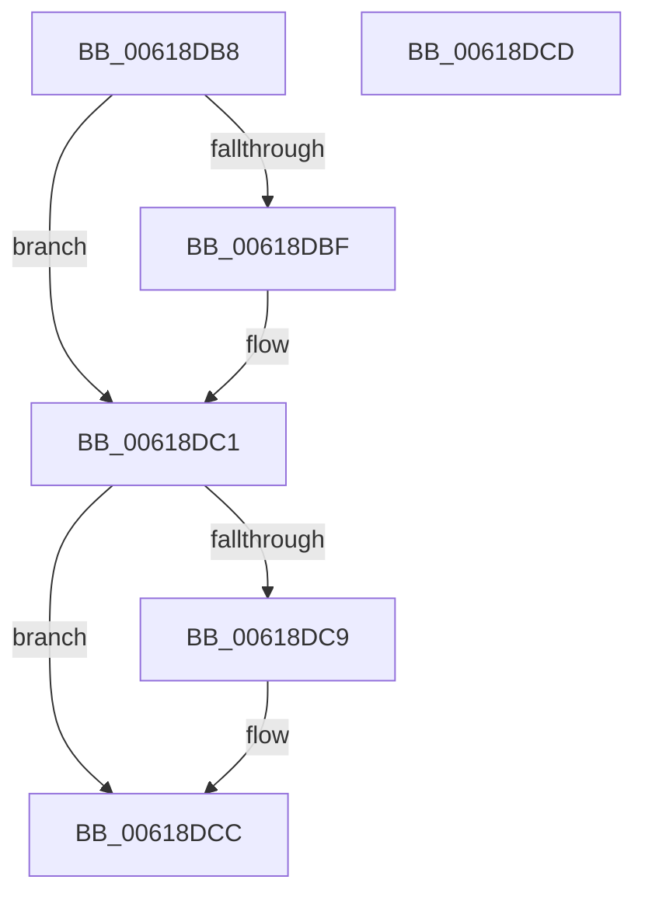

# CarOverrideReportAction

- RVA: `0x00618DB8`–`0x00618DCE` (길이 `22` bytes)
- VA: `0x0000000140618DB8`
- 실행 섹션: `.text`
- PDB 이름 있음: `예`; PDB Function 태그: `아니요`
- unwind 정보 RVA: `0x000DB714`
- 디코드: `10`개 명령, `22/22` bytes 표시
- 미해석 바이트: `0` (있으면 어셈블리에 `.byte`로 보존)

> 이 문서는 커널 이미지의 기계어와 PDB 기호를 분석해 생성했습니다. 4번과 5번은 함수 원형과 자료형을 바이너리 사용 방식에서 추정한 C 해석이며 원본 소스 복구 결과는 아닙니다.

## 1. Dependencies

- 직접 호출 지점: **0**; 고유 호출 대상: **0**
- 직접 호출자로 확인된 함수: **1**
- RIP 상대 이미지 참조: **0**

### Outgoing calls
- 직접 디코드된 call 명령이 없습니다.

### Direct callers
- [CarQueryReportActionForTriage](CarQueryReportActionForTriage_function_00618E10.md) at `0x00618E99`
- [CarQueryReportActionForTriage](CarQueryReportActionForTriage_function_00618E10.md) at `0x00618EBD`

### Static image references
- 디코드된 RIP-relative 메모리 참조가 없습니다.

## 2. Other-region calls and transfers

- 다른 실행 섹션으로 향하는 call: **0**
- 별도 외부 분기/꼬리 이동을 확인하지 못했습니다.

## 3. Assembly (complete function range)

```asm
00618DB8  8B 02                           mov eax, dword ptr [rdx]
00618DBA  83 F8 05                        cmp eax, 5
00618DBD  74 02                           je 0x140618dc1
00618DBF  89 01                           mov dword ptr [rcx], eax
00618DC1  8B 42 04                        mov eax, dword ptr [rdx + 4]
00618DC4  83 F8 03                        cmp eax, 3
00618DC7  74 03                           je 0x140618dcc
00618DC9  89 41 04                        mov dword ptr [rcx + 4], eax
00618DCC  C3                              ret
00618DCD  CC                              int3
```

## 4. C-style interpretation (structured pseudocode)

```c
__int64 __fastcall CarOverrideReportAction(__int64 a1, __int64 a2)
{
    if (((unsigned int)((unsigned int)(*(unsigned int *)(a2)))) != 5) {
        *(unsigned int *)(a1) = (unsigned int)((unsigned int)(*(unsigned int *)(a2)));
    }
    if (((unsigned int)((unsigned int)(*(unsigned int *)(a2 + 4)))) != 3) {
        *(unsigned int *)(a1 + 4) = (unsigned int)((unsigned int)(*(unsigned int *)(a2 + 4)));
    }
    return (unsigned int)(*(unsigned int *)(a2 + 4));
}
```

## 5. (Beta) C Style

```c
int64_t CarOverrideReportAction(void *Arg1, void *Arg2)
{
    uint8_t *arg1 = (uint8_t *)Arg1;
    uint8_t *arg2 = (uint8_t *)Arg2;

    if (((uint32_t)((uint32_t)(*(uint32_t *)(arg2)))) != 5) {
        *(uint32_t *)(arg1) = (uint32_t)((uint32_t)(*(uint32_t *)(arg2)));
    }
    if (((uint32_t)((uint32_t)(*(uint32_t *)(arg2 + 0x4)))) != 3) {
        *(uint32_t *)(arg1 + 0x4) = (uint32_t)((uint32_t)(*(uint32_t *)(arg2 + 0x4)));
    }
    return (uint32_t)(*(uint32_t *)(arg2 + 0x4));
}
```

### 관측된 메모리 오프셋

구조체 형식이 확인되지 않은 접근은 인자 기준의 오프셋으로만 기록했습니다.

| 기준 인자 | 오프셋 표현 | 폭 (bit) | 접근 |
|---|---:|---:|---|
| `Arg1` | `+ 0x0` | `32` | `W` |
| `Arg1` | `+ 0x4` | `32` | `W` |
| `Arg2` | `+ 0x0` | `32` | `R` |
| `Arg2` | `+ 0x4` | `32` | `R` |

## 6. Execution-region graph

[열기: 2D/3D 그래프와 함수 탐색 컨트롤 패널](../../../control-panel.html?section=text&rva=0x00618DB8&view=graph)

- 2D 그래프는 위에서 아래로 흐르고, 3D 그래프는 빈 공간을 드래그해 회전합니다. Shift+드래그는 이동, 휠은 확대·축소, 함수 노드 선택은 대상 보고서 이동입니다.

### Static fallback


