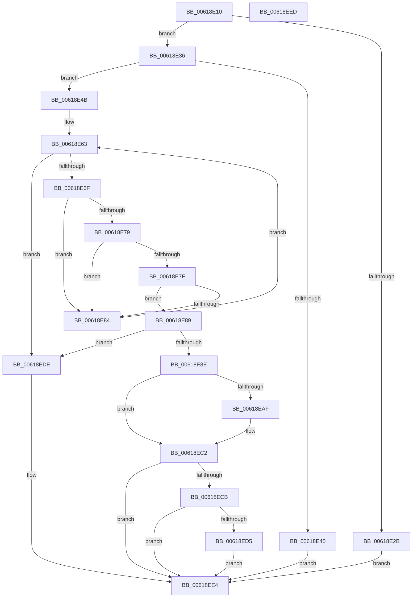

# CarQueryReportActionForTriage

- RVA: `0x00618E10`–`0x00618EEE` (길이 `222` bytes)
- VA: `0x0000000140618E10`
- 실행 섹션: `.text`
- PDB 이름 있음: `예`; PDB Function 태그: `아니요`
- unwind 정보 RVA: `0x0005CF00`
- 디코드: `60`개 명령, `222/222` bytes 표시
- 미해석 바이트: `0` (있으면 어셈블리에 `.byte`로 보존)

> 이 문서는 커널 이미지의 기계어와 PDB 기호를 분석해 생성했습니다. 4번과 5번은 함수 원형과 자료형을 바이너리 사용 방식에서 추정한 C 해석이며 원본 소스 복구 결과는 아닙니다.

## 1. Dependencies

- 직접 호출 지점: **3**; 고유 호출 대상: **2**
- 직접 호출자로 확인된 함수: **3**
- RIP 상대 이미지 참조: **5**

### Outgoing calls
- `0x00618E99` → [CarOverrideReportAction](CarOverrideReportAction_function_00618DB8.md) (function, `0x00618DB8`)
- `0x00618EA5` → [CarFindRuleOverrideEntryByGlobalRuleId](CarFindRuleOverrideEntryByGlobalRuleId_function_006189B4.md) (function, `0x006189B4`)
- `0x00618EBD` → [CarOverrideReportAction](CarOverrideReportAction_function_00618DB8.md) (function, `0x00618DB8`)

### Direct callers
- [CarQueryReportAction](CarQueryReportAction_function_00618DE0.md) at `0x00618DFF`
- [CarReportDifPluginRuleViolation](CarReportDifPluginRuleViolation_function_00619250.md) at `0x0061935F`
- [CarReportRuleViolationFromNt](../../pagevrfy/B9/CarReportRuleViolationFromNt_function_00B9D904.md) at `0x00B9DA1C`

### Static image references
- `0x00618E1C` → RVA `0x00F02580` (`.data`; read)
- `0x00618E36` → RVA `0x00F03EC0` (`.data`; read)
- `0x00618E4B` → RVA `0x000382F0` (`.rdata`; read)
- `0x00618E5C` → RVA `0x00F03ED0` (`.data`; read)
- `0x00618ECB` → RVA `0x00F02584` (`.data`; read)

## 2. Other-region calls and transfers

- 다른 실행 섹션으로 향하는 call: **0**
- 별도 외부 분기/꼬리 이동을 확인하지 못했습니다.

## 3. Assembly (complete function range)

```asm
00618E10  40 53                           push rbx
00618E12  48 83 EC 20                     sub rsp, 0x20
00618E16  45 33 C9                        xor r9d, r9d
00618E19  44 8B DA                        mov r11d, edx
00618E1C  48 63 15 5D 97 8E 00            movsxd rdx, dword ptr [rip + 0x8e975d]
00618E23  4D 8B D0                        mov r10, r8
00618E26  4D 85 C0                        test r8, r8
00618E29  75 0B                           jne 0x140618e36
00618E2B  41 B9 0D 00 00 C0               mov r9d, 0xc000000d
00618E31  E9 AE 00 00 00                  jmp 0x140618ee4
00618E36  8B 05 84 B0 8E 00               mov eax, dword ptr [rip + 0x8eb084]
00618E3C  85 C0                           test eax, eax
00618E3E  75 0B                           jne 0x140618e4b
00618E40  41 B9 02 00 00 C0               mov r9d, 0xc0000002
00618E46  E9 99 00 00 00                  jmp 0x140618ee4
00618E4B  48 8D 05 9E F4 A1 FF            lea rax, [rip - 0x5e0b62]
00618E52  48 8B DA                        mov rbx, rdx
00618E55  48 8B 04 D0                     mov rax, qword ptr [rax + rdx*8]
00618E59  49 89 00                        mov qword ptr [r8], rax
00618E5C  48 8B 05 6D B0 8E 00            mov rax, qword ptr [rip + 0x8eb06d]
00618E63  48 8D 15 66 B0 8E 00            lea rdx, [rip + 0x8eb066]
00618E6A  48 3B C2                        cmp rax, rdx
00618E6D  74 6F                           je 0x140618ede
00618E6F  4C 8D 40 A8                     lea r8, [rax - 0x58]
00618E73  45 39 58 40                     cmp dword ptr [r8 + 0x40], r11d
00618E77  73 0B                           jae 0x140618e84
00618E79  45 39 58 44                     cmp dword ptr [r8 + 0x44], r11d
00618E7D  72 05                           jb 0x140618e84
00618E7F  41 39 08                        cmp dword ptr [r8], ecx
00618E82  74 05                           je 0x140618e89
00618E84  48 8B 00                        mov rax, qword ptr [rax]
00618E87  EB DA                           jmp 0x140618e63
00618E89  4D 85 C0                        test r8, r8
00618E8C  74 50                           je 0x140618ede
00618E8E  48 8D 53 01                     lea rdx, [rbx + 1]
00618E92  49 8B CA                        mov rcx, r10
00618E95  49 8D 14 D0                     lea rdx, [r8 + rdx*8]
00618E99  E8 1A FF FF FF                  call 0x140618db8
00618E9E  49 8D 48 48                     lea rcx, [r8 + 0x48]
00618EA2  41 8B D3                        mov edx, r11d
00618EA5  E8 0A FB FF FF                  call 0x1406189b4
00618EAA  48 85 C0                        test rax, rax
00618EAD  74 13                           je 0x140618ec2
00618EAF  48 8D 14 DD 04 00 00 00         lea rdx, [rbx*8 + 4]
00618EB7  49 8B CA                        mov rcx, r10
00618EBA  48 03 D0                        add rdx, rax
00618EBD  E8 F6 FE FF FF                  call 0x140618db8
00618EC2  83 3D B7 96 8E 00 05            cmp dword ptr [rip + 0x8e96b7], 5
00618EC9  7D 19                           jge 0x140618ee4
00618ECB  8B 05 B3 96 8E 00               mov eax, dword ptr [rip + 0x8e96b3]
00618ED1  A8 01                           test al, 1
00618ED3  74 0F                           je 0x140618ee4
00618ED5  41 C7 02 04 00 00 00            mov dword ptr [r10], 4
00618EDC  EB 06                           jmp 0x140618ee4
00618EDE  41 B9 25 02 00 C0               mov r9d, 0xc0000225
00618EE4  41 8B C1                        mov eax, r9d
00618EE7  48 83 C4 20                     add rsp, 0x20
00618EEB  5B                              pop rbx
00618EEC  C3                              ret
00618EED  CC                              int3
```

## 4. C-style interpretation (structured pseudocode)

```c
__int64 __fastcall CarQueryReportActionForTriage(int a1, int a2, __int64 a3, int a4)
{
    __int64 result;
    __int64 v_rsp;

    v_rsp = (v_rsp) - (32);
    a4 = 0;
    if (a3 != 0) goto loc_00618E36;
    goto loc_00618EE4;
loc_00618E36:
    if ((unsigned int)((unsigned int)(*(unsigned int *)(v_rip + 9351300))) != 0) goto loc_00618E4B;
    goto loc_00618EE4;
loc_00618E4B:
    *(unsigned __int64 *)(a3) = *(unsigned __int64 *)(v_rip - 6163298 + (int)(*(unsigned int *)(v_rip + 9344861)) * 8);
loc_00618E63:
    if ((*(unsigned __int64 *)(v_rip + 9351277)) == (v_rip + 9351270)) goto loc_00618EDE;
    if ((*(unsigned int *)(*(unsigned __int64 *)(v_rip + 9351277) - 88 + 64)) >= ((unsigned int)((unsigned int)(a2)))) goto loc_00618E84;
    if ((*(unsigned int *)(*(unsigned __int64 *)(v_rip + 9351277) - 88 + 68)) < ((unsigned int)((unsigned int)(a2)))) goto loc_00618E84;
    if ((*(unsigned int *)(*(unsigned __int64 *)(v_rip + 9351277) - 88)) == a1) goto loc_00618E89;
loc_00618E84:
    goto loc_00618E63;
loc_00618E89:
    if (*(unsigned __int64 *)(v_rip + 9351277) - 88 == 0) goto loc_00618EDE;
    result = CarOverrideReportAction(a3, *(unsigned __int64 *)(v_rip + 9351277) - 88 + (int)(*(unsigned int *)(v_rip + 9344861)) + 1 * 8, *(unsigned __int64 *)(v_rip + 9351277) - 88, (unsigned int)(0xC0000002ULL));
    result = CarFindRuleOverrideEntryByGlobalRuleId(*(unsigned __int64 *)(v_rip + 9351277) - 88 + 72, (unsigned int)((unsigned int)((unsigned int)(a2))), *(unsigned __int64 *)(v_rip + 9351277) - 88, (unsigned int)(0xC0000002ULL));
    if (result != 0) {
        a2 = (int)(*(unsigned int *)(v_rip + 9344861)) * 8 + 4;
        a1 = a3;
        a2 = (a2) + (result);
        result = CarOverrideReportAction(a1, a2, *(unsigned __int64 *)(v_rip + 9351277) - 88, (unsigned int)(0xC0000002ULL));
    }
    if ((*(unsigned int *)(v_rip + 9344695)) >= 5) goto loc_00618EE4;
    if ((((unsigned __int8)((unsigned int)(*(unsigned int *)(v_rip + 9344691)))) & (1)) == 0) goto loc_00618EE4;
    *(unsigned int *)(a3) = 4;
    goto loc_00618EE4;
loc_00618EDE:
loc_00618EE4:
    v_rsp = (v_rsp) + (32);
    return (unsigned int)((unsigned int)((unsigned int)(0xC0000225ULL)));
}
```

## 5. (Beta) C Style

```c
int64_t CarQueryReportActionForTriage(int32_t Arg1, int32_t Arg2, int64_t Arg3, int32_t Arg4)
{
    int64_t result;
    int64_t local_rsp;

    local_rsp = (local_rsp) - (32);
    Arg4 = 0;
    if (Arg3 != 0) goto loc_00618E36;
    goto loc_00618EE4;
loc_00618E36:
    if ((uint32_t)((uint32_t)(*(uint32_t *)(v_rip + 0x8EB084))) != 0) goto loc_00618E4B;
    goto loc_00618EE4;
loc_00618E4B:
    *(uint64_t *)(Arg3) = *(uint64_t *)(v_rip - 0x5E0B62 + (int32_t)(*(uint32_t *)(v_rip + 0x8E975D)) * 8);
loc_00618E63:
    if ((*(uint64_t *)(v_rip + 0x8EB06D)) == (v_rip + 9351270)) goto loc_00618EDE;
    if ((*(uint32_t *)(*(uint64_t *)(v_rip + 0x8EB06D) - 0x58 + 0x40)) >= ((uint32_t)((uint32_t)(Arg2)))) goto loc_00618E84;
    if ((*(uint32_t *)(*(uint64_t *)(v_rip + 0x8EB06D) - 0x58 + 0x44)) < ((uint32_t)((uint32_t)(Arg2)))) goto loc_00618E84;
    if ((*(uint32_t *)(*(uint64_t *)(v_rip + 0x8EB06D) - 0x58)) == Arg1) goto loc_00618E89;
loc_00618E84:
    goto loc_00618E63;
loc_00618E89:
    if (*(uint64_t *)(v_rip + 0x8EB06D) - 88 == 0) goto loc_00618EDE;
    result = CarOverrideReportAction(Arg3, *(uint64_t *)(v_rip + 0x8EB06D) - 88 + (int32_t)(*(uint32_t *)(v_rip + 0x8E975D)) + 1 * 8, *(uint64_t *)(v_rip + 0x8EB06D) - 88, (uint32_t)(0xC0000002ULL));
    result = CarFindRuleOverrideEntryByGlobalRuleId(*(uint64_t *)(v_rip + 0x8EB06D) - 88 + 72, (uint32_t)((uint32_t)((uint32_t)(Arg2))), *(uint64_t *)(v_rip + 0x8EB06D) - 88, (uint32_t)(0xC0000002ULL));
    if (result != 0) {
        Arg2 = (int32_t)(*(uint32_t *)(v_rip + 0x8E975D)) * 8 + 4;
        Arg1 = Arg3;
        Arg2 = (Arg2) + (result);
        result = CarOverrideReportAction(Arg1, Arg2, *(uint64_t *)(v_rip + 0x8EB06D) - 88, (uint32_t)(0xC0000002ULL));
    }
    if ((*(uint32_t *)(v_rip + 0x8E96B7)) >= 5) goto loc_00618EE4;
    if ((((uint8_t)((uint32_t)(*(uint32_t *)(v_rip + 0x8E96B3)))) & (1)) == 0) goto loc_00618EE4;
    *(uint32_t *)(Arg3) = 4;
    goto loc_00618EE4;
loc_00618EDE:
loc_00618EE4:
    local_rsp = (local_rsp) + (32);
    return (uint32_t)((uint32_t)((uint32_t)(0xC0000225ULL)));
}
```

## 6. Execution-region graph

[열기: 2D/3D 그래프와 함수 탐색 컨트롤 패널](../../../control-panel.html?section=text&rva=0x00618E10&view=graph)

- 2D 그래프는 위에서 아래로 흐르고, 3D 그래프는 빈 공간을 드래그해 회전합니다. Shift+드래그는 이동, 휠은 확대·축소, 함수 노드 선택은 대상 보고서 이동입니다.

### Static fallback


