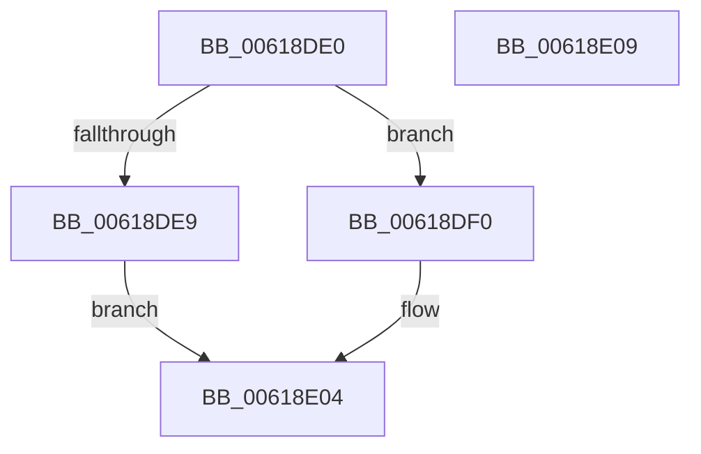

# CarQueryReportAction

- RVA: `0x00618DE0`–`0x00618E0A` (길이 `42` bytes)
- VA: `0x0000000140618DE0`
- 실행 섹션: `.text`
- PDB 이름 있음: `예`; PDB Function 태그: `아니요`
- unwind 정보 RVA: `0x0005C788`
- 디코드: `13`개 명령, `42/42` bytes 표시
- 미해석 바이트: `0` (있으면 어셈블리에 `.byte`로 보존)

> 이 문서는 커널 이미지의 기계어와 PDB 기호를 분석해 생성했습니다. 4번과 5번은 함수 원형과 자료형을 바이너리 사용 방식에서 추정한 C 해석이며 원본 소스 복구 결과는 아닙니다.

## 1. Dependencies

- 직접 호출 지점: **1**; 고유 호출 대상: **1**
- 직접 호출자로 확인된 함수: **0**
- RIP 상대 이미지 참조: **0**

### Outgoing calls
- `0x00618DFF` → [CarQueryReportActionForTriage](CarQueryReportActionForTriage_function_00618E10.md) (function, `0x00618E10`)

### Direct callers
- 이 함수 시작 RVA로 연결되는 직접 call은 확인되지 않았습니다. 간접 호출은 완전히 역산할 수 없습니다.

### Static image references
- 디코드된 RIP-relative 메모리 참조가 없습니다.

## 2. Other-region calls and transfers

- 다른 실행 섹션으로 향하는 call: **0**
- 별도 외부 분기/꼬리 이동을 확인하지 못했습니다.

## 3. Assembly (complete function range)

```asm
00618DE0  48 83 EC 28                     sub rsp, 0x28
00618DE4  4D 85 C9                        test r9, r9
00618DE7  75 07                           jne 0x140618df0
00618DE9  B8 0D 00 00 C0                  mov eax, 0xc000000d
00618DEE  EB 14                           jmp 0x140618e04
00618DF0  C1 E2 10                        shl edx, 0x10
00618DF3  81 C2 00 00 01 00               add edx, 0x10000
00618DF9  41 0B D0                        or edx, r8d
00618DFC  4D 8B C1                        mov r8, r9
00618DFF  E8 0C 00 00 00                  call 0x140618e10
00618E04  48 83 C4 28                     add rsp, 0x28
00618E08  C3                              ret
00618E09  CC                              int3
```

## 4. C-style interpretation (structured pseudocode)

```c
__int64 __fastcall CarQueryReportAction(__int64 a1, int a2, int a3, __int64 a4)
{
    __int64 result;
    __int64 v_rsp;

    v_rsp = (v_rsp) - (40);
    if (a4 != 0) goto loc_00618DF0;
    goto loc_00618E04;
loc_00618DF0:
    a2 = (unsigned int)((a2) << (16));
    a2 = (unsigned int)((a2) + (0x10000ULL));
    a2 = (unsigned int)((a2) | (a3));
    result = CarQueryReportActionForTriage(a1, a2, a4, a4);
loc_00618E04:
    v_rsp = (v_rsp) + (40);
    return result;
}
```

## 5. (Beta) C Style

```c
int64_t CarQueryReportAction(int64_t Arg1, int32_t Arg2, int32_t Arg3, int64_t Arg4)
{
    int64_t result;
    int64_t local_rsp;

    local_rsp = (local_rsp) - (40);
    if (Arg4 != 0) goto loc_00618DF0;
    goto loc_00618E04;
loc_00618DF0:
    Arg2 = (uint32_t)((Arg2) << (16));
    Arg2 = (uint32_t)((Arg2) + (0x10000ULL));
    Arg2 = (uint32_t)((Arg2) | (Arg3));
    result = CarQueryReportActionForTriage(Arg1, Arg2, Arg4, Arg4);
loc_00618E04:
    local_rsp = (local_rsp) + (40);
    return result;
}
```

## 6. Execution-region graph

[열기: 2D/3D 그래프와 함수 탐색 컨트롤 패널](../../../control-panel.html?section=text&rva=0x00618DE0&view=graph)

- 2D 그래프는 위에서 아래로 흐르고, 3D 그래프는 빈 공간을 드래그해 회전합니다. Shift+드래그는 이동, 휠은 확대·축소, 함수 노드 선택은 대상 보고서 이동입니다.

### Static fallback


