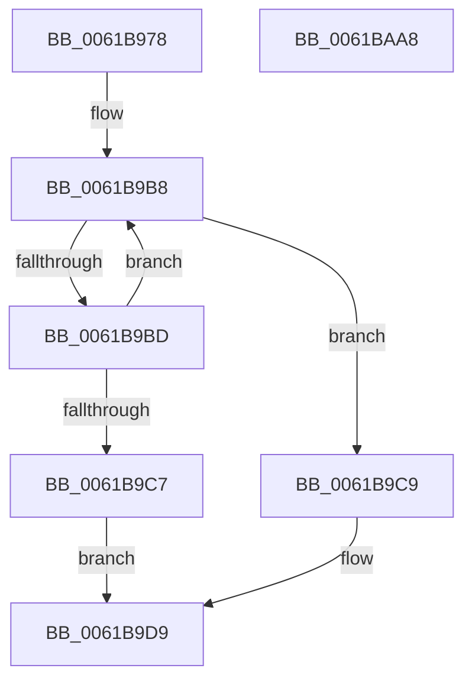

# CarReadRegistry

- RVA: `0x0061B978`–`0x0061BAA9` (길이 `305` bytes)
- VA: `0x000000014061B978`
- 실행 섹션: `.text`
- PDB 이름 있음: `예`; PDB Function 태그: `아니요`
- unwind 정보 RVA: `0x000C6F60`
- 디코드: `71`개 명령, `305/305` bytes 표시
- 미해석 바이트: `0` (있으면 어셈블리에 `.byte`로 보존)

> 이 문서는 커널 이미지의 기계어와 PDB 기호를 분석해 생성했습니다. 4번과 5번은 함수 원형과 자료형을 바이너리 사용 방식에서 추정한 C 해석이며 원본 소스 복구 결과는 아닙니다.

## 1. Dependencies

- 직접 호출 지점: **3**; 고유 호출 대상: **3**
- 직접 호출자로 확인된 함수: **1**
- RIP 상대 이미지 참조: **10**

### Outgoing calls
- `0x0061BA05` → [memset](../6C/memset_function_006C6C40.md) (function, `0x006C6C40`)
- `0x0061BA80` → [RtlQueryRegistryValuesEx](../../page/8C/RtlQueryRegistryValuesEx_function_008C8FF0.md) (function, `0x008C8FF0`)
- `0x0061BA8E` → [_security_check_cookie](../6A/_security_check_cookie_function_006AC640.md) (function, `0x006AC640`)

### Direct callers
- [CarInit](CarInit_function_006189FC.md) at `0x00618ACD`

### Static image references
- `0x0061B98F` → RVA `0x00E0A740` (`.data`; read)
- `0x0061B9A0` → RVA `0x00F025A0` (`.data`; read)
- `0x0061B9D9` → RVA `0x00EEFB6C` (`.data`; read)
- `0x0061B9E4` → RVA `0x00FD9FC0` (`PAGEDATA`; read)
- `0x0061B9F0` → RVA `0x00E09008` (`.data`; read)
- `0x0061BA20` → RVA `0x006CD9E0` (` ?? ::FNODOBFM::`string'`; read)
- `0x0061BA44` → RVA `0x006CDFA0` (` ?? ::FNODOBFM::`string'`; read)
- `0x0061BA54` → RVA `0x00F02584` (`.data`; read)
- `0x0061BA65` → RVA `0x006CFC90` (` ?? ::FNODOBFM::`string'`; read)
- `0x0061BA75` → RVA `0x00F03DA8` (`.data`; read)

## 2. Other-region calls and transfers

- 다른 실행 섹션으로 향하는 call: **1**
  - `0x0061BA80` → [RtlQueryRegistryValuesEx](../../page/8C/RtlQueryRegistryValuesEx_function_008C8FF0.md) (`.text` → `PAGE`)
- 별도 외부 분기/꼬리 이동을 확인하지 못했습니다.

## 3. Assembly (complete function range)

```asm
0061B978  48 89 5C 24 08                  mov qword ptr [rsp + 8], rbx
0061B97D  48 89 7C 24 10                  mov qword ptr [rsp + 0x10], rdi
0061B982  55                              push rbp
0061B983  48 8D 6C 24 D0                  lea rbp, [rsp - 0x30]
0061B988  48 81 EC 30 01 00 00            sub rsp, 0x130
0061B98F  48 8B 05 AA ED 7E 00            mov rax, qword ptr [rip + 0x7eedaa]
0061B996  48 33 C4                        xor rax, rsp
0061B999  48 89 45 20                     mov qword ptr [rbp + 0x20], rax
0061B99D  0F 57 C0                        xorps xmm0, xmm0
0061B9A0  4C 8D 05 F9 6B 8E 00            lea r8, [rip + 0x8e6bf9]
0061B9A7  B8 FF 7F 00 00                  mov eax, 0x7fff
0061B9AC  49 8B C8                        mov rcx, r8
0061B9AF  0F 11 44 24 30                  movups xmmword ptr [rsp + 0x30], xmm0
0061B9B4  8B D0                           mov edx, eax
0061B9B6  33 FF                           xor edi, edi
0061B9B8  66 39 39                        cmp word ptr [rcx], di
0061B9BB  74 0C                           je 0x14061b9c9
0061B9BD  48 83 C1 02                     add rcx, 2
0061B9C1  48 83 EA 01                     sub rdx, 1
0061B9C5  75 F1                           jne 0x14061b9b8
0061B9C7  EB 10                           jmp 0x14061b9d9
0061B9C9  48 2B C2                        sub rax, rdx
0061B9CC  4C 89 44 24 38                  mov qword ptr [rsp + 0x38], r8
0061B9D1  66 03 C0                        add ax, ax
0061B9D4  66 89 44 24 30                  mov word ptr [rsp + 0x30], ax
0061B9D9  39 3D 8D 41 8D 00               cmp dword ptr [rip + 0x8d418d], edi
0061B9DF  48 8D 4C 24 40                  lea rcx, [rsp + 0x40]
0061B9E4  48 8B 1D D5 E5 9B 00            mov rbx, qword ptr [rip + 0x9be5d5]
0061B9EB  B8 00 0C 00 00                  mov eax, 0xc00
0061B9F0  48 0F 45 1D 10 D6 7E 00         cmovne rbx, qword ptr [rip + 0x7ed610]
0061B9F8  41 B8 E0 00 00 00               mov r8d, 0xe0
0061B9FE  33 D2                           xor edx, edx
0061BA00  66 89 44 24 32                  mov word ptr [rsp + 0x32], ax
0061BA05  E8 36 B2 0A 00                  call 0x1406c6c40
0061BA0A  BA 20 01 00 00                  mov edx, 0x120
0061BA0F  C7 44 24 60 00 00 00 01         mov dword ptr [rsp + 0x60], 0x1000000
0061BA17  B9 00 00 00 04                  mov ecx, 0x4000000
0061BA1C  89 54 24 48                     mov dword ptr [rsp + 0x48], edx
0061BA20  48 8D 05 B9 1F 0B 00            lea rax, [rip + 0xb1fb9]
0061BA27  89 4D 98                        mov dword ptr [rbp - 0x68], ecx
0061BA2A  48 89 44 24 50                  mov qword ptr [rsp + 0x50], rax
0061BA2F  4C 8D 44 24 40                  lea r8, [rsp + 0x40]
0061BA34  48 8D 44 24 30                  lea rax, [rsp + 0x30]
0061BA39  89 55 80                        mov dword ptr [rbp - 0x80], edx
0061BA3C  48 89 44 24 58                  mov qword ptr [rsp + 0x58], rax
0061BA41  45 33 C9                        xor r9d, r9d
0061BA44  48 8D 05 55 25 0B 00            lea rax, [rip + 0xb2555]
0061BA4B  89 4D D0                        mov dword ptr [rbp - 0x30], ecx
0061BA4E  48 89 45 88                     mov qword ptr [rbp - 0x78], rax
0061BA52  33 C9                           xor ecx, ecx
0061BA54  48 8D 05 29 6B 8E 00            lea rax, [rip + 0x8e6b29]
0061BA5B  89 55 B8                        mov dword ptr [rbp - 0x48], edx
0061BA5E  48 89 45 90                     mov qword ptr [rbp - 0x70], rax
0061BA62  48 8B D3                        mov rdx, rbx
0061BA65  48 8D 05 24 42 0B 00            lea rax, [rip + 0xb4224]
0061BA6C  48 89 7C 24 20                  mov qword ptr [rsp + 0x20], rdi
0061BA71  48 89 45 C0                     mov qword ptr [rbp - 0x40], rax
0061BA75  48 8D 05 2C 83 8E 00            lea rax, [rip + 0x8e832c]
0061BA7C  48 89 45 C8                     mov qword ptr [rbp - 0x38], rax
0061BA80  E8 6B D5 2A 00                  call 0x1408c8ff0
0061BA85  33 C0                           xor eax, eax
0061BA87  48 8B 4D 20                     mov rcx, qword ptr [rbp + 0x20]
0061BA8B  48 33 CC                        xor rcx, rsp
0061BA8E  E8 AD 0B 09 00                  call 0x1406ac640
0061BA93  4C 8D 9C 24 30 01 00 00         lea r11, [rsp + 0x130]
0061BA9B  49 8B 5B 10                     mov rbx, qword ptr [r11 + 0x10]
0061BA9F  49 8B 7B 18                     mov rdi, qword ptr [r11 + 0x18]
0061BAA3  49 8B E3                        mov rsp, r11
0061BAA6  5D                              pop rbp
0061BAA7  C3                              ret
0061BAA8  CC                              int3
```

## 4. C-style interpretation (structured pseudocode)

```c
__int64 __fastcall CarReadRegistry(__int64 a1, __int64 a2, __int64 a3, int a4)
{
    __int64 result;
    __int64 v_rbx;
    __int64 v_rdi;
    __int64 v_rsp;
    unsigned __int64 v_stack_m100;
    unsigned __int16 v_stack_m106;
    unsigned __int64 v_stack_m108;
    unsigned __int64 v_stack_m118;
    unsigned __int64 v_stack_m18;
    unsigned __int64 v_stack_m38;
    unsigned int v_stack_m68;
    unsigned __int64 v_stack_m70;
    unsigned __int64 v_stack_m78;
    unsigned __int64 v_stack_m8;
    unsigned int v_stack_m80;
    unsigned int v_stack_mA0;
    unsigned __int64 v_stack_mA8;
    unsigned __int64 v_stack_mB0;
    unsigned int v_stack_mB8;
    unsigned int v_stack_mD8;
    unsigned __int64 v_stack_mE0;
    unsigned __int64 v_stack_mE8;
    unsigned int v_stack_mF0;
    unsigned __int64 v_stack_mF8;
    unsigned __int64 v_stack_p10;
    unsigned __int64 v_stack_p8;

    v_stack_p8 = v_rbx;
    v_stack_p10 = v_rdi;
    v_rsp = (v_rsp) - (304);
    result = (*(unsigned __int64 *)(v_rip + 8318378)) ^ (v_rsp);
    v_stack_m18 = result;
    v_stack_m108 = v_xmm0;
    v_rdi = 0;
loc_0061B9B8:
    if ((*(unsigned __int16 *)(v_rip + 9333753)) == 0) goto loc_0061B9C9;
    a1 = (v_rip + 9333753) + (2);
    a2 = ((unsigned int)((unsigned int)((unsigned int)(0x7FFFULL)))) - (1);
    if (condition_is_not_equal) goto loc_0061B9B8;
    goto loc_0061B9D9;
loc_0061B9C9:
    result = ((unsigned int)(0x7FFFULL)) - (a2);
    v_stack_m100 = v_rip + 9333753;
    result = (unsigned __int16)((result) + ((unsigned __int16)(result)));
    v_stack_m108 = (unsigned __int16)(result);
loc_0061B9D9:
    v_rbx = *(unsigned __int64 *)(v_rip + 10216917);
    if ((*(unsigned int *)(v_rip + 9257357)) != 0) { v_rbx = *(unsigned __int64 *)(v_rip + 8312336); }
    a2 = 0;
    v_stack_m106 = (unsigned __int16)((unsigned int)(0xC00ULL));
    result = memset(v_stack_mF8, a2, 224, a4);
    v_stack_mD8 = 0x1000000ULL;
    v_stack_mF0 = 288;
    v_stack_mA0 = (unsigned int)((unsigned int)(0x4000000ULL));
    v_stack_mE8 = v_rip + 729017;
    v_stack_mB8 = 288;
    v_stack_mE0 = v_stack_m108;
    a4 = 0;
    v_stack_m68 = (unsigned int)((unsigned int)(0x4000000ULL));
    v_stack_mB0 = v_rip + 730453;
    a1 = 0;
    v_stack_m80 = 288;
    v_stack_mA8 = v_rip + 9333545;
    v_stack_m118 = 0;
    v_stack_m78 = v_rip + 737828;
    v_stack_m70 = v_rip + 9339692;
    result = RtlQueryRegistryValuesEx(a1, v_rbx, v_stack_mF8, a4);
    result = 0;
    a1 = (v_stack_m18) ^ (v_rsp);
    result = _security_check_cookie(a1, v_rbx, v_stack_mF8, a4);
    return result;
}
```

## 5. (Beta) C Style

```c
int64_t CarReadRegistry(int64_t Arg1, int64_t Arg2, int64_t Arg3, int32_t Arg4)
{
    int64_t result;
    int64_t local_rbx;
    int64_t local_rdi;
    int64_t local_rsp;
    uint64_t v_stack_m100;
    uint16_t v_stack_m106;
    uint64_t v_stack_m108;
    uint64_t v_stack_m118;
    uint64_t v_stack_m18;
    uint64_t v_stack_m38;
    uint32_t v_stack_m68;
    uint64_t v_stack_m70;
    uint64_t v_stack_m78;
    uint64_t v_stack_m8;
    uint32_t v_stack_m80;
    uint32_t v_stack_mA0;
    uint64_t v_stack_mA8;
    uint64_t v_stack_mB0;
    uint32_t v_stack_mB8;
    uint32_t v_stack_mD8;
    uint64_t v_stack_mE0;
    uint64_t v_stack_mE8;
    uint32_t v_stack_mF0;
    uint64_t v_stack_mF8;
    uint64_t v_stack_p10;
    uint64_t v_stack_p8;

    v_stack_p8 = local_rbx;
    v_stack_p10 = local_rdi;
    local_rsp = (local_rsp) - (304);
    result = (*(uint64_t *)(v_rip + 0x7EEDAA)) ^ (local_rsp);
    v_stack_m18 = result;
    v_stack_m108 = v_xmm0;
    local_rdi = 0;
loc_0061B9B8:
    if ((*(uint16_t *)(v_rip + 0x8E6BF9)) == 0) goto loc_0061B9C9;
    Arg1 = (v_rip + 9333753) + (2);
    Arg2 = ((uint32_t)((uint32_t)((uint32_t)(0x7FFFULL)))) - (1);
    if (condition_is_not_equal) goto loc_0061B9B8;
    goto loc_0061B9D9;
loc_0061B9C9:
    result = ((uint32_t)(0x7FFFULL)) - (Arg2);
    v_stack_m100 = v_rip + 9333753;
    result = (uint16_t)((result) + ((uint16_t)(result)));
    v_stack_m108 = (uint16_t)(result);
loc_0061B9D9:
    local_rbx = *(uint64_t *)(v_rip + 0x9BE5D5);
    if ((*(uint32_t *)(v_rip + 0x8D418D)) != 0) { local_rbx = *(uint64_t *)(v_rip + 0x7ED610); }
    Arg2 = 0;
    v_stack_m106 = (uint16_t)((uint32_t)(0xC00ULL));
    result = memset(v_stack_mF8, Arg2, 224, Arg4);
    v_stack_mD8 = 0x1000000ULL;
    v_stack_mF0 = 288;
    v_stack_mA0 = (uint32_t)((uint32_t)(0x4000000ULL));
    v_stack_mE8 = v_rip + 729017;
    v_stack_mB8 = 288;
    v_stack_mE0 = v_stack_m108;
    Arg4 = 0;
    v_stack_m68 = (uint32_t)((uint32_t)(0x4000000ULL));
    v_stack_mB0 = v_rip + 730453;
    Arg1 = 0;
    v_stack_m80 = 288;
    v_stack_mA8 = v_rip + 9333545;
    v_stack_m118 = 0;
    v_stack_m78 = v_rip + 737828;
    v_stack_m70 = v_rip + 9339692;
    result = RtlQueryRegistryValuesEx(Arg1, local_rbx, v_stack_mF8, Arg4);
    result = 0;
    Arg1 = (v_stack_m18) ^ (local_rsp);
    result = _security_check_cookie(Arg1, local_rbx, v_stack_mF8, Arg4);
    return result;
}
```

## 6. Execution-region graph

[열기: 2D/3D 그래프와 함수 탐색 컨트롤 패널](../../../control-panel.html?section=text&rva=0x0061B978&view=graph)

- 2D 그래프는 위에서 아래로 흐르고, 3D 그래프는 빈 공간을 드래그해 회전합니다. Shift+드래그는 이동, 휠은 확대·축소, 함수 노드 선택은 대상 보고서 이동입니다.

### Static fallback


