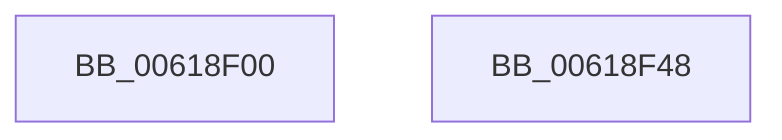

# CarRegisterDefaultRuleClassConfiguration

- RVA: `0x00618F00`–`0x00618F49` (길이 `73` bytes)
- VA: `0x0000000140618F00`
- 실행 섹션: `.text`
- PDB 이름 있음: `예`; PDB Function 태그: `아니요`
- unwind 정보 RVA: `0x0007A034`
- 디코드: `16`개 명령, `73/73` bytes 표시
- 미해석 바이트: `0` (있으면 어셈블리에 `.byte`로 보존)

> 이 문서는 커널 이미지의 기계어와 PDB 기호를 분석해 생성했습니다. 4번과 5번은 함수 원형과 자료형을 바이너리 사용 방식에서 추정한 C 해석이며 원본 소스 복구 결과는 아닙니다.

## 1. Dependencies

- 직접 호출 지점: **1**; 고유 호출 대상: **1**
- 직접 호출자로 확인된 함수: **1**
- RIP 상대 이미지 참조: **2**

### Outgoing calls
- `0x00618F3E` → [CarRegisterRuleClassConfiguration](CarRegisterRuleClassConfiguration_function_00618F50.md) (function, `0x00618F50`)

### Direct callers
- [DifRegisterKernelPlugins](DifRegisterKernelPlugins_function_0061AA40.md) at `0x0061AB5C`

### Static image references
- `0x00618F07` → RVA `0x00042E80` (`.rdata`; read)
- `0x00618F19` → RVA `0x00042E60` (`.rdata`; read)

## 2. Other-region calls and transfers

- 다른 실행 섹션으로 향하는 call: **0**
- 별도 외부 분기/꼬리 이동을 확인하지 못했습니다.

## 3. Assembly (complete function range)

```asm
00618F00  48 8B C4                        mov rax, rsp
00618F03  48 83 EC 68                     sub rsp, 0x68
00618F07  66 0F 6F 05 71 9F A2 FF         movdqa xmm0, xmmword ptr [rip - 0x5d608f]
00618F0F  66 0F 7F 40 C8                  movdqa xmmword ptr [rax - 0x38], xmm0
00618F14  66 0F 7F 40 D8                  movdqa xmmword ptr [rax - 0x28], xmm0
00618F19  66 0F 6F 05 3F 9F A2 FF         movdqa xmm0, xmmword ptr [rip - 0x5d60c1]
00618F21  89 48 B8                        mov dword ptr [rax - 0x48], ecx
00618F24  48 8D 48 B8                     lea rcx, [rax - 0x48]
00618F28  66 0F 7F 40 E8                  movdqa xmmword ptr [rax - 0x18], xmm0
00618F2D  C7 40 C0 05 00 00 00            mov dword ptr [rax - 0x40], 5
00618F34  C7 40 C4 03 00 00 00            mov dword ptr [rax - 0x3c], 3
00618F3B  89 50 BC                        mov dword ptr [rax - 0x44], edx
00618F3E  E8 0D 00 00 00                  call 0x140618f50
00618F43  48 83 C4 68                     add rsp, 0x68
00618F47  C3                              ret
00618F48  CC                              int3
```

## 4. C-style interpretation (structured pseudocode)

```c
__int64 __fastcall CarRegisterDefaultRuleClassConfiguration(int a1, int a2)
{
    __int64 result;
    __int64 v_rsp;

    v_rsp = (v_rsp) - (104);
    *(unsigned __int64 *)(v_rsp - 56) = v_xmm0;
    *(unsigned __int64 *)(v_rsp - 40) = v_xmm0;
    *(unsigned int *)(v_rsp - 72) = a1;
    *(unsigned __int64 *)(v_rsp - 24) = v_xmm0;
    *(unsigned int *)(v_rsp - 64) = 5;
    *(unsigned int *)(v_rsp - 60) = 3;
    *(unsigned int *)(v_rsp - 68) = a2;
    result = CarRegisterRuleClassConfiguration(v_rsp - 72, a2, a3, a4);
    v_rsp = (v_rsp) + (104);
    return result;
}
```

## 5. (Beta) C Style

```c
int64_t CarRegisterDefaultRuleClassConfiguration(int32_t Arg1, int32_t Arg2)
{
    int64_t result;
    int64_t local_rsp;

    local_rsp = (local_rsp) - (104);
    *(uint64_t *)(local_rsp - 0x38) = v_xmm0;
    *(uint64_t *)(local_rsp - 0x28) = v_xmm0;
    *(uint32_t *)(local_rsp - 0x48) = Arg1;
    *(uint64_t *)(local_rsp - 0x18) = v_xmm0;
    *(uint32_t *)(local_rsp - 0x40) = 5;
    *(uint32_t *)(local_rsp - 0x3C) = 3;
    *(uint32_t *)(local_rsp - 0x44) = Arg2;
    result = CarRegisterRuleClassConfiguration(local_rsp - 72, Arg2, a3, a4);
    local_rsp = (local_rsp) + (104);
    return result;
}
```

## 6. Execution-region graph

[열기: 2D/3D 그래프와 함수 탐색 컨트롤 패널](../../../control-panel.html?section=text&rva=0x00618F00&view=graph)

- 2D 그래프는 위에서 아래로 흐르고, 3D 그래프는 빈 공간을 드래그해 회전합니다. Shift+드래그는 이동, 휠은 확대·축소, 함수 노드 선택은 대상 보고서 이동입니다.

### Static fallback


