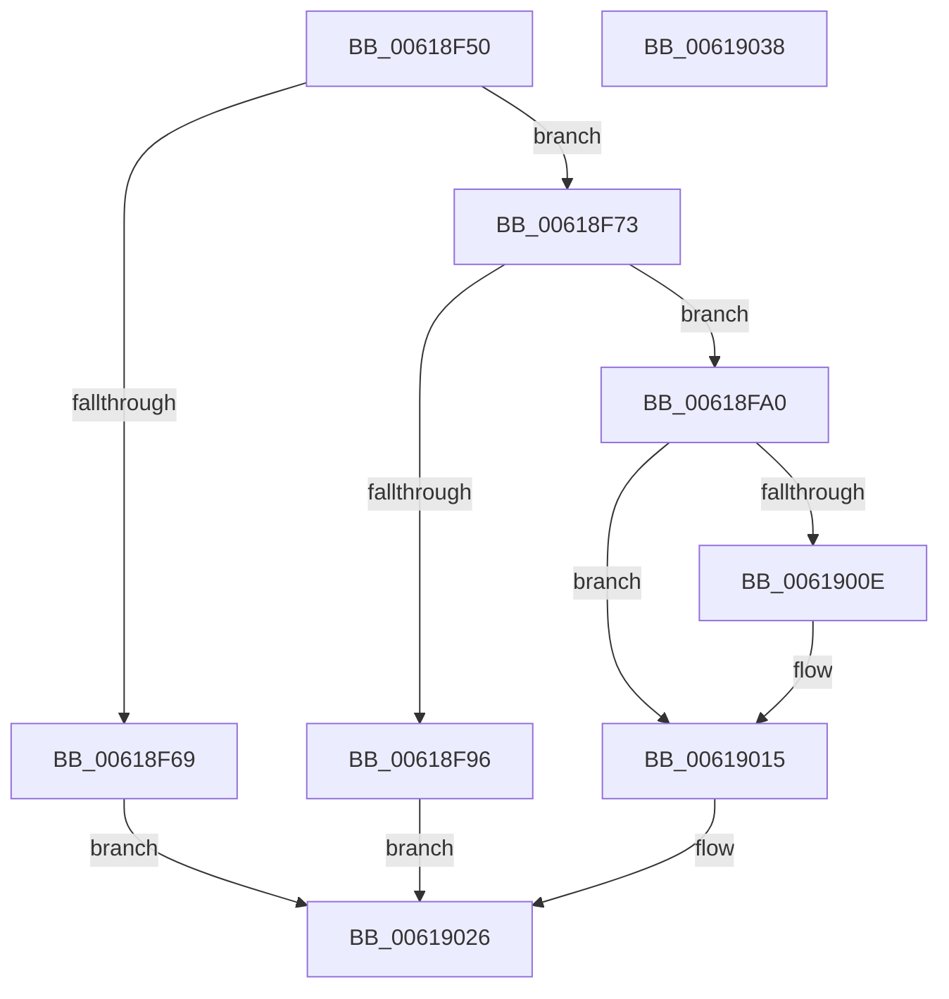

# CarRegisterRuleClassConfiguration

- RVA: `0x00618F50`–`0x00619039` (길이 `233` bytes)
- VA: `0x0000000140618F50`
- 실행 섹션: `.text`
- PDB 이름 있음: `예`; PDB Function 태그: `아니요`
- unwind 정보 RVA: `0x00060BC4`
- 디코드: `64`개 명령, `233/233` bytes 표시
- 미해석 바이트: `0` (있으면 어셈블리에 `.byte`로 보존)

> 이 문서는 커널 이미지의 기계어와 PDB 기호를 분석해 생성했습니다. 4번과 5번은 함수 원형과 자료형을 바이너리 사용 방식에서 추정한 C 해석이며 원본 소스 복구 결과는 아닙니다.

## 1. Dependencies

- 직접 호출 지점: **3**; 고유 호출 대상: **3**
- 직접 호출자로 확인된 함수: **1**
- RIP 상대 이미지 참조: **3**

### Outgoing calls
- `0x00618F76` → [CarDeregisterRuleClassConfiguration](CarDeregisterRuleClassConfiguration_function_00618870.md) (function, `0x00618870`)
- `0x00618F89` → [ExAllocatePool2](../../poolcode/B8/ExAllocatePool2_function_00B820F0.md) (function, `0x00B820F0`)
- `0x00618FA9` → [memset](../6C/memset_function_006C6C40.md) (function, `0x006C6C40`)

### Direct callers
- [CarRegisterDefaultRuleClassConfiguration](CarRegisterDefaultRuleClassConfiguration_function_00618F00.md) at `0x00618F3E`

### Static image references
- `0x00618FB6` → RVA `0x00F03ED0` (`.data`; read)
- `0x00619002` → RVA `0x00F03ED8` (`.data`; read)
- `0x0061901F` → RVA `0x00F03ED8` (`.data`; write)

## 2. Other-region calls and transfers

- 다른 실행 섹션으로 향하는 call: **1**
  - `0x00618F89` → [ExAllocatePool2](../../poolcode/B8/ExAllocatePool2_function_00B820F0.md) (`.text` → `POOLCODE`)
- 별도 외부 분기/꼬리 이동을 확인하지 못했습니다.

## 3. Assembly (complete function range)

```asm
00618F50  48 89 5C 24 08                  mov qword ptr [rsp + 8], rbx
00618F55  48 89 74 24 10                  mov qword ptr [rsp + 0x10], rsi
00618F5A  57                              push rdi
00618F5B  48 83 EC 20                     sub rsp, 0x20
00618F5F  33 DB                           xor ebx, ebx
00618F61  48 8B F9                        mov rdi, rcx
00618F64  48 85 C9                        test rcx, rcx
00618F67  75 0A                           jne 0x140618f73
00618F69  BB 0D 00 00 C0                  mov ebx, 0xc000000d
00618F6E  E9 B3 00 00 00                  jmp 0x140619026
00618F73  8B 49 04                        mov ecx, dword ptr [rcx + 4]
00618F76  E8 F5 F8 FF FF                  call 0x140618870
00618F7B  BA 68 00 00 00                  mov edx, 0x68
00618F80  41 B8 43 61 72 4E               mov r8d, 0x4e726143
00618F86  8D 4A D8                        lea ecx, [rdx - 0x28]
00618F89  E8 62 91 56 00                  call 0x140b820f0
00618F8E  48 8B F0                        mov rsi, rax
00618F91  48 85 C0                        test rax, rax
00618F94  75 0A                           jne 0x140618fa0
00618F96  BB 17 00 00 C0                  mov ebx, 0xc0000017
00618F9B  E9 86 00 00 00                  jmp 0x140619026
00618FA0  33 D2                           xor edx, edx
00618FA2  48 8B CE                        mov rcx, rsi
00618FA5  44 8D 42 68                     lea r8d, [rdx + 0x68]
00618FA9  E8 92 DC 0A 00                  call 0x1406c6c40
00618FAE  0F 10 07                        movups xmm0, xmmword ptr [rdi]
00618FB1  B9 00 00 01 00                  mov ecx, 0x10000
00618FB6  48 8D 15 13 AF 8E 00            lea rdx, [rip + 0x8eaf13]
00618FBD  0F 11 06                        movups xmmword ptr [rsi], xmm0
00618FC0  0F 10 4F 10                     movups xmm1, xmmword ptr [rdi + 0x10]
00618FC4  0F 11 4E 10                     movups xmmword ptr [rsi + 0x10], xmm1
00618FC8  0F 10 47 20                     movups xmm0, xmmword ptr [rdi + 0x20]
00618FCC  0F 11 46 20                     movups xmmword ptr [rsi + 0x20], xmm0
00618FD0  0F 10 4F 30                     movups xmm1, xmmword ptr [rdi + 0x30]
00618FD4  0F 11 4E 30                     movups xmmword ptr [rsi + 0x30], xmm1
00618FD8  8B 47 04                        mov eax, dword ptr [rdi + 4]
00618FDB  C1 E0 10                        shl eax, 0x10
00618FDE  03 C1                           add eax, ecx
00618FE0  89 46 40                        mov dword ptr [rsi + 0x40], eax
00618FE3  8B 47 04                        mov eax, dword ptr [rdi + 4]
00618FE6  C1 E0 10                        shl eax, 0x10
00618FE9  03 C1                           add eax, ecx
00618FEB  0D FF FF 00 00                  or eax, 0xffff
00618FF0  89 46 44                        mov dword ptr [rsi + 0x44], eax
00618FF3  48 8D 46 48                     lea rax, [rsi + 0x48]
00618FF7  48 89 40 08                     mov qword ptr [rax + 8], rax
00618FFB  48 89 00                        mov qword ptr [rax], rax
00618FFE  48 8D 46 58                     lea rax, [rsi + 0x58]
00619002  48 8B 0D CF AE 8E 00            mov rcx, qword ptr [rip + 0x8eaecf]
00619009  48 39 11                        cmp qword ptr [rcx], rdx
0061900C  74 07                           je 0x140619015
0061900E  B9 03 00 00 00                  mov ecx, 3
00619013  CD 29                           int 0x29
00619015  48 89 10                        mov qword ptr [rax], rdx
00619018  48 89 48 08                     mov qword ptr [rax + 8], rcx
0061901C  48 89 01                        mov qword ptr [rcx], rax
0061901F  48 89 05 B2 AE 8E 00            mov qword ptr [rip + 0x8eaeb2], rax
00619026  48 8B 74 24 38                  mov rsi, qword ptr [rsp + 0x38]
0061902B  8B C3                           mov eax, ebx
0061902D  48 8B 5C 24 30                  mov rbx, qword ptr [rsp + 0x30]
00619032  48 83 C4 20                     add rsp, 0x20
00619036  5F                              pop rdi
00619037  C3                              ret
00619038  CC                              int3
```

## 4. C-style interpretation (structured pseudocode)

```c
__int64 __fastcall CarRegisterRuleClassConfiguration(__int64 a1)
{
    __int64 result;
    __int64 v_rbx;
    __int64 v_rsp;
    unsigned __int64 v_stack_p10;
    unsigned __int64 v_stack_p8;

    v_stack_p8 = v_rbx;
    v_stack_p10 = v_rsi;
    v_rsp = (v_rsp) - (32);
    v_rbx = 0;
    if (a1 != 0) goto loc_00618F73;
    goto loc_00619026;
loc_00618F73:
    result = CarDeregisterRuleClassConfiguration((unsigned int)(*(unsigned int *)(a1 + 4)), a2, a3, a4);
    result = ExAllocatePool2(104 - 40, 104, (unsigned int)(0x4E726143ULL), a4);
    if (result != 0) goto loc_00618FA0;
    goto loc_00619026;
loc_00618FA0:
    a2 = 0;
    result = memset(result, a2, a2 + 104, a4);
    *(unsigned __int64 *)(result) = v_xmm0;
    *(unsigned __int64 *)(result + 16) = v_xmm1;
    *(unsigned __int64 *)(result + 32) = v_xmm0;
    *(unsigned __int64 *)(result + 48) = v_xmm1;
    result = (unsigned int)(((unsigned int)(*(unsigned int *)(a1 + 4))) << (16));
    result = (unsigned int)((result) + ((unsigned int)((unsigned int)(0x10000ULL))));
    *(unsigned int *)(result + 64) = (unsigned int)(result);
    result = (unsigned int)(((unsigned int)(*(unsigned int *)(a1 + 4))) << (16));
    result = (unsigned int)((result) + ((unsigned int)((unsigned int)(0x10000ULL))));
    result = (unsigned int)((result) | (0xFFFFULL));
    *(unsigned int *)(result + 68) = (unsigned int)(result);
    *(unsigned __int64 *)(result + 72 + 8) = result + 72;
    *(unsigned __int64 *)(result + 72) = result + 72;
    if ((*(unsigned __int64 *)(*(unsigned __int64 *)(v_rip + 9350863))) != (v_rip + 9350931)) {
        a1 = 3;
    }
    *(unsigned __int64 *)(result + 88) = v_rip + 9350931;
    *(unsigned __int64 *)(result + 88 + 8) = a1;
    *(unsigned __int64 *)(a1) = result + 88;
    *(unsigned __int64 *)(v_rip + 9350834) = result + 88;
loc_00619026:
    v_rsp = (v_rsp) + (32);
    return (unsigned int)((unsigned int)((unsigned int)(0xC0000017ULL)));
}
```

## 5. (Beta) C Style

```c
int64_t CarRegisterRuleClassConfiguration(void *Arg1)
{
    uint8_t *arg1 = (uint8_t *)Arg1;

    int64_t result;
    int64_t local_rbx;
    int64_t local_rsp;
    uint64_t v_stack_p10;
    uint64_t v_stack_p8;

    v_stack_p8 = local_rbx;
    v_stack_p10 = local_rsi;
    local_rsp = (local_rsp) - (32);
    local_rbx = 0;
    if (Arg1 != NULL) goto loc_00618F73;
    goto loc_00619026;
loc_00618F73:
    result = CarDeregisterRuleClassConfiguration((uint32_t)(*(uint32_t *)(arg1 + 0x4)), a2, a3, a4);
    result = ExAllocatePool2(104 - 40, 104, (uint32_t)(0x4E726143ULL), a4);
    if (result != 0) goto loc_00618FA0;
    goto loc_00619026;
loc_00618FA0:
    a2 = 0;
    result = memset(result, a2, a2 + 104, a4);
    *(uint64_t *)(result) = v_xmm0;
    *(uint64_t *)(result + 0x10) = v_xmm1;
    *(uint64_t *)(result + 0x20) = v_xmm0;
    *(uint64_t *)(result + 0x30) = v_xmm1;
    result = (uint32_t)(((uint32_t)(*(uint32_t *)(arg1 + 0x4))) << (16));
    result = (uint32_t)((result) + ((uint32_t)((uint32_t)(0x10000ULL))));
    *(uint32_t *)(result + 0x40) = (uint32_t)(result);
    result = (uint32_t)(((uint32_t)(*(uint32_t *)(arg1 + 0x4))) << (16));
    result = (uint32_t)((result) + ((uint32_t)((uint32_t)(0x10000ULL))));
    result = (uint32_t)((result) | (0xFFFFULL));
    *(uint32_t *)(result + 0x44) = (uint32_t)(result);
    *(uint64_t *)(result + 0x48 + 0x8) = result + 72;
    *(uint64_t *)(result + 0x48) = result + 72;
    if ((*(uint64_t *)(*(uint64_t *)(v_rip + 0x8EAECF))) != (v_rip + 9350931)) {
        Arg1 = 3;
    }
    *(uint64_t *)(result + 0x58) = v_rip + 9350931;
    *(void **)(result + 0x58 + 0x8) = Arg1;
    *(uint64_t *)(arg1) = result + 88;
    *(uint64_t *)(v_rip + 0x8EAEB2) = result + 88;
loc_00619026:
    local_rsp = (local_rsp) + (32);
    return (uint32_t)((uint32_t)((uint32_t)(0xC0000017ULL)));
}
```

### 관측된 메모리 오프셋

구조체 형식이 확인되지 않은 접근은 인자 기준의 오프셋으로만 기록했습니다.

| 기준 인자 | 오프셋 표현 | 폭 (bit) | 접근 |
|---|---:|---:|---|
| `Arg1` | `+ 0x0` | `128` | `R` |
| `Arg1` | `+ 0x4` | `32` | `R` |
| `Arg1` | `+ 0x10` | `128` | `R` |
| `Arg1` | `+ 0x20` | `128` | `R` |
| `Arg1` | `+ 0x30` | `128` | `R` |

## 6. Execution-region graph

[열기: 2D/3D 그래프와 함수 탐색 컨트롤 패널](../../../control-panel.html?section=text&rva=0x00618F50&view=graph)

- 2D 그래프는 위에서 아래로 흐르고, 3D 그래프는 빈 공간을 드래그해 회전합니다. Shift+드래그는 이동, 휠은 확대·축소, 함수 노드 선택은 대상 보고서 이동입니다.

### Static fallback


