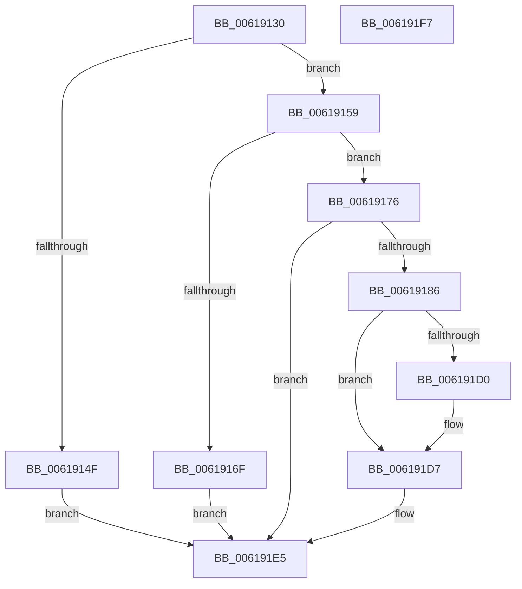

# CarRegisterRuleOverrideAllContexts

- RVA: `0x00619130`–`0x006191F8` (길이 `200` bytes)
- VA: `0x0000000140619130`
- 실행 섹션: `.text`
- PDB 이름 있음: `예`; PDB Function 태그: `아니요`
- unwind 정보 RVA: `0x0008E1D0`
- 디코드: `58`개 명령, `200/200` bytes 표시
- 미해석 바이트: `0` (있으면 어셈블리에 `.byte`로 보존)

> 이 문서는 커널 이미지의 기계어와 PDB 기호를 분석해 생성했습니다. 4번과 5번은 함수 원형과 자료형을 바이너리 사용 방식에서 추정한 C 해석이며 원본 소스 복구 결과는 아닙니다.

## 1. Dependencies

- 직접 호출 지점: **3**; 고유 호출 대상: **3**
- 직접 호출자로 확인된 함수: **1**
- RIP 상대 이미지 참조: **0**

### Outgoing calls
- `0x0061915B` → [CarDeregisterRuleOverride](CarDeregisterRuleOverride_function_00618910.md) (function, `0x00618910`)
- `0x00619162` → [CarFindRuleClassConfigurationEntryByRuleClassId](CarFindRuleClassConfigurationEntryByRuleClassId_function_0061897C.md) (function, `0x0061897C`)
- `0x0061917B` → [CarCreateRuleOverrideEntry](CarCreateRuleOverrideEntry_function_0061870C.md) (function, `0x0061870C`)

### Direct callers
- [CarRegisterRuleOverridesAllContexts](CarRegisterRuleOverridesAllContexts_function_00619200.md) at `0x00619223`

### Static image references
- 디코드된 RIP-relative 메모리 참조가 없습니다.

## 2. Other-region calls and transfers

- 다른 실행 섹션으로 향하는 call: **0**
- 별도 외부 분기/꼬리 이동을 확인하지 못했습니다.

## 3. Assembly (complete function range)

```asm
00619130  48 89 5C 24 08                  mov qword ptr [rsp + 8], rbx
00619135  48 89 74 24 18                  mov qword ptr [rsp + 0x18], rsi
0061913A  57                              push rdi
0061913B  48 83 EC 20                     sub rsp, 0x20
0061913F  48 83 64 24 38 00               and qword ptr [rsp + 0x38], 0
00619145  48 8B FA                        mov rdi, rdx
00619148  8B D9                           mov ebx, ecx
0061914A  48 85 D2                        test rdx, rdx
0061914D  75 0A                           jne 0x140619159
0061914F  BA 0D 00 00 C0                  mov edx, 0xc000000d
00619154  E9 8C 00 00 00                  jmp 0x1406191e5
00619159  8B 12                           mov edx, dword ptr [rdx]
0061915B  E8 B0 F7 FF FF                  call 0x140618910
00619160  8B D3                           mov edx, ebx
00619162  E8 15 F8 FF FF                  call 0x14061897c
00619167  48 8B F0                        mov rsi, rax
0061916A  48 85 C0                        test rax, rax
0061916D  75 07                           jne 0x140619176
0061916F  BA 34 00 00 C0                  mov edx, 0xc0000034
00619174  EB 6F                           jmp 0x1406191e5
00619176  48 8D 4C 24 38                  lea rcx, [rsp + 0x38]
0061917B  E8 8C F5 FF FF                  call 0x14061870c
00619180  8B D0                           mov edx, eax
00619182  85 C0                           test eax, eax
00619184  78 5F                           js 0x1406191e5
00619186  48 8B 4C 24 38                  mov rcx, qword ptr [rsp + 0x38]
0061918B  0F 10 07                        movups xmm0, xmmword ptr [rdi]
0061918E  C1 E3 10                        shl ebx, 0x10
00619191  81 C3 00 00 01 00               add ebx, 0x10000
00619197  0F 11 01                        movups xmmword ptr [rcx], xmm0
0061919A  0F 10 4F 10                     movups xmm1, xmmword ptr [rdi + 0x10]
0061919E  0F 11 49 10                     movups xmmword ptr [rcx + 0x10], xmm1
006191A2  0F 10 47 20                     movups xmm0, xmmword ptr [rdi + 0x20]
006191A6  0F 11 41 20                     movups xmmword ptr [rcx + 0x20], xmm0
006191AA  F2 0F 10 4F 30                  movsd xmm1, qword ptr [rdi + 0x30]
006191AF  F2 0F 11 49 30                  movsd qword ptr [rcx + 0x30], xmm1
006191B4  8B 47 38                        mov eax, dword ptr [rdi + 0x38]
006191B7  89 41 38                        mov dword ptr [rcx + 0x38], eax
006191BA  48 8D 46 48                     lea rax, [rsi + 0x48]
006191BE  0B 1F                           or ebx, dword ptr [rdi]
006191C0  89 59 3C                        mov dword ptr [rcx + 0x3c], ebx
006191C3  48 83 C1 40                     add rcx, 0x40
006191C7  4C 8B 40 08                     mov r8, qword ptr [rax + 8]
006191CB  49 39 00                        cmp qword ptr [r8], rax
006191CE  74 07                           je 0x1406191d7
006191D0  B9 03 00 00 00                  mov ecx, 3
006191D5  CD 29                           int 0x29
006191D7  48 89 01                        mov qword ptr [rcx], rax
006191DA  4C 89 41 08                     mov qword ptr [rcx + 8], r8
006191DE  49 89 08                        mov qword ptr [r8], rcx
006191E1  48 89 48 08                     mov qword ptr [rax + 8], rcx
006191E5  48 8B 5C 24 30                  mov rbx, qword ptr [rsp + 0x30]
006191EA  8B C2                           mov eax, edx
006191EC  48 8B 74 24 40                  mov rsi, qword ptr [rsp + 0x40]
006191F1  48 83 C4 20                     add rsp, 0x20
006191F5  5F                              pop rdi
006191F6  C3                              ret
006191F7  CC                              int3
```

## 4. C-style interpretation (structured pseudocode)

```c
__int64 __fastcall CarRegisterRuleOverrideAllContexts(int a1, __int64 a2)
{
    __int64 result;
    __int64 v_rbx;
    __int64 v_rsp;
    unsigned __int64 v_stack_p10;
    unsigned __int64 v_stack_p18;
    unsigned __int64 v_stack_p8;

    v_stack_p8 = v_rbx;
    v_stack_p18 = v_rsi;
    v_rsp = (v_rsp) - (32);
    if (a2 != 0) goto loc_00619159;
    goto loc_006191E5;
loc_00619159:
    result = CarDeregisterRuleOverride(a1, (unsigned int)(*(unsigned int *)((unsigned int)(0xC000000DULL))), a3, a4);
    result = CarFindRuleClassConfigurationEntryByRuleClassId(a1, (unsigned int)((unsigned int)((unsigned int)(a1))), a3, a4);
    if (result != 0) goto loc_00619176;
    goto loc_006191E5;
loc_00619176:
    result = CarCreateRuleOverrideEntry(v_stack_p10, (unsigned int)(0xC0000034ULL), a3, a4);
    if (sign_flag) goto loc_006191E5;
    v_rbx = (unsigned int)(((unsigned int)(a1)) << (16));
    v_rbx = (unsigned int)((v_rbx) + (0x10000ULL));
    *(unsigned __int64 *)(v_stack_p10) = v_xmm0;
    *(unsigned __int64 *)(v_stack_p10 + 16) = v_xmm1;
    *(unsigned __int64 *)(v_stack_p10 + 32) = v_xmm0;
    *(unsigned __int64 *)(v_stack_p10 + 48) = v_xmm1;
    *(unsigned int *)(v_stack_p10 + 56) = (unsigned int)((unsigned int)(*(unsigned int *)(a2 + 56)));
    v_rbx = (unsigned int)((v_rbx) | (*(unsigned int *)(a2)));
    *(unsigned int *)(v_stack_p10 + 60) = (unsigned int)(v_rbx);
    a1 = (v_stack_p10) + (64);
    if ((*(unsigned __int64 *)(*(unsigned __int64 *)(result + 72 + 8))) != (result + 72)) {
        a1 = 3;
    }
    *(unsigned __int64 *)(a1) = result + 72;
    *(unsigned __int64 *)(a1 + 8) = *(unsigned __int64 *)(result + 72 + 8);
    *(unsigned __int64 *)(*(unsigned __int64 *)(result + 72 + 8)) = a1;
    *(unsigned __int64 *)(result + 72 + 8) = a1;
loc_006191E5:
    v_rsp = (v_rsp) + (32);
    return (unsigned int)((unsigned int)((unsigned int)((unsigned int)(result))));
}
```

## 5. (Beta) C Style

```c
int64_t CarRegisterRuleOverrideAllContexts(int32_t Arg1, void *Arg2)
{
    uint8_t *arg2 = (uint8_t *)Arg2;

    int64_t result;
    int64_t local_rbx;
    int64_t local_rsp;
    uint64_t v_stack_p10;
    uint64_t v_stack_p18;
    uint64_t v_stack_p8;

    v_stack_p8 = local_rbx;
    v_stack_p18 = local_rsi;
    local_rsp = (local_rsp) - (32);
    if (Arg2 != NULL) goto loc_00619159;
    goto loc_006191E5;
loc_00619159:
    result = CarDeregisterRuleOverride(Arg1, (uint32_t)(*(uint32_t *)((uint32_t)(0xC000000DULL))), a3, a4);
    result = CarFindRuleClassConfigurationEntryByRuleClassId(Arg1, (uint32_t)((uint32_t)((uint32_t)(Arg1))), a3, a4);
    if (result != 0) goto loc_00619176;
    goto loc_006191E5;
loc_00619176:
    result = CarCreateRuleOverrideEntry(v_stack_p10, (uint32_t)(0xC0000034ULL), a3, a4);
    if (sign_flag) goto loc_006191E5;
    local_rbx = (uint32_t)(((uint32_t)(Arg1)) << (16));
    local_rbx = (uint32_t)((local_rbx) + (0x10000ULL));
    *(uint64_t *)(v_stack_p10) = v_xmm0;
    *(uint64_t *)(v_stack_p10 + 0x10) = v_xmm1;
    *(uint64_t *)(v_stack_p10 + 0x20) = v_xmm0;
    *(uint64_t *)(v_stack_p10 + 0x30) = v_xmm1;
    *(uint32_t *)(v_stack_p10 + 0x38) = (uint32_t)((uint32_t)(*(uint32_t *)(arg2 + 0x38)));
    local_rbx = (uint32_t)((local_rbx) | (*(uint32_t *)(arg2)));
    *(uint32_t *)(v_stack_p10 + 0x3C) = (uint32_t)(local_rbx);
    Arg1 = (v_stack_p10) + (64);
    if ((*(uint64_t *)(*(uint64_t *)(result + 0x48 + 0x8))) != (result + 72)) {
        Arg1 = 3;
    }
    *(uint64_t *)(Arg1) = result + 72;
    *(uint64_t *)(Arg1 + 0x8) = *(uint64_t *)(result + 0x48 + 0x8);
    *(uint64_t *)(*(uint64_t *)(result + 0x48 + 0x8)) = Arg1;
    *(uint64_t *)(result + 0x48 + 0x8) = Arg1;
loc_006191E5:
    local_rsp = (local_rsp) + (32);
    return (uint32_t)((uint32_t)((uint32_t)((uint32_t)(result))));
}
```

### 관측된 메모리 오프셋

구조체 형식이 확인되지 않은 접근은 인자 기준의 오프셋으로만 기록했습니다.

| 기준 인자 | 오프셋 표현 | 폭 (bit) | 접근 |
|---|---:|---:|---|
| `Arg2` | `+ 0x0` | `32` | `R` |
| `Arg2` | `+ 0x0` | `128` | `R` |
| `Arg2` | `+ 0x10` | `128` | `R` |
| `Arg2` | `+ 0x20` | `128` | `R` |
| `Arg2` | `+ 0x30` | `64` | `R` |
| `Arg2` | `+ 0x38` | `32` | `R` |

## 6. Execution-region graph

[열기: 2D/3D 그래프와 함수 탐색 컨트롤 패널](../../../control-panel.html?section=text&rva=0x00619130&view=graph)

- 2D 그래프는 위에서 아래로 흐르고, 3D 그래프는 빈 공간을 드래그해 회전합니다. Shift+드래그는 이동, 휠은 확대·축소, 함수 노드 선택은 대상 보고서 이동입니다.

### Static fallback


