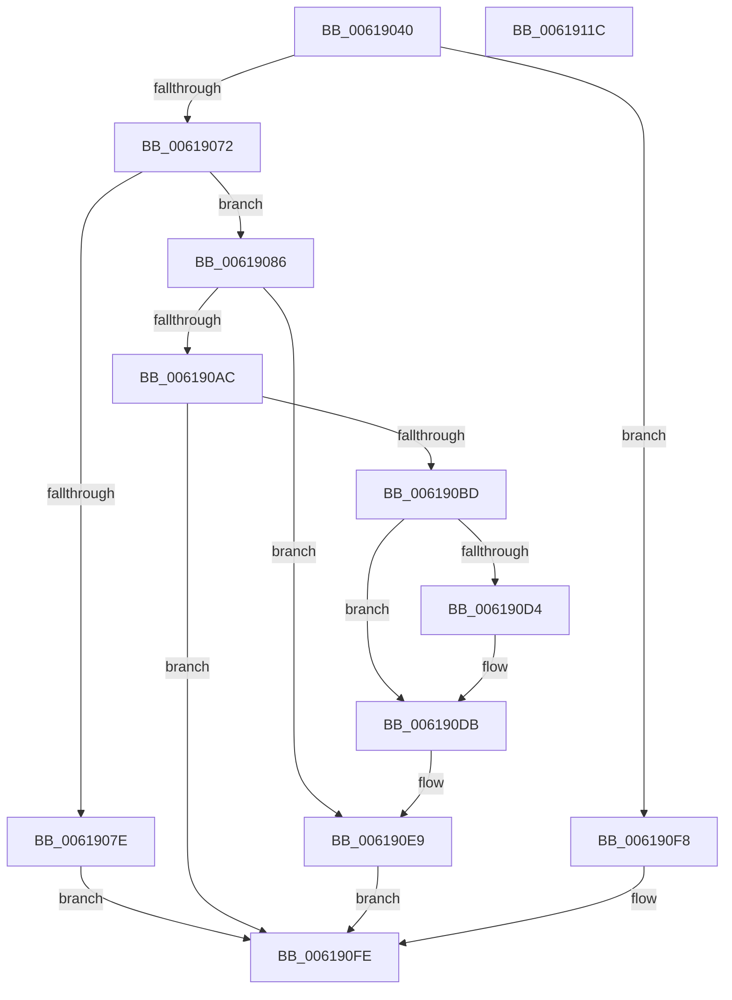

# CarRegisterRuleOverride

- RVA: `0x00619040`–`0x0061911D` (길이 `221` bytes)
- VA: `0x0000000140619040`
- 실행 섹션: `.text`
- PDB 이름 있음: `예`; PDB Function 태그: `아니요`
- unwind 정보 RVA: `0x0005D7BC`
- 디코드: `64`개 명령, `221/221` bytes 표시
- 미해석 바이트: `0` (있으면 어셈블리에 `.byte`로 보존)

> 이 문서는 커널 이미지의 기계어와 PDB 기호를 분석해 생성했습니다. 4번과 5번은 함수 원형과 자료형을 바이너리 사용 방식에서 추정한 C 해석이며 원본 소스 복구 결과는 아닙니다.

## 1. Dependencies

- 직접 호출 지점: **3**; 고유 호출 대상: **3**
- 직접 호출자로 확인된 함수: **0**
- RIP 상대 이미지 참조: **0**

### Outgoing calls
- `0x00619074` → [CarFindRuleClassConfigurationEntryByRuleClassId](CarFindRuleClassConfigurationEntryByRuleClassId_function_0061897C.md) (function, `0x0061897C`)
- `0x0061909A` → [CarFindRuleOverrideEntryByGlobalRuleId](CarFindRuleOverrideEntryByGlobalRuleId_function_006189B4.md) (function, `0x006189B4`)
- `0x006190B1` → [CarCreateRuleOverrideEntry](CarCreateRuleOverrideEntry_function_0061870C.md) (function, `0x0061870C`)

### Direct callers
- 이 함수 시작 RVA로 연결되는 직접 call은 확인되지 않았습니다. 간접 호출은 완전히 역산할 수 없습니다.

### Static image references
- 디코드된 RIP-relative 메모리 참조가 없습니다.

## 2. Other-region calls and transfers

- 다른 실행 섹션으로 향하는 call: **0**
- 별도 외부 분기/꼬리 이동을 확인하지 못했습니다.

## 3. Assembly (complete function range)

```asm
00619040  48 8B C4                        mov rax, rsp
00619043  48 89 58 08                     mov qword ptr [rax + 8], rbx
00619047  48 89 68 10                     mov qword ptr [rax + 0x10], rbp
0061904B  48 89 70 18                     mov qword ptr [rax + 0x18], rsi
0061904F  48 89 78 20                     mov qword ptr [rax + 0x20], rdi
00619053  41 56                           push r14
00619055  48 83 EC 30                     sub rsp, 0x30
00619059  49 63 F0                        movsxd rsi, r8d
0061905C  45 33 D2                        xor r10d, r10d
0061905F  45 8B F1                        mov r14d, r9d
00619062  8B EA                           mov ebp, edx
00619064  8B D9                           mov ebx, ecx
00619066  8D 46 FF                        lea eax, [rsi - 1]
00619069  83 F8 05                        cmp eax, 5
0061906C  0F 87 86 00 00 00               ja 0x1406190f8
00619072  8B D1                           mov edx, ecx
00619074  E8 03 F9 FF FF                  call 0x14061897c
00619079  48 85 C0                        test rax, rax
0061907C  75 08                           jne 0x140619086
0061907E  41 BA 34 00 00 C0               mov r10d, 0xc0000034
00619084  EB 78                           jmp 0x1406190fe
00619086  C1 E3 10                        shl ebx, 0x10
00619089  48 8D 78 48                     lea rdi, [rax + 0x48]
0061908D  81 C3 00 00 01 00               add ebx, 0x10000
00619093  48 8B CF                        mov rcx, rdi
00619096  0B DD                           or ebx, ebp
00619098  8B D3                           mov edx, ebx
0061909A  E8 15 F9 FF FF                  call 0x1406189b4
0061909F  48 89 44 24 20                  mov qword ptr [rsp + 0x20], rax
006190A4  48 8B D0                        mov rdx, rax
006190A7  48 85 C0                        test rax, rax
006190AA  75 3D                           jne 0x1406190e9
006190AC  48 8D 4C 24 20                  lea rcx, [rsp + 0x20]
006190B1  E8 56 F6 FF FF                  call 0x14061870c
006190B6  44 8B D0                        mov r10d, eax
006190B9  85 C0                           test eax, eax
006190BB  78 41                           js 0x1406190fe
006190BD  48 8B 54 24 20                  mov rdx, qword ptr [rsp + 0x20]
006190C2  89 2A                           mov dword ptr [rdx], ebp
006190C4  48 8D 4A 40                     lea rcx, [rdx + 0x40]
006190C8  89 5A 3C                        mov dword ptr [rdx + 0x3c], ebx
006190CB  4C 8B 47 08                     mov r8, qword ptr [rdi + 8]
006190CF  49 39 38                        cmp qword ptr [r8], rdi
006190D2  74 07                           je 0x1406190db
006190D4  B9 03 00 00 00                  mov ecx, 3
006190D9  CD 29                           int 0x29
006190DB  48 89 39                        mov qword ptr [rcx], rdi
006190DE  4C 89 41 08                     mov qword ptr [rcx + 8], r8
006190E2  49 89 08                        mov qword ptr [r8], rcx
006190E5  48 89 4F 08                     mov qword ptr [rdi + 8], rcx
006190E9  8B 44 24 60                     mov eax, dword ptr [rsp + 0x60]
006190ED  89 44 F2 08                     mov dword ptr [rdx + rsi*8 + 8], eax
006190F1  44 89 74 F2 04                  mov dword ptr [rdx + rsi*8 + 4], r14d
006190F6  EB 06                           jmp 0x1406190fe
006190F8  41 BA 0D 00 00 C0               mov r10d, 0xc000000d
006190FE  48 8B 5C 24 40                  mov rbx, qword ptr [rsp + 0x40]
00619103  41 8B C2                        mov eax, r10d
00619106  48 8B 6C 24 48                  mov rbp, qword ptr [rsp + 0x48]
0061910B  48 8B 74 24 50                  mov rsi, qword ptr [rsp + 0x50]
00619110  48 8B 7C 24 58                  mov rdi, qword ptr [rsp + 0x58]
00619115  48 83 C4 30                     add rsp, 0x30
00619119  41 5E                           pop r14
0061911B  C3                              ret
0061911C  CC                              int3
```

## 4. C-style interpretation (structured pseudocode)

```c
__int64 __fastcall CarRegisterRuleOverride(int a1, int a2, int a3, int a4, unsigned int a5)
{
    __int64 result;
    __int64 v_r10;
    __int64 v_rbx;
    __int64 v_rsp;
    unsigned __int64 v_stack_m18;
    unsigned __int64 v_stack_p10;
    unsigned __int64 v_stack_p18;
    unsigned __int64 v_stack_p20;
    unsigned __int64 v_stack_p8;

    *(unsigned __int64 *)(v_rsp + 8) = v_rbx;
    *(unsigned __int64 *)(v_rsp + 16) = v_rbp;
    *(unsigned __int64 *)(v_rsp + 24) = v_rsi;
    *(unsigned __int64 *)(v_rsp + 32) = v_rdi;
    v_rsp = (v_rsp) - (48);
    v_r10 = 0;
    if (((unsigned int)((int)(a3) - 1)) > 5) goto loc_006190F8;
    result = CarFindRuleClassConfigurationEntryByRuleClassId(a1, (unsigned int)(a1), a3, a4);
    if (result != 0) goto loc_00619086;
    goto loc_006190FE;
loc_00619086:
    v_rbx = (unsigned int)(((unsigned int)(a1)) << (16));
    v_rbx = (unsigned int)((v_rbx) + (0x10000ULL));
    v_rbx = (unsigned int)((v_rbx) | ((unsigned int)((unsigned int)(a2))));
    result = CarFindRuleOverrideEntryByGlobalRuleId(result + 72, (unsigned int)((unsigned int)(v_rbx)), a3, a4);
    v_stack_m18 = result;
    if (result != 0) goto loc_006190E9;
    result = CarCreateRuleOverrideEntry(v_stack_m18, result, a3, a4);
    if (sign_flag) goto loc_006190FE;
    *(unsigned int *)(v_stack_m18) = (unsigned int)((unsigned int)(a2));
    *(unsigned int *)(v_stack_m18 + 60) = (unsigned int)(v_rbx);
    if ((*(unsigned __int64 *)(*(unsigned __int64 *)(result + 72 + 8))) != (result + 72)) {
        a1 = 3;
    }
    *(unsigned __int64 *)(a1) = result + 72;
    *(unsigned __int64 *)(a1 + 8) = *(unsigned __int64 *)(result + 72 + 8);
    *(unsigned __int64 *)(*(unsigned __int64 *)(result + 72 + 8)) = a1;
    *(unsigned __int64 *)(result + 72 + 8) = a1;
loc_006190E9:
    *(unsigned int *)(v_stack_m18 + (int)(a3) * 8 + 8) = (unsigned int)((unsigned int)(a5));
    *(unsigned int *)(v_stack_m18 + (int)(a3) * 8 + 4) = (unsigned int)((unsigned int)(a4));
    goto loc_006190FE;
loc_006190F8:
loc_006190FE:
    v_rsp = (v_rsp) + (48);
    return (unsigned int)((unsigned int)((unsigned int)(0xC000000DULL)));
}
```

## 5. (Beta) C Style

```c
int64_t CarRegisterRuleOverride(int32_t Arg1, int32_t Arg2, void *Arg3, int32_t Arg4, uint32_t Arg5)
{
    uint8_t *arg3 = (uint8_t *)Arg3;

    int64_t result;
    int64_t local_r10;
    int64_t local_rbx;
    int64_t local_rsp;
    uint64_t v_stack_m18;
    uint64_t v_stack_p10;
    uint64_t v_stack_p18;
    uint64_t v_stack_p20;
    uint64_t v_stack_p8;

    *(uint64_t *)(local_rsp + 0x8) = local_rbx;
    *(uint64_t *)(local_rsp + 0x10) = local_rbp;
    *(uint64_t *)(local_rsp + 0x18) = local_rsi;
    *(uint64_t *)(local_rsp + 0x20) = local_rdi;
    local_rsp = (local_rsp) - (48);
    local_r10 = 0;
    if (((uint32_t)((int32_t)(Arg3) - 1)) > 5) goto loc_006190F8;
    result = CarFindRuleClassConfigurationEntryByRuleClassId(Arg1, (uint32_t)(Arg1), Arg3, Arg4);
    if (result != 0) goto loc_00619086;
    goto loc_006190FE;
loc_00619086:
    local_rbx = (uint32_t)(((uint32_t)(Arg1)) << (16));
    local_rbx = (uint32_t)((local_rbx) + (0x10000ULL));
    local_rbx = (uint32_t)((local_rbx) | ((uint32_t)((uint32_t)(Arg2))));
    result = CarFindRuleOverrideEntryByGlobalRuleId(result + 72, (uint32_t)((uint32_t)(local_rbx)), Arg3, Arg4);
    v_stack_m18 = result;
    if (result != 0) goto loc_006190E9;
    result = CarCreateRuleOverrideEntry(v_stack_m18, result, Arg3, Arg4);
    if (sign_flag) goto loc_006190FE;
    *(uint32_t *)(v_stack_m18) = (uint32_t)((uint32_t)(Arg2));
    *(uint32_t *)(v_stack_m18 + 0x3C) = (uint32_t)(local_rbx);
    if ((*(uint64_t *)(*(uint64_t *)(result + 0x48 + 0x8))) != (result + 72)) {
        Arg1 = 3;
    }
    *(uint64_t *)(Arg1) = result + 72;
    *(uint64_t *)(Arg1 + 0x8) = *(uint64_t *)(result + 0x48 + 0x8);
    *(uint64_t *)(*(uint64_t *)(result + 0x48 + 0x8)) = Arg1;
    *(uint64_t *)(result + 0x48 + 0x8) = Arg1;
loc_006190E9:
    *(uint32_t *)(v_stack_m18 + (int32_t)(arg3) * 8 + 0x8) = (uint32_t)((uint32_t)(Arg5));
    *(uint32_t *)(v_stack_m18 + (int32_t)(arg3) * 8 + 0x4) = (uint32_t)((uint32_t)(Arg4));
    goto loc_006190FE;
loc_006190F8:
loc_006190FE:
    local_rsp = (local_rsp) + (48);
    return (uint32_t)((uint32_t)((uint32_t)(0xC000000DULL)));
}
```

### 관측된 메모리 오프셋

구조체 형식이 확인되지 않은 접근은 인자 기준의 오프셋으로만 기록했습니다.

| 기준 인자 | 오프셋 표현 | 폭 (bit) | 접근 |
|---|---:|---:|---|
| `Arg3` | `- 0x1` | `32` | `R` |

## 6. Execution-region graph

[열기: 2D/3D 그래프와 함수 탐색 컨트롤 패널](../../../control-panel.html?section=text&rva=0x00619040&view=graph)

- 2D 그래프는 위에서 아래로 흐르고, 3D 그래프는 빈 공간을 드래그해 회전합니다. Shift+드래그는 이동, 휠은 확대·축소, 함수 노드 선택은 대상 보고서 이동입니다.

### Static fallback


