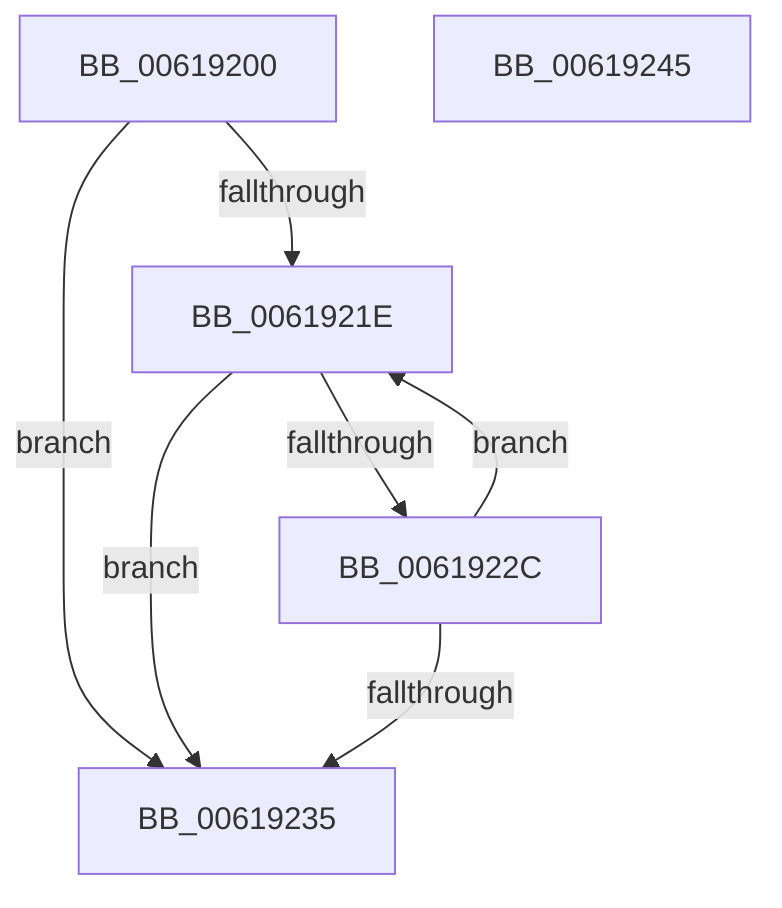

# CarRegisterRuleOverridesAllContexts

- RVA: `0x00619200`–`0x00619246` (길이 `70` bytes)
- VA: `0x0000000140619200`
- 실행 섹션: `.text`
- PDB 이름 있음: `예`; PDB Function 태그: `아니요`
- unwind 정보 RVA: `0x00060BC4`
- 디코드: `24`개 명령, `70/70` bytes 표시
- 미해석 바이트: `0` (있으면 어셈블리에 `.byte`로 보존)

> 이 문서는 커널 이미지의 기계어와 PDB 기호를 분석해 생성했습니다. 4번과 5번은 함수 원형과 자료형을 바이너리 사용 방식에서 추정한 C 해석이며 원본 소스 복구 결과는 아닙니다.

## 1. Dependencies

- 직접 호출 지점: **1**; 고유 호출 대상: **1**
- 직접 호출자로 확인된 함수: **0**
- RIP 상대 이미지 참조: **0**

### Outgoing calls
- `0x00619223` → [CarRegisterRuleOverrideAllContexts](CarRegisterRuleOverrideAllContexts_function_00619130.md) (function, `0x00619130`)

### Direct callers
- 이 함수 시작 RVA로 연결되는 직접 call은 확인되지 않았습니다. 간접 호출은 완전히 역산할 수 없습니다.

### Static image references
- 디코드된 RIP-relative 메모리 참조가 없습니다.

## 2. Other-region calls and transfers

- 다른 실행 섹션으로 향하는 call: **0**
- 별도 외부 분기/꼬리 이동을 확인하지 못했습니다.

## 3. Assembly (complete function range)

```asm
00619200  48 89 5C 24 08                  mov qword ptr [rsp + 8], rbx
00619205  48 89 74 24 10                  mov qword ptr [rsp + 0x10], rsi
0061920A  57                              push rdi
0061920B  48 83 EC 20                     sub rsp, 0x20
0061920F  33 C0                           xor eax, eax
00619211  41 8B D8                        mov ebx, r8d
00619214  48 8B FA                        mov rdi, rdx
00619217  8B F1                           mov esi, ecx
00619219  45 85 C0                        test r8d, r8d
0061921C  74 17                           je 0x140619235
0061921E  48 8B D7                        mov rdx, rdi
00619221  8B CE                           mov ecx, esi
00619223  E8 08 FF FF FF                  call 0x140619130
00619228  85 C0                           test eax, eax
0061922A  78 09                           js 0x140619235
0061922C  48 83 C7 3C                     add rdi, 0x3c
00619230  83 C3 FF                        add ebx, -1
00619233  75 E9                           jne 0x14061921e
00619235  48 8B 5C 24 30                  mov rbx, qword ptr [rsp + 0x30]
0061923A  48 8B 74 24 38                  mov rsi, qword ptr [rsp + 0x38]
0061923F  48 83 C4 20                     add rsp, 0x20
00619243  5F                              pop rdi
00619244  C3                              ret
00619245  CC                              int3
```

## 4. C-style interpretation (structured pseudocode)

```c
__int64 __fastcall CarRegisterRuleOverridesAllContexts(int a1, __int64 a2, int a3)
{
    __int64 result;
    __int64 v_rbx;
    __int64 v_rdi;
    __int64 v_rsp;
    unsigned __int64 v_stack_p10;
    unsigned __int64 v_stack_p8;

    v_stack_p8 = v_rbx;
    v_stack_p10 = v_rsi;
    v_rsp = (v_rsp) - (32);
    result = 0;
    if (a3 == 0) goto loc_00619235;
loc_0061921E:
    result = CarRegisterRuleOverrideAllContexts((unsigned int)((unsigned int)((unsigned int)(a1))), a2, a3, a4);
    if (sign_flag) goto loc_00619235;
    v_rdi = (a2) + (60);
    v_rbx = (unsigned int)(((unsigned int)(a3)) + (-1));
    if (condition_is_not_equal) goto loc_0061921E;
loc_00619235:
    v_rsp = (v_rsp) + (32);
    return result;
}
```

## 5. (Beta) C Style

```c
int64_t CarRegisterRuleOverridesAllContexts(int32_t Arg1, int64_t Arg2, int32_t Arg3)
{
    int64_t result;
    int64_t local_rbx;
    int64_t local_rdi;
    int64_t local_rsp;
    uint64_t v_stack_p10;
    uint64_t v_stack_p8;

    v_stack_p8 = local_rbx;
    v_stack_p10 = local_rsi;
    local_rsp = (local_rsp) - (32);
    result = 0;
    if (Arg3 == 0) goto loc_00619235;
loc_0061921E:
    result = CarRegisterRuleOverrideAllContexts((uint32_t)((uint32_t)((uint32_t)(Arg1))), Arg2, Arg3, a4);
    if (sign_flag) goto loc_00619235;
    local_rdi = (Arg2) + (60);
    local_rbx = (uint32_t)(((uint32_t)(Arg3)) + (-1));
    if (condition_is_not_equal) goto loc_0061921E;
loc_00619235:
    local_rsp = (local_rsp) + (32);
    return result;
}
```

## 6. Execution-region graph

[열기: 2D/3D 그래프와 함수 탐색 컨트롤 패널](../../../control-panel.html?section=text&rva=0x00619200&view=graph)

- 2D 그래프는 위에서 아래로 흐르고, 3D 그래프는 빈 공간을 드래그해 회전합니다. Shift+드래그는 이동, 휠은 확대·축소, 함수 노드 선택은 대상 보고서 이동입니다.

### Static fallback


