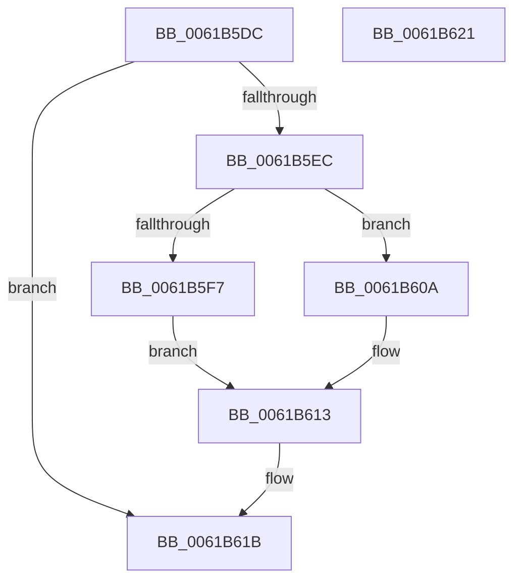

# CarReleaseDbLockFromDpcLevel

- RVA: `0x0061B5DC`–`0x0061B622` (길이 `70` bytes)
- VA: `0x000000014061B5DC`
- 실행 섹션: `.text`
- PDB 이름 있음: `예`; PDB Function 태그: `아니요`
- unwind 정보 RVA: `0x0005CF00`
- 디코드: `21`개 명령, `70/70` bytes 표시
- 미해석 바이트: `0` (있으면 어셈블리에 `.byte`로 보존)

> 이 문서는 커널 이미지의 기계어와 PDB 기호를 분석해 생성했습니다. 4번과 5번은 함수 원형과 자료형을 바이너리 사용 방식에서 추정한 C 해석이며 원본 소스 복구 결과는 아닙니다.

## 1. Dependencies

- 직접 호출 지점: **2**; 고유 호출 대상: **2**
- 직접 호출자로 확인된 함수: **6**
- RIP 상대 이미지 참조: **1**

### Outgoing calls
- `0x0061B603` → [ExReleaseSpinLockExclusiveFromDpcLevel](../24/ExReleaseSpinLockExclusiveFromDpcLevel_function_002497E0.md) (function, `0x002497E0`)
- `0x0061B60E` → [ExReleaseSpinLockSharedFromDpcLevel](../24/ExReleaseSpinLockSharedFromDpcLevel_function_0024A590.md) (function, `0x0024A590`)

### Direct callers
- [CarAddUniqueViolation](CarAddUniqueViolation_function_0061B08C.md) at `0x0061B27E`
- [CarCleanDbLockContext](CarCleanDbLockContext_function_0061B2E4.md) at `0x0061B2F7`
- [CarDeleteDriverRuleViolations](CarDeleteDriverRuleViolations_function_0061B38C.md) at `0x0061B410`
- [CarDeletePluginRuleViolations](CarDeletePluginRuleViolations_function_0061B440.md) at `0x0061B4AE`
- [CarDeleteRuleViolationDB](CarDeleteRuleViolationDB_function_0061B4D0.md) at `0x0061B53F`
- [CarWriteEarlyRuleViolationEvents](CarWriteEarlyRuleViolationEvents_function_0061B628.md) at `0x0061B6E0`

### Static image references
- `0x0061B5EC` → RVA `0x00F03EA8` (`.data`; read)

## 2. Other-region calls and transfers

- 다른 실행 섹션으로 향하는 call: **0**
- 별도 외부 분기/꼬리 이동을 확인하지 못했습니다.

## 3. Assembly (complete function range)

```asm
0061B5DC  40 53                           push rbx
0061B5DE  48 83 EC 20                     sub rsp, 0x20
0061B5E2  8A 41 09                        mov al, byte ptr [rcx + 9]
0061B5E5  48 8B D9                        mov rbx, rcx
0061B5E8  A8 02                           test al, 2
0061B5EA  74 2F                           je 0x14061b61b
0061B5EC  48 8B 0D B5 88 8E 00            mov rcx, qword ptr [rip + 0x8e88b5]
0061B5F3  A8 04                           test al, 4
0061B5F5  74 13                           je 0x14061b60a
0061B5F7  48 83 A1 88 00 00 00 00         and qword ptr [rcx + 0x88], 0
0061B5FF  48 83 E9 80                     sub rcx, -0x80
0061B603  E8 D8 E1 C2 FF                  call 0x1402497e0
0061B608  EB 09                           jmp 0x14061b613
0061B60A  48 83 E9 80                     sub rcx, -0x80
0061B60E  E8 7D EF C2 FF                  call 0x14024a590
0061B613  80 63 09 FD                     and byte ptr [rbx + 9], 0xfd
0061B617  48 83 23 00                     and qword ptr [rbx], 0
0061B61B  48 83 C4 20                     add rsp, 0x20
0061B61F  5B                              pop rbx
0061B620  C3                              ret
0061B621  CC                              int3
```

## 4. C-style interpretation (structured pseudocode)

```c
__int64 __fastcall CarReleaseDbLockFromDpcLevel(__int64 a1)
{
    __int64 result;
    __int64 v_rsp;

    v_rsp = (v_rsp) - (32);
    if ((((unsigned __int8)(*(unsigned __int8 *)(a1 + 9))) & (2)) == 0) goto loc_0061B61B;
    if ((((unsigned __int8)(*(unsigned __int8 *)(a1 + 9))) & (4)) == 0) goto loc_0061B60A;
    a1 = (*(unsigned __int64 *)(v_rip + 9341109)) - (-128);
    result = ExReleaseSpinLockExclusiveFromDpcLevel(a1, a2, a3, a4);
    goto loc_0061B613;
loc_0061B60A:
    a1 = (a1) - (-128);
    result = ExReleaseSpinLockSharedFromDpcLevel(a1, a2, a3, a4);
loc_0061B613:
loc_0061B61B:
    v_rsp = (v_rsp) + (32);
    return result;
}
```

## 5. (Beta) C Style

```c
int64_t CarReleaseDbLockFromDpcLevel(void *Arg1)
{
    uint8_t *arg1 = (uint8_t *)Arg1;

    int64_t result;
    int64_t local_rsp;

    local_rsp = (local_rsp) - (32);
    if ((((uint8_t)(*(uint8_t *)(arg1 + 0x9))) & (2)) == 0) goto loc_0061B61B;
    if ((((uint8_t)(*(uint8_t *)(arg1 + 0x9))) & (4)) == 0) goto loc_0061B60A;
    Arg1 = (*(uint64_t *)(v_rip + 0x8E88B5)) - (-128);
    result = ExReleaseSpinLockExclusiveFromDpcLevel(Arg1, a2, a3, a4);
    goto loc_0061B613;
loc_0061B60A:
    Arg1 = (Arg1) - (-128);
    result = ExReleaseSpinLockSharedFromDpcLevel(Arg1, a2, a3, a4);
loc_0061B613:
loc_0061B61B:
    local_rsp = (local_rsp) + (32);
    return result;
}
```

### 관측된 메모리 오프셋

구조체 형식이 확인되지 않은 접근은 인자 기준의 오프셋으로만 기록했습니다.

| 기준 인자 | 오프셋 표현 | 폭 (bit) | 접근 |
|---|---:|---:|---|
| `Arg1` | `+ 0x0` | `64` | `R/W` |
| `Arg1` | `+ 0x9` | `8` | `R` |
| `Arg1` | `+ 0x9` | `8` | `R/W` |

## 6. Execution-region graph

[열기: 2D/3D 그래프와 함수 탐색 컨트롤 패널](../../../control-panel.html?section=text&rva=0x0061B5DC&view=graph)

- 2D 그래프는 위에서 아래로 흐르고, 3D 그래프는 빈 공간을 드래그해 회전합니다. Shift+드래그는 이동, 휠은 확대·축소, 함수 노드 선택은 대상 보고서 이동입니다.

### Static fallback


