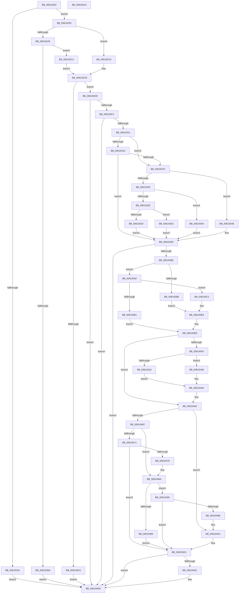

# CarReportDifPluginRuleViolation

- RVA: `0x00619250`–`0x00619516` (길이 `710` bytes)
- VA: `0x0000000140619250`
- 실행 섹션: `.text`
- PDB 이름 있음: `예`; PDB Function 태그: `아니요`
- unwind 정보 RVA: `0x000D2A38`
- 디코드: `195`개 명령, `710/710` bytes 표시
- 미해석 바이트: `0` (있으면 어셈블리에 `.byte`로 보존)

> 이 문서는 커널 이미지의 기계어와 PDB 기호를 분석해 생성했습니다. 4번과 5번은 함수 원형과 자료형을 바이너리 사용 방식에서 추정한 C 해석이며 원본 소스 복구 결과는 아닙니다.

## 1. Dependencies

- 직접 호출 지점: **15**; 고유 호출 대상: **13**
- 직접 호출자로 확인된 함수: **1**
- RIP 상대 이미지 참조: **11**

### Outgoing calls
- `0x006192B0` → [CarFindRuleClassConfigurationEntryByRuleClassId](CarFindRuleClassConfigurationEntryByRuleClassId_function_0061897C.md) (function, `0x0061897C`)
- `0x006192E5` → [CarCreateRuleViolationDetails](CarCreateRuleViolationDetails_function_00618770.md) (function, `0x00618770`)
- `0x00619302` → [CarCopyRuleViolationDetails](CarCopyRuleViolationDetails_function_00618590.md) (function, `0x00618590`)
- `0x0061935F` → [CarQueryReportActionForTriage](CarQueryReportActionForTriage_function_00618E10.md) (function, `0x00618E10`)
- `0x0061937E` → [ExAllocatePool2](../../poolcode/B8/ExAllocatePool2_function_00B820F0.md) (function, `0x00B820F0`)
- `0x006193A3` → [CarInitializeTelemetryData](CarInitializeTelemetryData_function_00618BB0.md) (function, `0x00618BB0`)
- `0x006193B6` → [ExFreePoolWithTag](../../poolcode/B8/ExFreePoolWithTag_function_00B82870.md) (function, `0x00B82870`)
- `0x006193DF` → [CarHandleEtwEvent](CarHandleEtwEvent_function_00617FBC.md) (function, `0x00617FBC`)
- `0x0061945D` → [RtlStringCchCopyW](../26/RtlStringCchCopyW_function_0026E9A4.md) (function, `0x0026E9A4`)
- `0x0061947E` → [CarInitiateBugcheck](CarInitiateBugcheck_function_0061BAB0.md) (function, `0x0061BAB0`)
- `0x00619493` → [VfUtilGetSigningLevel](../../pagevrfy/B9/VfUtilGetSigningLevel_function_00B933B0.md) (function, `0x00B933B0`)
- `0x006194A6` → [CarInitiateBugcheck](CarInitiateBugcheck_function_0061BAB0.md) (function, `0x0061BAB0`)
- `0x006194C1` → [CarWriteLivedump](CarWriteLivedump_function_0061BD24.md) (function, `0x0061BD24`)
- `0x006194E9` → [ExFreePoolWithTag](../../poolcode/B8/ExFreePoolWithTag_function_00B82870.md) (function, `0x00B82870`)
- `0x006194F6` → [CarDeleteRuleViolationDetails](CarDeleteRuleViolationDetails_function_00618810.md) (function, `0x00618810`)

### Direct callers
- [CarReportRuleViolationFromNt](../../pagevrfy/B9/CarReportRuleViolationFromNt_function_00B9D904.md) at `0x00B9DA59`

### Static image references
- `0x00619333` → RVA `0x006CFB40` (` ?? ::FNODOBFM::`string'`; read)
- `0x0061933C` → RVA `0x006CFB70` (` ?? ::FNODOBFM::`string'`; read)
- `0x00619345` → RVA `0x006CFAE0` (` ?? ::FNODOBFM::`string'`; read)
- `0x0061934E` → RVA `0x006CFB10` (` ?? ::FNODOBFM::`string'`; read)
- `0x006193EE` → RVA `0x00E68440` (`.data`; read)
- `0x00619404` → RVA `0x00F02508` (`.data`; write)
- `0x0061940B` → RVA `0x00F0250C` (`.data`; write)
- `0x00619419` → RVA `0x00F02510` (`.data`; write)
- `0x00619424` → RVA `0x00F02518` (`.data`; write)
- `0x0061942F` → RVA `0x00F02520` (`.data`; write)
- `0x00619456` → RVA `0x00F0253C` (`.data`; read)

## 2. Other-region calls and transfers

- 다른 실행 섹션으로 향하는 call: **4**
  - `0x0061937E` → [ExAllocatePool2](../../poolcode/B8/ExAllocatePool2_function_00B820F0.md) (`.text` → `POOLCODE`)
  - `0x006193B6` → [ExFreePoolWithTag](../../poolcode/B8/ExFreePoolWithTag_function_00B82870.md) (`.text` → `POOLCODE`)
  - `0x00619493` → [VfUtilGetSigningLevel](../../pagevrfy/B9/VfUtilGetSigningLevel_function_00B933B0.md) (`.text` → `PAGEVRFY`)
  - `0x006194E9` → [ExFreePoolWithTag](../../poolcode/B8/ExFreePoolWithTag_function_00B82870.md) (`.text` → `POOLCODE`)
- 별도 외부 분기/꼬리 이동을 확인하지 못했습니다.

## 3. Assembly (complete function range)

```asm
00619250  48 8B C4                        mov rax, rsp
00619253  48 89 58 08                     mov qword ptr [rax + 8], rbx
00619257  55                              push rbp
00619258  56                              push rsi
00619259  57                              push rdi
0061925A  41 54                           push r12
0061925C  41 55                           push r13
0061925E  41 56                           push r14
00619260  41 57                           push r15
00619262  48 83 EC 50                     sub rsp, 0x50
00619266  48 83 60 B8 00                  and qword ptr [rax - 0x48], 0
0061926B  49 8B F9                        mov rdi, r9
0061926E  48 83 60 20 00                  and qword ptr [rax + 0x20], 0
00619273  4D 8B E0                        mov r12, r8
00619276  41 81 79 4C 80 84 1E 00         cmp dword ptr [r9 + 0x4c], 0x1e8480
0061927E  44 8B E9                        mov r13d, ecx
00619281  41 8B 41 48                     mov eax, dword ptr [r9 + 0x48]
00619285  89 84 24 A0 00 00 00            mov dword ptr [rsp + 0xa0], eax
0061928C  4D 89 41 30                     mov qword ptr [r9 + 0x30], r8
00619290  7E 0A                           jle 0x14061929c
00619292  BB F2 00 00 C0                  mov ebx, 0xc00000f2
00619297  E9 52 02 00 00                  jmp 0x1406194ee
0061929C  45 8B 79 50                     mov r15d, dword ptr [r9 + 0x50]
006192A0  45 85 FF                        test r15d, r15d
006192A3  75 24                           jne 0x1406192c9
006192A5  8D 71 01                        lea esi, [rcx + 1]
006192A8  C1 E6 10                        shl esi, 0x10
006192AB  0B F2                           or esi, edx
006192AD  41 8B D5                        mov edx, r13d
006192B0  E8 C7 F6 FF FF                  call 0x14061897c
006192B5  48 85 C0                        test rax, rax
006192B8  75 0A                           jne 0x1406192c4
006192BA  BB 25 02 00 C0                  mov ebx, 0xc0000225
006192BF  E9 2A 02 00 00                  jmp 0x1406194ee
006192C4  44 8B 38                        mov r15d, dword ptr [rax]
006192C7  EB 02                           jmp 0x1406192cb
006192C9  8B F2                           mov esi, edx
006192CB  44 0F 20 C0                     mov rax, cr8
006192CF  3C 02                           cmp al, 2
006192D1  76 0A                           jbe 0x1406192dd
006192D3  BB BB 00 00 C0                  mov ebx, 0xc00000bb
006192D8  E9 11 02 00 00                  jmp 0x1406194ee
006192DD  48 8D 8C 24 A8 00 00 00         lea rcx, [rsp + 0xa8]
006192E5  E8 86 F4 FF FF                  call 0x140618770
006192EA  8B D8                           mov ebx, eax
006192EC  85 C0                           test eax, eax
006192EE  0F 88 FA 01 00 00               js 0x1406194ee
006192F4  4C 8B B4 24 A8 00 00 00         mov r14, qword ptr [rsp + 0xa8]
006192FC  48 8B D7                        mov rdx, rdi
006192FF  49 8B CE                        mov rcx, r14
00619302  E8 89 F2 FF FF                  call 0x140618590
00619307  8B D8                           mov ebx, eax
00619309  85 C0                           test eax, eax
0061930B  0F 88 DD 01 00 00               js 0x1406194ee
00619311  4D 85 F6                        test r14, r14
00619314  74 09                           je 0x14061931f
00619316  49 8B 6E 18                     mov rbp, qword ptr [r14 + 0x18]
0061931A  48 85 ED                        test rbp, rbp
0061931D  75 36                           jne 0x140619355
0061931F  41 8B C7                        mov eax, r15d
00619322  2D C4 00 00 00                  sub eax, 0xc4
00619327  74 25                           je 0x14061934e
00619329  83 E8 05                        sub eax, 5
0061932C  74 17                           je 0x140619345
0061932E  83 F8 1D                        cmp eax, 0x1d
00619331  74 09                           je 0x14061933c
00619333  48 8D 2D 06 68 0B 00            lea rbp, [rip + 0xb6806]
0061933A  EB 19                           jmp 0x140619355
0061933C  48 8D 2D 2D 68 0B 00            lea rbp, [rip + 0xb682d]
00619343  EB 10                           jmp 0x140619355
00619345  48 8D 2D 94 67 0B 00            lea rbp, [rip + 0xb6794]
0061934C  EB 07                           jmp 0x140619355
0061934E  48 8D 2D BB 67 0B 00            lea rbp, [rip + 0xb67bb]
00619355  4C 8D 44 24 40                  lea r8, [rsp + 0x40]
0061935A  8B D6                           mov edx, esi
0061935C  41 8B CF                        mov ecx, r15d
0061935F  E8 AC FA FF FF                  call 0x140618e10
00619364  8B D8                           mov ebx, eax
00619366  85 C0                           test eax, eax
00619368  0F 88 80 01 00 00               js 0x1406194ee
0061936E  BA 50 05 00 00                  mov edx, 0x550
00619373  B9 40 00 00 00                  mov ecx, 0x40
00619378  41 B8 43 61 72 4E               mov r8d, 0x4e726143
0061937E  E8 6D 8D 56 00                  call 0x140b820f0
00619383  48 8B F8                        mov rdi, rax
00619386  48 85 C0                        test rax, rax
00619389  75 07                           jne 0x140619392
0061938B  BB 17 00 00 C0                  mov ebx, 0xc0000017
00619390  EB 54                           jmp 0x1406193e6
00619392  4D 8B CE                        mov r9, r14
00619395  48 89 6C 24 20                  mov qword ptr [rsp + 0x20], rbp
0061939A  44 8B C6                        mov r8d, esi
0061939D  41 8B D7                        mov edx, r15d
006193A0  48 8B CF                        mov rcx, rdi
006193A3  E8 08 F8 FF FF                  call 0x140618bb0
006193A8  8B D8                           mov ebx, eax
006193AA  48 8B CF                        mov rcx, rdi
006193AD  85 C0                           test eax, eax
006193AF  79 10                           jns 0x1406193c1
006193B1  BA 43 61 72 4E                  mov edx, 0x4e726143
006193B6  E8 B5 94 56 00                  call 0x140b82870
006193BB  33 ED                           xor ebp, ebp
006193BD  8B FD                           mov edi, ebp
006193BF  EB 27                           jmp 0x1406193e8
006193C1  45 0F 20 C1                     mov r9, cr8
006193C5  8B 84 24 A0 00 00 00            mov eax, dword ptr [rsp + 0xa0]
006193CC  4C 8B C5                        mov r8, rbp
006193CF  89 44 24 30                     mov dword ptr [rsp + 0x30], eax
006193D3  8B D6                           mov edx, esi
006193D5  4C 89 64 24 28                  mov qword ptr [rsp + 0x28], r12
006193DA  44 89 6C 24 20                  mov dword ptr [rsp + 0x20], r13d
006193DF  E8 D8 EB FF FF                  call 0x140617fbc
006193E4  8B D8                           mov ebx, eax
006193E6  33 ED                           xor ebp, ebp
006193E8  33 C0                           xor eax, eax
006193EA  44 8D 68 01                     lea r13d, [rax + 1]
006193EE  F0 44 0F B1 2D 49 F0 84 00      lock cmpxchg dword ptr [rip + 0x84f049], r13d
006193F7  4C 8B B4 24 A8 00 00 00         mov r14, qword ptr [rsp + 0xa8]
006193FF  41 3B C5                        cmp eax, r13d
00619402  74 5E                           je 0x140619462
00619404  44 89 3D FD 90 8E 00            mov dword ptr [rip + 0x8e90fd], r15d
0061940B  89 35 FB 90 8E 00               mov dword ptr [rip + 0x8e90fb], esi
00619411  4D 85 F6                        test r14, r14
00619414  74 22                           je 0x140619438
00619416  49 8B 06                        mov rax, qword ptr [r14]
00619419  48 89 05 F0 90 8E 00            mov qword ptr [rip + 0x8e90f0], rax
00619420  49 8B 46 08                     mov rax, qword ptr [r14 + 8]
00619424  48 89 05 ED 90 8E 00            mov qword ptr [rip + 0x8e90ed], rax
0061942B  49 8B 46 10                     mov rax, qword ptr [r14 + 0x10]
0061942F  48 89 05 EA 90 8E 00            mov qword ptr [rip + 0x8e90ea], rax
00619436  EB 15                           jmp 0x14061944d
00619438  48 89 2D D1 90 8E 00            mov qword ptr [rip + 0x8e90d1], rbp
0061943F  48 89 2D D2 90 8E 00            mov qword ptr [rip + 0x8e90d2], rbp
00619446  48 89 2D D3 90 8E 00            mov qword ptr [rip + 0x8e90d3], rbp
0061944D  4C 8D 47 04                     lea r8, [rdi + 4]
00619451  BA 20 00 00 00                  mov edx, 0x20
00619456  48 8D 0D DF 90 8E 00            lea rcx, [rip + 0x8e90df]
0061945D  E8 42 55 C5 FF                  call 0x14026e9a4
00619462  48 8B 44 24 40                  mov rax, qword ptr [rsp + 0x40]
00619467  83 E8 02                        sub eax, 2
0061946A  74 40                           je 0x1406194ac
0061946C  41 2B C5                        sub eax, r13d
0061946F  74 13                           je 0x140619484
00619471  41 3B C5                        cmp eax, r13d
00619474  75 5B                           jne 0x1406194d1
00619476  4D 8B C6                        mov r8, r14
00619479  8B D6                           mov edx, esi
0061947B  41 8B CF                        mov ecx, r15d
0061947E  E8 2D 26 00 00                  call 0x14061bab0
00619483  CC                              int3
00619484  4D 85 E4                        test r12, r12
00619487  75 07                           jne 0x140619490
00619489  BB 0D 00 00 C0                  mov ebx, 0xc000000d
0061948E  EB 41                           jmp 0x1406194d1
00619490  49 8B CC                        mov rcx, r12
00619493  E8 18 9F 57 00                  call 0x140b933b0
00619498  2C 08                           sub al, 8
0061949A  A8 FB                           test al, 0xfb
0061949C  74 33                           je 0x1406194d1
0061949E  4D 8B C6                        mov r8, r14
006194A1  8B D6                           mov edx, esi
006194A3  41 8B CF                        mov ecx, r15d
006194A6  E8 05 26 00 00                  call 0x14061bab0
006194AB  CC                              int3
006194AC  49 8B 46 10                     mov rax, qword ptr [r14 + 0x10]
006194B0  8B D6                           mov edx, esi
006194B2  4D 8B 4E 08                     mov r9, qword ptr [r14 + 8]
006194B6  48 8B CF                        mov rcx, rdi
006194B9  4D 8B 06                        mov r8, qword ptr [r14]
006194BC  48 89 44 24 20                  mov qword ptr [rsp + 0x20], rax
006194C1  E8 5E 28 00 00                  call 0x14061bd24
006194C6  3D 10 0C 00 C0                  cmp eax, 0xc0000c10
006194CB  8B D8                           mov ebx, eax
006194CD  48 0F 45 FD                     cmovne rdi, rbp
006194D1  41 8B C5                        mov eax, r13d
006194D4  F0 0F B1 2D 64 EF 84 00         lock cmpxchg dword ptr [rip + 0x84ef64], ebp
006194DC  48 85 FF                        test rdi, rdi
006194DF  74 0D                           je 0x1406194ee
006194E1  BA 43 61 72 4E                  mov edx, 0x4e726143
006194E6  48 8B CF                        mov rcx, rdi
006194E9  E8 82 93 56 00                  call 0x140b82870
006194EE  48 8D 8C 24 A8 00 00 00         lea rcx, [rsp + 0xa8]
006194F6  E8 15 F3 FF FF                  call 0x140618810
006194FB  8B C3                           mov eax, ebx
006194FD  48 8B 9C 24 90 00 00 00         mov rbx, qword ptr [rsp + 0x90]
00619505  48 83 C4 50                     add rsp, 0x50
00619509  41 5F                           pop r15
0061950B  41 5E                           pop r14
0061950D  41 5D                           pop r13
0061950F  41 5C                           pop r12
00619511  5F                              pop rdi
00619512  5E                              pop rsi
00619513  5D                              pop rbp
00619514  C3                              ret
00619515  CC                              int3
```

## 4. C-style interpretation (structured pseudocode)

```c
__int64 __fastcall CarReportDifPluginRuleViolation(__int64 a1, int a2, __int64 a3, __int64 a4)
{
    __int64 result;
    __int64 v_rbp;
    __int64 v_rdi;
    __int64 v_rsi;
    __int64 v_rsp;
    unsigned __int64 v_stack_m48;
    unsigned int v_stack_m58;
    unsigned __int64 v_stack_m60;
    unsigned __int64 v_stack_m68;
    unsigned int v_stack_p18;
    unsigned __int64 v_stack_p20;
    unsigned __int64 v_stack_p8;

    *(unsigned __int64 *)(v_rsp + 8) = v_rbx;
    v_rsp = (v_rsp) - (80);
    v_stack_p18 = (unsigned int)((unsigned int)(*(unsigned int *)(a4 + 72)));
    *(unsigned __int64 *)(a4 + 48) = a3;
    if ((*(unsigned int *)(a4 + 76)) <= 0x1E8480ULL) goto loc_0061929C;
    goto loc_006194EE;
loc_0061929C:
    if ((unsigned int)((unsigned int)(*(unsigned int *)(a4 + 80))) != 0) goto loc_006192C9;
    v_rsi = (unsigned int)((a1 + 1) << (16));
    v_rsi = (unsigned int)((v_rsi) | (a2));
    result = CarFindRuleClassConfigurationEntryByRuleClassId(a1, (unsigned int)((unsigned int)((unsigned int)((unsigned int)(a1)))), a3, a4);
    if (result != 0) goto loc_006192C4;
    goto loc_006194EE;
loc_006192C4:
    goto loc_006192CB;
loc_006192C9:
loc_006192CB:
    if (((unsigned __int8)(v_cr8)) <= 2) goto loc_006192DD;
    goto loc_006194EE;
loc_006192DD:
    result = CarCreateRuleViolationDetails(v_stack_p20, (unsigned int)((unsigned int)((unsigned int)((unsigned int)(a1)))), a3, a4);
    if (sign_flag) goto loc_006194EE;
    result = CarCopyRuleViolationDetails(v_stack_p20, a4, a3, a4);
    if (sign_flag) goto loc_006194EE;
    if (v_stack_p20 == 0) goto loc_0061931F;
    if (*(unsigned __int64 *)(v_stack_p20 + 24) != 0) goto loc_00619355;
loc_0061931F:
    result = (unsigned int)(((unsigned int)((unsigned int)((unsigned int)(*(unsigned int *)(result))))) - (196));
    if (condition_is_equal) goto loc_0061934E;
    result = (unsigned int)((result) - (5));
    if (condition_is_equal) goto loc_00619345;
    if (((unsigned int)(result)) == 29) goto loc_0061933C;
    goto loc_00619355;
loc_0061933C:
    goto loc_00619355;
loc_00619345:
    goto loc_00619355;
loc_0061934E:
loc_00619355:
    result = CarQueryReportActionForTriage((unsigned int)((unsigned int)((unsigned int)(*(unsigned int *)(result)))), (unsigned int)((unsigned int)((unsigned int)((unsigned int)((unsigned int)((unsigned int)((unsigned int)((unsigned int)(a1)))))))), v_stack_m48, a4);
    if (sign_flag) goto loc_006194EE;
    result = ExAllocatePool2(64, (unsigned int)(0x550ULL), (unsigned int)(0x4E726143ULL), a4);
    if (result != 0) goto loc_00619392;
    goto loc_006193E6;
loc_00619392:
    v_stack_m68 = v_rip + 747451;
    result = CarInitializeTelemetryData(result, (unsigned int)((unsigned int)((unsigned int)(*(unsigned int *)(result)))), (unsigned int)((unsigned int)((unsigned int)((unsigned int)((unsigned int)((unsigned int)((unsigned int)((unsigned int)(a1)))))))), v_stack_p20);
    if (!sign_flag) goto loc_006193C1;
    result = ExFreePoolWithTag(result, (unsigned int)(0x4E726143ULL), (unsigned int)((unsigned int)((unsigned int)((unsigned int)((unsigned int)((unsigned int)((unsigned int)((unsigned int)(a1)))))))), v_stack_p20);
    v_rbp = 0;
    goto loc_006193E8;
loc_006193C1:
    v_stack_m58 = (unsigned int)((unsigned int)(v_stack_p18));
    v_stack_m60 = a3;
    v_stack_m68 = (unsigned int)((unsigned int)((unsigned int)(a1)));
    result = CarHandleEtwEvent(result, (unsigned int)((unsigned int)((unsigned int)((unsigned int)((unsigned int)((unsigned int)((unsigned int)((unsigned int)(a1)))))))), 0, v_cr8);
loc_006193E6:
    v_rbp = 0;
loc_006193E8:
    result = 0;
    if (0 == ((unsigned int)(result + 1))) goto loc_00619462;
    *(unsigned int *)(v_rip + 9343229) = (unsigned int)((unsigned int)(*(unsigned int *)(result)));
    *(unsigned int *)(v_rip + 9343227) = (unsigned int)((unsigned int)((unsigned int)((unsigned int)((unsigned int)((unsigned int)((unsigned int)(a1)))))));
    if (v_stack_p20 == 0) goto loc_00619438;
    *(unsigned __int64 *)(v_rip + 9343216) = *(unsigned __int64 *)(v_stack_p20);
    *(unsigned __int64 *)(v_rip + 9343213) = *(unsigned __int64 *)(v_stack_p20 + 8);
    *(unsigned __int64 *)(v_rip + 9343210) = *(unsigned __int64 *)(v_stack_p20 + 16);
    goto loc_0061944D;
loc_00619438:
    *(unsigned __int64 *)(v_rip + 9343185) = 0;
    *(unsigned __int64 *)(v_rip + 9343186) = 0;
    *(unsigned __int64 *)(v_rip + 9343187) = 0;
loc_0061944D:
    result = RtlStringCchCopyW(v_rip + 9343199, 32, 0 + 4, v_cr8);
loc_00619462:
    result = (unsigned int)((v_stack_m48) - (2));
    if (condition_is_equal) goto loc_006194AC;
    result = (unsigned int)((result) - ((unsigned int)(result + 1)));
    if (condition_is_equal) goto loc_00619484;
    if (((unsigned int)(result)) != ((unsigned int)(result + 1))) goto loc_006194D1;
    result = CarInitiateBugcheck((unsigned int)((unsigned int)((unsigned int)(*(unsigned int *)(result)))), (unsigned int)((unsigned int)((unsigned int)((unsigned int)((unsigned int)((unsigned int)((unsigned int)((unsigned int)(a1)))))))), v_stack_p20, v_cr8);
loc_00619484:
    if (a3 != 0) goto loc_00619490;
    goto loc_006194D1;
loc_00619490:
    result = VfUtilGetSigningLevel(a3, (unsigned int)((unsigned int)((unsigned int)((unsigned int)((unsigned int)((unsigned int)((unsigned int)((unsigned int)(a1)))))))), v_stack_p20, v_cr8);
    result = (unsigned __int8)((result) - (8));
    if ((((unsigned __int8)(result)) & (251)) == 0) goto loc_006194D1;
    result = CarInitiateBugcheck((unsigned int)((unsigned int)((unsigned int)(*(unsigned int *)(result)))), (unsigned int)((unsigned int)((unsigned int)((unsigned int)((unsigned int)((unsigned int)((unsigned int)((unsigned int)(a1)))))))), v_stack_p20, v_cr8);
loc_006194AC:
    v_stack_m68 = *(unsigned __int64 *)(v_stack_p20 + 16);
    result = CarWriteLivedump(0, (unsigned int)((unsigned int)((unsigned int)((unsigned int)((unsigned int)((unsigned int)((unsigned int)((unsigned int)(a1)))))))), *(unsigned __int64 *)(v_stack_p20), *(unsigned __int64 *)(v_stack_p20 + 8));
    v_rdi = 0;
    if (((unsigned int)(result)) != 0xC0000C10ULL) { v_rdi = 0; }
loc_006194D1:
    result = (unsigned int)((unsigned int)(result + 1));
    if (v_rdi != 0) {
        a2 = 0x4E726143ULL;
        a1 = v_rdi;
        result = ExFreePoolWithTag(a1, a2, *(unsigned __int64 *)(v_stack_p20), *(unsigned __int64 *)(v_stack_p20 + 8));
    }
    result = CarDeleteRuleViolationDetails(v_stack_p20, a2, *(unsigned __int64 *)(v_stack_p20), *(unsigned __int64 *)(v_stack_p20 + 8));
    v_rsp = (v_rsp) + (80);
    return (unsigned int)((unsigned int)((unsigned int)((unsigned int)(result))));
}
```

## 5. (Beta) C Style

```c
int64_t CarReportDifPluginRuleViolation(void *Arg1, int32_t Arg2, int64_t Arg3, void *Arg4)
{
    uint8_t *arg1 = (uint8_t *)Arg1;
    uint8_t *arg4 = (uint8_t *)Arg4;

    int64_t result;
    int64_t local_rbp;
    int64_t local_rdi;
    int64_t local_rsi;
    int64_t local_rsp;
    uint64_t v_stack_m48;
    uint32_t v_stack_m58;
    uint64_t v_stack_m60;
    uint64_t v_stack_m68;
    uint32_t v_stack_p18;
    uint64_t v_stack_p20;
    uint64_t v_stack_p8;

    *(uint64_t *)(local_rsp + 0x8) = local_rbx;
    local_rsp = (local_rsp) - (80);
    v_stack_p18 = (uint32_t)((uint32_t)(*(uint32_t *)(arg4 + 0x48)));
    *(uint64_t *)(arg4 + 0x30) = Arg3;
    if ((*(uint32_t *)(arg4 + 0x4C)) <= 0x1E8480ULL) goto loc_0061929C;
    goto loc_006194EE;
loc_0061929C:
    if ((uint32_t)((uint32_t)(*(uint32_t *)(arg4 + 0x50))) != 0) goto loc_006192C9;
    local_rsi = (uint32_t)((Arg1 + 1) << (16));
    local_rsi = (uint32_t)((local_rsi) | (Arg2));
    result = CarFindRuleClassConfigurationEntryByRuleClassId(Arg1, (uint32_t)((uint32_t)((uint32_t)((uint32_t)(Arg1)))), Arg3, Arg4);
    if (result != 0) goto loc_006192C4;
    goto loc_006194EE;
loc_006192C4:
    goto loc_006192CB;
loc_006192C9:
loc_006192CB:
    if (((uint8_t)(v_cr8)) <= 2) goto loc_006192DD;
    goto loc_006194EE;
loc_006192DD:
    result = CarCreateRuleViolationDetails(v_stack_p20, (uint32_t)((uint32_t)((uint32_t)((uint32_t)(Arg1)))), Arg3, Arg4);
    if (sign_flag) goto loc_006194EE;
    result = CarCopyRuleViolationDetails(v_stack_p20, Arg4, Arg3, Arg4);
    if (sign_flag) goto loc_006194EE;
    if (v_stack_p20 == 0) goto loc_0061931F;
    if (*(uint64_t *)(v_stack_p20 + 0x18) != 0) goto loc_00619355;
loc_0061931F:
    result = (uint32_t)(((uint32_t)((uint32_t)((uint32_t)(*(uint32_t *)(result))))) - (196));
    if (condition_is_equal) goto loc_0061934E;
    result = (uint32_t)((result) - (5));
    if (condition_is_equal) goto loc_00619345;
    if (((uint32_t)(result)) == 29) goto loc_0061933C;
    goto loc_00619355;
loc_0061933C:
    goto loc_00619355;
loc_00619345:
    goto loc_00619355;
loc_0061934E:
loc_00619355:
    result = CarQueryReportActionForTriage((uint32_t)((uint32_t)((uint32_t)(*(uint32_t *)(result)))), (uint32_t)((uint32_t)((uint32_t)((uint32_t)((uint32_t)((uint32_t)((uint32_t)((uint32_t)(Arg1)))))))), v_stack_m48, Arg4);
    if (sign_flag) goto loc_006194EE;
    result = ExAllocatePool2(64, (uint32_t)(0x550ULL), (uint32_t)(0x4E726143ULL), Arg4);
    if (result != 0) goto loc_00619392;
    goto loc_006193E6;
loc_00619392:
    v_stack_m68 = v_rip + 747451;
    result = CarInitializeTelemetryData(result, (uint32_t)((uint32_t)((uint32_t)(*(uint32_t *)(result)))), (uint32_t)((uint32_t)((uint32_t)((uint32_t)((uint32_t)((uint32_t)((uint32_t)((uint32_t)(Arg1)))))))), v_stack_p20);
    if (!sign_flag) goto loc_006193C1;
    result = ExFreePoolWithTag(result, (uint32_t)(0x4E726143ULL), (uint32_t)((uint32_t)((uint32_t)((uint32_t)((uint32_t)((uint32_t)((uint32_t)((uint32_t)(Arg1)))))))), v_stack_p20);
    local_rbp = 0;
    goto loc_006193E8;
loc_006193C1:
    v_stack_m58 = (uint32_t)((uint32_t)(v_stack_p18));
    v_stack_m60 = Arg3;
    v_stack_m68 = (uint32_t)((uint32_t)((uint32_t)(Arg1)));
    result = CarHandleEtwEvent(result, (uint32_t)((uint32_t)((uint32_t)((uint32_t)((uint32_t)((uint32_t)((uint32_t)((uint32_t)(Arg1)))))))), 0, v_cr8);
loc_006193E6:
    local_rbp = 0;
loc_006193E8:
    result = 0;
    if (0 == ((uint32_t)(result + 1))) goto loc_00619462;
    *(uint32_t *)(v_rip + 0x8E90FD) = (uint32_t)((uint32_t)(*(uint32_t *)(result)));
    *(uint32_t *)(v_rip + 0x8E90FB) = (uint32_t)((uint32_t)((uint32_t)((uint32_t)((uint32_t)((uint32_t)((uint32_t)(Arg1)))))));
    if (v_stack_p20 == 0) goto loc_00619438;
    *(uint64_t *)(v_rip + 0x8E90F0) = *(uint64_t *)(v_stack_p20);
    *(uint64_t *)(v_rip + 0x8E90ED) = *(uint64_t *)(v_stack_p20 + 0x8);
    *(uint64_t *)(v_rip + 0x8E90EA) = *(uint64_t *)(v_stack_p20 + 0x10);
    goto loc_0061944D;
loc_00619438:
    *(uint64_t *)(v_rip + 0x8E90D1) = 0;
    *(uint64_t *)(v_rip + 0x8E90D2) = 0;
    *(uint64_t *)(v_rip + 0x8E90D3) = 0;
loc_0061944D:
    result = RtlStringCchCopyW(v_rip + 9343199, 32, 0 + 4, v_cr8);
loc_00619462:
    result = (uint32_t)((v_stack_m48) - (2));
    if (condition_is_equal) goto loc_006194AC;
    result = (uint32_t)((result) - ((uint32_t)(result + 1)));
    if (condition_is_equal) goto loc_00619484;
    if (((uint32_t)(result)) != ((uint32_t)(result + 1))) goto loc_006194D1;
    result = CarInitiateBugcheck((uint32_t)((uint32_t)((uint32_t)(*(uint32_t *)(result)))), (uint32_t)((uint32_t)((uint32_t)((uint32_t)((uint32_t)((uint32_t)((uint32_t)((uint32_t)(Arg1)))))))), v_stack_p20, v_cr8);
loc_00619484:
    if (Arg3 != 0) goto loc_00619490;
    goto loc_006194D1;
loc_00619490:
    result = VfUtilGetSigningLevel(Arg3, (uint32_t)((uint32_t)((uint32_t)((uint32_t)((uint32_t)((uint32_t)((uint32_t)((uint32_t)(Arg1)))))))), v_stack_p20, v_cr8);
    result = (uint8_t)((result) - (8));
    if ((((uint8_t)(result)) & (251)) == 0) goto loc_006194D1;
    result = CarInitiateBugcheck((uint32_t)((uint32_t)((uint32_t)(*(uint32_t *)(result)))), (uint32_t)((uint32_t)((uint32_t)((uint32_t)((uint32_t)((uint32_t)((uint32_t)((uint32_t)(Arg1)))))))), v_stack_p20, v_cr8);
loc_006194AC:
    v_stack_m68 = *(uint64_t *)(v_stack_p20 + 0x10);
    result = CarWriteLivedump(0, (uint32_t)((uint32_t)((uint32_t)((uint32_t)((uint32_t)((uint32_t)((uint32_t)((uint32_t)(Arg1)))))))), *(uint64_t *)(v_stack_p20), *(uint64_t *)(v_stack_p20 + 0x8));
    local_rdi = 0;
    if (((uint32_t)(result)) != 0xC0000C10ULL) { local_rdi = 0; }
loc_006194D1:
    result = (uint32_t)((uint32_t)(result + 1));
    if (local_rdi != 0) {
        Arg2 = 0x4E726143ULL;
        Arg1 = local_rdi;
        result = ExFreePoolWithTag(Arg1, Arg2, *(uint64_t *)(v_stack_p20), *(uint64_t *)(v_stack_p20 + 0x8));
    }
    result = CarDeleteRuleViolationDetails(v_stack_p20, Arg2, *(uint64_t *)(v_stack_p20), *(uint64_t *)(v_stack_p20 + 0x8));
    local_rsp = (local_rsp) + (80);
    return (uint32_t)((uint32_t)((uint32_t)((uint32_t)(result))));
}
```

### 관측된 메모리 오프셋

구조체 형식이 확인되지 않은 접근은 인자 기준의 오프셋으로만 기록했습니다.

| 기준 인자 | 오프셋 표현 | 폭 (bit) | 접근 |
|---|---:|---:|---|
| `Arg1` | `+ 0x1` | `32` | `R` |
| `Arg4` | `+ 0x30` | `64` | `W` |
| `Arg4` | `+ 0x48` | `32` | `R` |
| `Arg4` | `+ 0x4C` | `32` | `R` |
| `Arg4` | `+ 0x50` | `32` | `R` |

## 6. Execution-region graph

[열기: 2D/3D 그래프와 함수 탐색 컨트롤 패널](../../../control-panel.html?section=text&rva=0x00619250&view=graph)

- 2D 그래프는 위에서 아래로 흐르고, 3D 그래프는 빈 공간을 드래그해 회전합니다. Shift+드래그는 이동, 휠은 확대·축소, 함수 노드 선택은 대상 보고서 이동입니다.

### Static fallback


