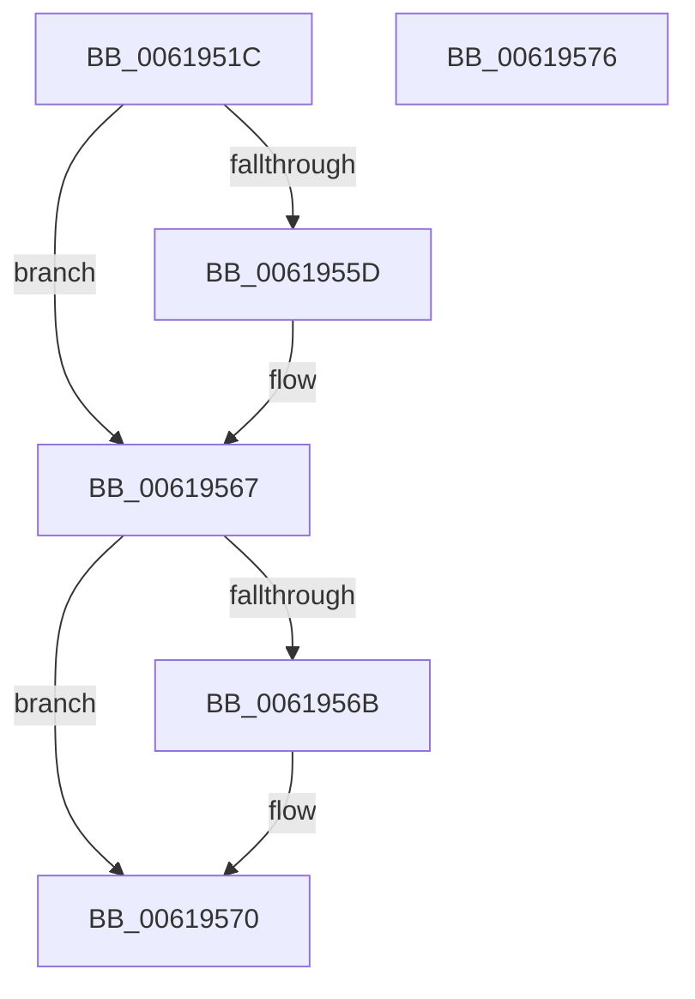

# CarReportUnusualShutdown

- RVA: `0x0061951C`–`0x00619577` (길이 `91` bytes)
- VA: `0x000000014061951C`
- 실행 섹션: `.text`
- PDB 이름 있음: `예`; PDB Function 태그: `아니요`
- unwind 정보 RVA: `0x0006E5B4`
- 디코드: `26`개 명령, `91/91` bytes 표시
- 미해석 바이트: `0` (있으면 어셈블리에 `.byte`로 보존)

> 이 문서는 커널 이미지의 기계어와 PDB 기호를 분석해 생성했습니다. 4번과 5번은 함수 원형과 자료형을 바이너리 사용 방식에서 추정한 C 해석이며 원본 소스 복구 결과는 아닙니다.

## 1. Dependencies

- 직접 호출 지점: **6**; 고유 호출 대상: **6**
- 직접 호출자로 확인된 함수: **1**
- RIP 상대 이미지 참조: **0**

### Outgoing calls
- `0x00619524` → [CarInit](CarInit_function_006189FC.md) (function, `0x006189FC`)
- `0x00619529` → [CarInitLogging](CarInitLogging_function_006180B0.md) (function, `0x006180B0`)
- `0x00619539` → [memset](../6C/memset_function_006C6C40.md) (function, `0x006C6C40`)
- `0x00619554` → [VfUtilCrashEvent](VfUtilCrashEvent_function_0061220C.md) (function, `0x0061220C`)
- `0x00619562` → [CarEtwCrashEvent](CarEtwCrashEvent_function_00617800.md) (function, `0x00617800`)
- `0x0061956B` → [CarCleanup](CarCleanup_function_0061850C.md) (function, `0x0061850C`)

### Direct callers
- [Phase1InitializationIoReady](../../init/C7/Phase1InitializationIoReady_function_00C70458.md) at `0x00C707A0`

### Static image references
- 디코드된 RIP-relative 메모리 참조가 없습니다.

## 2. Other-region calls and transfers

- 다른 실행 섹션으로 향하는 call: **0**
- 별도 외부 분기/꼬리 이동을 확인하지 못했습니다.

## 3. Assembly (complete function range)

```asm
0061951C  40 53                           push rbx
0061951E  48 83 EC 60                     sub rsp, 0x60
00619522  8A D9                           mov bl, cl
00619524  E8 D3 F4 FF FF                  call 0x1406189fc
00619529  E8 82 EB FF FF                  call 0x1406180b0
0061952E  33 D2                           xor edx, edx
00619530  48 8D 4C 24 20                  lea rcx, [rsp + 0x20]
00619535  44 8D 42 40                     lea r8d, [rdx + 0x40]
00619539  E8 02 D7 0A 00                  call 0x1406c6c40
0061953E  33 C0                           xor eax, eax
00619540  48 8D 4C 24 20                  lea rcx, [rsp + 0x20]
00619545  48 89 44 24 78                  mov qword ptr [rsp + 0x78], rax
0061954A  48 8D 44 24 78                  lea rax, [rsp + 0x78]
0061954F  48 89 44 24 48                  mov qword ptr [rsp + 0x48], rax
00619554  E8 B3 8C FF FF                  call 0x14061220c
00619559  84 C0                           test al, al
0061955B  74 0A                           je 0x140619567
0061955D  48 8D 4C 24 20                  lea rcx, [rsp + 0x20]
00619562  E8 99 E2 FF FF                  call 0x140617800
00619567  84 DB                           test bl, bl
00619569  74 05                           je 0x140619570
0061956B  E8 9C EF FF FF                  call 0x14061850c
00619570  48 83 C4 60                     add rsp, 0x60
00619574  5B                              pop rbx
00619575  C3                              ret
00619576  CC                              int3
```

## 4. C-style interpretation (structured pseudocode)

```c
__int64 __fastcall CarReportUnusualShutdown(unsigned __int8 a1, int a2)
{
    __int64 result;
    __int64 v_rsp;
    unsigned __int64 v_stack_m20;
    unsigned __int64 v_stack_m48;
    unsigned __int64 v_stack_p10;

    v_rsp = (v_rsp) - (96);
    result = CarInit(a1, a2, a3, a4);
    result = CarInitLogging(a1, a2, a3, a4);
    a2 = 0;
    result = memset(v_stack_m48, a2, a2 + 64, a4);
    result = 0;
    v_stack_p10 = 0;
    v_stack_m20 = v_stack_p10;
    result = VfUtilCrashEvent(v_stack_m48, a2, a2 + 64, a4);
    if ((unsigned __int8)(result) != 0) {
        a1 = v_stack_m48;
        result = CarEtwCrashEvent(a1, a2, a2 + 64, a4);
    }
    if (a1 != 0) {
        result = CarCleanup(a1, a2, a2 + 64, a4);
    }
    v_rsp = (v_rsp) + (96);
    return result;
}
```

## 5. (Beta) C Style

```c
int64_t CarReportUnusualShutdown(uint8_t Arg1, int32_t Arg2)
{
    int64_t result;
    int64_t local_rsp;
    uint64_t v_stack_m20;
    uint64_t v_stack_m48;
    uint64_t v_stack_p10;

    local_rsp = (local_rsp) - (96);
    result = CarInit(Arg1, Arg2, a3, a4);
    result = CarInitLogging(Arg1, Arg2, a3, a4);
    Arg2 = 0;
    result = memset(v_stack_m48, Arg2, Arg2 + 64, a4);
    result = 0;
    v_stack_p10 = 0;
    v_stack_m20 = v_stack_p10;
    result = VfUtilCrashEvent(v_stack_m48, Arg2, Arg2 + 64, a4);
    if ((uint8_t)(result) != 0) {
        Arg1 = v_stack_m48;
        result = CarEtwCrashEvent(Arg1, Arg2, Arg2 + 64, a4);
    }
    if (Arg1 != 0) {
        result = CarCleanup(Arg1, Arg2, Arg2 + 64, a4);
    }
    local_rsp = (local_rsp) + (96);
    return result;
}
```

## 6. Execution-region graph

[열기: 2D/3D 그래프와 함수 탐색 컨트롤 패널](../../../control-panel.html?section=text&rva=0x0061951C&view=graph)

- 2D 그래프는 위에서 아래로 흐르고, 3D 그래프는 빈 공간을 드래그해 회전합니다. Shift+드래그는 이동, 휠은 확대·축소, 함수 노드 선택은 대상 보고서 이동입니다.

### Static fallback


