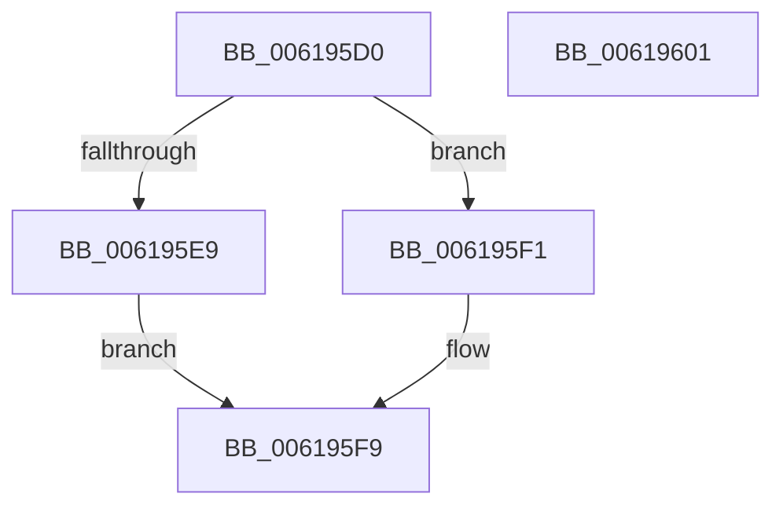

# CarSetCustomRuleIdRange

- RVA: `0x006195D0`–`0x00619602` (길이 `50` bytes)
- VA: `0x00000001406195D0`
- 실행 섹션: `.text`
- PDB 이름 있음: `예`; PDB Function 태그: `아니요`
- unwind 정보 RVA: `0x0005C788`
- 디코드: `16`개 명령, `50/50` bytes 표시
- 미해석 바이트: `0` (있으면 어셈블리에 `.byte`로 보존)

> 이 문서는 커널 이미지의 기계어와 PDB 기호를 분석해 생성했습니다. 4번과 5번은 함수 원형과 자료형을 바이너리 사용 방식에서 추정한 C 해석이며 원본 소스 복구 결과는 아닙니다.

## 1. Dependencies

- 직접 호출 지점: **1**; 고유 호출 대상: **1**
- 직접 호출자로 확인된 함수: **1**
- RIP 상대 이미지 참조: **0**

### Outgoing calls
- `0x006195DF` → [CarFindRuleClassConfigurationEntryByRuleClassId](CarFindRuleClassConfigurationEntryByRuleClassId_function_0061897C.md) (function, `0x0061897C`)

### Direct callers
- [DifRegisterKernelPlugins](DifRegisterKernelPlugins_function_0061AA40.md) at `0x0061AB6E`

### Static image references
- 디코드된 RIP-relative 메모리 참조가 없습니다.

## 2. Other-region calls and transfers

- 다른 실행 섹션으로 향하는 call: **0**
- 별도 외부 분기/꼬리 이동을 확인하지 못했습니다.

## 3. Assembly (complete function range)

```asm
006195D0  48 83 EC 28                     sub rsp, 0x28
006195D4  44 8B DA                        mov r11d, edx
006195D7  45 8B D0                        mov r10d, r8d
006195DA  8B D1                           mov edx, ecx
006195DC  45 33 C9                        xor r9d, r9d
006195DF  E8 98 F3 FF FF                  call 0x14061897c
006195E4  48 85 C0                        test rax, rax
006195E7  75 08                           jne 0x1406195f1
006195E9  41 B9 34 00 00 C0               mov r9d, 0xc0000034
006195EF  EB 08                           jmp 0x1406195f9
006195F1  44 89 58 40                     mov dword ptr [rax + 0x40], r11d
006195F5  44 89 50 44                     mov dword ptr [rax + 0x44], r10d
006195F9  41 8B C1                        mov eax, r9d
006195FC  48 83 C4 28                     add rsp, 0x28
00619600  C3                              ret
00619601  CC                              int3
```

## 4. C-style interpretation (structured pseudocode)

```c
__int64 __fastcall CarSetCustomRuleIdRange(int a1, int a2, int a3, int a4)
{
    __int64 result;
    __int64 v_rsp;

    v_rsp = (v_rsp) - (40);
    a4 = 0;
    result = CarFindRuleClassConfigurationEntryByRuleClassId(a1, (unsigned int)(a1), a3, a4);
    if (result != 0) goto loc_006195F1;
    goto loc_006195F9;
loc_006195F1:
    *(unsigned int *)(result + 64) = (unsigned int)((unsigned int)(a2));
    *(unsigned int *)(result + 68) = (unsigned int)((unsigned int)(a3));
loc_006195F9:
    v_rsp = (v_rsp) + (40);
    return (unsigned int)((unsigned int)((unsigned int)(0xC0000034ULL)));
}
```

## 5. (Beta) C Style

```c
int64_t CarSetCustomRuleIdRange(int32_t Arg1, int32_t Arg2, int32_t Arg3, int32_t Arg4)
{
    int64_t result;
    int64_t local_rsp;

    local_rsp = (local_rsp) - (40);
    Arg4 = 0;
    result = CarFindRuleClassConfigurationEntryByRuleClassId(Arg1, (uint32_t)(Arg1), Arg3, Arg4);
    if (result != 0) goto loc_006195F1;
    goto loc_006195F9;
loc_006195F1:
    *(uint32_t *)(result + 0x40) = (uint32_t)((uint32_t)(Arg2));
    *(uint32_t *)(result + 0x44) = (uint32_t)((uint32_t)(Arg3));
loc_006195F9:
    local_rsp = (local_rsp) + (40);
    return (uint32_t)((uint32_t)((uint32_t)(0xC0000034ULL)));
}
```

## 6. Execution-region graph

[열기: 2D/3D 그래프와 함수 탐색 컨트롤 패널](../../../control-panel.html?section=text&rva=0x006195D0&view=graph)

- 2D 그래프는 위에서 아래로 흐르고, 3D 그래프는 빈 공간을 드래그해 회전합니다. Shift+드래그는 이동, 휠은 확대·축소, 함수 노드 선택은 대상 보고서 이동입니다.

### Static fallback


