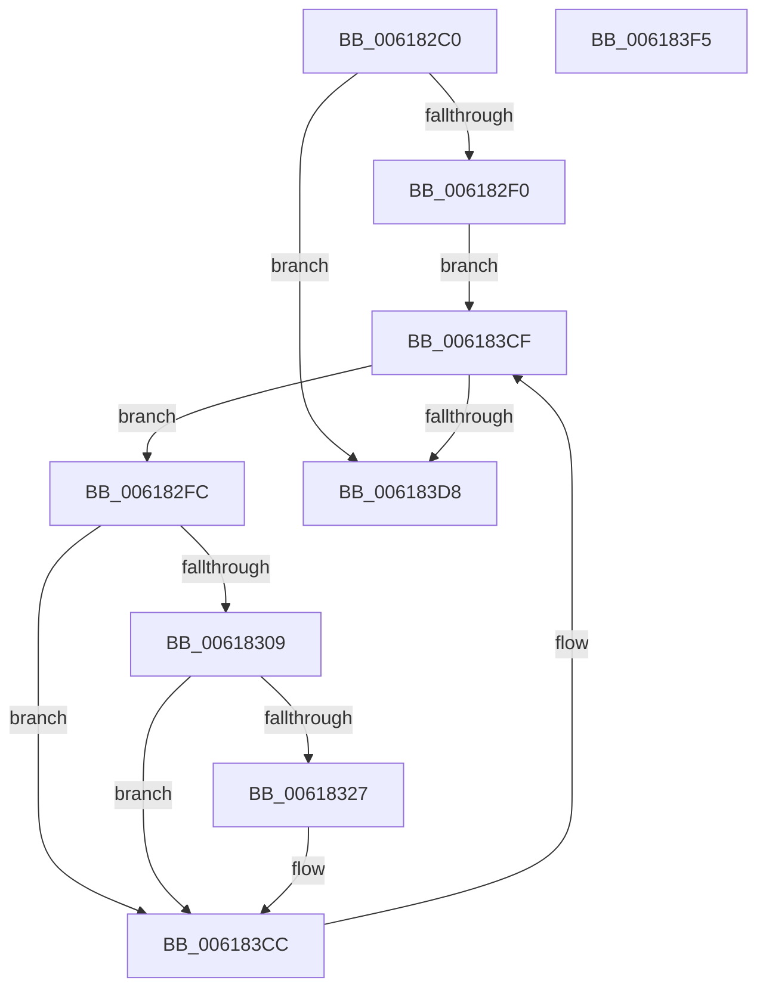

# CarTipLogDriverLoad

- RVA: `0x006182C0`–`0x006183F6` (길이 `310` bytes)
- VA: `0x00000001406182C0`
- 실행 섹션: `.text`
- PDB 이름 있음: `예`; PDB Function 태그: `아니요`
- unwind 정보 RVA: `0x0006FCAC`
- 디코드: `64`개 명령, `310/310` bytes 표시
- 미해석 바이트: `0` (있으면 어셈블리에 `.byte`로 보존)

> 이 문서는 커널 이미지의 기계어와 PDB 기호를 분석해 생성했습니다. 4번과 5번은 함수 원형과 자료형을 바이너리 사용 방식에서 추정한 C 해석이며 원본 소스 복구 결과는 아닙니다.

## 1. Dependencies

- 직접 호출 지점: **4**; 고유 호출 대상: **4**
- 직접 호출자로 확인된 함수: **1**
- RIP 상대 이미지 참조: **7**

### Outgoing calls
- `0x0061831A` → [tlgKeywordOn](../42/tlgKeywordOn_function_0042EAA0.md) (function, `0x0042EAA0`)
- `0x0061834B` → [tlgCreate1Sz_wchar_t](../42/tlgCreate1Sz_wchar_t_function_00426198.md) (function, `0x00426198`)
- `0x006183C7` → [tlgWriteTransfer_EtwWriteTransfer](../42/tlgWriteTransfer_EtwWriteTransfer_function_004260E0.md) (function, `0x004260E0`)
- `0x006183DF` → [_security_check_cookie](../6A/_security_check_cookie_function_006AC640.md) (function, `0x006AC640`)

### Direct callers
- [CarEtwRegister](CarEtwRegister_function_006179D4.md) at `0x00617B3B`

### Static image references
- `0x006182D2` → RVA `0x00E0A740` (`.data`; read)
- `0x006182E0` → RVA `0x00E681A0` (`.data`; read)
- `0x006182F0` → RVA `0x00E681C8` (`.data`; read)
- `0x006182FC` → RVA `0x00E090C8` (`.data`; read)
- `0x00618327` → RVA `0x00F03DA8` (`.data`; read)
- `0x00618350` → RVA `0x00E681D0` (`.data`; read)
- `0x0061835F` → RVA `0x000532EC` (`.rdata`; read)

## 2. Other-region calls and transfers

- 다른 실행 섹션으로 향하는 call: **0**
- 별도 외부 분기/꼬리 이동을 확인하지 못했습니다.

## 3. Assembly (complete function range)

```asm
006182C0  48 89 5C 24 08                  mov qword ptr [rsp + 8], rbx
006182C5  55                              push rbp
006182C6  48 8D 6C 24 A9                  lea rbp, [rsp - 0x57]
006182CB  48 81 EC D0 00 00 00            sub rsp, 0xd0
006182D2  48 8B 05 67 24 7F 00            mov rax, qword ptr [rip + 0x7f2467]
006182D9  48 33 C4                        xor rax, rsp
006182DC  48 89 45 47                     mov qword ptr [rbp + 0x47], rax
006182E0  F7 05 B6 FE 84 00 00 00 40 00   test dword ptr [rip + 0x84feb6], 0x400000
006182EA  0F 84 E8 00 00 00               je 0x1406183d8
006182F0  48 8B 1D D1 FE 84 00            mov rbx, qword ptr [rip + 0x84fed1]
006182F7  E9 D3 00 00 00                  jmp 0x1406183cf
006182FC  83 3D C5 0D 7F 00 05            cmp dword ptr [rip + 0x7f0dc5], 5
00618303  0F 86 C3 00 00 00               jbe 0x1406183cc
00618309  48 BA 00 00 00 00 00 80 00 00   movabs rdx, 0x800000000000
00618313  48 8D 0D AE 0D 7F 00            lea rcx, [rip + 0x7f0dae]
0061831A  E8 81 67 E1 FF                  call 0x14042eaa0
0061831F  84 C0                           test al, al
00618321  0F 84 A5 00 00 00               je 0x1406183cc
00618327  8B 05 7B BA 8E 00               mov eax, dword ptr [rip + 0x8eba7b]
0061832D  48 8D 53 08                     lea rdx, [rbx + 8]
00618331  83 65 03 00                     and dword ptr [rbp + 3], 0
00618335  48 8D 4D 07                     lea rcx, [rbp + 7]
00618339  89 45 B7                        mov dword ptr [rbp - 0x49], eax
0061833C  48 8D 45 B7                     lea rax, [rbp - 0x49]
00618340  48 89 45 F7                     mov qword ptr [rbp - 9], rax
00618344  C7 45 FF 04 00 00 00            mov dword ptr [rbp - 1], 4
0061834B  E8 48 DE E0 FF                  call 0x140426198
00618350  48 8B 0D 79 FE 84 00            mov rcx, qword ptr [rip + 0x84fe79]
00618357  48 8D 45 BF                     lea rax, [rbp - 0x41]
0061835B  83 65 23 00                     and dword ptr [rbp + 0x23], 0
0061835F  48 8D 15 86 AF A3 FF            lea rdx, [rip - 0x5c507a]
00618366  83 65 33 00                     and dword ptr [rbp + 0x33], 0
0061836A  45 33 C9                        xor r9d, r9d
0061836D  83 65 43 00                     and dword ptr [rbp + 0x43], 0
00618371  45 33 C0                        xor r8d, r8d
00618374  48 89 45 17                     mov qword ptr [rbp + 0x17], rax
00618378  8B 43 54                        mov eax, dword ptr [rbx + 0x54]
0061837B  48 89 45 C7                     mov qword ptr [rbp - 0x39], rax
0061837F  48 8D 45 C7                     lea rax, [rbp - 0x39]
00618383  48 89 45 27                     mov qword ptr [rbp + 0x27], rax
00618387  8B 43 58                        mov eax, dword ptr [rbx + 0x58]
0061838A  48 89 45 CF                     mov qword ptr [rbp - 0x31], rax
0061838E  48 8D 45 CF                     lea rax, [rbp - 0x31]
00618392  48 89 45 37                     mov qword ptr [rbp + 0x37], rax
00618396  48 8D 45 D7                     lea rax, [rbp - 0x29]
0061839A  48 89 4D BF                     mov qword ptr [rbp - 0x41], rcx
0061839E  48 8D 0D 23 0D 7F 00            lea rcx, [rip + 0x7f0d23]
006183A5  48 89 44 24 28                  mov qword ptr [rsp + 0x28], rax
006183AA  C7 44 24 20 07 00 00 00         mov dword ptr [rsp + 0x20], 7
006183B2  C7 45 1F 08 00 00 00            mov dword ptr [rbp + 0x1f], 8
006183B9  C7 45 2F 08 00 00 00            mov dword ptr [rbp + 0x2f], 8
006183C0  C7 45 3F 08 00 00 00            mov dword ptr [rbp + 0x3f], 8
006183C7  E8 14 DD E0 FF                  call 0x1404260e0
006183CC  48 8B 1B                        mov rbx, qword ptr [rbx]
006183CF  48 85 DB                        test rbx, rbx
006183D2  0F 85 24 FF FF FF               jne 0x1406182fc
006183D8  48 8B 4D 47                     mov rcx, qword ptr [rbp + 0x47]
006183DC  48 33 CC                        xor rcx, rsp
006183DF  E8 5C 42 09 00                  call 0x1406ac640
006183E4  48 8B 9C 24 E0 00 00 00         mov rbx, qword ptr [rsp + 0xe0]
006183EC  48 81 C4 D0 00 00 00            add rsp, 0xd0
006183F3  5D                              pop rbp
006183F4  C3                              ret
006183F5  CC                              int3
```

## 4. C-style interpretation (structured pseudocode)

```c
__int64 __fastcall CarTipLogDriverLoad(__int64 a1, __int64 a2, int a3, int a4)
{
    __int64 result;
    __int64 v_rsp;
    unsigned __int64 v_stack_m18;
    unsigned int v_stack_m1C;
    unsigned int v_stack_m20;
    unsigned __int64 v_stack_m28;
    unsigned int v_stack_m2C;
    unsigned int v_stack_m30;
    unsigned __int64 v_stack_m38;
    unsigned int v_stack_m3C;
    unsigned int v_stack_m40;
    unsigned __int64 v_stack_m48;
    unsigned __int64 v_stack_m58;
    unsigned int v_stack_m5C;
    unsigned __int64 v_stack_m5F;
    unsigned int v_stack_m60;
    unsigned __int64 v_stack_m68;
    unsigned __int64 v_stack_m88;
    unsigned __int64 v_stack_m90;
    unsigned __int64 v_stack_m98;
    unsigned __int64 v_stack_mA0;
    unsigned int v_stack_mA8;
    unsigned __int64 v_stack_mB0;
    unsigned int v_stack_mB8;
    unsigned __int64 v_stack_p8;

    v_stack_p8 = v_rbx;
    v_rsp = (v_rsp) - (208);
    result = (*(unsigned __int64 *)(v_rip + 8332391)) ^ (v_rsp);
    v_stack_m18 = result;
    if (((*(unsigned int *)(v_rip + 8715958)) & (0x400000ULL)) == 0) goto loc_006183D8;
    goto loc_006183CF;
loc_006182FC:
    if ((*(unsigned int *)(v_rip + 8326597)) <= 5) goto loc_006183CC;
    result = tlgKeywordOn(v_rip + 8326574, a2, a3, a4);
    if ((unsigned __int8)(result) != 0) {
        result = *(unsigned int *)(v_rip + 9353851);
        a2 = *(unsigned __int64 *)(v_rip + 8715985) + 8;
        a1 = v_stack_m58;
        v_stack_mA8 = (unsigned int)(result);
        result = v_stack_mA8;
        v_stack_m68 = result;
        v_stack_m60 = 4;
        result = tlgCreate1Sz_wchar_t(a1, a2, a3, a4);
        a1 = *(unsigned __int64 *)(v_rip + 8715897);
        result = v_stack_mA0;
        a2 = v_rip - 6049914;
        a4 = 0;
        a3 = 0;
        v_stack_m48 = result;
        result = *(unsigned int *)(*(unsigned __int64 *)(v_rip + 8715985) + 84);
        v_stack_m98 = result;
        result = v_stack_m98;
        v_stack_m38 = result;
        result = *(unsigned int *)(*(unsigned __int64 *)(v_rip + 8715985) + 88);
        v_stack_m90 = result;
        result = v_stack_m90;
        v_stack_m28 = result;
        result = v_stack_m88;
        v_stack_mA0 = a1;
        a1 = v_rip + 8326435;
        v_stack_mB0 = result;
        v_stack_mB8 = 7;
        v_stack_m40 = 8;
        v_stack_m30 = 8;
        v_stack_m20 = 8;
        result = tlgWriteTransfer_EtwWriteTransfer(a1, a2, a3, a4);
    }
loc_006183CF:
    if (*(unsigned __int64 *)(*(unsigned __int64 *)(v_rip + 8715985)) != 0) goto loc_006182FC;
loc_006183D8:
    a1 = (v_stack_m18) ^ (v_rsp);
    result = _security_check_cookie(a1, a2, a3, a4);
    v_rsp = (v_rsp) + (208);
    return result;
}
```

## 5. (Beta) C Style

```c
int64_t CarTipLogDriverLoad(int64_t Arg1, int64_t Arg2, int32_t Arg3, int32_t Arg4)
{
    int64_t result;
    int64_t local_rsp;
    uint64_t v_stack_m18;
    uint32_t v_stack_m1C;
    uint32_t v_stack_m20;
    uint64_t v_stack_m28;
    uint32_t v_stack_m2C;
    uint32_t v_stack_m30;
    uint64_t v_stack_m38;
    uint32_t v_stack_m3C;
    uint32_t v_stack_m40;
    uint64_t v_stack_m48;
    uint64_t v_stack_m58;
    uint32_t v_stack_m5C;
    uint64_t v_stack_m5F;
    uint32_t v_stack_m60;
    uint64_t v_stack_m68;
    uint64_t v_stack_m88;
    uint64_t v_stack_m90;
    uint64_t v_stack_m98;
    uint64_t v_stack_mA0;
    uint32_t v_stack_mA8;
    uint64_t v_stack_mB0;
    uint32_t v_stack_mB8;
    uint64_t v_stack_p8;

    v_stack_p8 = local_rbx;
    local_rsp = (local_rsp) - (208);
    result = (*(uint64_t *)(v_rip + 0x7F2467)) ^ (local_rsp);
    v_stack_m18 = result;
    if (((*(uint32_t *)(v_rip + 0x84FEB6)) & (0x400000ULL)) == 0) goto loc_006183D8;
    goto loc_006183CF;
loc_006182FC:
    if ((*(uint32_t *)(v_rip + 0x7F0DC5)) <= 5) goto loc_006183CC;
    result = tlgKeywordOn(v_rip + 8326574, Arg2, Arg3, Arg4);
    if ((uint8_t)(result) != 0) {
        result = *(uint32_t *)(v_rip + 0x8EBA7B);
        Arg2 = *(uint64_t *)(v_rip + 0x84FED1) + 8;
        Arg1 = v_stack_m58;
        v_stack_mA8 = (uint32_t)(result);
        result = v_stack_mA8;
        v_stack_m68 = result;
        v_stack_m60 = 4;
        result = tlgCreate1Sz_wchar_t(Arg1, Arg2, Arg3, Arg4);
        Arg1 = *(uint64_t *)(v_rip + 0x84FE79);
        result = v_stack_mA0;
        Arg2 = v_rip - 6049914;
        Arg4 = 0;
        Arg3 = 0;
        v_stack_m48 = result;
        result = *(uint32_t *)(*(uint64_t *)(v_rip + 0x84FED1) + 0x54);
        v_stack_m98 = result;
        result = v_stack_m98;
        v_stack_m38 = result;
        result = *(uint32_t *)(*(uint64_t *)(v_rip + 0x84FED1) + 0x58);
        v_stack_m90 = result;
        result = v_stack_m90;
        v_stack_m28 = result;
        result = v_stack_m88;
        v_stack_mA0 = Arg1;
        Arg1 = v_rip + 8326435;
        v_stack_mB0 = result;
        v_stack_mB8 = 7;
        v_stack_m40 = 8;
        v_stack_m30 = 8;
        v_stack_m20 = 8;
        result = tlgWriteTransfer_EtwWriteTransfer(Arg1, Arg2, Arg3, Arg4);
    }
loc_006183CF:
    if (*(uint64_t *)(*(uint64_t *)(v_rip + 0x84FED1)) != 0) goto loc_006182FC;
loc_006183D8:
    Arg1 = (v_stack_m18) ^ (local_rsp);
    result = _security_check_cookie(Arg1, Arg2, Arg3, Arg4);
    local_rsp = (local_rsp) + (208);
    return result;
}
```

## 6. Execution-region graph

[열기: 2D/3D 그래프와 함수 탐색 컨트롤 패널](../../../control-panel.html?section=text&rva=0x006182C0&view=graph)

- 2D 그래프는 위에서 아래로 흐르고, 3D 그래프는 빈 공간을 드래그해 회전합니다. Shift+드래그는 이동, 휠은 확대·축소, 함수 노드 선택은 대상 보고서 이동입니다.

### Static fallback


