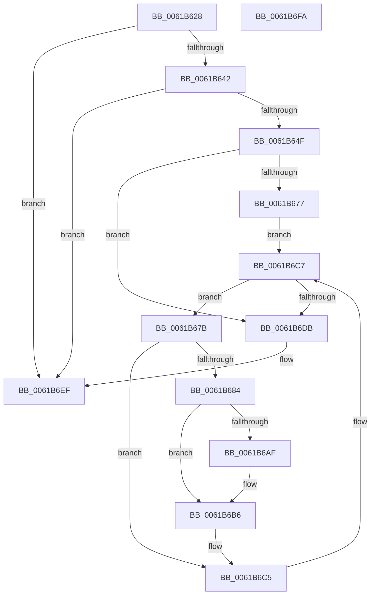

# CarWriteEarlyRuleViolationEvents

- RVA: `0x0061B628`–`0x0061B6FB` (길이 `211` bytes)
- VA: `0x000000014061B628`
- 실행 섹션: `.text`
- PDB 이름 있음: `예`; PDB Function 태그: `아니요`
- unwind 정보 RVA: `0x000718C0`
- 디코드: `56`개 명령, `211/211` bytes 표시
- 미해석 바이트: `0` (있으면 어셈블리에 `.byte`로 보존)

> 이 문서는 커널 이미지의 기계어와 PDB 기호를 분석해 생성했습니다. 4번과 5번은 함수 원형과 자료형을 바이너리 사용 방식에서 추정한 C 해석이며 원본 소스 복구 결과는 아닙니다.

## 1. Dependencies

- 직접 호출 지점: **8**; 고유 호출 대상: **7**
- 직접 호출자로 확인된 함수: **1**
- RIP 상대 이미지 참조: **3**

### Outgoing calls
- `0x0061B65E` → [CarDbRaiseIrqlSafe](CarDbRaiseIrqlSafe_function_0061396C.md) (function, `0x0061396C`)
- `0x0061B668` → [CarAcquireDbLockAtDpcLevelSafe](CarAcquireDbLockAtDpcLevelSafe_function_0061B00C.md) (function, `0x0061B00C`)
- `0x0061B6A1` → [CarEtwWriteBugCheckEvent](CarEtwWriteBugCheckEvent_function_00617B68.md) (function, `0x00617B68`)
- `0x0061B6B1` → [ExFreePoolWithTag](../../poolcode/B8/ExFreePoolWithTag_function_00B82870.md) (function, `0x00B82870`)
- `0x0061B6BB` → [ExFreePoolWithTag](../../poolcode/B8/ExFreePoolWithTag_function_00B82870.md) (function, `0x00B82870`)
- `0x0061B6CE` → [RtlEnumerateGenericTableAvl](../3E/RtlEnumerateGenericTableAvl_function_003E5AB0.md) (function, `0x003E5AB0`)
- `0x0061B6E0` → [CarReleaseDbLockFromDpcLevel](CarReleaseDbLockFromDpcLevel_function_0061B5DC.md) (function, `0x0061B5DC`)
- `0x0061B6EA` → [CarCleanDbLockContext](CarCleanDbLockContext_function_0061B2E4.md) (function, `0x0061B2E4`)

### Direct callers
- [CarInitLogging](CarInitLogging_function_006180B0.md) at `0x00618114`

### Static image references
- `0x0061B634` → RVA `0x00F03EA8` (`.data`; read)
- `0x0061B642` → RVA `0x00F03EE0` (`.data`; read)
- `0x0061B66D` → RVA `0x00F03EB0` (`.data`; read)

## 2. Other-region calls and transfers

- 다른 실행 섹션으로 향하는 call: **2**
  - `0x0061B6B1` → [ExFreePoolWithTag](../../poolcode/B8/ExFreePoolWithTag_function_00B82870.md) (`.text` → `POOLCODE`)
  - `0x0061B6BB` → [ExFreePoolWithTag](../../poolcode/B8/ExFreePoolWithTag_function_00B82870.md) (`.text` → `POOLCODE`)
- 별도 외부 분기/꼬리 이동을 확인하지 못했습니다.

## 3. Assembly (complete function range)

```asm
0061B628  48 8B C4                        mov rax, rsp
0061B62B  48 89 58 08                     mov qword ptr [rax + 8], rbx
0061B62F  57                              push rdi
0061B630  48 83 EC 40                     sub rsp, 0x40
0061B634  48 83 3D 6C 88 8E 00 00         cmp qword ptr [rip + 0x8e886c], 0
0061B63C  0F 84 AD 00 00 00               je 0x14061b6ef
0061B642  80 3D 97 88 8E 00 00            cmp byte ptr [rip + 0x8e8897], 0
0061B649  0F 84 A0 00 00 00               je 0x14061b6ef
0061B64F  0F 57 C0                        xorps xmm0, xmm0
0061B652  48 8D 48 E8                     lea rcx, [rax - 0x18]
0061B656  0F 11 40 E8                     movups xmmword ptr [rax - 0x18], xmm0
0061B65A  C6 40 F1 04                     mov byte ptr [rax - 0xf], 4
0061B65E  E8 09 83 FF FF                  call 0x14061396c
0061B663  48 8D 4C 24 30                  lea rcx, [rsp + 0x30]
0061B668  E8 9F F9 FF FF                  call 0x14061b00c
0061B66D  8B 05 3D 88 8E 00               mov eax, dword ptr [rip + 0x8e883d]
0061B673  85 C0                           test eax, eax
0061B675  74 64                           je 0x14061b6db
0061B677  B2 01                           mov dl, 1
0061B679  EB 4C                           jmp 0x14061b6c7
0061B67B  48 8B 5F 18                     mov rbx, qword ptr [rdi + 0x18]
0061B67F  48 85 DB                        test rbx, rbx
0061B682  74 41                           je 0x14061b6c5
0061B684  8B 4B 60                        mov ecx, dword ptr [rbx + 0x60]
0061B687  48 8D 53 02                     lea rdx, [rbx + 2]
0061B68B  8A 03                           mov al, byte ptr [rbx]
0061B68D  4C 8B 4B 48                     mov r9, qword ptr [rbx + 0x48]
0061B691  44 8B 43 50                     mov r8d, dword ptr [rbx + 0x50]
0061B695  89 4C 24 28                     mov dword ptr [rsp + 0x28], ecx
0061B699  48 8B 4B 58                     mov rcx, qword ptr [rbx + 0x58]
0061B69D  88 44 24 20                     mov byte ptr [rsp + 0x20], al
0061B6A1  E8 C2 C4 FF FF                  call 0x140617b68
0061B6A6  48 8B 4B 48                     mov rcx, qword ptr [rbx + 0x48]
0061B6AA  48 85 C9                        test rcx, rcx
0061B6AD  74 07                           je 0x14061b6b6
0061B6AF  33 D2                           xor edx, edx
0061B6B1  E8 BA 71 56 00                  call 0x140b82870
0061B6B6  33 D2                           xor edx, edx
0061B6B8  48 8B CB                        mov rcx, rbx
0061B6BB  E8 B0 71 56 00                  call 0x140b82870
0061B6C0  48 83 67 18 00                  and qword ptr [rdi + 0x18], 0
0061B6C5  33 D2                           xor edx, edx
0061B6C7  48 8B 0D DA 87 8E 00            mov rcx, qword ptr [rip + 0x8e87da]
0061B6CE  E8 DD A3 DC FF                  call 0x1403e5ab0
0061B6D3  48 8B F8                        mov rdi, rax
0061B6D6  48 85 C0                        test rax, rax
0061B6D9  75 A0                           jne 0x14061b67b
0061B6DB  48 8D 4C 24 30                  lea rcx, [rsp + 0x30]
0061B6E0  E8 F7 FE FF FF                  call 0x14061b5dc
0061B6E5  48 8D 4C 24 30                  lea rcx, [rsp + 0x30]
0061B6EA  E8 F5 FB FF FF                  call 0x14061b2e4
0061B6EF  48 8B 5C 24 50                  mov rbx, qword ptr [rsp + 0x50]
0061B6F4  48 83 C4 40                     add rsp, 0x40
0061B6F8  5F                              pop rdi
0061B6F9  C3                              ret
0061B6FA  CC                              int3
```

## 4. C-style interpretation (structured pseudocode)

```c
__int64 __fastcall CarWriteEarlyRuleViolationEvents(void)
{
    __int64 result;
    __int64 v_rsp;
    unsigned __int64 v_stack_m18;
    unsigned int v_stack_m20;
    unsigned __int8 v_stack_m28;
    unsigned __int64 v_stack_p8;

    *(unsigned __int64 *)(v_rsp + 8) = v_rbx;
    v_rsp = (v_rsp) - (64);
    if ((*(unsigned __int64 *)(v_rip + 9341036)) == 0) goto loc_0061B6EF;
    if ((*(unsigned __int8 *)(v_rip + 9341079)) == 0) goto loc_0061B6EF;
    *(unsigned __int64 *)(v_rsp - 24) = v_xmm0;
    *(unsigned __int8 *)(v_rsp - 15) = 4;
    result = CarDbRaiseIrqlSafe(v_rsp - 24, a2, a3, a4);
    result = CarAcquireDbLockAtDpcLevelSafe(v_stack_m18, a2, a3, a4);
    if ((unsigned int)((unsigned int)(*(unsigned int *)(v_rip + 9340989))) == 0) goto loc_0061B6DB;
    goto loc_0061B6C7;
loc_0061B67B:
    if (*(unsigned __int64 *)(v_rdi + 24) == 0) goto loc_0061B6C5;
    v_stack_m20 = (unsigned int)((unsigned int)(*(unsigned int *)(*(unsigned __int64 *)(v_rdi + 24) + 96)));
    v_stack_m28 = (unsigned __int8)(*(unsigned __int8 *)(*(unsigned __int64 *)(v_rdi + 24)));
    result = CarEtwWriteBugCheckEvent(*(unsigned __int64 *)(*(unsigned __int64 *)(v_rdi + 24) + 88), *(unsigned __int64 *)(v_rdi + 24) + 2, (unsigned int)(*(unsigned int *)(*(unsigned __int64 *)(v_rdi + 24) + 80)), *(unsigned __int64 *)(*(unsigned __int64 *)(v_rdi + 24) + 72));
    if (*(unsigned __int64 *)(*(unsigned __int64 *)(v_rdi + 24) + 72) != 0) {
        a2 = 0;
        result = ExFreePoolWithTag(*(unsigned __int64 *)(*(unsigned __int64 *)(v_rdi + 24) + 72), a2, (unsigned int)(*(unsigned int *)(*(unsigned __int64 *)(v_rdi + 24) + 80)), *(unsigned __int64 *)(*(unsigned __int64 *)(v_rdi + 24) + 72));
    }
    a2 = 0;
    result = ExFreePoolWithTag(*(unsigned __int64 *)(v_rdi + 24), a2, (unsigned int)(*(unsigned int *)(*(unsigned __int64 *)(v_rdi + 24) + 80)), *(unsigned __int64 *)(*(unsigned __int64 *)(v_rdi + 24) + 72));
loc_0061B6C5:
    a2 = 0;
loc_0061B6C7:
    result = RtlEnumerateGenericTableAvl(*(unsigned __int64 *)(v_rip + 9340890), a2, (unsigned int)(*(unsigned int *)(*(unsigned __int64 *)(v_rdi + 24) + 80)), *(unsigned __int64 *)(*(unsigned __int64 *)(v_rdi + 24) + 72));
    if (result != 0) goto loc_0061B67B;
loc_0061B6DB:
    result = CarReleaseDbLockFromDpcLevel(v_stack_m18, a2, (unsigned int)(*(unsigned int *)(*(unsigned __int64 *)(v_rdi + 24) + 80)), *(unsigned __int64 *)(*(unsigned __int64 *)(v_rdi + 24) + 72));
    result = CarCleanDbLockContext(v_stack_m18, a2, (unsigned int)(*(unsigned int *)(*(unsigned __int64 *)(v_rdi + 24) + 80)), *(unsigned __int64 *)(*(unsigned __int64 *)(v_rdi + 24) + 72));
loc_0061B6EF:
    v_rsp = (v_rsp) + (64);
    return result;
}
```

## 5. (Beta) C Style

```c
void CarWriteEarlyRuleViolationEvents(void)
{
    int64_t result;
    int64_t local_rsp;
    uint64_t v_stack_m18;
    uint32_t v_stack_m20;
    uint8_t v_stack_m28;
    uint64_t v_stack_p8;

    *(uint64_t *)(local_rsp + 0x8) = local_rbx;
    local_rsp = (local_rsp) - (64);
    if ((*(uint64_t *)(v_rip + 0x8E886C)) == 0) goto loc_0061B6EF;
    if ((*(uint8_t *)(v_rip + 0x8E8897)) == 0) goto loc_0061B6EF;
    *(uint64_t *)(local_rsp - 0x18) = v_xmm0;
    *(uint8_t *)(local_rsp - 0xF) = 4;
    result = CarDbRaiseIrqlSafe(local_rsp - 24, a2, a3, a4);
    result = CarAcquireDbLockAtDpcLevelSafe(v_stack_m18, a2, a3, a4);
    if ((uint32_t)((uint32_t)(*(uint32_t *)(v_rip + 0x8E883D))) == 0) goto loc_0061B6DB;
    goto loc_0061B6C7;
loc_0061B67B:
    if (*(uint64_t *)(local_rdi + 0x18) == 0) goto loc_0061B6C5;
    v_stack_m20 = (uint32_t)((uint32_t)(*(uint32_t *)(*(uint64_t *)(local_rdi + 0x18) + 0x60)));
    v_stack_m28 = (uint8_t)(*(uint8_t *)(*(uint64_t *)(local_rdi + 0x18)));
    result = CarEtwWriteBugCheckEvent(*(uint64_t *)(*(uint64_t *)(local_rdi + 0x18) + 0x58), *(uint64_t *)(local_rdi + 0x18) + 2, (uint32_t)(*(uint32_t *)(*(uint64_t *)(local_rdi + 0x18) + 0x50)), *(uint64_t *)(*(uint64_t *)(local_rdi + 0x18) + 0x48));
    if (*(uint64_t *)(*(uint64_t *)(local_rdi + 0x18) + 0x48) != 0) {
        a2 = 0;
        result = ExFreePoolWithTag(*(uint64_t *)(*(uint64_t *)(local_rdi + 0x18) + 0x48), a2, (uint32_t)(*(uint32_t *)(*(uint64_t *)(local_rdi + 0x18) + 0x50)), *(uint64_t *)(*(uint64_t *)(local_rdi + 0x18) + 0x48));
    }
    a2 = 0;
    result = ExFreePoolWithTag(*(uint64_t *)(local_rdi + 0x18), a2, (uint32_t)(*(uint32_t *)(*(uint64_t *)(local_rdi + 0x18) + 0x50)), *(uint64_t *)(*(uint64_t *)(local_rdi + 0x18) + 0x48));
loc_0061B6C5:
    a2 = 0;
loc_0061B6C7:
    result = RtlEnumerateGenericTableAvl(*(uint64_t *)(v_rip + 0x8E87DA), a2, (uint32_t)(*(uint32_t *)(*(uint64_t *)(local_rdi + 0x18) + 0x50)), *(uint64_t *)(*(uint64_t *)(local_rdi + 0x18) + 0x48));
    if (result != 0) goto loc_0061B67B;
loc_0061B6DB:
    result = CarReleaseDbLockFromDpcLevel(v_stack_m18, a2, (uint32_t)(*(uint32_t *)(*(uint64_t *)(local_rdi + 0x18) + 0x50)), *(uint64_t *)(*(uint64_t *)(local_rdi + 0x18) + 0x48));
    result = CarCleanDbLockContext(v_stack_m18, a2, (uint32_t)(*(uint32_t *)(*(uint64_t *)(local_rdi + 0x18) + 0x50)), *(uint64_t *)(*(uint64_t *)(local_rdi + 0x18) + 0x48));
loc_0061B6EF:
    local_rsp = (local_rsp) + (64);
    return result;
}
```

## 6. Execution-region graph

[열기: 2D/3D 그래프와 함수 탐색 컨트롤 패널](../../../control-panel.html?section=text&rva=0x0061B628&view=graph)

- 2D 그래프는 위에서 아래로 흐르고, 3D 그래프는 빈 공간을 드래그해 회전합니다. Shift+드래그는 이동, 휠은 확대·축소, 함수 노드 선택은 대상 보고서 이동입니다.

### Static fallback


