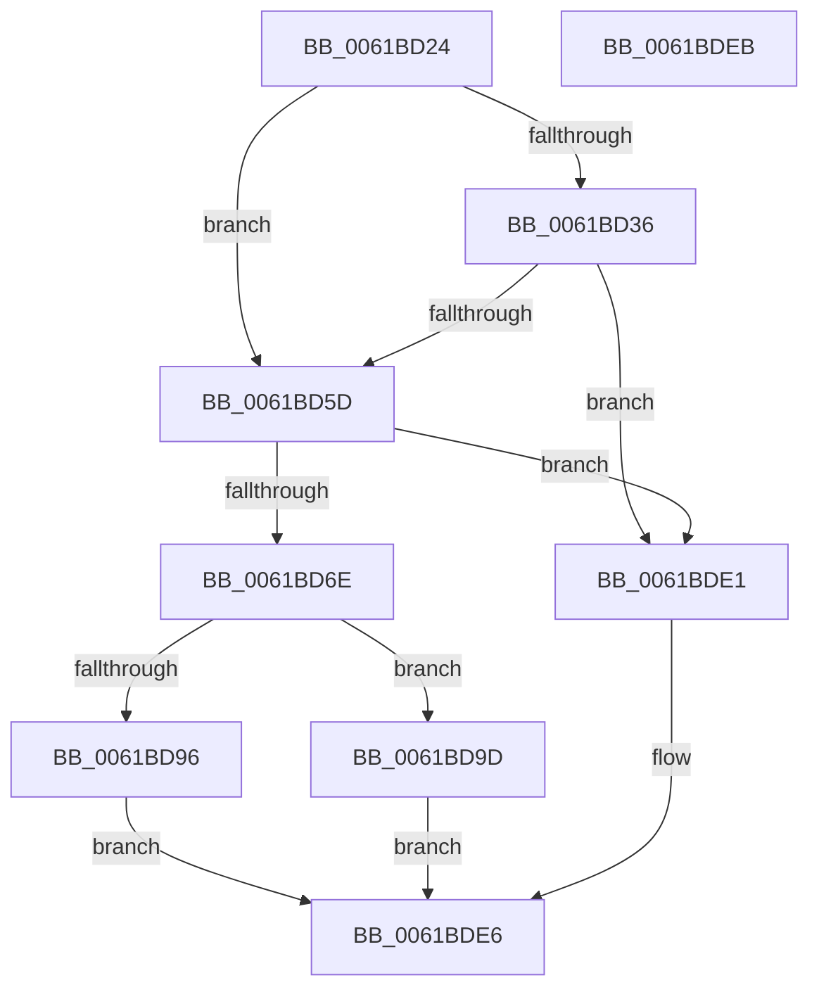

# CarWriteLivedump

- RVA: `0x0061BD24`–`0x0061BDEC` (길이 `200` bytes)
- VA: `0x000000014061BD24`
- 실행 섹션: `.text`
- PDB 이름 있음: `예`; PDB Function 태그: `아니요`
- unwind 정보 RVA: `0x0005C788`
- 디코드: `39`개 명령, `200/200` bytes 표시
- 미해석 바이트: `0` (있으면 어셈블리에 `.byte`로 보존)

> 이 문서는 커널 이미지의 기계어와 PDB 기호를 분석해 생성했습니다. 4번과 5번은 함수 원형과 자료형을 바이너리 사용 방식에서 추정한 C 해석이며 원본 소스 복구 결과는 아닙니다.

## 1. Dependencies

- 직접 호출 지점: **2**; 고유 호출 대상: **2**
- 직접 호출자로 확인된 함수: **1**
- RIP 상대 이미지 참조: **8**

### Outgoing calls
- `0x0061BD96` → [CarLiveDump](CarLiveDump_function_0061BB30.md) (function, `0x0061BB30`)
- `0x0061BDD5` → [ExQueueWorkItem](../2F/ExQueueWorkItem_function_002F9520.md) (function, `0x002F9520`)

### Direct callers
- [CarReportDifPluginRuleViolation](CarReportDifPluginRuleViolation_function_00619250.md) at `0x006194C1`

### Static image references
- `0x0061BD2C` → RVA `0x00F02470` (`.data`; read)
- `0x0061BD63` → RVA `0x00F024A0` (`.data`; read)
- `0x0061BD9D` → RVA `0x00F02488` (`.data`; read/write)
- `0x0061BDA5` → RVA `0x0061BB30` (`CarLiveDump`; read)
- `0x0061BDAC` → RVA `0x00F02480` (`.data`; read/write)
- `0x0061BDB9` → RVA `0x00F02498` (`.data`; write)
- `0x0061BDC0` → RVA `0x00F02490` (`.data`; write)
- `0x0061BDCE` → RVA `0x00F02480` (`.data`; read)

## 2. Other-region calls and transfers

- 다른 실행 섹션으로 향하는 call: **0**
- 별도 외부 분기/꼬리 이동을 확인하지 못했습니다.

## 3. Assembly (complete function range)

```asm
0061BD24  48 83 EC 28                     sub rsp, 0x28
0061BD28  45 0F 20 C2                     mov r10, cr8
0061BD2C  48 83 3D 3C 67 8E 00 00         cmp qword ptr [rip + 0x8e673c], 0
0061BD34  74 27                           je 0x14061bd5d
0061BD36  48 B8 14 00 00 00 80 F7 FF FF   movabs rax, 0xfffff78000000014
0061BD40  49 BB 00 68 C4 61 08 00 00 00   movabs r11, 0x861c46800
0061BD4A  48 8B 00                        mov rax, qword ptr [rax]
0061BD4D  48 2B 05 1C 67 8E 00            sub rax, qword ptr [rip + 0x8e671c]
0061BD54  49 3B C3                        cmp rax, r11
0061BD57  0F 8C 84 00 00 00               jl 0x14061bde1
0061BD5D  33 C0                           xor eax, eax
0061BD5F  44 8D 58 01                     lea r11d, [rax + 1]
0061BD63  F0 44 0F B1 1D 34 67 8E 00      lock cmpxchg dword ptr [rip + 0x8e6734], r11d
0061BD6C  75 73                           jne 0x14061bde1
0061BD6E  8B C2                           mov eax, edx
0061BD70  48 89 81 28 05 00 00            mov qword ptr [rcx + 0x528], rax
0061BD77  48 8B 44 24 50                  mov rax, qword ptr [rsp + 0x50]
0061BD7C  48 89 81 40 05 00 00            mov qword ptr [rcx + 0x540], rax
0061BD83  4C 89 81 30 05 00 00            mov qword ptr [rcx + 0x530], r8
0061BD8A  4C 89 89 38 05 00 00            mov qword ptr [rcx + 0x538], r9
0061BD91  45 84 D2                        test r10b, r10b
0061BD94  75 07                           jne 0x14061bd9d
0061BD96  E8 95 FD FF FF                  call 0x14061bb30
0061BD9B  EB 49                           jmp 0x14061bde6
0061BD9D  48 83 25 E3 66 8E 00 00         and qword ptr [rip + 0x8e66e3], 0
0061BDA5  48 8D 05 84 FD FF FF            lea rax, [rip - 0x27c]
0061BDAC  48 83 25 CC 66 8E 00 00         and qword ptr [rip + 0x8e66cc], 0
0061BDB4  BA 06 00 00 00                  mov edx, 6
0061BDB9  48 89 0D D8 66 8E 00            mov qword ptr [rip + 0x8e66d8], rcx
0061BDC0  48 89 05 C9 66 8E 00            mov qword ptr [rip + 0x8e66c9], rax
0061BDC7  44 88 99 48 05 00 00            mov byte ptr [rcx + 0x548], r11b
0061BDCE  48 8D 0D AB 66 8E 00            lea rcx, [rip + 0x8e66ab]
0061BDD5  E8 46 D7 CD FF                  call 0x1402f9520
0061BDDA  B8 03 01 00 00                  mov eax, 0x103
0061BDDF  EB 05                           jmp 0x14061bde6
0061BDE1  B8 10 0C 00 C0                  mov eax, 0xc0000c10
0061BDE6  48 83 C4 28                     add rsp, 0x28
0061BDEA  C3                              ret
0061BDEB  CC                              int3
```

## 4. C-style interpretation (structured pseudocode)

```c
__int64 __fastcall CarWriteLivedump(__int64 a1, int a2, __int64 a3, __int64 a4, __int64 a5)
{
    __int64 result;
    __int64 v_rsp;

    v_rsp = (v_rsp) - (40);
    if ((*(unsigned __int64 *)(v_rip + 9332540)) == 0) goto loc_0061BD5D;
    result = (*(unsigned __int64 *)(result)) - (*(unsigned __int64 *)(v_rip + 9332508));
    if (result < v_r11) goto loc_0061BDE1;
loc_0061BD5D:
    result = 0;
    if (condition_is_not_equal) goto loc_0061BDE1;
    *(unsigned __int64 *)(a1 + 1320) = (unsigned int)(a2);
    *(unsigned __int64 *)(a1 + 1344) = a5;
    *(unsigned __int64 *)(a1 + 1328) = a3;
    *(unsigned __int64 *)(a1 + 1336) = a4;
    if ((unsigned __int8)(v_cr8) != 0) goto loc_0061BD9D;
    result = CarLiveDump(a1, a2, a3, a4);
    goto loc_0061BDE6;
loc_0061BD9D:
    *(unsigned __int64 *)(v_rip + 9332440) = a1;
    *(unsigned __int64 *)(v_rip + 9332425) = v_rip - 636;
    *(unsigned __int8 *)(a1 + 1352) = (unsigned __int8)(result + 1);
    result = ExQueueWorkItem(v_rip + 9332395, 6, a3, a4);
    goto loc_0061BDE6;
loc_0061BDE1:
loc_0061BDE6:
    v_rsp = (v_rsp) + (40);
    return (unsigned int)(0xC0000C10ULL);
}
```

## 5. (Beta) C Style

```c
int64_t CarWriteLivedump(void *Arg1, int32_t Arg2, int64_t Arg3, int64_t Arg4, int64_t Arg5)
{
    uint8_t *arg1 = (uint8_t *)Arg1;

    int64_t result;
    int64_t local_rsp;

    local_rsp = (local_rsp) - (40);
    if ((*(uint64_t *)(v_rip + 0x8E673C)) == 0) goto loc_0061BD5D;
    result = (*(uint64_t *)(result)) - (*(uint64_t *)(v_rip + 0x8E671C));
    if (result < local_r11) goto loc_0061BDE1;
loc_0061BD5D:
    result = 0;
    if (condition_is_not_equal) goto loc_0061BDE1;
    *(uint64_t *)(arg1 + 0x528) = (uint32_t)(Arg2);
    *(uint64_t *)(arg1 + 0x540) = Arg5;
    *(uint64_t *)(arg1 + 0x530) = Arg3;
    *(uint64_t *)(arg1 + 0x538) = Arg4;
    if ((uint8_t)(v_cr8) != 0) goto loc_0061BD9D;
    result = CarLiveDump(Arg1, Arg2, Arg3, Arg4);
    goto loc_0061BDE6;
loc_0061BD9D:
    *(void **)(v_rip + 0x8E66D8) = Arg1;
    *(uint64_t *)(v_rip + 0x8E66C9) = v_rip - 636;
    *(uint8_t *)(arg1 + 0x548) = (uint8_t)(result + 1);
    result = ExQueueWorkItem(v_rip + 9332395, 6, Arg3, Arg4);
    goto loc_0061BDE6;
loc_0061BDE1:
loc_0061BDE6:
    local_rsp = (local_rsp) + (40);
    return (uint32_t)(0xC0000C10ULL);
}
```

### 관측된 메모리 오프셋

구조체 형식이 확인되지 않은 접근은 인자 기준의 오프셋으로만 기록했습니다.

| 기준 인자 | 오프셋 표현 | 폭 (bit) | 접근 |
|---|---:|---:|---|
| `Arg1` | `+ 0x528` | `64` | `W` |
| `Arg1` | `+ 0x530` | `64` | `W` |
| `Arg1` | `+ 0x538` | `64` | `W` |
| `Arg1` | `+ 0x540` | `64` | `W` |
| `Arg1` | `+ 0x548` | `8` | `W` |

## 6. Execution-region graph

[열기: 2D/3D 그래프와 함수 탐색 컨트롤 패널](../../../control-panel.html?section=text&rva=0x0061BD24&view=graph)

- 2D 그래프는 위에서 아래로 흐르고, 3D 그래프는 빈 공간을 드래그해 회전합니다. Shift+드래그는 이동, 휠은 확대·축소, 함수 노드 선택은 대상 보고서 이동입니다.

### Static fallback


