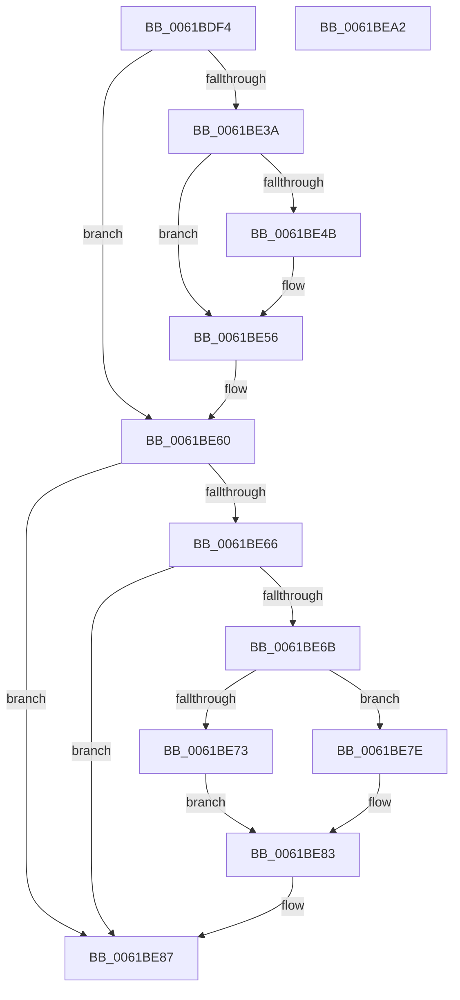

# DifAcquireSpinLockAtDpcLevelSafe

- RVA: `0x0061BDF4`–`0x0061BEA3` (길이 `175` bytes)
- VA: `0x000000014061BDF4`
- 실행 섹션: `.text`
- PDB 이름 있음: `예`; PDB Function 태그: `아니요`
- unwind 정보 RVA: `0x0005E6B4`
- 디코드: `48`개 명령, `175/175` bytes 표시
- 미해석 바이트: `0` (있으면 어셈블리에 `.byte`로 보존)

> 이 문서는 커널 이미지의 기계어와 PDB 기호를 분석해 생성했습니다. 4번과 5번은 함수 원형과 자료형을 바이너리 사용 방식에서 추정한 C 해석이며 원본 소스 복구 결과는 아닙니다.

## 1. Dependencies

- 직접 호출 지점: **3**; 고유 호출 대상: **3**
- 직접 호출자로 확인된 함수: **3**
- RIP 상대 이미지 참조: **2**

### Outgoing calls
- `0x0061BE51` → [KiRaiseIrqlProcessIrqlFlags](../4F/KiRaiseIrqlProcessIrqlFlags_function_004F56FC.md) (function, `0x004F56FC`)
- `0x0061BE73` → [ExAcquireSpinLockExclusiveAtDpcLevel](../24/ExAcquireSpinLockExclusiveAtDpcLevel_function_00248E80.md) (function, `0x00248E80`)
- `0x0061BE7E` → [ExAcquireSpinLockSharedAtDpcLevel](../24/ExAcquireSpinLockSharedAtDpcLevel_function_00248E30.md) (function, `0x00248E30`)

### Direct callers
- [DifObjTrkInsertItem](DifObjTrkInsertItem_function_00619D00.md) at `0x00619DC6`
- [DifObjTrkQeuryInvokeDeleteRange](DifObjTrkQeuryInvokeDeleteRange_function_00619EA0.md) at `0x00619F68`
- [DifObjTrkRemoveItem](DifObjTrkRemoveItem_function_0061A1D0.md) at `0x0061A28D`

### Static image references
- `0x0061BE0D` → RVA `0x00F03EB8` (`.data`; read)
- `0x0061BE42` → RVA `0x00FC6D20` (`ALMOSTRO`; read)

## 2. Other-region calls and transfers

- 다른 실행 섹션으로 향하는 call: **0**
- 별도 외부 분기/꼬리 이동을 확인하지 못했습니다.

## 3. Assembly (complete function range)

```asm
0061BDF4  48 8B C4                        mov rax, rsp
0061BDF7  48 89 58 08                     mov qword ptr [rax + 8], rbx
0061BDFB  48 89 68 10                     mov qword ptr [rax + 0x10], rbp
0061BDFF  48 89 70 18                     mov qword ptr [rax + 0x18], rsi
0061BE03  48 89 78 20                     mov qword ptr [rax + 0x20], rdi
0061BE07  41 56                           push r14
0061BE09  48 83 EC 20                     sub rsp, 0x20
0061BE0D  48 8B 3D A4 80 8E 00            mov rdi, qword ptr [rip + 0x8e80a4]
0061BE14  33 C0                           xor eax, eax
0061BE16  65 48 8B 2C 25 88 01 00 00      mov rbp, qword ptr gs:[0x188]
0061BE1F  48 8B D9                        mov rbx, rcx
0061BE22  66 89 01                        mov word ptr [rcx], ax
0061BE25  C6 41 01 04                     mov byte ptr [rcx + 1], 4
0061BE29  44 0F 20 C0                     mov rax, cr8
0061BE2D  41 BE 02 00 00 00               mov r14d, 2
0061BE33  B1 04                           mov cl, 4
0061BE35  41 3A C6                        cmp al, r14b
0061BE38  73 26                           jae 0x14061be60
0061BE3A  44 0F 20 C6                     mov rsi, cr8
0061BE3E  45 0F 22 C6                     mov cr8, r14
0061BE42  83 3D D7 AE 9A 00 00            cmp dword ptr [rip + 0x9aaed7], 0
0061BE49  74 0B                           je 0x14061be56
0061BE4B  41 8A D6                        mov dl, r14b
0061BE4E  40 8A CE                        mov cl, sil
0061BE51  E8 A6 98 ED FF                  call 0x1404f56fc
0061BE56  80 4B 01 01                     or byte ptr [rbx + 1], 1
0061BE5A  8A 4B 01                        mov cl, byte ptr [rbx + 1]
0061BE5D  40 88 33                        mov byte ptr [rbx], sil
0061BE60  48 39 6F 08                     cmp qword ptr [rdi + 8], rbp
0061BE64  74 21                           je 0x14061be87
0061BE66  41 84 CE                        test r14b, cl
0061BE69  75 1C                           jne 0x14061be87
0061BE6B  F6 C1 04                        test cl, 4
0061BE6E  48 8B CF                        mov rcx, rdi
0061BE71  74 0B                           je 0x14061be7e
0061BE73  E8 08 D0 C2 FF                  call 0x140248e80
0061BE78  48 89 6F 08                     mov qword ptr [rdi + 8], rbp
0061BE7C  EB 05                           jmp 0x14061be83
0061BE7E  E8 AD CF C2 FF                  call 0x140248e30
0061BE83  44 08 73 01                     or byte ptr [rbx + 1], r14b
0061BE87  48 8B 5C 24 30                  mov rbx, qword ptr [rsp + 0x30]
0061BE8C  48 8B 6C 24 38                  mov rbp, qword ptr [rsp + 0x38]
0061BE91  48 8B 74 24 40                  mov rsi, qword ptr [rsp + 0x40]
0061BE96  48 8B 7C 24 48                  mov rdi, qword ptr [rsp + 0x48]
0061BE9B  48 83 C4 20                     add rsp, 0x20
0061BE9F  41 5E                           pop r14
0061BEA1  C3                              ret
0061BEA2  CC                              int3
```

## 4. C-style interpretation (structured pseudocode)

```c
__int64 __fastcall DifAcquireSpinLockAtDpcLevelSafe(__int64 a1)
{
    __int64 result;
    __int64 v_rsp;
    unsigned __int64 v_stack_p10;
    unsigned __int64 v_stack_p18;
    unsigned __int64 v_stack_p20;
    unsigned __int64 v_stack_p8;

    *(unsigned __int64 *)(v_rsp + 8) = v_rbx;
    *(unsigned __int64 *)(v_rsp + 16) = v_rbp;
    *(unsigned __int64 *)(v_rsp + 24) = v_rsi;
    *(unsigned __int64 *)(v_rsp + 32) = v_rdi;
    v_rsp = (v_rsp) - (32);
    result = 0;
    *(unsigned __int16 *)(a1) = 0;
    *(unsigned __int8 *)(a1 + 1) = 4;
    if (((unsigned __int8)(v_cr8)) >= 2) goto loc_0061BE60;
    result = v_cr8;
    if ((*(unsigned int *)(v_rip + 10137303)) != 0) {
        a2 = 2;
        a1 = (unsigned __int8)(v_cr8);
        result = KiRaiseIrqlProcessIrqlFlags(a1, a2, a3, a4);
    }
    *(unsigned __int8 *)(a1) = (unsigned __int8)(v_cr8);
loc_0061BE60:
    if ((*(unsigned __int64 *)(*(unsigned __int64 *)(v_rip + 9339044) + 8)) == (*(unsigned __int64 *)(gs_base + (0 + 392)))) goto loc_0061BE87;
    if (((2) & ((unsigned __int8)(*(unsigned __int8 *)(a1 + 1)))) != 0) goto loc_0061BE87;
    if ((((unsigned __int8)(*(unsigned __int8 *)(a1 + 1))) & (4)) == 0) goto loc_0061BE7E;
    result = ExAcquireSpinLockExclusiveAtDpcLevel(*(unsigned __int64 *)(v_rip + 9339044), a2, a3, a4);
    *(unsigned __int64 *)(*(unsigned __int64 *)(v_rip + 9339044) + 8) = *(unsigned __int64 *)(gs_base + (0 + 392));
    goto loc_0061BE83;
loc_0061BE7E:
    result = ExAcquireSpinLockSharedAtDpcLevel(*(unsigned __int64 *)(v_rip + 9339044), a2, a3, a4);
loc_0061BE83:
loc_0061BE87:
    v_rsp = (v_rsp) + (32);
    return result;
}
```

## 5. (Beta) C Style

```c
int64_t DifAcquireSpinLockAtDpcLevelSafe(void *Arg1)
{
    uint8_t *arg1 = (uint8_t *)Arg1;

    int64_t result;
    int64_t local_rsp;
    uint64_t v_stack_p10;
    uint64_t v_stack_p18;
    uint64_t v_stack_p20;
    uint64_t v_stack_p8;

    *(uint64_t *)(local_rsp + 0x8) = local_rbx;
    *(uint64_t *)(local_rsp + 0x10) = local_rbp;
    *(uint64_t *)(local_rsp + 0x18) = local_rsi;
    *(uint64_t *)(local_rsp + 0x20) = local_rdi;
    local_rsp = (local_rsp) - (32);
    result = 0;
    *(uint16_t *)(arg1) = 0;
    *(uint8_t *)(arg1 + 0x1) = 4;
    if (((uint8_t)(v_cr8)) >= 2) goto loc_0061BE60;
    result = v_cr8;
    if ((*(uint32_t *)(v_rip + 0x9AAED7)) != 0) {
        a2 = 2;
        Arg1 = (uint8_t)(v_cr8);
        result = KiRaiseIrqlProcessIrqlFlags(Arg1, a2, a3, a4);
    }
    *(uint8_t *)(arg1) = (uint8_t)(v_cr8);
loc_0061BE60:
    if ((*(uint64_t *)(*(uint64_t *)(v_rip + 0x8E80A4) + 0x8)) == (*(uint64_t *)(gs_base + (0 + 0x188)))) goto loc_0061BE87;
    if (((2) & ((uint8_t)(*(uint8_t *)(arg1 + 0x1)))) != 0) goto loc_0061BE87;
    if ((((uint8_t)(*(uint8_t *)(arg1 + 0x1))) & (4)) == 0) goto loc_0061BE7E;
    result = ExAcquireSpinLockExclusiveAtDpcLevel(*(uint64_t *)(v_rip + 0x8E80A4), a2, a3, a4);
    *(uint64_t *)(*(uint64_t *)(v_rip + 0x8E80A4) + 0x8) = *(uint64_t *)(gs_base + (0 + 0x188));
    goto loc_0061BE83;
loc_0061BE7E:
    result = ExAcquireSpinLockSharedAtDpcLevel(*(uint64_t *)(v_rip + 0x8E80A4), a2, a3, a4);
loc_0061BE83:
loc_0061BE87:
    local_rsp = (local_rsp) + (32);
    return result;
}
```

### 관측된 메모리 오프셋

구조체 형식이 확인되지 않은 접근은 인자 기준의 오프셋으로만 기록했습니다.

| 기준 인자 | 오프셋 표현 | 폭 (bit) | 접근 |
|---|---:|---:|---|
| `Arg1` | `+ 0x0` | `8` | `W` |
| `Arg1` | `+ 0x0` | `16` | `W` |
| `Arg1` | `+ 0x1` | `8` | `R` |
| `Arg1` | `+ 0x1` | `8` | `R/W` |
| `Arg1` | `+ 0x1` | `8` | `W` |

## 6. Execution-region graph

[열기: 2D/3D 그래프와 함수 탐색 컨트롤 패널](../../../control-panel.html?section=text&rva=0x0061BDF4&view=graph)

- 2D 그래프는 위에서 아래로 흐르고, 3D 그래프는 빈 공간을 드래그해 회전합니다. Shift+드래그는 이동, 휠은 확대·축소, 함수 노드 선택은 대상 보고서 이동입니다.

### Static fallback


