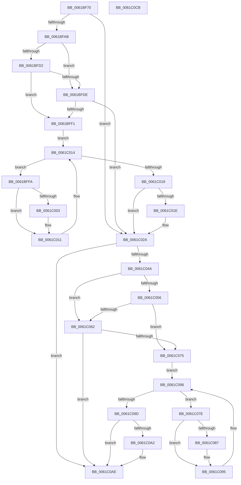

# DifAddDeviceWrapper

- RVA: `0x0061BF70`–`0x0061C0CC` (길이 `348` bytes)
- VA: `0x000000014061BF70`
- 실행 섹션: `.text`
- PDB 이름 있음: `예`; PDB Function 태그: `아니요`
- unwind 정보 RVA: `0x00093E28`
- 디코드: `95`개 명령, `348/348` bytes 표시
- 미해석 바이트: `0` (있으면 어셈블리에 `.byte`로 보존)

> 이 문서는 커널 이미지의 기계어와 PDB 기호를 분석해 생성했습니다. 4번과 5번은 함수 원형과 자료형을 바이너리 사용 방식에서 추정한 C 해석이며 원본 소스 복구 결과는 아닙니다.

## 1. Dependencies

- 직접 호출 지점: **8**; 고유 호출 대상: **4**
- 직접 호출자로 확인된 함수: **0**
- RIP 상대 이미지 참조: **3**

### Outgoing calls
- `0x0061BF9E` → [DifGetAPIThunkContextById](../49/DifGetAPIThunkContextById_function_00495A34.md) (function, `0x00495A34`)
- `0x0061BFE5` → [ExAcquireRundownProtection](../21/ExAcquireRundownProtection_function_00216620.md) (function, `0x00216620`)
- `0x0061C00C` → [guard_dispatch_icall](../6B/guard_dispatch_icall_function_006BAAD0.md) (function, `0x006BAAD0`)
- `0x0061C025` → [ExReleaseRundownProtection](../34/ExReleaseRundownProtection_function_00349E80.md) (function, `0x00349E80`)
- `0x0061C03C` → [guard_dispatch_icall](../6B/guard_dispatch_icall_function_006BAAD0.md) (function, `0x006BAAD0`)
- `0x0061C069` → [ExAcquireRundownProtection](../21/ExAcquireRundownProtection_function_00216620.md) (function, `0x00216620`)
- `0x0061C090` → [guard_dispatch_icall](../6B/guard_dispatch_icall_function_006BAAD0.md) (function, `0x006BAAD0`)
- `0x0061C0A9` → [ExReleaseRundownProtection](../34/ExReleaseRundownProtection_function_00349E80.md) (function, `0x00349E80`)

### Direct callers
- 이 함수 시작 RVA로 연결되는 직접 call은 확인되지 않았습니다. 간접 호출은 완전히 역산할 수 없습니다.

### Static image references
- `0x0061BFB2` → RVA `0x00F048B8` (`.data`; read)
- `0x0061BFD2` → RVA `0x00F04980` (`.data`; read)
- `0x0061BFDE` → RVA `0x00F03E80` (`.data`; read)

## 2. Other-region calls and transfers

- 다른 실행 섹션으로 향하는 call: **0**
- 별도 외부 분기/꼬리 이동을 확인하지 못했습니다.

## 3. Assembly (complete function range)

```asm
0061BF70  48 8B C4                        mov rax, rsp
0061BF73  48 89 58 08                     mov qword ptr [rax + 8], rbx
0061BF77  48 89 68 10                     mov qword ptr [rax + 0x10], rbp
0061BF7B  48 89 70 18                     mov qword ptr [rax + 0x18], rsi
0061BF7F  57                              push rdi
0061BF80  41 56                           push r14
0061BF82  41 57                           push r15
0061BF84  48 83 EC 40                     sub rsp, 0x40
0061BF88  0F 57 C0                        xorps xmm0, xmm0
0061BF8B  4C 8B F1                        mov r14, rcx
0061BF8E  B9 1E 00 00 10                  mov ecx, 0x1000001e
0061BF93  4C 8B FA                        mov r15, rdx
0061BF96  0F 11 40 C8                     movups xmmword ptr [rax - 0x38], xmm0
0061BF9A  0F 11 40 D8                     movups xmmword ptr [rax - 0x28], xmm0
0061BF9E  E8 91 9A E7 FF                  call 0x140495a34
0061BFA3  48 8B E8                        mov rbp, rax
0061BFA6  48 85 C0                        test rax, rax
0061BFA9  74 7F                           je 0x14061c02a
0061BFAB  49 8B 56 30                     mov rdx, qword ptr [r14 + 0x30]
0061BFAF  40 32 F6                        xor sil, sil
0061BFB2  40 38 35 FF 88 8E 00            cmp byte ptr [rip + 0x8e88ff], sil
0061BFB9  48 8B 4A 40                     mov rcx, qword ptr [rdx + 0x40]
0061BFBD  48 8B 51 18                     mov rdx, qword ptr [rcx + 0x18]
0061BFC1  48 89 54 24 20                  mov qword ptr [rsp + 0x20], rdx
0061BFC6  4C 89 74 24 30                  mov qword ptr [rsp + 0x30], r14
0061BFCB  4C 89 7C 24 28                  mov qword ptr [rsp + 0x28], r15
0061BFD0  75 0C                           jne 0x14061bfde
0061BFD2  F7 05 A4 89 8E 00 00 08 00 00   test dword ptr [rip + 0x8e89a4], 0x800
0061BFDC  74 13                           je 0x14061bff1
0061BFDE  48 8D 0D 9B 7E 8E 00            lea rcx, [rip + 0x8e7e9b]
0061BFE5  E8 36 A6 BF FF                  call 0x140216620
0061BFEA  40 8A F0                        mov sil, al
0061BFED  84 C0                           test al, al
0061BFEF  74 39                           je 0x14061c02a
0061BFF1  48 8D 7D 20                     lea rdi, [rbp + 0x20]
0061BFF5  48 8B 1F                        mov rbx, qword ptr [rdi]
0061BFF8  EB 1A                           jmp 0x14061c014
0061BFFA  48 8D 43 F0                     lea rax, [rbx - 0x10]
0061BFFE  48 85 C0                        test rax, rax
0061C001  74 0E                           je 0x14061c011
0061C003  48 8B 40 08                     mov rax, qword ptr [rax + 8]
0061C007  48 8D 4C 24 20                  lea rcx, [rsp + 0x20]
0061C00C  E8 BF EA 09 00                  call 0x1406baad0
0061C011  48 8B 1B                        mov rbx, qword ptr [rbx]
0061C014  48 3B DF                        cmp rbx, rdi
0061C017  75 E1                           jne 0x14061bffa
0061C019  40 84 F6                        test sil, sil
0061C01C  74 0C                           je 0x14061c02a
0061C01E  48 8D 0D 5B 7E 8E 00            lea rcx, [rip + 0x8e7e5b]
0061C025  E8 56 DE D2 FF                  call 0x140349e80
0061C02A  49 8B 46 30                     mov rax, qword ptr [r14 + 0x30]
0061C02E  49 8B D7                        mov rdx, r15
0061C031  48 8B 48 40                     mov rcx, qword ptr [rax + 0x40]
0061C035  48 8B 41 18                     mov rax, qword ptr [rcx + 0x18]
0061C039  49 8B CE                        mov rcx, r14
0061C03C  E8 8F EA 09 00                  call 0x1406baad0
0061C041  89 44 24 38                     mov dword ptr [rsp + 0x38], eax
0061C045  48 85 ED                        test rbp, rbp
0061C048  74 64                           je 0x14061c0ae
0061C04A  40 32 FF                        xor dil, dil
0061C04D  40 38 3D 64 88 8E 00            cmp byte ptr [rip + 0x8e8864], dil
0061C054  75 0C                           jne 0x14061c062
0061C056  F7 05 20 89 8E 00 00 08 00 00   test dword ptr [rip + 0x8e8920], 0x800
0061C060  74 13                           je 0x14061c075
0061C062  48 8D 0D 17 7E 8E 00            lea rcx, [rip + 0x8e7e17]
0061C069  E8 B2 A5 BF FF                  call 0x140216620
0061C06E  40 8A F8                        mov dil, al
0061C071  84 C0                           test al, al
0061C073  74 39                           je 0x14061c0ae
0061C075  48 8D 75 30                     lea rsi, [rbp + 0x30]
0061C079  48 8B 1E                        mov rbx, qword ptr [rsi]
0061C07C  EB 1A                           jmp 0x14061c098
0061C07E  48 8D 43 F0                     lea rax, [rbx - 0x10]
0061C082  48 85 C0                        test rax, rax
0061C085  74 0E                           je 0x14061c095
0061C087  48 8B 40 08                     mov rax, qword ptr [rax + 8]
0061C08B  48 8D 4C 24 20                  lea rcx, [rsp + 0x20]
0061C090  E8 3B EA 09 00                  call 0x1406baad0
0061C095  48 8B 1B                        mov rbx, qword ptr [rbx]
0061C098  48 3B DE                        cmp rbx, rsi
0061C09B  75 E1                           jne 0x14061c07e
0061C09D  40 84 FF                        test dil, dil
0061C0A0  74 0C                           je 0x14061c0ae
0061C0A2  48 8D 0D D7 7D 8E 00            lea rcx, [rip + 0x8e7dd7]
0061C0A9  E8 D2 DD D2 FF                  call 0x140349e80
0061C0AE  8B 44 24 38                     mov eax, dword ptr [rsp + 0x38]
0061C0B2  48 8B 5C 24 60                  mov rbx, qword ptr [rsp + 0x60]
0061C0B7  48 8B 6C 24 68                  mov rbp, qword ptr [rsp + 0x68]
0061C0BC  48 8B 74 24 70                  mov rsi, qword ptr [rsp + 0x70]
0061C0C1  48 83 C4 40                     add rsp, 0x40
0061C0C5  41 5F                           pop r15
0061C0C7  41 5E                           pop r14
0061C0C9  5F                              pop rdi
0061C0CA  C3                              ret
0061C0CB  CC                              int3
```

## 4. C-style interpretation (structured pseudocode)

```c
__int64 __fastcall DifAddDeviceWrapper(__int64 a1, __int64 a2)
{
    __int64 result;
    __int64 v_rdi;
    __int64 v_rsi;
    __int64 v_rsp;
    unsigned int v_stack_m20;
    unsigned __int64 v_stack_m28;
    unsigned __int64 v_stack_m30;
    unsigned __int64 v_stack_m38;
    unsigned __int64 v_stack_p10;
    unsigned __int64 v_stack_p18;
    unsigned __int64 v_stack_p8;

    *(unsigned __int64 *)(v_rsp + 8) = v_rbx;
    *(unsigned __int64 *)(v_rsp + 16) = v_rbp;
    *(unsigned __int64 *)(v_rsp + 24) = v_rsi;
    v_rsp = (v_rsp) - (64);
    *(unsigned __int64 *)(v_rsp - 56) = v_xmm0;
    *(unsigned __int64 *)(v_rsp - 40) = v_xmm0;
    result = DifGetAPIThunkContextById((unsigned int)(0x1000001EULL), a2, a3, a4);
    if (result == 0) goto loc_0061C02A;
    v_rsi = 0;
    v_stack_m38 = *(unsigned __int64 *)(*(unsigned __int64 *)(*(unsigned __int64 *)(a1 + 48) + 64) + 24);
    v_stack_m28 = a1;
    v_stack_m30 = a2;
    if ((*(unsigned __int8 *)(v_rip + 9341183)) != 0) goto loc_0061BFDE;
    if (((*(unsigned int *)(v_rip + 9341348)) & (0x800ULL)) == 0) goto loc_0061BFF1;
loc_0061BFDE:
    result = ExAcquireRundownProtection(v_rip + 9338523, *(unsigned __int64 *)(*(unsigned __int64 *)(*(unsigned __int64 *)(a1 + 48) + 64) + 24), a3, a4);
    if ((unsigned __int8)(result) == 0) goto loc_0061C02A;
loc_0061BFF1:
    goto loc_0061C014;
loc_0061BFFA:
    result = *(unsigned __int64 *)(result + 32) - 16;
    if (*(unsigned __int64 *)(result + 32) - 16 != 0) {
        result = *(unsigned __int64 *)(*(unsigned __int64 *)(result + 32) - 16 + 8);
        a1 = v_stack_m38;
        result = guard_dispatch_icall(a1, *(unsigned __int64 *)(*(unsigned __int64 *)(*(unsigned __int64 *)(a1 + 48) + 64) + 24), a3, a4);
    }
loc_0061C014:
    if ((*(unsigned __int64 *)(*(unsigned __int64 *)(result + 32))) != (result + 32)) goto loc_0061BFFA;
    if ((unsigned __int8)((unsigned __int8)(result)) != 0) {
        a1 = v_rip + 9338459;
        result = ExReleaseRundownProtection(a1, *(unsigned __int64 *)(*(unsigned __int64 *)(*(unsigned __int64 *)(a1 + 48) + 64) + 24), a3, a4);
    }
    result = guard_dispatch_icall(a1, a2, a3, a4);
    v_stack_m20 = (unsigned int)(result);
    if (result == 0) goto loc_0061C0AE;
    v_rdi = 0;
    if ((*(unsigned __int8 *)(v_rip + 9341028)) != 0) goto loc_0061C062;
    if (((*(unsigned int *)(v_rip + 9341216)) & (0x800ULL)) == 0) goto loc_0061C075;
loc_0061C062:
    result = ExAcquireRundownProtection(v_rip + 9338391, a2, a3, a4);
    if ((unsigned __int8)(result) == 0) goto loc_0061C0AE;
loc_0061C075:
    goto loc_0061C098;
loc_0061C07E:
    result = *(unsigned __int64 *)(result + 48) - 16;
    if (*(unsigned __int64 *)(result + 48) - 16 != 0) {
        result = *(unsigned __int64 *)(*(unsigned __int64 *)(result + 48) - 16 + 8);
        a1 = v_stack_m38;
        result = guard_dispatch_icall(a1, a2, a3, a4);
    }
loc_0061C098:
    if ((*(unsigned __int64 *)(*(unsigned __int64 *)(result + 48))) != (result + 48)) goto loc_0061C07E;
    if ((unsigned __int8)((unsigned __int8)(result)) != 0) {
        a1 = v_rip + 9338327;
        result = ExReleaseRundownProtection(a1, a2, a3, a4);
    }
    v_rsp = (v_rsp) + (64);
    return (unsigned int)(v_stack_m20);
}
```

## 5. (Beta) C Style

```c
int64_t DifAddDeviceWrapper(void *Arg1, int64_t Arg2)
{
    uint8_t *arg1 = (uint8_t *)Arg1;

    int64_t result;
    int64_t local_rdi;
    int64_t local_rsi;
    int64_t local_rsp;
    uint32_t v_stack_m20;
    uint64_t v_stack_m28;
    uint64_t v_stack_m30;
    uint64_t v_stack_m38;
    uint64_t v_stack_p10;
    uint64_t v_stack_p18;
    uint64_t v_stack_p8;

    *(uint64_t *)(local_rsp + 0x8) = local_rbx;
    *(uint64_t *)(local_rsp + 0x10) = local_rbp;
    *(uint64_t *)(local_rsp + 0x18) = local_rsi;
    local_rsp = (local_rsp) - (64);
    *(uint64_t *)(local_rsp - 0x38) = v_xmm0;
    *(uint64_t *)(local_rsp - 0x28) = v_xmm0;
    result = DifGetAPIThunkContextById((uint32_t)(0x1000001EULL), Arg2, a3, a4);
    if (result == 0) goto loc_0061C02A;
    local_rsi = 0;
    v_stack_m38 = *(uint64_t *)(*(uint64_t *)(*(uint64_t *)(arg1 + 0x30) + 0x40) + 0x18);
    v_stack_m28 = Arg1;
    v_stack_m30 = Arg2;
    if ((*(uint8_t *)(v_rip + 0x8E88FF)) != 0) goto loc_0061BFDE;
    if (((*(uint32_t *)(v_rip + 0x8E89A4)) & (0x800ULL)) == 0) goto loc_0061BFF1;
loc_0061BFDE:
    result = ExAcquireRundownProtection(v_rip + 9338523, *(uint64_t *)(*(uint64_t *)(*(uint64_t *)(arg1 + 0x30) + 0x40) + 0x18), a3, a4);
    if ((uint8_t)(result) == 0) goto loc_0061C02A;
loc_0061BFF1:
    goto loc_0061C014;
loc_0061BFFA:
    result = *(uint64_t *)(result + 0x20) - 16;
    if (*(uint64_t *)(result + 0x20) - 16 != 0) {
        result = *(uint64_t *)(*(uint64_t *)(result + 0x20) - 0x10 + 0x8);
        Arg1 = v_stack_m38;
        result = guard_dispatch_icall(Arg1, *(uint64_t *)(*(uint64_t *)(*(uint64_t *)(arg1 + 0x30) + 0x40) + 0x18), a3, a4);
    }
loc_0061C014:
    if ((*(uint64_t *)(*(uint64_t *)(result + 0x20))) != (result + 32)) goto loc_0061BFFA;
    if ((uint8_t)((uint8_t)(result)) != 0) {
        Arg1 = v_rip + 9338459;
        result = ExReleaseRundownProtection(Arg1, *(uint64_t *)(*(uint64_t *)(*(uint64_t *)(arg1 + 0x30) + 0x40) + 0x18), a3, a4);
    }
    result = guard_dispatch_icall(Arg1, Arg2, a3, a4);
    v_stack_m20 = (uint32_t)(result);
    if (result == 0) goto loc_0061C0AE;
    local_rdi = 0;
    if ((*(uint8_t *)(v_rip + 0x8E8864)) != 0) goto loc_0061C062;
    if (((*(uint32_t *)(v_rip + 0x8E8920)) & (0x800ULL)) == 0) goto loc_0061C075;
loc_0061C062:
    result = ExAcquireRundownProtection(v_rip + 9338391, Arg2, a3, a4);
    if ((uint8_t)(result) == 0) goto loc_0061C0AE;
loc_0061C075:
    goto loc_0061C098;
loc_0061C07E:
    result = *(uint64_t *)(result + 0x30) - 16;
    if (*(uint64_t *)(result + 0x30) - 16 != 0) {
        result = *(uint64_t *)(*(uint64_t *)(result + 0x30) - 0x10 + 0x8);
        Arg1 = v_stack_m38;
        result = guard_dispatch_icall(Arg1, Arg2, a3, a4);
    }
loc_0061C098:
    if ((*(uint64_t *)(*(uint64_t *)(result + 0x30))) != (result + 48)) goto loc_0061C07E;
    if ((uint8_t)((uint8_t)(result)) != 0) {
        Arg1 = v_rip + 9338327;
        result = ExReleaseRundownProtection(Arg1, Arg2, a3, a4);
    }
    local_rsp = (local_rsp) + (64);
    return (uint32_t)(v_stack_m20);
}
```

### 관측된 메모리 오프셋

구조체 형식이 확인되지 않은 접근은 인자 기준의 오프셋으로만 기록했습니다.

| 기준 인자 | 오프셋 표현 | 폭 (bit) | 접근 |
|---|---:|---:|---|
| `Arg1` | `+ 0x30` | `64` | `R` |

## 6. Execution-region graph

[열기: 2D/3D 그래프와 함수 탐색 컨트롤 패널](../../../control-panel.html?section=text&rva=0x0061BF70&view=graph)

- 2D 그래프는 위에서 아래로 흐르고, 3D 그래프는 빈 공간을 드래그해 회전합니다. Shift+드래그는 이동, 휠은 확대·축소, 함수 노드 선택은 대상 보고서 이동입니다.

### Static fallback


