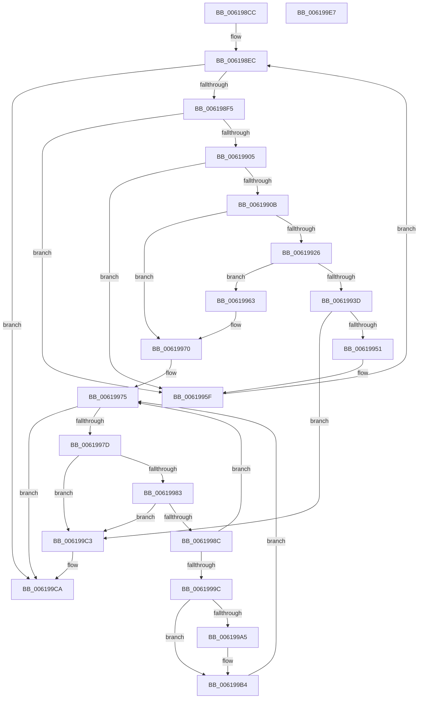

# DifAddPerDriverDataForPlugins

- RVA: `0x006198CC`–`0x006199E8` (길이 `284` bytes)
- VA: `0x00000001406198CC`
- 실행 섹션: `.text`
- PDB 이름 있음: `예`; PDB Function 태그: `아니요`
- unwind 정보 RVA: `0x0005E6B4`
- 디코드: `82`개 명령, `284/284` bytes 표시
- 미해석 바이트: `0` (있으면 어셈블리에 `.byte`로 보존)

> 이 문서는 커널 이미지의 기계어와 PDB 기호를 분석해 생성했습니다. 4번과 5번은 함수 원형과 자료형을 바이너리 사용 방식에서 추정한 C 해석이며 원본 소스 복구 결과는 아닙니다.

## 1. Dependencies

- 직접 호출 지점: **5**; 고유 호출 대상: **2**
- 직접 호출자로 확인된 함수: **1**
- RIP 상대 이미지 참조: **1**

### Outgoing calls
- `0x00619919` → [ExAllocatePool2](../../poolcode/B8/ExAllocatePool2_function_00B820F0.md) (function, `0x00B820F0`)
- `0x00619933` → [ExAllocatePool2](../../poolcode/B8/ExAllocatePool2_function_00B820F0.md) (function, `0x00B820F0`)
- `0x0061996B` → [ExFreePoolWithTag](../../poolcode/B8/ExFreePoolWithTag_function_00B82870.md) (function, `0x00B82870`)
- `0x006199AA` → [ExFreePoolWithTag](../../poolcode/B8/ExFreePoolWithTag_function_00B82870.md) (function, `0x00B82870`)
- `0x006199BC` → [ExFreePoolWithTag](../../poolcode/B8/ExFreePoolWithTag_function_00B82870.md) (function, `0x00B82870`)

### Direct callers
- [sub_006EAE08](../6E/Unknown_function_006EAE08.md) at `0x006EAE12`

### Static image references
- `0x006198F5` → RVA `0x00E68240` (`.data`; read)

## 2. Other-region calls and transfers

- 다른 실행 섹션으로 향하는 call: **5**
  - `0x00619919` → [ExAllocatePool2](../../poolcode/B8/ExAllocatePool2_function_00B820F0.md) (`.text` → `POOLCODE`)
  - `0x00619933` → [ExAllocatePool2](../../poolcode/B8/ExAllocatePool2_function_00B820F0.md) (`.text` → `POOLCODE`)
  - `0x0061996B` → [ExFreePoolWithTag](../../poolcode/B8/ExFreePoolWithTag_function_00B82870.md) (`.text` → `POOLCODE`)
  - `0x006199AA` → [ExFreePoolWithTag](../../poolcode/B8/ExFreePoolWithTag_function_00B82870.md) (`.text` → `POOLCODE`)
  - `0x006199BC` → [ExFreePoolWithTag](../../poolcode/B8/ExFreePoolWithTag_function_00B82870.md) (`.text` → `POOLCODE`)
- 별도 외부 분기/꼬리 이동을 확인하지 못했습니다.

## 3. Assembly (complete function range)

```asm
006198CC  48 8B C4                        mov rax, rsp
006198CF  48 89 58 08                     mov qword ptr [rax + 8], rbx
006198D3  48 89 68 10                     mov qword ptr [rax + 0x10], rbp
006198D7  48 89 70 18                     mov qword ptr [rax + 0x18], rsi
006198DB  48 89 78 20                     mov qword ptr [rax + 0x20], rdi
006198DF  41 56                           push r14
006198E1  48 83 EC 20                     sub rsp, 0x20
006198E5  33 F6                           xor esi, esi
006198E7  48 8B D9                        mov rbx, rcx
006198EA  33 FF                           xor edi, edi
006198EC  83 FE 40                        cmp esi, 0x40
006198EF  0F 83 D5 00 00 00               jae 0x1406199ca
006198F5  48 8D 0D 44 E9 84 00            lea rcx, [rip + 0x84e944]
006198FC  48 8B 0C F1                     mov rcx, qword ptr [rcx + rsi*8]
00619900  48 85 C9                        test rcx, rcx
00619903  74 5A                           je 0x14061995f
00619905  8B 29                           mov ebp, dword ptr [rcx]
00619907  85 ED                           test ebp, ebp
00619909  74 54                           je 0x14061995f
0061990B  BA 20 00 00 00                  mov edx, 0x20
00619910  41 B8 44 66 44 63               mov r8d, 0x63446644
00619916  8D 4A 20                        lea ecx, [rdx + 0x20]
00619919  E8 D2 87 56 00                  call 0x140b820f0
0061991E  4C 8B F0                        mov r14, rax
00619921  48 85 C0                        test rax, rax
00619924  74 4A                           je 0x140619970
00619926  8B D5                           mov edx, ebp
00619928  B9 40 00 00 00                  mov ecx, 0x40
0061992D  41 B8 44 66 44 63               mov r8d, 0x63446644
00619933  E8 B8 87 56 00                  call 0x140b820f0
00619938  48 85 C0                        test rax, rax
0061993B  74 26                           je 0x140619963
0061993D  49 89 46 08                     mov qword ptr [r14 + 8], rax
00619941  49 8D 46 10                     lea rax, [r14 + 0x10]
00619945  41 89 36                        mov dword ptr [r14], esi
00619948  48 8B 4B 08                     mov rcx, qword ptr [rbx + 8]
0061994C  48 39 19                        cmp qword ptr [rcx], rbx
0061994F  75 72                           jne 0x1406199c3
00619951  48 89 18                        mov qword ptr [rax], rbx
00619954  48 89 48 08                     mov qword ptr [rax + 8], rcx
00619958  48 89 01                        mov qword ptr [rcx], rax
0061995B  48 89 43 08                     mov qword ptr [rbx + 8], rax
0061995F  FF C6                           inc esi
00619961  EB 89                           jmp 0x1406198ec
00619963  BA 44 69 66 4E                  mov edx, 0x4e666944
00619968  49 8B CE                        mov rcx, r14
0061996B  E8 00 8F 56 00                  call 0x140b82870
00619970  BF 17 00 00 C0                  mov edi, 0xc0000017
00619975  48 8B 03                        mov rax, qword ptr [rbx]
00619978  48 3B C3                        cmp rax, rbx
0061997B  74 4D                           je 0x1406199ca
0061997D  48 39 58 08                     cmp qword ptr [rax + 8], rbx
00619981  75 40                           jne 0x1406199c3
00619983  48 8B 08                        mov rcx, qword ptr [rax]
00619986  48 39 41 08                     cmp qword ptr [rcx + 8], rax
0061998A  75 37                           jne 0x1406199c3
0061998C  48 8D 70 F0                     lea rsi, [rax - 0x10]
00619990  48 89 0B                        mov qword ptr [rbx], rcx
00619993  48 89 59 08                     mov qword ptr [rcx + 8], rbx
00619997  48 85 F6                        test rsi, rsi
0061999A  74 D9                           je 0x140619975
0061999C  48 8B 4E 08                     mov rcx, qword ptr [rsi + 8]
006199A0  48 85 C9                        test rcx, rcx
006199A3  74 0F                           je 0x1406199b4
006199A5  BA 44 69 66 4E                  mov edx, 0x4e666944
006199AA  E8 C1 8E 56 00                  call 0x140b82870
006199AF  48 83 66 08 00                  and qword ptr [rsi + 8], 0
006199B4  BA 44 69 66 4E                  mov edx, 0x4e666944
006199B9  48 8B CE                        mov rcx, rsi
006199BC  E8 AF 8E 56 00                  call 0x140b82870
006199C1  EB B2                           jmp 0x140619975
006199C3  B9 03 00 00 00                  mov ecx, 3
006199C8  CD 29                           int 0x29
006199CA  48 8B 5C 24 30                  mov rbx, qword ptr [rsp + 0x30]
006199CF  8B C7                           mov eax, edi
006199D1  48 8B 7C 24 48                  mov rdi, qword ptr [rsp + 0x48]
006199D6  48 8B 6C 24 38                  mov rbp, qword ptr [rsp + 0x38]
006199DB  48 8B 74 24 40                  mov rsi, qword ptr [rsp + 0x40]
006199E0  48 83 C4 20                     add rsp, 0x20
006199E4  41 5E                           pop r14
006199E6  C3                              ret
006199E7  CC                              int3
```

## 4. C-style interpretation (structured pseudocode)

```c
__int64 __fastcall DifAddPerDriverDataForPlugins(__int64 a1)
{
    __int64 result;
    __int64 v_rdi;
    __int64 v_rsi;
    __int64 v_rsp;
    unsigned __int64 v_stack_p10;
    unsigned __int64 v_stack_p18;
    unsigned __int64 v_stack_p20;
    unsigned __int64 v_stack_p8;

    *(unsigned __int64 *)(v_rsp + 8) = v_rbx;
    *(unsigned __int64 *)(v_rsp + 16) = v_rbp;
    *(unsigned __int64 *)(v_rsp + 24) = v_rsi;
    *(unsigned __int64 *)(v_rsp + 32) = v_rdi;
    v_rsp = (v_rsp) - (32);
    v_rsi = 0;
    v_rdi = 0;
loc_006198EC:
    if (0 >= 64) goto loc_006199CA;
    if (*(unsigned __int64 *)(v_rip + 8710468 + v_rsi * 8) == 0) goto loc_0061995F;
    if ((unsigned int)((unsigned int)(*(unsigned int *)(*(unsigned __int64 *)(v_rip + 8710468 + v_rsi * 8)))) == 0) goto loc_0061995F;
    result = ExAllocatePool2(32 + 32, 32, (unsigned int)(0x63446644ULL), a4);
    if (result == 0) goto loc_00619970;
    result = ExAllocatePool2(64, (unsigned int)((unsigned int)((unsigned int)(*(unsigned int *)(*(unsigned __int64 *)(v_rip + 8710468 + v_rsi * 8))))), (unsigned int)(0x63446644ULL), a4);
    if (result == 0) goto loc_00619963;
    *(unsigned __int64 *)(result + 8) = result;
    *(unsigned int *)(result) = 0;
    if ((*(unsigned __int64 *)(*(unsigned __int64 *)(a1 + 8))) != a1) goto loc_006199C3;
    *(unsigned __int64 *)(result + 16) = a1;
    *(unsigned __int64 *)(result + 16 + 8) = *(unsigned __int64 *)(a1 + 8);
    *(unsigned __int64 *)(*(unsigned __int64 *)(a1 + 8)) = result + 16;
    *(unsigned __int64 *)(a1 + 8) = result + 16;
loc_0061995F:
    v_rsi = (unsigned int)((v_rsi) + 1);
    goto loc_006198EC;
loc_00619963:
    result = ExFreePoolWithTag(result, (unsigned int)(0x4E666944ULL), (unsigned int)(0x63446644ULL), a4);
loc_00619970:
loc_00619975:
    if ((*(unsigned __int64 *)(a1)) == a1) goto loc_006199CA;
    if ((*(unsigned __int64 *)(*(unsigned __int64 *)(a1) + 8)) != a1) goto loc_006199C3;
    if ((*(unsigned __int64 *)(*(unsigned __int64 *)(*(unsigned __int64 *)(a1)) + 8)) != (*(unsigned __int64 *)(a1))) goto loc_006199C3;
    *(unsigned __int64 *)(a1) = *(unsigned __int64 *)(*(unsigned __int64 *)(a1));
    *(unsigned __int64 *)(*(unsigned __int64 *)(*(unsigned __int64 *)(a1)) + 8) = a1;
    if (*(unsigned __int64 *)(a1) - 16 == 0) goto loc_00619975;
    result = *(unsigned __int64 *)(a1);
    if (*(unsigned __int64 *)(*(unsigned __int64 *)(a1) - 16 + 8) != 0) {
        a2 = 0x4E666944ULL;
        result = ExFreePoolWithTag(*(unsigned __int64 *)(*(unsigned __int64 *)(a1) - 16 + 8), a2, (unsigned int)(0x63446644ULL), a4);
    }
    result = ExFreePoolWithTag(*(unsigned __int64 *)(a1) - 16, (unsigned int)(0x4E666944ULL), (unsigned int)(0x63446644ULL), a4);
    goto loc_00619975;
loc_006199C3:
loc_006199CA:
    v_rsp = (v_rsp) + (32);
    return (unsigned int)((unsigned int)((unsigned int)(0xC0000017ULL)));
}
```

## 5. (Beta) C Style

```c
int64_t DifAddPerDriverDataForPlugins(void *Arg1)
{
    uint8_t *arg1 = (uint8_t *)Arg1;

    int64_t result;
    int64_t local_rdi;
    int64_t local_rsi;
    int64_t local_rsp;
    uint64_t v_stack_p10;
    uint64_t v_stack_p18;
    uint64_t v_stack_p20;
    uint64_t v_stack_p8;

    *(uint64_t *)(local_rsp + 0x8) = local_rbx;
    *(uint64_t *)(local_rsp + 0x10) = local_rbp;
    *(uint64_t *)(local_rsp + 0x18) = local_rsi;
    *(uint64_t *)(local_rsp + 0x20) = local_rdi;
    local_rsp = (local_rsp) - (32);
    local_rsi = 0;
    local_rdi = 0;
loc_006198EC:
    if (0 >= 64) goto loc_006199CA;
    if (*(uint64_t *)(v_rip + 0x84E944 + local_rsi * 8) == 0) goto loc_0061995F;
    if ((uint32_t)((uint32_t)(*(uint32_t *)(*(uint64_t *)(v_rip + 0x84E944 + local_rsi * 8)))) == 0) goto loc_0061995F;
    result = ExAllocatePool2(32 + 32, 32, (uint32_t)(0x63446644ULL), a4);
    if (result == 0) goto loc_00619970;
    result = ExAllocatePool2(64, (uint32_t)((uint32_t)((uint32_t)(*(uint32_t *)(*(uint64_t *)(v_rip + 0x84E944 + local_rsi * 8))))), (uint32_t)(0x63446644ULL), a4);
    if (result == 0) goto loc_00619963;
    *(uint64_t *)(result + 0x8) = result;
    *(uint32_t *)(result) = 0;
    if ((*(uint64_t *)(*(uint64_t *)(arg1 + 0x8))) != Arg1) goto loc_006199C3;
    *(void **)(result + 0x10) = Arg1;
    *(uint64_t *)(result + 0x10 + 0x8) = *(uint64_t *)(arg1 + 0x8);
    *(uint64_t *)(*(uint64_t *)(arg1 + 0x8)) = result + 16;
    *(uint64_t *)(arg1 + 0x8) = result + 16;
loc_0061995F:
    local_rsi = (uint32_t)((local_rsi) + 1);
    goto loc_006198EC;
loc_00619963:
    result = ExFreePoolWithTag(result, (uint32_t)(0x4E666944ULL), (uint32_t)(0x63446644ULL), a4);
loc_00619970:
loc_00619975:
    if ((*(uint64_t *)(arg1)) == Arg1) goto loc_006199CA;
    if ((*(uint64_t *)(*(uint64_t *)(arg1) + 0x8)) != Arg1) goto loc_006199C3;
    if ((*(uint64_t *)(*(uint64_t *)(*(uint64_t *)(arg1)) + 0x8)) != (*(uint64_t *)(arg1))) goto loc_006199C3;
    *(uint64_t *)(arg1) = *(uint64_t *)(*(uint64_t *)(arg1));
    *(void **)(*(uint64_t *)(*(uint64_t *)(arg1)) + 0x8) = Arg1;
    if (*(uint64_t *)(arg1) - 16 == 0) goto loc_00619975;
    result = *(uint64_t *)(arg1);
    if (*(uint64_t *)(*(uint64_t *)(arg1) - 0x10 + 0x8) != 0) {
        a2 = 0x4E666944ULL;
        result = ExFreePoolWithTag(*(uint64_t *)(*(uint64_t *)(arg1) - 0x10 + 0x8), a2, (uint32_t)(0x63446644ULL), a4);
    }
    result = ExFreePoolWithTag(*(uint64_t *)(arg1) - 16, (uint32_t)(0x4E666944ULL), (uint32_t)(0x63446644ULL), a4);
    goto loc_00619975;
loc_006199C3:
loc_006199CA:
    local_rsp = (local_rsp) + (32);
    return (uint32_t)((uint32_t)((uint32_t)(0xC0000017ULL)));
}
```

### 관측된 메모리 오프셋

구조체 형식이 확인되지 않은 접근은 인자 기준의 오프셋으로만 기록했습니다.

| 기준 인자 | 오프셋 표현 | 폭 (bit) | 접근 |
|---|---:|---:|---|
| `Arg1` | `+ 0x0` | `64` | `R` |
| `Arg1` | `+ 0x0` | `64` | `W` |
| `Arg1` | `+ 0x8` | `64` | `R` |
| `Arg1` | `+ 0x8` | `64` | `W` |

## 6. Execution-region graph

[열기: 2D/3D 그래프와 함수 탐색 컨트롤 패널](../../../control-panel.html?section=text&rva=0x006198CC&view=graph)

- 2D 그래프는 위에서 아래로 흐르고, 3D 그래프는 빈 공간을 드래그해 회전합니다. Shift+드래그는 이동, 휠은 확대·축소, 함수 노드 선택은 대상 보고서 이동입니다.

### Static fallback


