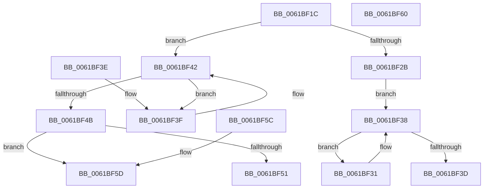

# DifAvlRealPredecessor

- RVA: `0x0061BF1C`–`0x0061BF61` (길이 `69` bytes)
- VA: `0x000000014061BF1C`
- 실행 섹션: `.text`
- PDB 이름 있음: `예`; PDB Function 태그: `아니요`
- unwind 정보 RVA: `0x000DB714`
- 디코드: `27`개 명령, `69/69` bytes 표시
- 미해석 바이트: `0` (있으면 어셈블리에 `.byte`로 보존)

> 이 문서는 커널 이미지의 기계어와 PDB 기호를 분석해 생성했습니다. 4번과 5번은 함수 원형과 자료형을 바이너리 사용 방식에서 추정한 C 해석이며 원본 소스 복구 결과는 아닙니다.

## 1. Dependencies

- 직접 호출 지점: **0**; 고유 호출 대상: **0**
- 직접 호출자로 확인된 함수: **1**
- RIP 상대 이미지 참조: **0**

### Outgoing calls
- 직접 디코드된 call 명령이 없습니다.

### Direct callers
- [DifObjTrkQeuryInvokeDeleteRange](DifObjTrkQeuryInvokeDeleteRange_function_00619EA0.md) at `0x0061A07E`

### Static image references
- 디코드된 RIP-relative 메모리 참조가 없습니다.

## 2. Other-region calls and transfers

- 다른 실행 섹션으로 향하는 call: **0**
- 별도 외부 분기/꼬리 이동을 확인하지 못했습니다.

## 3. Assembly (complete function range)

```asm
0061BF1C  48 8B 41 08                     mov rax, qword ptr [rcx + 8]
0061BF20  45 33 C0                        xor r8d, r8d
0061BF23  48 8B D1                        mov rdx, rcx
0061BF26  48 85 C0                        test rax, rax
0061BF29  74 17                           je 0x14061bf42
0061BF2B  48 8B 48 10                     mov rcx, qword ptr [rax + 0x10]
0061BF2F  EB 07                           jmp 0x14061bf38
0061BF31  48 8B C1                        mov rax, rcx
0061BF34  48 8B 49 10                     mov rcx, qword ptr [rcx + 0x10]
0061BF38  48 85 C9                        test rcx, rcx
0061BF3B  75 F4                           jne 0x14061bf31
0061BF3D  C3                              ret
0061BF3E  CC                              int3
0061BF3F  48 8B D1                        mov rdx, rcx
0061BF42  48 8B 09                        mov rcx, qword ptr [rcx]
0061BF45  48 39 51 08                     cmp qword ptr [rcx + 8], rdx
0061BF49  74 F4                           je 0x14061bf3f
0061BF4B  48 39 51 10                     cmp qword ptr [rcx + 0x10], rdx
0061BF4F  75 0C                           jne 0x14061bf5d
0061BF51  48 39 09                        cmp qword ptr [rcx], rcx
0061BF54  4C 0F 45 C1                     cmovne r8, rcx
0061BF58  49 8B C0                        mov rax, r8
0061BF5B  C3                              ret
0061BF5C  CC                              int3
0061BF5D  33 C0                           xor eax, eax
0061BF5F  C3                              ret
0061BF60  CC                              int3
```

## 4. C-style interpretation (structured pseudocode)

```c
__int64 __fastcall DifAvlRealPredecessor(__int64 a1, __int64 a2, int a3)
{
    __int64 result;

    a3 = 0;
    if (*(unsigned __int64 *)(a1 + 8) == 0) goto loc_0061BF42;
    goto loc_0061BF38;
loc_0061BF31:
loc_0061BF38:
    if (*(unsigned __int64 *)(*(unsigned __int64 *)(*(unsigned __int64 *)(a1 + 8) + 16) + 16) != 0) goto loc_0061BF31;
    return *(unsigned __int64 *)(*(unsigned __int64 *)(a1 + 8) + 16);
loc_0061BF3F:
loc_0061BF42:
    if ((*(unsigned __int64 *)(*(unsigned __int64 *)(*(unsigned __int64 *)(*(unsigned __int64 *)(*(unsigned __int64 *)(a1 + 8) + 16) + 16)) + 8)) == (*(unsigned __int64 *)(*(unsigned __int64 *)(*(unsigned __int64 *)(a1 + 8) + 16) + 16))) goto loc_0061BF3F;
    if ((*(unsigned __int64 *)(*(unsigned __int64 *)(*(unsigned __int64 *)(*(unsigned __int64 *)(*(unsigned __int64 *)(a1 + 8) + 16) + 16)) + 16)) != (*(unsigned __int64 *)(*(unsigned __int64 *)(*(unsigned __int64 *)(a1 + 8) + 16) + 16))) goto loc_0061BF5D;
    if ((*(unsigned __int64 *)(*(unsigned __int64 *)(*(unsigned __int64 *)(*(unsigned __int64 *)(*(unsigned __int64 *)(a1 + 8) + 16) + 16)))) != (*(unsigned __int64 *)(*(unsigned __int64 *)(*(unsigned __int64 *)(*(unsigned __int64 *)(a1 + 8) + 16) + 16)))) { a3 = *(unsigned __int64 *)(*(unsigned __int64 *)(*(unsigned __int64 *)(*(unsigned __int64 *)(a1 + 8) + 16) + 16)); }
    return a3;
loc_0061BF5D:
    result = 0;
    return result;
}
```

## 5. (Beta) C Style

```c
int64_t DifAvlRealPredecessor(void *Arg1, int64_t Arg2, int32_t Arg3)
{
    uint8_t *arg1 = (uint8_t *)Arg1;

    int64_t result;

    Arg3 = 0;
    if (*(uint64_t *)(arg1 + 0x8) == 0) goto loc_0061BF42;
    goto loc_0061BF38;
loc_0061BF31:
loc_0061BF38:
    if (*(uint64_t *)(*(uint64_t *)(*(uint64_t *)(arg1 + 0x8) + 0x10) + 0x10) != 0) goto loc_0061BF31;
    return *(uint64_t *)(*(uint64_t *)(arg1 + 0x8) + 0x10);
loc_0061BF3F:
loc_0061BF42:
    if ((*(uint64_t *)(*(uint64_t *)(*(uint64_t *)(*(uint64_t *)(*(uint64_t *)(arg1 + 0x8) + 0x10) + 0x10)) + 0x8)) == (*(uint64_t *)(*(uint64_t *)(*(uint64_t *)(arg1 + 0x8) + 0x10) + 0x10))) goto loc_0061BF3F;
    if ((*(uint64_t *)(*(uint64_t *)(*(uint64_t *)(*(uint64_t *)(*(uint64_t *)(arg1 + 0x8) + 0x10) + 0x10)) + 0x10)) != (*(uint64_t *)(*(uint64_t *)(*(uint64_t *)(arg1 + 0x8) + 0x10) + 0x10))) goto loc_0061BF5D;
    if ((*(uint64_t *)(*(uint64_t *)(*(uint64_t *)(*(uint64_t *)(*(uint64_t *)(arg1 + 0x8) + 0x10) + 0x10)))) != (*(uint64_t *)(*(uint64_t *)(*(uint64_t *)(*(uint64_t *)(arg1 + 0x8) + 0x10) + 0x10)))) { Arg3 = *(uint64_t *)(*(uint64_t *)(*(uint64_t *)(*(uint64_t *)(arg1 + 0x8) + 0x10) + 0x10)); }
    return Arg3;
loc_0061BF5D:
    result = 0;
    return result;
}
```

### 관측된 메모리 오프셋

구조체 형식이 확인되지 않은 접근은 인자 기준의 오프셋으로만 기록했습니다.

| 기준 인자 | 오프셋 표현 | 폭 (bit) | 접근 |
|---|---:|---:|---|
| `Arg1` | `+ 0x8` | `64` | `R` |

## 6. Execution-region graph

[열기: 2D/3D 그래프와 함수 탐색 컨트롤 패널](../../../control-panel.html?section=text&rva=0x0061BF1C&view=graph)

- 2D 그래프는 위에서 아래로 흐르고, 3D 그래프는 빈 공간을 드래그해 회전합니다. Shift+드래그는 이동, 휠은 확대·축소, 함수 노드 선택은 대상 보고서 이동입니다.

### Static fallback


