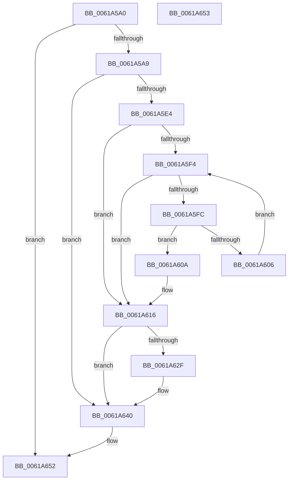

# DifCallPluginEntry

- RVA: `0x0061A5A0`–`0x0061A654` (길이 `180` bytes)
- VA: `0x000000014061A5A0`
- 실행 섹션: `.text`
- PDB 이름 있음: `예`; PDB Function 태그: `아니요`
- unwind 정보 RVA: `0x000D2B10`
- 디코드: `53`개 명령, `180/180` bytes 표시
- 미해석 바이트: `0` (있으면 어셈블리에 `.byte`로 보존)

> 이 문서는 커널 이미지의 기계어와 PDB 기호를 분석해 생성했습니다. 4번과 5번은 함수 원형과 자료형을 바이너리 사용 방식에서 추정한 C 해석이며 원본 소스 복구 결과는 아닙니다.

## 1. Dependencies

- 직접 호출 지점: **3**; 고유 호출 대상: **3**
- 직접 호출자로 확인된 함수: **1**
- RIP 상대 이미지 참조: **5**

### Outgoing calls
- `0x0061A626` → [guard_dispatch_icall](../6B/guard_dispatch_icall_function_006BAAD0.md) (function, `0x006BAAD0`)
- `0x0061A63B` → [DifUtilDbgPrint](DifUtilDbgPrint_function_00619B70.md) (function, `0x00619B70`)
- `0x0061A648` → [_security_check_cookie](../6A/_security_check_cookie_function_006AC640.md) (function, `0x006AC640`)

### Direct callers
- [DifRegisterKernelPlugins](DifRegisterKernelPlugins_function_0061AA40.md) at `0x0061ABA4`

### Static image references
- `0x0061A5AE` → RVA `0x00E0A740` (`.data`; read)
- `0x0061A5D5` → RVA `0x00E681A0` (`.data`; read)
- `0x0061A5E4` → RVA `0x00F03DB0` (`.data`; read)
- `0x0061A5F4` → RVA `0x00F03DB8` (`.data`; read)
- `0x0061A632` → RVA `0x006CFBD0` (` ?? ::FNODOBFM::`string'`; read)

## 2. Other-region calls and transfers

- 다른 실행 섹션으로 향하는 call: **0**
- 별도 외부 분기/꼬리 이동을 확인하지 못했습니다.

## 3. Assembly (complete function range)

```asm
0061A5A0  83 F9 40                        cmp ecx, 0x40
0061A5A3  0F 83 A9 00 00 00               jae 0x14061a652
0061A5A9  53                              push rbx
0061A5AA  48 83 EC 30                     sub rsp, 0x30
0061A5AE  48 8B 05 8B 01 7F 00            mov rax, qword ptr [rip + 0x7f018b]
0061A5B5  48 33 C4                        xor rax, rsp
0061A5B8  48 89 44 24 28                  mov qword ptr [rsp + 0x28], rax
0061A5BD  48 83 64 24 20 00               and qword ptr [rsp + 0x20], 0
0061A5C3  4C 8B CA                        mov r9, rdx
0061A5C6  8B D9                           mov ebx, ecx
0061A5C8  8A C3                           mov al, bl
0061A5CA  8B D3                           mov edx, ebx
0061A5CC  24 1F                           and al, 0x1f
0061A5CE  48 C1 EA 05                     shr rdx, 5
0061A5D2  0F B6 C8                        movzx ecx, al
0061A5D5  48 8D 05 C4 DB 84 00            lea rax, [rip + 0x84dbc4]
0061A5DC  8B 04 90                        mov eax, dword ptr [rax + rdx*4]
0061A5DF  0F A3 C8                        bt eax, ecx
0061A5E2  73 5C                           jae 0x14061a640
0061A5E4  4C 8B 05 C5 97 8E 00            mov r8, qword ptr [rip + 0x8e97c5]
0061A5EB  32 D2                           xor dl, dl
0061A5ED  33 C9                           xor ecx, ecx
0061A5EF  4D 85 C0                        test r8, r8
0061A5F2  74 22                           je 0x14061a616
0061A5F4  3B 0D BE 97 8E 00               cmp ecx, dword ptr [rip + 0x8e97be]
0061A5FA  73 1A                           jae 0x14061a616
0061A5FC  48 8D 04 49                     lea rax, [rcx + rcx*2]
0061A600  41 3B 1C 80                     cmp ebx, dword ptr [r8 + rax*4]
0061A604  74 04                           je 0x14061a60a
0061A606  FF C1                           inc ecx
0061A608  EB EA                           jmp 0x14061a5f4
0061A60A  49 8B 44 80 04                  mov rax, qword ptr [r8 + rax*4 + 4]
0061A60F  B2 01                           mov dl, 1
0061A611  48 89 44 24 20                  mov qword ptr [rsp + 0x20], rax
0061A616  F6 DA                           neg dl
0061A618  48 8D 44 24 20                  lea rax, [rsp + 0x20]
0061A61D  48 1B C9                        sbb rcx, rcx
0061A620  48 23 C8                        and rcx, rax
0061A623  49 8B C1                        mov rax, r9
0061A626  E8 A5 04 0A 00                  call 0x1406baad0
0061A62B  85 C0                           test eax, eax
0061A62D  79 11                           jns 0x14061a640
0061A62F  44 8B C0                        mov r8d, eax
0061A632  48 8D 0D 97 55 0B 00            lea rcx, [rip + 0xb5597]
0061A639  8B D3                           mov edx, ebx
0061A63B  E8 30 F5 FF FF                  call 0x140619b70
0061A640  48 8B 4C 24 28                  mov rcx, qword ptr [rsp + 0x28]
0061A645  48 33 CC                        xor rcx, rsp
0061A648  E8 F3 1F 09 00                  call 0x1406ac640
0061A64D  48 83 C4 30                     add rsp, 0x30
0061A651  5B                              pop rbx
0061A652  C3                              ret
0061A653  CC                              int3
```

## 4. C-style interpretation (structured pseudocode)

```c
__int64 __fastcall DifCallPluginEntry(int a1, __int64 a2)
{
    __int64 result;
    __int64 v_rsp;
    unsigned __int64 v_stack_m10;
    unsigned __int64 v_stack_m18;

    if (a1 >= 64) goto loc_0061A652;
    v_rsp = (v_rsp) - (48);
    result = (*(unsigned __int64 *)(v_rip + 8323467)) ^ (v_rsp);
    v_stack_m10 = result;
    result = (unsigned __int8)(((unsigned __int8)((unsigned int)(a1))) & (31));
    a2 = ((unsigned int)((unsigned int)((unsigned int)(a1)))) >> (5);
    if (condition_is_above_or_equal) goto loc_0061A640;
    a2 = 0;
    a1 = 0;
    if (*(unsigned __int64 *)(v_rip + 9344965) == 0) goto loc_0061A616;
loc_0061A5F4:
    if (0 >= (*(unsigned int *)(v_rip + 9344958))) goto loc_0061A616;
    if (((unsigned int)((unsigned int)(a1))) == (*(unsigned int *)(*(unsigned __int64 *)(v_rip + 9344965) + a1 + a1 * 2 * 4))) goto loc_0061A60A;
    a1 = (unsigned int)((a1) + 1);
    goto loc_0061A5F4;
loc_0061A60A:
    v_stack_m18 = *(unsigned __int64 *)(*(unsigned __int64 *)(v_rip + 9344965) + a1 + a1 * 2 * 4 + 4);
loc_0061A616:
    a2 = (unsigned __int8)(-(1));
    a1 = (a1) & (v_stack_m18);
    result = guard_dispatch_icall(a1, a2, *(unsigned __int64 *)(v_rip + 9344965), a2);
    if (sign_flag) {
        a3 = (unsigned int)(result);
        a1 = v_rip + 742807;
        a2 = (unsigned int)((unsigned int)(a1));
        result = DifUtilDbgPrint(a1, a2, a3, a2);
    }
    a1 = (v_stack_m10) ^ (v_rsp);
    result = _security_check_cookie(a1, a2, a3, a2);
    v_rsp = (v_rsp) + (48);
loc_0061A652:
    return result;
}
```

## 5. (Beta) C Style

```c
int64_t DifCallPluginEntry(int32_t Arg1, int64_t Arg2)
{
    int64_t result;
    int64_t local_rsp;
    uint64_t v_stack_m10;
    uint64_t v_stack_m18;

    if (Arg1 >= 64) goto loc_0061A652;
    local_rsp = (local_rsp) - (48);
    result = (*(uint64_t *)(v_rip + 0x7F018B)) ^ (local_rsp);
    v_stack_m10 = result;
    result = (uint8_t)(((uint8_t)((uint32_t)(Arg1))) & (31));
    Arg2 = ((uint32_t)((uint32_t)((uint32_t)(Arg1)))) >> (5);
    if (condition_is_above_or_equal) goto loc_0061A640;
    Arg2 = 0;
    Arg1 = 0;
    if (*(uint64_t *)(v_rip + 0x8E97C5) == 0) goto loc_0061A616;
loc_0061A5F4:
    if (0 >= (*(uint32_t *)(v_rip + 0x8E97BE))) goto loc_0061A616;
    if (((uint32_t)((uint32_t)(Arg1))) == (*(uint32_t *)(*(uint64_t *)(v_rip + 0x8E97C5) + Arg1 + Arg1 * 2 * 4))) goto loc_0061A60A;
    Arg1 = (uint32_t)((Arg1) + 1);
    goto loc_0061A5F4;
loc_0061A60A:
    v_stack_m18 = *(uint64_t *)(*(uint64_t *)(v_rip + 0x8E97C5) + Arg1 + Arg1 * 2 * 4 + 0x4);
loc_0061A616:
    Arg2 = (uint8_t)(-(1));
    Arg1 = (Arg1) & (v_stack_m18);
    result = guard_dispatch_icall(Arg1, Arg2, *(uint64_t *)(v_rip + 0x8E97C5), Arg2);
    if (sign_flag) {
        a3 = (uint32_t)(result);
        Arg1 = v_rip + 742807;
        Arg2 = (uint32_t)((uint32_t)(Arg1));
        result = DifUtilDbgPrint(Arg1, Arg2, a3, Arg2);
    }
    Arg1 = (v_stack_m10) ^ (local_rsp);
    result = _security_check_cookie(Arg1, Arg2, a3, Arg2);
    local_rsp = (local_rsp) + (48);
loc_0061A652:
    return result;
}
```

## 6. Execution-region graph

[열기: 2D/3D 그래프와 함수 탐색 컨트롤 패널](../../../control-panel.html?section=text&rva=0x0061A5A0&view=graph)

- 2D 그래프는 위에서 아래로 흐르고, 3D 그래프는 빈 공간을 드래그해 회전합니다. Shift+드래그는 이동, 휠은 확대·축소, 함수 노드 선택은 대상 보고서 이동입니다.

### Static fallback


