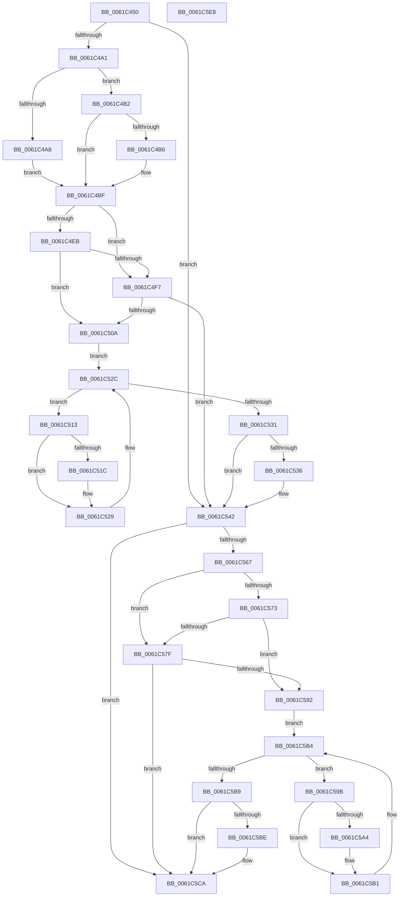

# DifCcDeferWriteWrapper

- RVA: `0x0061C450`–`0x0061C5E9` (길이 `409` bytes)
- VA: `0x000000014061C450`
- 실행 섹션: `.text`
- PDB 이름 있음: `예`; PDB Function 태그: `아니요`
- unwind 정보 RVA: `0x000D2BBC`
- 디코드: `118`개 명령, `409/409` bytes 표시
- 미해석 바이트: `0` (있으면 어셈블리에 `.byte`로 보존)

> 이 문서는 커널 이미지의 기계어와 PDB 기호를 분석해 생성했습니다. 4번과 5번은 함수 원형과 자료형을 바이너리 사용 방식에서 추정한 C 해석이며 원본 소스 복구 결과는 아닙니다.

## 1. Dependencies

- 직접 호출 지점: **9**; 고유 호출 대상: **6**
- 직접 호출자로 확인된 함수: **0**
- RIP 상대 이미지 참조: **3**

### Outgoing calls
- `0x0061C490` → [DifGetAPIThunkContextById](../49/DifGetAPIThunkContextById_function_00495A34.md) (function, `0x00495A34`)
- `0x0061C4B6` → [DifGetReturnAddressForWrappers](../4D/DifGetReturnAddressForWrappers_function_004D3C08.md) (function, `0x004D3C08`)
- `0x0061C4FE` → [ExAcquireRundownProtection](../21/ExAcquireRundownProtection_function_00216620.md) (function, `0x00216620`)
- `0x0061C524` → [guard_dispatch_icall](../6B/guard_dispatch_icall_function_006BAAD0.md) (function, `0x006BAAD0`)
- `0x0061C53D` → [ExReleaseRundownProtection](../34/ExReleaseRundownProtection_function_00349E80.md) (function, `0x00349E80`)
- `0x0061C55D` → [CcDeferWrite](../57/CcDeferWrite_function_0057C860.md) (function, `0x0057C860`)
- `0x0061C586` → [ExAcquireRundownProtection](../21/ExAcquireRundownProtection_function_00216620.md) (function, `0x00216620`)
- `0x0061C5AC` → [guard_dispatch_icall](../6B/guard_dispatch_icall_function_006BAAD0.md) (function, `0x006BAAD0`)
- `0x0061C5C5` → [ExReleaseRundownProtection](../34/ExReleaseRundownProtection_function_00349E80.md) (function, `0x00349E80`)

### Direct callers
- 이 함수 시작 RVA로 연결되는 직접 call은 확인되지 않았습니다. 간접 호출은 완전히 역산할 수 없습니다.

### Static image references
- `0x0061C4C6` → RVA `0x00F048B8` (`.data`; read)
- `0x0061C4EB` → RVA `0x00F04980` (`.data`; read)
- `0x0061C4F7` → RVA `0x00F03E80` (`.data`; read)

## 2. Other-region calls and transfers

- 다른 실행 섹션으로 향하는 call: **0**
- 별도 외부 분기/꼬리 이동을 확인하지 못했습니다.

## 3. Assembly (complete function range)

```asm
0061C450  48 8B C4                        mov rax, rsp
0061C453  48 89 58 10                     mov qword ptr [rax + 0x10], rbx
0061C457  48 89 70 18                     mov qword ptr [rax + 0x18], rsi
0061C45B  48 89 78 20                     mov qword ptr [rax + 0x20], rdi
0061C45F  48 89 48 08                     mov qword ptr [rax + 8], rcx
0061C463  55                              push rbp
0061C464  41 54                           push r12
0061C466  41 55                           push r13
0061C468  41 56                           push r14
0061C46A  41 57                           push r15
0061C46C  48 8B EC                        mov rbp, rsp
0061C46F  48 83 EC 60                     sub rsp, 0x60
0061C473  0F 57 C0                        xorps xmm0, xmm0
0061C476  B9 B0 01 00 00                  mov ecx, 0x1b0
0061C47B  0F 11 45 D0                     movups xmmword ptr [rbp - 0x30], xmm0
0061C47F  4D 8B F9                        mov r15, r9
0061C482  4D 8B E0                        mov r12, r8
0061C485  0F 11 45 E0                     movups xmmword ptr [rbp - 0x20], xmm0
0061C489  4C 8B EA                        mov r13, rdx
0061C48C  0F 11 45 F0                     movups xmmword ptr [rbp - 0x10], xmm0
0061C490  E8 9F 95 E7 FF                  call 0x140495a34
0061C495  48 8B F0                        mov rsi, rax
0061C498  48 85 C0                        test rax, rax
0061C49B  0F 84 A1 00 00 00               je 0x14061c542
0061C4A1  8B 40 0C                        mov eax, dword ptr [rax + 0xc]
0061C4A4  A8 18                           test al, 0x18
0061C4A6  74 0A                           je 0x14061c4b2
0061C4A8  48 8B 4D 28                     mov rcx, qword ptr [rbp + 0x28]
0061C4AC  48 89 4D D0                     mov qword ptr [rbp - 0x30], rcx
0061C4B0  EB 0D                           jmp 0x14061c4bf
0061C4B2  A8 04                           test al, 4
0061C4B4  74 09                           je 0x14061c4bf
0061C4B6  E8 4D 77 EB FF                  call 0x1404d3c08
0061C4BB  48 89 45 D0                     mov qword ptr [rbp - 0x30], rax
0061C4BF  48 8B 45 30                     mov rax, qword ptr [rbp + 0x30]
0061C4C3  45 32 F6                        xor r14b, r14b
0061C4C6  44 38 35 EB 83 8E 00            cmp byte ptr [rip + 0x8e83eb], r14b
0061C4CD  48 89 45 F8                     mov qword ptr [rbp - 8], rax
0061C4D1  8B 45 50                        mov eax, dword ptr [rbp + 0x50]
0061C4D4  89 45 DC                        mov dword ptr [rbp - 0x24], eax
0061C4D7  8A 45 58                        mov al, byte ptr [rbp + 0x58]
0061C4DA  88 45 D8                        mov byte ptr [rbp - 0x28], al
0061C4DD  4C 89 6D F0                     mov qword ptr [rbp - 0x10], r13
0061C4E1  4C 89 65 E8                     mov qword ptr [rbp - 0x18], r12
0061C4E5  4C 89 7D E0                     mov qword ptr [rbp - 0x20], r15
0061C4E9  75 0C                           jne 0x14061c4f7
0061C4EB  F7 05 8B 84 8E 00 00 08 00 00   test dword ptr [rip + 0x8e848b], 0x800
0061C4F5  74 13                           je 0x14061c50a
0061C4F7  48 8D 0D 82 79 8E 00            lea rcx, [rip + 0x8e7982]
0061C4FE  E8 1D A1 BF FF                  call 0x140216620
0061C503  44 8A F0                        mov r14b, al
0061C506  84 C0                           test al, al
0061C508  74 38                           je 0x14061c542
0061C50A  48 8D 7E 20                     lea rdi, [rsi + 0x20]
0061C50E  48 8B 1F                        mov rbx, qword ptr [rdi]
0061C511  EB 19                           jmp 0x14061c52c
0061C513  48 8D 43 F0                     lea rax, [rbx - 0x10]
0061C517  48 85 C0                        test rax, rax
0061C51A  74 0D                           je 0x14061c529
0061C51C  48 8B 40 08                     mov rax, qword ptr [rax + 8]
0061C520  48 8D 4D D0                     lea rcx, [rbp - 0x30]
0061C524  E8 A7 E5 09 00                  call 0x1406baad0
0061C529  48 8B 1B                        mov rbx, qword ptr [rbx]
0061C52C  48 3B DF                        cmp rbx, rdi
0061C52F  75 E2                           jne 0x14061c513
0061C531  45 84 F6                        test r14b, r14b
0061C534  74 0C                           je 0x14061c542
0061C536  48 8D 0D 43 79 8E 00            lea rcx, [rip + 0x8e7943]
0061C53D  E8 3E D9 D2 FF                  call 0x140349e80
0061C542  8A 45 58                        mov al, byte ptr [rbp + 0x58]
0061C545  4D 8B CF                        mov r9, r15
0061C548  48 8B 4D 30                     mov rcx, qword ptr [rbp + 0x30]
0061C54C  4D 8B C4                        mov r8, r12
0061C54F  88 44 24 28                     mov byte ptr [rsp + 0x28], al
0061C553  49 8B D5                        mov rdx, r13
0061C556  8B 45 50                        mov eax, dword ptr [rbp + 0x50]
0061C559  89 44 24 20                     mov dword ptr [rsp + 0x20], eax
0061C55D  E8 FE 02 F6 FF                  call 0x14057c860
0061C562  48 85 F6                        test rsi, rsi
0061C565  74 63                           je 0x14061c5ca
0061C567  40 32 FF                        xor dil, dil
0061C56A  40 38 3D 47 83 8E 00            cmp byte ptr [rip + 0x8e8347], dil
0061C571  75 0C                           jne 0x14061c57f
0061C573  F7 05 03 84 8E 00 00 08 00 00   test dword ptr [rip + 0x8e8403], 0x800
0061C57D  74 13                           je 0x14061c592
0061C57F  48 8D 0D FA 78 8E 00            lea rcx, [rip + 0x8e78fa]
0061C586  E8 95 A0 BF FF                  call 0x140216620
0061C58B  40 8A F8                        mov dil, al
0061C58E  84 C0                           test al, al
0061C590  74 38                           je 0x14061c5ca
0061C592  48 83 C6 30                     add rsi, 0x30
0061C596  48 8B 1E                        mov rbx, qword ptr [rsi]
0061C599  EB 19                           jmp 0x14061c5b4
0061C59B  48 8D 43 F0                     lea rax, [rbx - 0x10]
0061C59F  48 85 C0                        test rax, rax
0061C5A2  74 0D                           je 0x14061c5b1
0061C5A4  48 8B 40 08                     mov rax, qword ptr [rax + 8]
0061C5A8  48 8D 4D D0                     lea rcx, [rbp - 0x30]
0061C5AC  E8 1F E5 09 00                  call 0x1406baad0
0061C5B1  48 8B 1B                        mov rbx, qword ptr [rbx]
0061C5B4  48 3B DE                        cmp rbx, rsi
0061C5B7  75 E2                           jne 0x14061c59b
0061C5B9  40 84 FF                        test dil, dil
0061C5BC  74 0C                           je 0x14061c5ca
0061C5BE  48 8D 0D BB 78 8E 00            lea rcx, [rip + 0x8e78bb]
0061C5C5  E8 B6 D8 D2 FF                  call 0x140349e80
0061C5CA  4C 8D 5C 24 60                  lea r11, [rsp + 0x60]
0061C5CF  49 8B 5B 38                     mov rbx, qword ptr [r11 + 0x38]
0061C5D3  49 8B 73 40                     mov rsi, qword ptr [r11 + 0x40]
0061C5D7  49 8B 7B 48                     mov rdi, qword ptr [r11 + 0x48]
0061C5DB  49 8B E3                        mov rsp, r11
0061C5DE  41 5F                           pop r15
0061C5E0  41 5E                           pop r14
0061C5E2  41 5D                           pop r13
0061C5E4  41 5C                           pop r12
0061C5E6  5D                              pop rbp
0061C5E7  C3                              ret
0061C5E8  CC                              int3
```

## 4. C-style interpretation (structured pseudocode)

```c
__int64 __fastcall DifCcDeferWriteWrapper(__int64 a1, __int64 a2, __int64 a3, __int64 a4, unsigned int a5, unsigned __int8 a6)
{
    __int64 result;
    __int64 v_r14;
    __int64 v_rdi;
    __int64 v_rsi;
    __int64 v_rsp;
    unsigned __int64 v_stack_m28;
    unsigned __int64 v_stack_m30;
    unsigned __int64 v_stack_m38;
    unsigned __int64 v_stack_m40;
    unsigned __int64 v_stack_m48;
    unsigned int v_stack_m4C;
    unsigned __int8 v_stack_m50;
    unsigned __int64 v_stack_m58;
    unsigned __int8 v_stack_m60;
    unsigned int v_stack_m68;
    unsigned __int64 v_stack_p0;
    unsigned __int64 v_stack_p8;

    *(unsigned __int64 *)(v_rsp + 16) = v_rbx;
    *(unsigned __int64 *)(v_rsp + 24) = v_rsi;
    *(unsigned __int64 *)(v_rsp + 32) = v_rdi;
    *(unsigned __int64 *)(v_rsp + 8) = a1;
    v_rsp = (v_rsp) - (96);
    v_stack_m58 = v_xmm0;
    v_stack_m48 = v_xmm0;
    v_stack_m38 = v_xmm0;
    result = DifGetAPIThunkContextById(432, a2, a3, a4);
    if (result == 0) goto loc_0061C542;
    if ((((unsigned __int8)((unsigned int)(*(unsigned int *)(result + 12)))) & (24)) == 0) goto loc_0061C4B2;
    v_stack_m58 = v_stack_p0;
    goto loc_0061C4BF;
loc_0061C4B2:
    result = (unsigned int)(*(unsigned int *)(result + 12));
    if ((((unsigned __int8)((unsigned int)(*(unsigned int *)(result + 12)))) & (4)) != 0) {
        result = DifGetReturnAddressForWrappers(v_stack_p0, a2, a3, a4);
        v_stack_m58 = result;
    }
    v_r14 = 0;
    v_stack_m30 = v_stack_p8;
    v_stack_m4C = (unsigned int)((unsigned int)(a5));
    v_stack_m50 = a6;
    v_stack_m38 = a2;
    v_stack_m40 = a3;
    v_stack_m48 = a4;
    if ((*(unsigned __int8 *)(v_rip + 9339883)) != 0) goto loc_0061C4F7;
    if (((*(unsigned int *)(v_rip + 9340043)) & (0x800ULL)) == 0) goto loc_0061C50A;
loc_0061C4F7:
    result = ExAcquireRundownProtection(v_rip + 9337218, a2, a3, a4);
    if ((unsigned __int8)(result) == 0) goto loc_0061C542;
loc_0061C50A:
    goto loc_0061C52C;
loc_0061C513:
    result = *(unsigned __int64 *)(result + 32) - 16;
    if (*(unsigned __int64 *)(result + 32) - 16 != 0) {
        result = *(unsigned __int64 *)(*(unsigned __int64 *)(result + 32) - 16 + 8);
        a1 = v_stack_m58;
        result = guard_dispatch_icall(a1, a2, a3, a4);
    }
loc_0061C52C:
    if ((*(unsigned __int64 *)(*(unsigned __int64 *)(result + 32))) != (result + 32)) goto loc_0061C513;
    if ((unsigned __int8)((unsigned __int8)(result)) != 0) {
        a1 = v_rip + 9337155;
        result = ExReleaseRundownProtection(a1, a2, a3, a4);
    }
    v_stack_m60 = a6;
    v_stack_m68 = (unsigned int)((unsigned int)(a5));
    result = CcDeferWrite(v_stack_p8, a2, a3, a4);
    if (result == 0) goto loc_0061C5CA;
    v_rdi = 0;
    if ((*(unsigned __int8 *)(v_rip + 9339719)) != 0) goto loc_0061C57F;
    if (((*(unsigned int *)(v_rip + 9339907)) & (0x800ULL)) == 0) goto loc_0061C592;
loc_0061C57F:
    result = ExAcquireRundownProtection(v_rip + 9337082, a2, a3, a4);
    if ((unsigned __int8)(result) == 0) goto loc_0061C5CA;
loc_0061C592:
    v_rsi = (result) + (48);
    goto loc_0061C5B4;
loc_0061C59B:
    result = *(unsigned __int64 *)(v_rsi) - 16;
    if (*(unsigned __int64 *)(v_rsi) - 16 != 0) {
        result = *(unsigned __int64 *)(*(unsigned __int64 *)(v_rsi) - 16 + 8);
        a1 = v_stack_m58;
        result = guard_dispatch_icall(a1, a2, a3, a4);
    }
loc_0061C5B4:
    if ((*(unsigned __int64 *)(*(unsigned __int64 *)(v_rsi))) != v_rsi) goto loc_0061C59B;
    if ((unsigned __int8)((unsigned __int8)(result)) != 0) {
        a1 = v_rip + 9337019;
        result = ExReleaseRundownProtection(a1, a2, a3, a4);
    }
    return result;
}
```

## 5. (Beta) C Style

```c
int64_t DifCcDeferWriteWrapper(int64_t Arg1, int64_t Arg2, int64_t Arg3, int64_t Arg4, uint32_t Arg5, uint8_t Arg6)
{
    int64_t result;
    int64_t local_r14;
    int64_t local_rdi;
    int64_t local_rsi;
    int64_t local_rsp;
    uint64_t v_stack_m28;
    uint64_t v_stack_m30;
    uint64_t v_stack_m38;
    uint64_t v_stack_m40;
    uint64_t v_stack_m48;
    uint32_t v_stack_m4C;
    uint8_t v_stack_m50;
    uint64_t v_stack_m58;
    uint8_t v_stack_m60;
    uint32_t v_stack_m68;
    uint64_t v_stack_p0;
    uint64_t v_stack_p8;

    *(uint64_t *)(local_rsp + 0x10) = local_rbx;
    *(uint64_t *)(local_rsp + 0x18) = local_rsi;
    *(uint64_t *)(local_rsp + 0x20) = local_rdi;
    *(uint64_t *)(local_rsp + 0x8) = Arg1;
    local_rsp = (local_rsp) - (96);
    v_stack_m58 = v_xmm0;
    v_stack_m48 = v_xmm0;
    v_stack_m38 = v_xmm0;
    result = DifGetAPIThunkContextById(432, Arg2, Arg3, Arg4);
    if (result == 0) goto loc_0061C542;
    if ((((uint8_t)((uint32_t)(*(uint32_t *)(result + 0xC)))) & (24)) == 0) goto loc_0061C4B2;
    v_stack_m58 = v_stack_p0;
    goto loc_0061C4BF;
loc_0061C4B2:
    result = (uint32_t)(*(uint32_t *)(result + 0xC));
    if ((((uint8_t)((uint32_t)(*(uint32_t *)(result + 0xC)))) & (4)) != 0) {
        result = DifGetReturnAddressForWrappers(v_stack_p0, Arg2, Arg3, Arg4);
        v_stack_m58 = result;
    }
    local_r14 = 0;
    v_stack_m30 = v_stack_p8;
    v_stack_m4C = (uint32_t)((uint32_t)(Arg5));
    v_stack_m50 = Arg6;
    v_stack_m38 = Arg2;
    v_stack_m40 = Arg3;
    v_stack_m48 = Arg4;
    if ((*(uint8_t *)(v_rip + 0x8E83EB)) != 0) goto loc_0061C4F7;
    if (((*(uint32_t *)(v_rip + 0x8E848B)) & (0x800ULL)) == 0) goto loc_0061C50A;
loc_0061C4F7:
    result = ExAcquireRundownProtection(v_rip + 9337218, Arg2, Arg3, Arg4);
    if ((uint8_t)(result) == 0) goto loc_0061C542;
loc_0061C50A:
    goto loc_0061C52C;
loc_0061C513:
    result = *(uint64_t *)(result + 0x20) - 16;
    if (*(uint64_t *)(result + 0x20) - 16 != 0) {
        result = *(uint64_t *)(*(uint64_t *)(result + 0x20) - 0x10 + 0x8);
        Arg1 = v_stack_m58;
        result = guard_dispatch_icall(Arg1, Arg2, Arg3, Arg4);
    }
loc_0061C52C:
    if ((*(uint64_t *)(*(uint64_t *)(result + 0x20))) != (result + 32)) goto loc_0061C513;
    if ((uint8_t)((uint8_t)(result)) != 0) {
        Arg1 = v_rip + 9337155;
        result = ExReleaseRundownProtection(Arg1, Arg2, Arg3, Arg4);
    }
    v_stack_m60 = Arg6;
    v_stack_m68 = (uint32_t)((uint32_t)(Arg5));
    result = CcDeferWrite(v_stack_p8, Arg2, Arg3, Arg4);
    if (result == 0) goto loc_0061C5CA;
    local_rdi = 0;
    if ((*(uint8_t *)(v_rip + 0x8E8347)) != 0) goto loc_0061C57F;
    if (((*(uint32_t *)(v_rip + 0x8E8403)) & (0x800ULL)) == 0) goto loc_0061C592;
loc_0061C57F:
    result = ExAcquireRundownProtection(v_rip + 9337082, Arg2, Arg3, Arg4);
    if ((uint8_t)(result) == 0) goto loc_0061C5CA;
loc_0061C592:
    local_rsi = (result) + (48);
    goto loc_0061C5B4;
loc_0061C59B:
    result = *(uint64_t *)(local_rsi) - 16;
    if (*(uint64_t *)(local_rsi) - 16 != 0) {
        result = *(uint64_t *)(*(uint64_t *)(local_rsi) - 0x10 + 0x8);
        Arg1 = v_stack_m58;
        result = guard_dispatch_icall(Arg1, Arg2, Arg3, Arg4);
    }
loc_0061C5B4:
    if ((*(uint64_t *)(*(uint64_t *)(local_rsi))) != local_rsi) goto loc_0061C59B;
    if ((uint8_t)((uint8_t)(result)) != 0) {
        Arg1 = v_rip + 9337019;
        result = ExReleaseRundownProtection(Arg1, Arg2, Arg3, Arg4);
    }
    return result;
}
```

## 6. Execution-region graph

[열기: 2D/3D 그래프와 함수 탐색 컨트롤 패널](../../../control-panel.html?section=text&rva=0x0061C450&view=graph)

- 2D 그래프는 위에서 아래로 흐르고, 3D 그래프는 빈 공간을 드래그해 회전합니다. Shift+드래그는 이동, 휠은 확대·축소, 함수 노드 선택은 대상 보고서 이동입니다.

### Static fallback


