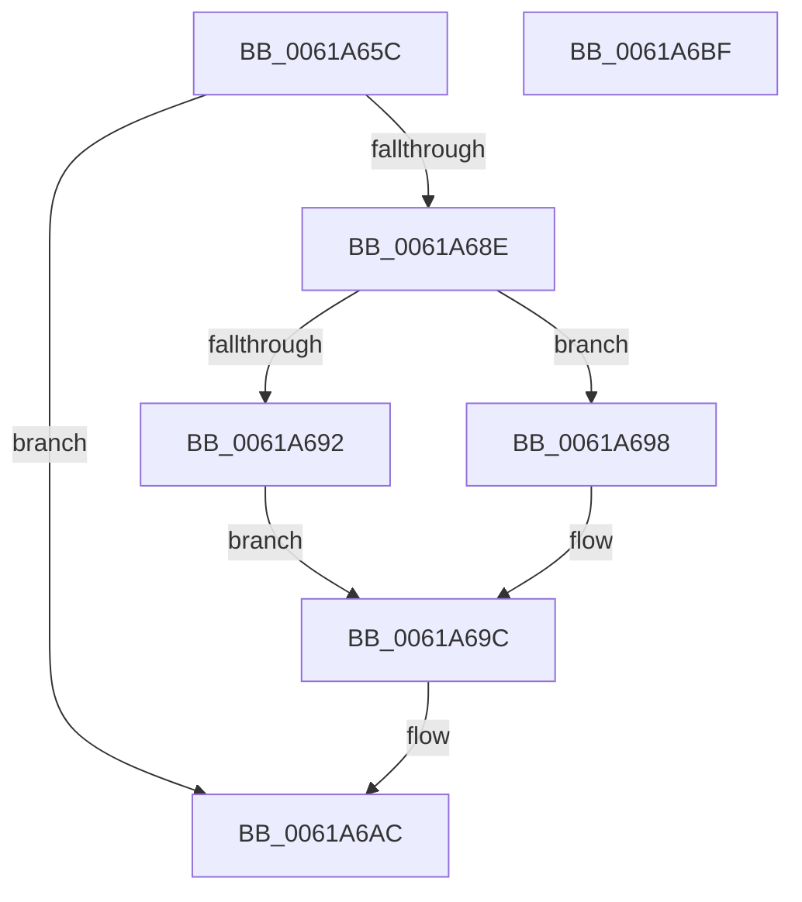

# DifCreateAPIThunkContext

- RVA: `0x0061A65C`–`0x0061A6C0` (길이 `100` bytes)
- VA: `0x000000014061A65C`
- 실행 섹션: `.text`
- PDB 이름 있음: `예`; PDB Function 태그: `아니요`
- unwind 정보 RVA: `0x00060BC4`
- 디코드: `31`개 명령, `100/100` bytes 표시
- 미해석 바이트: `0` (있으면 어셈블리에 `.byte`로 보존)

> 이 문서는 커널 이미지의 기계어와 PDB 기호를 분석해 생성했습니다. 4번과 5번은 함수 원형과 자료형을 바이너리 사용 방식에서 추정한 C 해석이며 원본 소스 복구 결과는 아닙니다.

## 1. Dependencies

- 직접 호출 지점: **1**; 고유 호출 대상: **1**
- 직접 호출자로 확인된 함수: **1**
- RIP 상대 이미지 참조: **0**

### Outgoing calls
- `0x0061A681` → [ExAllocatePool2](../../poolcode/B8/ExAllocatePool2_function_00B820F0.md) (function, `0x00B820F0`)

### Direct callers
- [DifRegisterPlugin](DifRegisterPlugin_function_0061ABE0.md) at `0x0061AD2D`
- [DifRegisterPlugin](DifRegisterPlugin_function_0061ABE0.md) at `0x0061AD68`
- [DifRegisterPlugin](DifRegisterPlugin_function_0061ABE0.md) at `0x0061AE40`
- [DifRegisterPlugin](DifRegisterPlugin_function_0061ABE0.md) at `0x0061AE7B`

### Static image references
- 디코드된 RIP-relative 메모리 참조가 없습니다.

## 2. Other-region calls and transfers

- 다른 실행 섹션으로 향하는 call: **1**
  - `0x0061A681` → [ExAllocatePool2](../../poolcode/B8/ExAllocatePool2_function_00B820F0.md) (`.text` → `POOLCODE`)
- 별도 외부 분기/꼬리 이동을 확인하지 못했습니다.

## 3. Assembly (complete function range)

```asm
0061A65C  48 89 5C 24 08                  mov qword ptr [rsp + 8], rbx
0061A661  48 89 74 24 10                  mov qword ptr [rsp + 0x10], rsi
0061A666  57                              push rdi
0061A667  48 83 EC 20                     sub rsp, 0x20
0061A66B  8B FA                           mov edi, edx
0061A66D  41 8B F0                        mov esi, r8d
0061A670  BA 20 00 00 00                  mov edx, 0x20
0061A675  48 8B D9                        mov rbx, rcx
0061A678  41 B8 44 66 41 70               mov r8d, 0x70416644
0061A67E  8D 4A 20                        lea ecx, [rdx + 0x20]
0061A681  E8 6A 7A 56 00                  call 0x140b820f0
0061A686  4C 8B C8                        mov r9, rax
0061A689  48 85 C0                        test rax, rax
0061A68C  74 1E                           je 0x14061a6ac
0061A68E  85 FF                           test edi, edi
0061A690  74 06                           je 0x14061a698
0061A692  48 8B 43 10                     mov rax, qword ptr [rbx + 0x10]
0061A696  EB 04                           jmp 0x14061a69c
0061A698  48 8B 43 18                     mov rax, qword ptr [rbx + 0x18]
0061A69C  49 89 41 08                     mov qword ptr [r9 + 8], rax
0061A6A0  85 FF                           test edi, edi
0061A6A2  0F 95 C0                        setne al
0061A6A5  41 88 41 04                     mov byte ptr [r9 + 4], al
0061A6A9  41 89 31                        mov dword ptr [r9], esi
0061A6AC  48 8B 5C 24 30                  mov rbx, qword ptr [rsp + 0x30]
0061A6B1  49 8B C1                        mov rax, r9
0061A6B4  48 8B 74 24 38                  mov rsi, qword ptr [rsp + 0x38]
0061A6B9  48 83 C4 20                     add rsp, 0x20
0061A6BD  5F                              pop rdi
0061A6BE  C3                              ret
0061A6BF  CC                              int3
```

## 4. C-style interpretation (structured pseudocode)

```c
__int64 __fastcall DifCreateAPIThunkContext(__int64 a1, int a2, int a3)
{
    __int64 result;
    __int64 v_rsp;
    unsigned __int64 v_stack_p10;
    unsigned __int64 v_stack_p8;

    v_stack_p8 = v_rbx;
    v_stack_p10 = v_rsi;
    v_rsp = (v_rsp) - (32);
    result = ExAllocatePool2(32 + 32, 32, (unsigned int)(0x70416644ULL), a4);
    if (result == 0) goto loc_0061A6AC;
    if ((unsigned int)((unsigned int)(a2)) == 0) goto loc_0061A698;
    goto loc_0061A69C;
loc_0061A698:
loc_0061A69C:
    *(unsigned __int64 *)(result + 8) = *(unsigned __int64 *)(a1 + 24);
    result = ((unsigned int)((unsigned int)(a2)) != 0) ? 1 : 0;
    *(unsigned __int8 *)(result + 4) = (unsigned __int8)(result);
    *(unsigned int *)(result) = (unsigned int)((unsigned int)(a3));
loc_0061A6AC:
    v_rsp = (v_rsp) + (32);
    return result;
}
```

## 5. (Beta) C Style

```c
int64_t DifCreateAPIThunkContext(void *Arg1, int32_t Arg2, int32_t Arg3)
{
    uint8_t *arg1 = (uint8_t *)Arg1;

    int64_t result;
    int64_t local_rsp;
    uint64_t v_stack_p10;
    uint64_t v_stack_p8;

    v_stack_p8 = local_rbx;
    v_stack_p10 = local_rsi;
    local_rsp = (local_rsp) - (32);
    result = ExAllocatePool2(32 + 32, 32, (uint32_t)(0x70416644ULL), a4);
    if (result == 0) goto loc_0061A6AC;
    if ((uint32_t)((uint32_t)(Arg2)) == 0) goto loc_0061A698;
    goto loc_0061A69C;
loc_0061A698:
loc_0061A69C:
    *(uint64_t *)(result + 0x8) = *(uint64_t *)(arg1 + 0x18);
    result = ((uint32_t)((uint32_t)(Arg2)) != 0) ? 1 : 0;
    *(uint8_t *)(result + 0x4) = (uint8_t)(result);
    *(uint32_t *)(result) = (uint32_t)((uint32_t)(Arg3));
loc_0061A6AC:
    local_rsp = (local_rsp) + (32);
    return result;
}
```

### 관측된 메모리 오프셋

구조체 형식이 확인되지 않은 접근은 인자 기준의 오프셋으로만 기록했습니다.

| 기준 인자 | 오프셋 표현 | 폭 (bit) | 접근 |
|---|---:|---:|---|
| `Arg1` | `+ 0x10` | `64` | `R` |
| `Arg1` | `+ 0x18` | `64` | `R` |

## 6. Execution-region graph

[열기: 2D/3D 그래프와 함수 탐색 컨트롤 패널](../../../control-panel.html?section=text&rva=0x0061A65C&view=graph)

- 2D 그래프는 위에서 아래로 흐르고, 3D 그래프는 빈 공간을 드래그해 회전합니다. Shift+드래그는 이동, 휠은 확대·축소, 함수 노드 선택은 대상 보고서 이동입니다.

### Static fallback


