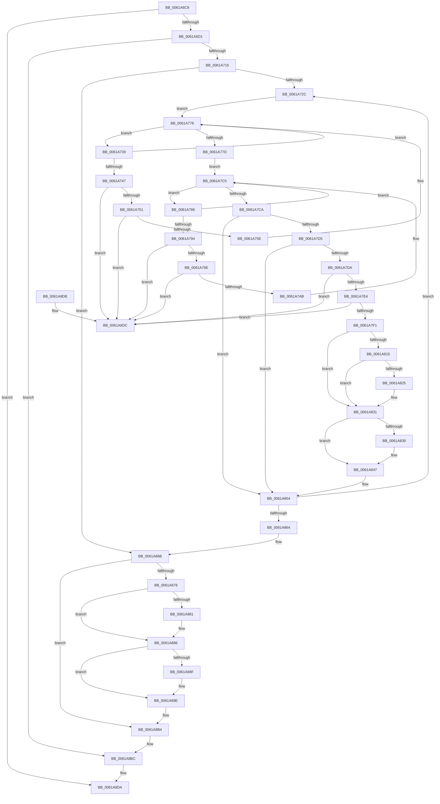

# DifDeregisterPlugin

- RVA: `0x0061A6C8`–`0x0061A8E3` (길이 `539` bytes)
- VA: `0x000000014061A6C8`
- 실행 섹션: `.text`
- PDB 이름 있음: `예`; PDB Function 태그: `아니요`
- unwind 정보 RVA: `0x000D2AB4`
- 디코드: `137`개 명령, `539/539` bytes 표시
- 미해석 바이트: `0` (있으면 어셈블리에 `.byte`로 보존)

> 이 문서는 커널 이미지의 기계어와 PDB 기호를 분석해 생성했습니다. 4번과 5번은 함수 원형과 자료형을 바이너리 사용 방식에서 추정한 C 해석이며 원본 소스 복구 결과는 아닙니다.

## 1. Dependencies

- 직접 호출 지점: **10**; 고유 호출 대상: **3**
- 직접 호출자로 확인된 함수: **2**
- RIP 상대 이미지 참조: **5**

### Outgoing calls
- `0x0061A773` → [ExFreePoolWithTag](../../poolcode/B8/ExFreePoolWithTag_function_00B82870.md) (function, `0x00B82870`)
- `0x0061A7C0` → [ExFreePoolWithTag](../../poolcode/B8/ExFreePoolWithTag_function_00B82870.md) (function, `0x00B82870`)
- `0x0061A80C` → [ViUnbindDifThunk](ViUnbindDifThunk_function_00613188.md) (function, `0x00613188`)
- `0x0061A81C` → [ViUnbindDifThunk](ViUnbindDifThunk_function_00613188.md) (function, `0x00613188`)
- `0x0061A82C` → [ViUnbindDifThunk](ViUnbindDifThunk_function_00613188.md) (function, `0x00613188`)
- `0x0061A83E` → [ExFreePoolWithTag](../../poolcode/B8/ExFreePoolWithTag_function_00B82870.md) (function, `0x00B82870`)
- `0x0061A84F` → [ExFreePoolWithTag](../../poolcode/B8/ExFreePoolWithTag_function_00B82870.md) (function, `0x00B82870`)
- `0x0061A881` → [guard_dispatch_icall](../6B/guard_dispatch_icall_function_006BAAD0.md) (function, `0x006BAAD0`)
- `0x0061A894` → [ExFreePoolWithTag](../../poolcode/B8/ExFreePoolWithTag_function_00B82870.md) (function, `0x00B82870`)
- `0x0061A8A6` → [ExFreePoolWithTag](../../poolcode/B8/ExFreePoolWithTag_function_00B82870.md) (function, `0x00B82870`)

### Direct callers
- [VfVolatileClearDifRuleClass](VfVolatileClearDifRuleClass_function_006168E0.md) at `0x00616936`
- [DifRegisterPlugin](DifRegisterPlugin_function_0061ABE0.md) at `0x0061AF64`

### Static image references
- `0x0061A6F0` → RVA `0x00000000` (`image boundary/outside`; read)
- `0x0061A715` → RVA `0x00F03E90` (`.data`; read)
- `0x0061A7F8` → RVA `0x00FF5F20` (`PAGEVRFD`; read)
- `0x0061A815` → RVA `0x00FF4A40` (`PAGEVRFD`; read)
- `0x0061A825` → RVA `0x00FF51B0` (`PAGEVRFD`; read)

## 2. Other-region calls and transfers

- 다른 실행 섹션으로 향하는 call: **6**
  - `0x0061A773` → [ExFreePoolWithTag](../../poolcode/B8/ExFreePoolWithTag_function_00B82870.md) (`.text` → `POOLCODE`)
  - `0x0061A7C0` → [ExFreePoolWithTag](../../poolcode/B8/ExFreePoolWithTag_function_00B82870.md) (`.text` → `POOLCODE`)
  - `0x0061A83E` → [ExFreePoolWithTag](../../poolcode/B8/ExFreePoolWithTag_function_00B82870.md) (`.text` → `POOLCODE`)
  - `0x0061A84F` → [ExFreePoolWithTag](../../poolcode/B8/ExFreePoolWithTag_function_00B82870.md) (`.text` → `POOLCODE`)
  - `0x0061A894` → [ExFreePoolWithTag](../../poolcode/B8/ExFreePoolWithTag_function_00B82870.md) (`.text` → `POOLCODE`)
  - `0x0061A8A6` → [ExFreePoolWithTag](../../poolcode/B8/ExFreePoolWithTag_function_00B82870.md) (`.text` → `POOLCODE`)
- 별도 외부 분기/꼬리 이동을 확인하지 못했습니다.

## 3. Assembly (complete function range)

```asm
0061A6C8  83 F9 40                        cmp ecx, 0x40
0061A6CB  0F 83 09 02 00 00               jae 0x14061a8da
0061A6D1  48 8B C4                        mov rax, rsp
0061A6D4  48 89 58 08                     mov qword ptr [rax + 8], rbx
0061A6D8  48 89 68 10                     mov qword ptr [rax + 0x10], rbp
0061A6DC  48 89 70 18                     mov qword ptr [rax + 0x18], rsi
0061A6E0  48 89 78 20                     mov qword ptr [rax + 0x20], rdi
0061A6E4  41 54                           push r12
0061A6E6  41 56                           push r14
0061A6E8  41 57                           push r15
0061A6EA  48 83 EC 20                     sub rsp, 0x20
0061A6EE  8B E9                           mov ebp, ecx
0061A6F0  48 8D 35 09 59 9E FF            lea rsi, [rip - 0x61a6f7]
0061A6F7  40 8A C5                        mov al, bpl
0061A6FA  24 1F                           and al, 0x1f
0061A6FC  0F B6 D0                        movzx edx, al
0061A6FF  8B C5                           mov eax, ebp
0061A701  48 C1 E8 05                     shr rax, 5
0061A705  8B 84 86 A0 81 E6 00            mov eax, dword ptr [rsi + rax*4 + 0xe681a0]
0061A70C  0F A3 D0                        bt eax, edx
0061A70F  0F 83 A7 01 00 00               jae 0x14061a8bc
0061A715  48 8B 3D 74 97 8E 00            mov rdi, qword ptr [rip + 0x8e9774]
0061A71C  48 8D 05 6D 97 8E 00            lea rax, [rip + 0x8e976d]
0061A723  48 3B F8                        cmp rdi, rax
0061A726  0F 84 3F 01 00 00               je 0x14061a86b
0061A72C  4C 8D 77 F0                     lea r14, [rdi - 0x10]
0061A730  4D 8D 7E 20                     lea r15, [r14 + 0x20]
0061A734  49 8B 1F                        mov rbx, qword ptr [r15]
0061A737  EB 3F                           jmp 0x14061a778
0061A739  48 8D 4B F0                     lea rcx, [rbx - 0x10]
0061A73D  48 8B C3                        mov rax, rbx
0061A740  48 8B 1B                        mov rbx, qword ptr [rbx]
0061A743  39 29                           cmp dword ptr [rcx], ebp
0061A745  75 31                           jne 0x14061a778
0061A747  48 39 43 08                     cmp qword ptr [rbx + 8], rax
0061A74B  0F 85 8B 01 00 00               jne 0x14061a8dc
0061A751  48 8B 50 08                     mov rdx, qword ptr [rax + 8]
0061A755  48 39 02                        cmp qword ptr [rdx], rax
0061A758  0F 85 7E 01 00 00               jne 0x14061a8dc
0061A75E  48 89 1A                        mov qword ptr [rdx], rbx
0061A761  48 89 53 08                     mov qword ptr [rbx + 8], rdx
0061A765  BA 44 69 66 4E                  mov edx, 0x4e666944
0061A76A  48 83 20 00                     and qword ptr [rax], 0
0061A76E  48 83 60 08 00                  and qword ptr [rax + 8], 0
0061A773  E8 F8 80 56 00                  call 0x140b82870
0061A778  49 3B DF                        cmp rbx, r15
0061A77B  75 BC                           jne 0x14061a739
0061A77D  49 8D 76 30                     lea rsi, [r14 + 0x30]
0061A781  48 8B 1E                        mov rbx, qword ptr [rsi]
0061A784  EB 3F                           jmp 0x14061a7c5
0061A786  48 8D 4B F0                     lea rcx, [rbx - 0x10]
0061A78A  48 8B C3                        mov rax, rbx
0061A78D  48 8B 1B                        mov rbx, qword ptr [rbx]
0061A790  39 29                           cmp dword ptr [rcx], ebp
0061A792  75 31                           jne 0x14061a7c5
0061A794  48 39 43 08                     cmp qword ptr [rbx + 8], rax
0061A798  0F 85 3E 01 00 00               jne 0x14061a8dc
0061A79E  48 8B 50 08                     mov rdx, qword ptr [rax + 8]
0061A7A2  48 39 02                        cmp qword ptr [rdx], rax
0061A7A5  0F 85 31 01 00 00               jne 0x14061a8dc
0061A7AB  48 89 1A                        mov qword ptr [rdx], rbx
0061A7AE  48 89 53 08                     mov qword ptr [rbx + 8], rdx
0061A7B2  BA 44 69 66 4E                  mov edx, 0x4e666944
0061A7B7  48 83 20 00                     and qword ptr [rax], 0
0061A7BB  48 83 60 08 00                  and qword ptr [rax + 8], 0
0061A7C0  E8 AB 80 56 00                  call 0x140b82870
0061A7C5  48 3B DE                        cmp rbx, rsi
0061A7C8  75 BC                           jne 0x14061a786
0061A7CA  48 8B C7                        mov rax, rdi
0061A7CD  48 8B 3F                        mov rdi, qword ptr [rdi]
0061A7D0  4D 39 3F                        cmp qword ptr [r15], r15
0061A7D3  75 7F                           jne 0x14061a854
0061A7D5  48 39 36                        cmp qword ptr [rsi], rsi
0061A7D8  75 7A                           jne 0x14061a854
0061A7DA  48 39 47 08                     cmp qword ptr [rdi + 8], rax
0061A7DE  0F 85 F8 00 00 00               jne 0x14061a8dc
0061A7E4  48 8B 48 08                     mov rcx, qword ptr [rax + 8]
0061A7E8  48 39 01                        cmp qword ptr [rcx], rax
0061A7EB  0F 85 EB 00 00 00               jne 0x14061a8dc
0061A7F1  48 89 39                        mov qword ptr [rcx], rdi
0061A7F4  48 89 4F 08                     mov qword ptr [rdi + 8], rcx
0061A7F8  48 8D 0D 21 B7 9D 00            lea rcx, [rip + 0x9db721]
0061A7FF  48 83 20 00                     and qword ptr [rax], 0
0061A803  48 83 60 08 00                  and qword ptr [rax + 8], 0
0061A808  41 8B 56 08                     mov edx, dword ptr [r14 + 8]
0061A80C  E8 77 89 FF FF                  call 0x140613188
0061A811  84 C0                           test al, al
0061A813  75 1C                           jne 0x14061a831
0061A815  48 8D 0D 24 A2 9D 00            lea rcx, [rip + 0x9da224]
0061A81C  E8 67 89 FF FF                  call 0x140613188
0061A821  84 C0                           test al, al
0061A823  75 0C                           jne 0x14061a831
0061A825  48 8D 0D 84 A9 9D 00            lea rcx, [rip + 0x9da984]
0061A82C  E8 57 89 FF FF                  call 0x140613188
0061A831  49 8B 0E                        mov rcx, qword ptr [r14]
0061A834  48 85 C9                        test rcx, rcx
0061A837  74 0E                           je 0x14061a847
0061A839  BA 44 69 66 4E                  mov edx, 0x4e666944
0061A83E  E8 2D 80 56 00                  call 0x140b82870
0061A843  49 83 26 00                     and qword ptr [r14], 0
0061A847  BA 44 69 66 4E                  mov edx, 0x4e666944
0061A84C  49 8B CE                        mov rcx, r14
0061A84F  E8 1C 80 56 00                  call 0x140b82870
0061A854  48 8D 05 35 96 8E 00            lea rax, [rip + 0x8e9635]
0061A85B  48 3B F8                        cmp rdi, rax
0061A85E  0F 85 C8 FE FF FF               jne 0x14061a72c
0061A864  48 8D 35 95 57 9E FF            lea rsi, [rip - 0x61a86b]
0061A86B  48 8B 9C EE 40 82 E6 00         mov rbx, qword ptr [rsi + rbp*8 + 0xe68240]
0061A873  48 85 DB                        test rbx, rbx
0061A876  74 3C                           je 0x14061a8b4
0061A878  48 8B 43 08                     mov rax, qword ptr [rbx + 8]
0061A87C  48 85 C0                        test rax, rax
0061A87F  74 05                           je 0x14061a886
0061A881  E8 4A 02 0A 00                  call 0x1406baad0
0061A886  48 8B 4B 18                     mov rcx, qword ptr [rbx + 0x18]
0061A88A  48 85 C9                        test rcx, rcx
0061A88D  74 0F                           je 0x14061a89e
0061A88F  BA 44 69 66 4E                  mov edx, 0x4e666944
0061A894  E8 D7 7F 56 00                  call 0x140b82870
0061A899  48 83 63 18 00                  and qword ptr [rbx + 0x18], 0
0061A89E  BA 44 69 66 4E                  mov edx, 0x4e666944
0061A8A3  48 8B CB                        mov rcx, rbx
0061A8A6  E8 C5 7F 56 00                  call 0x140b82870
0061A8AB  48 83 A4 EE 40 82 E6 00 00      and qword ptr [rsi + rbp*8 + 0xe68240], 0
0061A8B4  C6 84 35 00 82 E6 00 00         mov byte ptr [rbp + rsi + 0xe68200], 0
0061A8BC  48 8B 5C 24 40                  mov rbx, qword ptr [rsp + 0x40]
0061A8C1  48 8B 6C 24 48                  mov rbp, qword ptr [rsp + 0x48]
0061A8C6  48 8B 74 24 50                  mov rsi, qword ptr [rsp + 0x50]
0061A8CB  48 8B 7C 24 58                  mov rdi, qword ptr [rsp + 0x58]
0061A8D0  48 83 C4 20                     add rsp, 0x20
0061A8D4  41 5F                           pop r15
0061A8D6  41 5E                           pop r14
0061A8D8  41 5C                           pop r12
0061A8DA  C3                              ret
0061A8DB  CC                              int3
0061A8DC  B9 03 00 00 00                  mov ecx, 3
0061A8E1  CD 29                           int 0x29
```

## 4. C-style interpretation (structured pseudocode)

```c
__int64 __fastcall DifDeregisterPlugin(int a1)
{
    __int64 result;
    __int64 v_rsp;
    unsigned __int64 v_stack_p10;
    unsigned __int64 v_stack_p18;
    unsigned __int64 v_stack_p20;
    unsigned __int64 v_stack_p8;

    if (a1 >= 64) goto loc_0061A8DA;
    *(unsigned __int64 *)(v_rsp + 8) = v_rbx;
    *(unsigned __int64 *)(v_rsp + 16) = v_rbp;
    *(unsigned __int64 *)(v_rsp + 24) = v_rsi;
    *(unsigned __int64 *)(v_rsp + 32) = v_rdi;
    v_rsp = (v_rsp) - (32);
    result = (unsigned __int8)(((unsigned __int8)((unsigned int)(a1))) & (31));
    result = ((unsigned int)((unsigned int)((unsigned int)(a1)))) >> (5);
    if (condition_is_above_or_equal) goto loc_0061A8BC;
    if ((*(unsigned __int64 *)(v_rip + 9344884)) == (v_rip + 9344877)) goto loc_0061A86B;
loc_0061A72C:
    goto loc_0061A778;
loc_0061A739:
    if ((*(unsigned int *)(*(unsigned __int64 *)(*(unsigned __int64 *)(v_rip + 9344884) - 16 + 32) - 16)) != ((unsigned int)((unsigned int)(a1)))) goto loc_0061A778;
    if ((*(unsigned __int64 *)(*(unsigned __int64 *)(*(unsigned __int64 *)(*(unsigned __int64 *)(v_rip + 9344884) - 16 + 32)) + 8)) != (*(unsigned __int64 *)(*(unsigned __int64 *)(v_rip + 9344884) - 16 + 32))) goto loc_0061A8DC;
    if ((*(unsigned __int64 *)(*(unsigned __int64 *)(*(unsigned __int64 *)(*(unsigned __int64 *)(v_rip + 9344884) - 16 + 32) + 8))) != (*(unsigned __int64 *)(*(unsigned __int64 *)(v_rip + 9344884) - 16 + 32))) goto loc_0061A8DC;
    *(unsigned __int64 *)(*(unsigned __int64 *)(*(unsigned __int64 *)(*(unsigned __int64 *)(v_rip + 9344884) - 16 + 32) + 8)) = *(unsigned __int64 *)(*(unsigned __int64 *)(*(unsigned __int64 *)(v_rip + 9344884) - 16 + 32));
    *(unsigned __int64 *)(*(unsigned __int64 *)(*(unsigned __int64 *)(*(unsigned __int64 *)(v_rip + 9344884) - 16 + 32)) + 8) = *(unsigned __int64 *)(*(unsigned __int64 *)(*(unsigned __int64 *)(v_rip + 9344884) - 16 + 32) + 8);
    result = ExFreePoolWithTag(*(unsigned __int64 *)(*(unsigned __int64 *)(v_rip + 9344884) - 16 + 32) - 16, (unsigned int)(0x4E666944ULL), a3, a4);
loc_0061A778:
    if ((*(unsigned __int64 *)(*(unsigned __int64 *)(*(unsigned __int64 *)(v_rip + 9344884) - 16 + 32))) != (*(unsigned __int64 *)(v_rip + 9344884) - 16 + 32)) goto loc_0061A739;
    goto loc_0061A7C5;
loc_0061A786:
    if ((*(unsigned int *)(*(unsigned __int64 *)(*(unsigned __int64 *)(v_rip + 9344884) - 16 + 48) - 16)) != ((unsigned int)((unsigned int)(a1)))) goto loc_0061A7C5;
    if ((*(unsigned __int64 *)(*(unsigned __int64 *)(*(unsigned __int64 *)(*(unsigned __int64 *)(v_rip + 9344884) - 16 + 48)) + 8)) != (*(unsigned __int64 *)(*(unsigned __int64 *)(v_rip + 9344884) - 16 + 48))) goto loc_0061A8DC;
    if ((*(unsigned __int64 *)(*(unsigned __int64 *)(*(unsigned __int64 *)(*(unsigned __int64 *)(v_rip + 9344884) - 16 + 48) + 8))) != (*(unsigned __int64 *)(*(unsigned __int64 *)(v_rip + 9344884) - 16 + 48))) goto loc_0061A8DC;
    *(unsigned __int64 *)(*(unsigned __int64 *)(*(unsigned __int64 *)(*(unsigned __int64 *)(v_rip + 9344884) - 16 + 48) + 8)) = *(unsigned __int64 *)(*(unsigned __int64 *)(*(unsigned __int64 *)(v_rip + 9344884) - 16 + 48));
    *(unsigned __int64 *)(*(unsigned __int64 *)(*(unsigned __int64 *)(*(unsigned __int64 *)(v_rip + 9344884) - 16 + 48)) + 8) = *(unsigned __int64 *)(*(unsigned __int64 *)(*(unsigned __int64 *)(v_rip + 9344884) - 16 + 48) + 8);
    result = ExFreePoolWithTag(*(unsigned __int64 *)(*(unsigned __int64 *)(v_rip + 9344884) - 16 + 48) - 16, (unsigned int)(0x4E666944ULL), a3, a4);
loc_0061A7C5:
    if ((*(unsigned __int64 *)(*(unsigned __int64 *)(*(unsigned __int64 *)(v_rip + 9344884) - 16 + 48))) != (*(unsigned __int64 *)(v_rip + 9344884) - 16 + 48)) goto loc_0061A786;
    if ((*(unsigned __int64 *)(*(unsigned __int64 *)(v_rip + 9344884) - 16 + 32)) != (*(unsigned __int64 *)(v_rip + 9344884) - 16 + 32)) goto loc_0061A854;
    if ((*(unsigned __int64 *)(*(unsigned __int64 *)(v_rip + 9344884) - 16 + 48)) != (*(unsigned __int64 *)(v_rip + 9344884) - 16 + 48)) goto loc_0061A854;
    if ((*(unsigned __int64 *)(*(unsigned __int64 *)(*(unsigned __int64 *)(v_rip + 9344884)) + 8)) != (*(unsigned __int64 *)(v_rip + 9344884))) goto loc_0061A8DC;
    if ((*(unsigned __int64 *)(*(unsigned __int64 *)(*(unsigned __int64 *)(v_rip + 9344884) + 8))) != (*(unsigned __int64 *)(v_rip + 9344884))) goto loc_0061A8DC;
    *(unsigned __int64 *)(*(unsigned __int64 *)(*(unsigned __int64 *)(v_rip + 9344884) + 8)) = *(unsigned __int64 *)(*(unsigned __int64 *)(v_rip + 9344884));
    *(unsigned __int64 *)(*(unsigned __int64 *)(*(unsigned __int64 *)(v_rip + 9344884)) + 8) = *(unsigned __int64 *)(*(unsigned __int64 *)(v_rip + 9344884) + 8);
    result = ViUnbindDifThunk(v_rip + 10336033, (unsigned int)(*(unsigned int *)(*(unsigned __int64 *)(v_rip + 9344884) - 16 + 8)), a3, a4);
    if ((unsigned __int8)(result) != 0) goto loc_0061A831;
    result = ViUnbindDifThunk(v_rip + 10330660, (unsigned int)(*(unsigned int *)(*(unsigned __int64 *)(v_rip + 9344884) - 16 + 8)), a3, a4);
    if ((unsigned __int8)(result) == 0) {
        a1 = v_rip + 10332548;
        result = ViUnbindDifThunk(a1, (unsigned int)(*(unsigned int *)(*(unsigned __int64 *)(v_rip + 9344884) - 16 + 8)), a3, a4);
    }
    if (*(unsigned __int64 *)(*(unsigned __int64 *)(v_rip + 9344884) - 16) != 0) {
        a2 = 0x4E666944ULL;
        result = ExFreePoolWithTag(*(unsigned __int64 *)(*(unsigned __int64 *)(v_rip + 9344884) - 16), a2, a3, a4);
    }
    result = ExFreePoolWithTag(*(unsigned __int64 *)(v_rip + 9344884) - 16, (unsigned int)(0x4E666944ULL), a3, a4);
loc_0061A854:
    if ((*(unsigned __int64 *)(*(unsigned __int64 *)(v_rip + 9344884))) != (v_rip + 9344565)) goto loc_0061A72C;
loc_0061A86B:
    if (*(unsigned __int64 *)(v_rip - 6400107 + (unsigned int)(a1) * 8 + 15106624) == 0) goto loc_0061A8B4;
    result = *(unsigned __int64 *)(*(unsigned __int64 *)(v_rip - 6400107 + (unsigned int)(a1) * 8 + 15106624) + 8);
    if (*(unsigned __int64 *)(*(unsigned __int64 *)(v_rip - 6400107 + (unsigned int)(a1) * 8 + 15106624) + 8) != 0) {
        result = guard_dispatch_icall(*(unsigned __int64 *)(v_rip + 9344884) - 16, (unsigned int)(0x4E666944ULL), a3, a4);
    }
    if (*(unsigned __int64 *)(*(unsigned __int64 *)(v_rip - 6400107 + (unsigned int)(a1) * 8 + 15106624) + 24) != 0) {
        a2 = 0x4E666944ULL;
        result = ExFreePoolWithTag(*(unsigned __int64 *)(*(unsigned __int64 *)(v_rip - 6400107 + (unsigned int)(a1) * 8 + 15106624) + 24), a2, a3, a4);
    }
    result = ExFreePoolWithTag(*(unsigned __int64 *)(v_rip - 6400107 + (unsigned int)(a1) * 8 + 15106624), (unsigned int)(0x4E666944ULL), a3, a4);
loc_0061A8B4:
    *(unsigned __int8 *)((unsigned int)(a1) + v_rip - 6400107 * 1 + 15106560) = 0;
loc_0061A8BC:
    v_rsp = (v_rsp) + (32);
loc_0061A8DA:
    return result;
loc_0061A8DC:
    return result;
}
```

## 5. (Beta) C Style

```c
int64_t DifDeregisterPlugin(int32_t Arg1)
{
    int64_t result;
    int64_t local_rsp;
    uint64_t v_stack_p10;
    uint64_t v_stack_p18;
    uint64_t v_stack_p20;
    uint64_t v_stack_p8;

    if (Arg1 >= 64) goto loc_0061A8DA;
    *(uint64_t *)(local_rsp + 0x8) = local_rbx;
    *(uint64_t *)(local_rsp + 0x10) = local_rbp;
    *(uint64_t *)(local_rsp + 0x18) = local_rsi;
    *(uint64_t *)(local_rsp + 0x20) = local_rdi;
    local_rsp = (local_rsp) - (32);
    result = (uint8_t)(((uint8_t)((uint32_t)(Arg1))) & (31));
    result = ((uint32_t)((uint32_t)((uint32_t)(Arg1)))) >> (5);
    if (condition_is_above_or_equal) goto loc_0061A8BC;
    if ((*(uint64_t *)(v_rip + 0x8E9774)) == (v_rip + 9344877)) goto loc_0061A86B;
loc_0061A72C:
    goto loc_0061A778;
loc_0061A739:
    if ((*(uint32_t *)(*(uint64_t *)(*(uint64_t *)(v_rip + 0x8E9774) - 0x10 + 0x20) - 0x10)) != ((uint32_t)((uint32_t)(Arg1)))) goto loc_0061A778;
    if ((*(uint64_t *)(*(uint64_t *)(*(uint64_t *)(*(uint64_t *)(v_rip + 0x8E9774) - 0x10 + 0x20)) + 0x8)) != (*(uint64_t *)(*(uint64_t *)(v_rip + 0x8E9774) - 0x10 + 0x20))) goto loc_0061A8DC;
    if ((*(uint64_t *)(*(uint64_t *)(*(uint64_t *)(*(uint64_t *)(v_rip + 0x8E9774) - 0x10 + 0x20) + 0x8))) != (*(uint64_t *)(*(uint64_t *)(v_rip + 0x8E9774) - 0x10 + 0x20))) goto loc_0061A8DC;
    *(uint64_t *)(*(uint64_t *)(*(uint64_t *)(*(uint64_t *)(v_rip + 0x8E9774) - 0x10 + 0x20) + 0x8)) = *(uint64_t *)(*(uint64_t *)(*(uint64_t *)(v_rip + 0x8E9774) - 0x10 + 0x20));
    *(uint64_t *)(*(uint64_t *)(*(uint64_t *)(*(uint64_t *)(v_rip + 0x8E9774) - 0x10 + 0x20)) + 0x8) = *(uint64_t *)(*(uint64_t *)(*(uint64_t *)(v_rip + 0x8E9774) - 0x10 + 0x20) + 0x8);
    result = ExFreePoolWithTag(*(uint64_t *)(*(uint64_t *)(v_rip + 0x8E9774) - 0x10 + 0x20) - 16, (uint32_t)(0x4E666944ULL), a3, a4);
loc_0061A778:
    if ((*(uint64_t *)(*(uint64_t *)(*(uint64_t *)(v_rip + 0x8E9774) - 0x10 + 0x20))) != (*(uint64_t *)(v_rip + 0x8E9774) - 16 + 32)) goto loc_0061A739;
    goto loc_0061A7C5;
loc_0061A786:
    if ((*(uint32_t *)(*(uint64_t *)(*(uint64_t *)(v_rip + 0x8E9774) - 0x10 + 0x30) - 0x10)) != ((uint32_t)((uint32_t)(Arg1)))) goto loc_0061A7C5;
    if ((*(uint64_t *)(*(uint64_t *)(*(uint64_t *)(*(uint64_t *)(v_rip + 0x8E9774) - 0x10 + 0x30)) + 0x8)) != (*(uint64_t *)(*(uint64_t *)(v_rip + 0x8E9774) - 0x10 + 0x30))) goto loc_0061A8DC;
    if ((*(uint64_t *)(*(uint64_t *)(*(uint64_t *)(*(uint64_t *)(v_rip + 0x8E9774) - 0x10 + 0x30) + 0x8))) != (*(uint64_t *)(*(uint64_t *)(v_rip + 0x8E9774) - 0x10 + 0x30))) goto loc_0061A8DC;
    *(uint64_t *)(*(uint64_t *)(*(uint64_t *)(*(uint64_t *)(v_rip + 0x8E9774) - 0x10 + 0x30) + 0x8)) = *(uint64_t *)(*(uint64_t *)(*(uint64_t *)(v_rip + 0x8E9774) - 0x10 + 0x30));
    *(uint64_t *)(*(uint64_t *)(*(uint64_t *)(*(uint64_t *)(v_rip + 0x8E9774) - 0x10 + 0x30)) + 0x8) = *(uint64_t *)(*(uint64_t *)(*(uint64_t *)(v_rip + 0x8E9774) - 0x10 + 0x30) + 0x8);
    result = ExFreePoolWithTag(*(uint64_t *)(*(uint64_t *)(v_rip + 0x8E9774) - 0x10 + 0x30) - 16, (uint32_t)(0x4E666944ULL), a3, a4);
loc_0061A7C5:
    if ((*(uint64_t *)(*(uint64_t *)(*(uint64_t *)(v_rip + 0x8E9774) - 0x10 + 0x30))) != (*(uint64_t *)(v_rip + 0x8E9774) - 16 + 48)) goto loc_0061A786;
    if ((*(uint64_t *)(*(uint64_t *)(v_rip + 0x8E9774) - 0x10 + 0x20)) != (*(uint64_t *)(v_rip + 0x8E9774) - 16 + 32)) goto loc_0061A854;
    if ((*(uint64_t *)(*(uint64_t *)(v_rip + 0x8E9774) - 0x10 + 0x30)) != (*(uint64_t *)(v_rip + 0x8E9774) - 16 + 48)) goto loc_0061A854;
    if ((*(uint64_t *)(*(uint64_t *)(*(uint64_t *)(v_rip + 0x8E9774)) + 0x8)) != (*(uint64_t *)(v_rip + 0x8E9774))) goto loc_0061A8DC;
    if ((*(uint64_t *)(*(uint64_t *)(*(uint64_t *)(v_rip + 0x8E9774) + 0x8))) != (*(uint64_t *)(v_rip + 0x8E9774))) goto loc_0061A8DC;
    *(uint64_t *)(*(uint64_t *)(*(uint64_t *)(v_rip + 0x8E9774) + 0x8)) = *(uint64_t *)(*(uint64_t *)(v_rip + 0x8E9774));
    *(uint64_t *)(*(uint64_t *)(*(uint64_t *)(v_rip + 0x8E9774)) + 0x8) = *(uint64_t *)(*(uint64_t *)(v_rip + 0x8E9774) + 0x8);
    result = ViUnbindDifThunk(v_rip + 10336033, (uint32_t)(*(uint32_t *)(*(uint64_t *)(v_rip + 0x8E9774) - 0x10 + 0x8)), a3, a4);
    if ((uint8_t)(result) != 0) goto loc_0061A831;
    result = ViUnbindDifThunk(v_rip + 10330660, (uint32_t)(*(uint32_t *)(*(uint64_t *)(v_rip + 0x8E9774) - 0x10 + 0x8)), a3, a4);
    if ((uint8_t)(result) == 0) {
        Arg1 = v_rip + 10332548;
        result = ViUnbindDifThunk(Arg1, (uint32_t)(*(uint32_t *)(*(uint64_t *)(v_rip + 0x8E9774) - 0x10 + 0x8)), a3, a4);
    }
    if (*(uint64_t *)(*(uint64_t *)(v_rip + 0x8E9774) - 0x10) != 0) {
        a2 = 0x4E666944ULL;
        result = ExFreePoolWithTag(*(uint64_t *)(*(uint64_t *)(v_rip + 0x8E9774) - 0x10), a2, a3, a4);
    }
    result = ExFreePoolWithTag(*(uint64_t *)(v_rip + 0x8E9774) - 16, (uint32_t)(0x4E666944ULL), a3, a4);
loc_0061A854:
    if ((*(uint64_t *)(*(uint64_t *)(v_rip + 0x8E9774))) != (v_rip + 9344565)) goto loc_0061A72C;
loc_0061A86B:
    if (*(uint64_t *)(v_rip - 0x61A86B + (uint32_t)(Arg1) * 8 + 0xE68240) == 0) goto loc_0061A8B4;
    result = *(uint64_t *)(*(uint64_t *)(v_rip - 0x61A86B + (uint32_t)(Arg1) * 8 + 0xE68240) + 0x8);
    if (*(uint64_t *)(*(uint64_t *)(v_rip - 0x61A86B + (uint32_t)(Arg1) * 8 + 0xE68240) + 0x8) != 0) {
        result = guard_dispatch_icall(*(uint64_t *)(v_rip + 0x8E9774) - 16, (uint32_t)(0x4E666944ULL), a3, a4);
    }
    if (*(uint64_t *)(*(uint64_t *)(v_rip - 0x61A86B + (uint32_t)(Arg1) * 8 + 0xE68240) + 0x18) != 0) {
        a2 = 0x4E666944ULL;
        result = ExFreePoolWithTag(*(uint64_t *)(*(uint64_t *)(v_rip - 0x61A86B + (uint32_t)(Arg1) * 8 + 0xE68240) + 0x18), a2, a3, a4);
    }
    result = ExFreePoolWithTag(*(uint64_t *)(v_rip - 0x61A86B + (uint32_t)(Arg1) * 8 + 0xE68240), (uint32_t)(0x4E666944ULL), a3, a4);
loc_0061A8B4:
    *(uint8_t *)((uint32_t)(Arg1) + v_rip - 0x61A86B * 1 + 0xE68200) = 0;
loc_0061A8BC:
    local_rsp = (local_rsp) + (32);
loc_0061A8DA:
    return result;
loc_0061A8DC:
    return result;
}
```

## 6. Execution-region graph

[열기: 2D/3D 그래프와 함수 탐색 컨트롤 패널](../../../control-panel.html?section=text&rva=0x0061A6C8&view=graph)

- 2D 그래프는 위에서 아래로 흐르고, 3D 그래프는 빈 공간을 드래그해 회전합니다. Shift+드래그는 이동, 휠은 확대·축소, 함수 노드 선택은 대상 보고서 이동입니다.

### Static fallback


