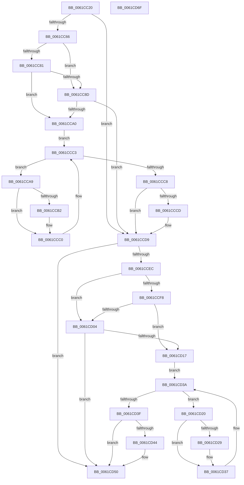

# DifDriverCancelWrapper

- RVA: `0x0061CC20`–`0x0061CD70` (길이 `336` bytes)
- VA: `0x000000014061CC20`
- 실행 섹션: `.text`
- PDB 이름 있음: `예`; PDB Function 태그: `아니요`
- unwind 정보 RVA: `0x0008A668`
- 디코드: `92`개 명령, `336/336` bytes 표시
- 미해석 바이트: `0` (있으면 어셈블리에 `.byte`로 보존)

> 이 문서는 커널 이미지의 기계어와 PDB 기호를 분석해 생성했습니다. 4번과 5번은 함수 원형과 자료형을 바이너리 사용 방식에서 추정한 C 해석이며 원본 소스 복구 결과는 아닙니다.

## 1. Dependencies

- 직접 호출 지점: **8**; 고유 호출 대상: **4**
- 직접 호출자로 확인된 함수: **0**
- RIP 상대 이미지 참조: **3**

### Outgoing calls
- `0x0061CC59` → [DifGetAPIThunkContextById](../49/DifGetAPIThunkContextById_function_00495A34.md) (function, `0x00495A34`)
- `0x0061CC94` → [ExAcquireRundownProtection](../21/ExAcquireRundownProtection_function_00216620.md) (function, `0x00216620`)
- `0x0061CCBB` → [guard_dispatch_icall](../6B/guard_dispatch_icall_function_006BAAD0.md) (function, `0x006BAAD0`)
- `0x0061CCD4` → [ExReleaseRundownProtection](../34/ExReleaseRundownProtection_function_00349E80.md) (function, `0x00349E80`)
- `0x0061CCE2` → [guard_dispatch_icall](../6B/guard_dispatch_icall_function_006BAAD0.md) (function, `0x006BAAD0`)
- `0x0061CD0B` → [ExAcquireRundownProtection](../21/ExAcquireRundownProtection_function_00216620.md) (function, `0x00216620`)
- `0x0061CD32` → [guard_dispatch_icall](../6B/guard_dispatch_icall_function_006BAAD0.md) (function, `0x006BAAD0`)
- `0x0061CD4B` → [ExReleaseRundownProtection](../34/ExReleaseRundownProtection_function_00349E80.md) (function, `0x00349E80`)

### Direct callers
- 이 함수 시작 RVA로 연결되는 직접 call은 확인되지 않았습니다. 간접 호출은 완전히 역산할 수 없습니다.

### Static image references
- `0x0061CC6E` → RVA `0x00F048B8` (`.data`; read)
- `0x0061CC81` → RVA `0x00F04980` (`.data`; read)
- `0x0061CC8D` → RVA `0x00F03E80` (`.data`; read)

## 2. Other-region calls and transfers

- 다른 실행 섹션으로 향하는 call: **0**
- 별도 외부 분기/꼬리 이동을 확인하지 못했습니다.

## 3. Assembly (complete function range)

```asm
0061CC20  4C 8B DC                        mov r11, rsp
0061CC23  49 89 5B 08                     mov qword ptr [r11 + 8], rbx
0061CC27  49 89 6B 10                     mov qword ptr [r11 + 0x10], rbp
0061CC2B  49 89 73 18                     mov qword ptr [r11 + 0x18], rsi
0061CC2F  49 89 7B 20                     mov qword ptr [r11 + 0x20], rdi
0061CC33  41 54                           push r12
0061CC35  41 56                           push r14
0061CC37  41 57                           push r15
0061CC39  48 83 EC 40                     sub rsp, 0x40
0061CC3D  33 C0                           xor eax, eax
0061CC3F  0F 57 C0                        xorps xmm0, xmm0
0061CC42  0F 11 44 24 20                  movups xmmword ptr [rsp + 0x20], xmm0
0061CC47  4C 8B E1                        mov r12, rcx
0061CC4A  49 89 43 D8                     mov qword ptr [r11 - 0x28], rax
0061CC4E  B9 20 00 00 10                  mov ecx, 0x10000020
0061CC53  4D 8B F0                        mov r14, r8
0061CC56  4C 8B FA                        mov r15, rdx
0061CC59  E8 D6 8D E7 FF                  call 0x140495a34
0061CC5E  48 8B E8                        mov rbp, rax
0061CC61  48 85 C0                        test rax, rax
0061CC64  74 73                           je 0x14061ccd9
0061CC66  40 32 F6                        xor sil, sil
0061CC69  4C 89 44 24 20                  mov qword ptr [rsp + 0x20], r8
0061CC6E  40 38 35 43 7C 8E 00            cmp byte ptr [rip + 0x8e7c43], sil
0061CC75  4C 89 64 24 30                  mov qword ptr [rsp + 0x30], r12
0061CC7A  4C 89 7C 24 28                  mov qword ptr [rsp + 0x28], r15
0061CC7F  75 0C                           jne 0x14061cc8d
0061CC81  F7 05 F5 7C 8E 00 00 08 00 00   test dword ptr [rip + 0x8e7cf5], 0x800
0061CC8B  74 13                           je 0x14061cca0
0061CC8D  48 8D 0D EC 71 8E 00            lea rcx, [rip + 0x8e71ec]
0061CC94  E8 87 99 BF FF                  call 0x140216620
0061CC99  40 8A F0                        mov sil, al
0061CC9C  84 C0                           test al, al
0061CC9E  74 39                           je 0x14061ccd9
0061CCA0  48 8D 7D 20                     lea rdi, [rbp + 0x20]
0061CCA4  48 8B 1F                        mov rbx, qword ptr [rdi]
0061CCA7  EB 1A                           jmp 0x14061ccc3
0061CCA9  48 8D 43 F0                     lea rax, [rbx - 0x10]
0061CCAD  48 85 C0                        test rax, rax
0061CCB0  74 0E                           je 0x14061ccc0
0061CCB2  48 8B 40 08                     mov rax, qword ptr [rax + 8]
0061CCB6  48 8D 4C 24 20                  lea rcx, [rsp + 0x20]
0061CCBB  E8 10 DE 09 00                  call 0x1406baad0
0061CCC0  48 8B 1B                        mov rbx, qword ptr [rbx]
0061CCC3  48 3B DF                        cmp rbx, rdi
0061CCC6  75 E1                           jne 0x14061cca9
0061CCC8  40 84 F6                        test sil, sil
0061CCCB  74 0C                           je 0x14061ccd9
0061CCCD  48 8D 0D AC 71 8E 00            lea rcx, [rip + 0x8e71ac]
0061CCD4  E8 A7 D1 D2 FF                  call 0x140349e80
0061CCD9  49 8B D7                        mov rdx, r15
0061CCDC  49 8B CC                        mov rcx, r12
0061CCDF  49 8B C6                        mov rax, r14
0061CCE2  E8 E9 DD 09 00                  call 0x1406baad0
0061CCE7  48 85 ED                        test rbp, rbp
0061CCEA  74 64                           je 0x14061cd50
0061CCEC  40 32 FF                        xor dil, dil
0061CCEF  40 38 3D C2 7B 8E 00            cmp byte ptr [rip + 0x8e7bc2], dil
0061CCF6  75 0C                           jne 0x14061cd04
0061CCF8  F7 05 7E 7C 8E 00 00 08 00 00   test dword ptr [rip + 0x8e7c7e], 0x800
0061CD02  74 13                           je 0x14061cd17
0061CD04  48 8D 0D 75 71 8E 00            lea rcx, [rip + 0x8e7175]
0061CD0B  E8 10 99 BF FF                  call 0x140216620
0061CD10  40 8A F8                        mov dil, al
0061CD13  84 C0                           test al, al
0061CD15  74 39                           je 0x14061cd50
0061CD17  48 8D 75 30                     lea rsi, [rbp + 0x30]
0061CD1B  48 8B 1E                        mov rbx, qword ptr [rsi]
0061CD1E  EB 1A                           jmp 0x14061cd3a
0061CD20  48 8D 43 F0                     lea rax, [rbx - 0x10]
0061CD24  48 85 C0                        test rax, rax
0061CD27  74 0E                           je 0x14061cd37
0061CD29  48 8B 40 08                     mov rax, qword ptr [rax + 8]
0061CD2D  48 8D 4C 24 20                  lea rcx, [rsp + 0x20]
0061CD32  E8 99 DD 09 00                  call 0x1406baad0
0061CD37  48 8B 1B                        mov rbx, qword ptr [rbx]
0061CD3A  48 3B DE                        cmp rbx, rsi
0061CD3D  75 E1                           jne 0x14061cd20
0061CD3F  40 84 FF                        test dil, dil
0061CD42  74 0C                           je 0x14061cd50
0061CD44  48 8D 0D 35 71 8E 00            lea rcx, [rip + 0x8e7135]
0061CD4B  E8 30 D1 D2 FF                  call 0x140349e80
0061CD50  48 8B 5C 24 60                  mov rbx, qword ptr [rsp + 0x60]
0061CD55  48 8B 6C 24 68                  mov rbp, qword ptr [rsp + 0x68]
0061CD5A  48 8B 74 24 70                  mov rsi, qword ptr [rsp + 0x70]
0061CD5F  48 8B 7C 24 78                  mov rdi, qword ptr [rsp + 0x78]
0061CD64  48 83 C4 40                     add rsp, 0x40
0061CD68  41 5F                           pop r15
0061CD6A  41 5E                           pop r14
0061CD6C  41 5C                           pop r12
0061CD6E  C3                              ret
0061CD6F  CC                              int3
```

## 4. C-style interpretation (structured pseudocode)

```c
__int64 __fastcall DifDriverCancelWrapper(__int64 a1, __int64 a2, __int64 a3)
{
    __int64 result;
    __int64 v_rdi;
    __int64 v_rsi;
    __int64 v_rsp;
    unsigned __int64 v_stack_m28;
    unsigned __int64 v_stack_m30;
    unsigned __int64 v_stack_m38;
    unsigned __int64 v_stack_p10;
    unsigned __int64 v_stack_p18;
    unsigned __int64 v_stack_p20;
    unsigned __int64 v_stack_p8;

    *(unsigned __int64 *)(v_rsp + 8) = v_rbx;
    *(unsigned __int64 *)(v_rsp + 16) = v_rbp;
    *(unsigned __int64 *)(v_rsp + 24) = v_rsi;
    *(unsigned __int64 *)(v_rsp + 32) = v_rdi;
    v_rsp = (v_rsp) - (64);
    result = 0;
    v_stack_m38 = v_xmm0;
    *(unsigned __int64 *)(v_rsp - 40) = 0;
    result = DifGetAPIThunkContextById((unsigned int)(0x10000020ULL), a2, a3, a4);
    if (result == 0) goto loc_0061CCD9;
    v_rsi = 0;
    v_stack_m38 = a3;
    v_stack_m28 = a1;
    v_stack_m30 = a2;
    if ((*(unsigned __int8 *)(v_rip + 9337923)) != 0) goto loc_0061CC8D;
    if (((*(unsigned int *)(v_rip + 9338101)) & (0x800ULL)) == 0) goto loc_0061CCA0;
loc_0061CC8D:
    result = ExAcquireRundownProtection(v_rip + 9335276, a2, a3, a4);
    if ((unsigned __int8)(result) == 0) goto loc_0061CCD9;
loc_0061CCA0:
    goto loc_0061CCC3;
loc_0061CCA9:
    result = *(unsigned __int64 *)(result + 32) - 16;
    if (*(unsigned __int64 *)(result + 32) - 16 != 0) {
        result = *(unsigned __int64 *)(*(unsigned __int64 *)(result + 32) - 16 + 8);
        a1 = v_stack_m38;
        result = guard_dispatch_icall(a1, a2, a3, a4);
    }
loc_0061CCC3:
    if ((*(unsigned __int64 *)(*(unsigned __int64 *)(result + 32))) != (result + 32)) goto loc_0061CCA9;
    if ((unsigned __int8)((unsigned __int8)(result)) != 0) {
        a1 = v_rip + 9335212;
        result = ExReleaseRundownProtection(a1, a2, a3, a4);
    }
    result = guard_dispatch_icall(a1, a2, a3, a4);
    if (result == 0) goto loc_0061CD50;
    v_rdi = 0;
    if ((*(unsigned __int8 *)(v_rip + 9337794)) != 0) goto loc_0061CD04;
    if (((*(unsigned int *)(v_rip + 9337982)) & (0x800ULL)) == 0) goto loc_0061CD17;
loc_0061CD04:
    result = ExAcquireRundownProtection(v_rip + 9335157, a2, a3, a4);
    if ((unsigned __int8)(result) == 0) goto loc_0061CD50;
loc_0061CD17:
    goto loc_0061CD3A;
loc_0061CD20:
    result = *(unsigned __int64 *)(result + 48) - 16;
    if (*(unsigned __int64 *)(result + 48) - 16 != 0) {
        result = *(unsigned __int64 *)(*(unsigned __int64 *)(result + 48) - 16 + 8);
        a1 = v_stack_m38;
        result = guard_dispatch_icall(a1, a2, a3, a4);
    }
loc_0061CD3A:
    if ((*(unsigned __int64 *)(*(unsigned __int64 *)(result + 48))) != (result + 48)) goto loc_0061CD20;
    if ((unsigned __int8)((unsigned __int8)(result)) != 0) {
        a1 = v_rip + 9335093;
        result = ExReleaseRundownProtection(a1, a2, a3, a4);
    }
    v_rsp = (v_rsp) + (64);
    return result;
}
```

## 5. (Beta) C Style

```c
int64_t DifDriverCancelWrapper(int64_t Arg1, int64_t Arg2, int64_t Arg3)
{
    int64_t result;
    int64_t local_rdi;
    int64_t local_rsi;
    int64_t local_rsp;
    uint64_t v_stack_m28;
    uint64_t v_stack_m30;
    uint64_t v_stack_m38;
    uint64_t v_stack_p10;
    uint64_t v_stack_p18;
    uint64_t v_stack_p20;
    uint64_t v_stack_p8;

    *(uint64_t *)(local_rsp + 0x8) = local_rbx;
    *(uint64_t *)(local_rsp + 0x10) = local_rbp;
    *(uint64_t *)(local_rsp + 0x18) = local_rsi;
    *(uint64_t *)(local_rsp + 0x20) = local_rdi;
    local_rsp = (local_rsp) - (64);
    result = 0;
    v_stack_m38 = v_xmm0;
    *(uint64_t *)(local_rsp - 0x28) = 0;
    result = DifGetAPIThunkContextById((uint32_t)(0x10000020ULL), Arg2, Arg3, a4);
    if (result == 0) goto loc_0061CCD9;
    local_rsi = 0;
    v_stack_m38 = Arg3;
    v_stack_m28 = Arg1;
    v_stack_m30 = Arg2;
    if ((*(uint8_t *)(v_rip + 0x8E7C43)) != 0) goto loc_0061CC8D;
    if (((*(uint32_t *)(v_rip + 0x8E7CF5)) & (0x800ULL)) == 0) goto loc_0061CCA0;
loc_0061CC8D:
    result = ExAcquireRundownProtection(v_rip + 9335276, Arg2, Arg3, a4);
    if ((uint8_t)(result) == 0) goto loc_0061CCD9;
loc_0061CCA0:
    goto loc_0061CCC3;
loc_0061CCA9:
    result = *(uint64_t *)(result + 0x20) - 16;
    if (*(uint64_t *)(result + 0x20) - 16 != 0) {
        result = *(uint64_t *)(*(uint64_t *)(result + 0x20) - 0x10 + 0x8);
        Arg1 = v_stack_m38;
        result = guard_dispatch_icall(Arg1, Arg2, Arg3, a4);
    }
loc_0061CCC3:
    if ((*(uint64_t *)(*(uint64_t *)(result + 0x20))) != (result + 32)) goto loc_0061CCA9;
    if ((uint8_t)((uint8_t)(result)) != 0) {
        Arg1 = v_rip + 9335212;
        result = ExReleaseRundownProtection(Arg1, Arg2, Arg3, a4);
    }
    result = guard_dispatch_icall(Arg1, Arg2, Arg3, a4);
    if (result == 0) goto loc_0061CD50;
    local_rdi = 0;
    if ((*(uint8_t *)(v_rip + 0x8E7BC2)) != 0) goto loc_0061CD04;
    if (((*(uint32_t *)(v_rip + 0x8E7C7E)) & (0x800ULL)) == 0) goto loc_0061CD17;
loc_0061CD04:
    result = ExAcquireRundownProtection(v_rip + 9335157, Arg2, Arg3, a4);
    if ((uint8_t)(result) == 0) goto loc_0061CD50;
loc_0061CD17:
    goto loc_0061CD3A;
loc_0061CD20:
    result = *(uint64_t *)(result + 0x30) - 16;
    if (*(uint64_t *)(result + 0x30) - 16 != 0) {
        result = *(uint64_t *)(*(uint64_t *)(result + 0x30) - 0x10 + 0x8);
        Arg1 = v_stack_m38;
        result = guard_dispatch_icall(Arg1, Arg2, Arg3, a4);
    }
loc_0061CD3A:
    if ((*(uint64_t *)(*(uint64_t *)(result + 0x30))) != (result + 48)) goto loc_0061CD20;
    if ((uint8_t)((uint8_t)(result)) != 0) {
        Arg1 = v_rip + 9335093;
        result = ExReleaseRundownProtection(Arg1, Arg2, Arg3, a4);
    }
    local_rsp = (local_rsp) + (64);
    return result;
}
```

## 6. Execution-region graph

[열기: 2D/3D 그래프와 함수 탐색 컨트롤 패널](../../../control-panel.html?section=text&rva=0x0061CC20&view=graph)

- 2D 그래프는 위에서 아래로 흐르고, 3D 그래프는 빈 공간을 드래그해 회전합니다. Shift+드래그는 이동, 휠은 확대·축소, 함수 노드 선택은 대상 보고서 이동입니다.

### Static fallback


