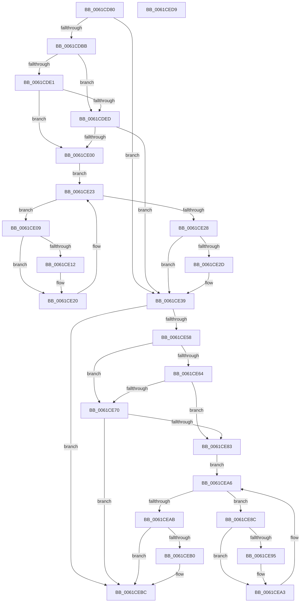

# DifDriverEntryWrapper

- RVA: `0x0061CD80`–`0x0061CEDA` (길이 `346` bytes)
- VA: `0x000000014061CD80`
- 실행 섹션: `.text`
- PDB 이름 있음: `예`; PDB Function 태그: `아니요`
- unwind 정보 RVA: `0x00093E28`
- 디코드: `95`개 명령, `346/346` bytes 표시
- 미해석 바이트: `0` (있으면 어셈블리에 `.byte`로 보존)

> 이 문서는 커널 이미지의 기계어와 PDB 기호를 분석해 생성했습니다. 4번과 5번은 함수 원형과 자료형을 바이너리 사용 방식에서 추정한 C 해석이며 원본 소스 복구 결과는 아닙니다.

## 1. Dependencies

- 직접 호출 지점: **8**; 고유 호출 대상: **4**
- 직접 호출자로 확인된 함수: **0**
- RIP 상대 이미지 참조: **3**

### Outgoing calls
- `0x0061CDAE` → [DifGetAPIThunkContextById](../49/DifGetAPIThunkContextById_function_00495A34.md) (function, `0x00495A34`)
- `0x0061CDF4` → [ExAcquireRundownProtection](../21/ExAcquireRundownProtection_function_00216620.md) (function, `0x00216620`)
- `0x0061CE1B` → [guard_dispatch_icall](../6B/guard_dispatch_icall_function_006BAAD0.md) (function, `0x006BAAD0`)
- `0x0061CE34` → [ExReleaseRundownProtection](../34/ExReleaseRundownProtection_function_00349E80.md) (function, `0x00349E80`)
- `0x0061CE4A` → [guard_dispatch_icall](../6B/guard_dispatch_icall_function_006BAAD0.md) (function, `0x006BAAD0`)
- `0x0061CE77` → [ExAcquireRundownProtection](../21/ExAcquireRundownProtection_function_00216620.md) (function, `0x00216620`)
- `0x0061CE9E` → [guard_dispatch_icall](../6B/guard_dispatch_icall_function_006BAAD0.md) (function, `0x006BAAD0`)
- `0x0061CEB7` → [ExReleaseRundownProtection](../34/ExReleaseRundownProtection_function_00349E80.md) (function, `0x00349E80`)

### Direct callers
- 이 함수 시작 RVA로 연결되는 직접 call은 확인되지 않았습니다. 간접 호출은 완전히 역산할 수 없습니다.

### Static image references
- `0x0061CDC2` → RVA `0x00F048B8` (`.data`; read)
- `0x0061CDE1` → RVA `0x00F04980` (`.data`; read)
- `0x0061CDED` → RVA `0x00F03E80` (`.data`; read)

## 2. Other-region calls and transfers

- 다른 실행 섹션으로 향하는 call: **0**
- 별도 외부 분기/꼬리 이동을 확인하지 못했습니다.

## 3. Assembly (complete function range)

```asm
0061CD80  48 8B C4                        mov rax, rsp
0061CD83  48 89 58 08                     mov qword ptr [rax + 8], rbx
0061CD87  48 89 68 10                     mov qword ptr [rax + 0x10], rbp
0061CD8B  48 89 70 18                     mov qword ptr [rax + 0x18], rsi
0061CD8F  57                              push rdi
0061CD90  41 56                           push r14
0061CD92  41 57                           push r15
0061CD94  48 83 EC 40                     sub rsp, 0x40
0061CD98  0F 57 C0                        xorps xmm0, xmm0
0061CD9B  4C 8B F1                        mov r14, rcx
0061CD9E  B9 1C 00 00 10                  mov ecx, 0x1000001c
0061CDA3  4C 8B FA                        mov r15, rdx
0061CDA6  0F 11 40 C8                     movups xmmword ptr [rax - 0x38], xmm0
0061CDAA  0F 11 40 D8                     movups xmmword ptr [rax - 0x28], xmm0
0061CDAE  E8 81 8C E7 FF                  call 0x140495a34
0061CDB3  48 8B E8                        mov rbp, rax
0061CDB6  48 85 C0                        test rax, rax
0061CDB9  74 7E                           je 0x14061ce39
0061CDBB  49 8B 56 30                     mov rdx, qword ptr [r14 + 0x30]
0061CDBF  40 32 F6                        xor sil, sil
0061CDC2  40 38 35 EF 7A 8E 00            cmp byte ptr [rip + 0x8e7aef], sil
0061CDC9  48 8B 4A 40                     mov rcx, qword ptr [rdx + 0x40]
0061CDCD  48 8B 11                        mov rdx, qword ptr [rcx]
0061CDD0  48 89 54 24 20                  mov qword ptr [rsp + 0x20], rdx
0061CDD5  4C 89 74 24 30                  mov qword ptr [rsp + 0x30], r14
0061CDDA  4C 89 7C 24 28                  mov qword ptr [rsp + 0x28], r15
0061CDDF  75 0C                           jne 0x14061cded
0061CDE1  F7 05 95 7B 8E 00 00 08 00 00   test dword ptr [rip + 0x8e7b95], 0x800
0061CDEB  74 13                           je 0x14061ce00
0061CDED  48 8D 0D 8C 70 8E 00            lea rcx, [rip + 0x8e708c]
0061CDF4  E8 27 98 BF FF                  call 0x140216620
0061CDF9  40 8A F0                        mov sil, al
0061CDFC  84 C0                           test al, al
0061CDFE  74 39                           je 0x14061ce39
0061CE00  48 8D 7D 20                     lea rdi, [rbp + 0x20]
0061CE04  48 8B 1F                        mov rbx, qword ptr [rdi]
0061CE07  EB 1A                           jmp 0x14061ce23
0061CE09  48 8D 43 F0                     lea rax, [rbx - 0x10]
0061CE0D  48 85 C0                        test rax, rax
0061CE10  74 0E                           je 0x14061ce20
0061CE12  48 8B 40 08                     mov rax, qword ptr [rax + 8]
0061CE16  48 8D 4C 24 20                  lea rcx, [rsp + 0x20]
0061CE1B  E8 B0 DC 09 00                  call 0x1406baad0
0061CE20  48 8B 1B                        mov rbx, qword ptr [rbx]
0061CE23  48 3B DF                        cmp rbx, rdi
0061CE26  75 E1                           jne 0x14061ce09
0061CE28  40 84 F6                        test sil, sil
0061CE2B  74 0C                           je 0x14061ce39
0061CE2D  48 8D 0D 4C 70 8E 00            lea rcx, [rip + 0x8e704c]
0061CE34  E8 47 D0 D2 FF                  call 0x140349e80
0061CE39  49 8B 46 30                     mov rax, qword ptr [r14 + 0x30]
0061CE3D  49 8B D7                        mov rdx, r15
0061CE40  48 8B 48 40                     mov rcx, qword ptr [rax + 0x40]
0061CE44  48 8B 01                        mov rax, qword ptr [rcx]
0061CE47  49 8B CE                        mov rcx, r14
0061CE4A  E8 81 DC 09 00                  call 0x1406baad0
0061CE4F  89 44 24 38                     mov dword ptr [rsp + 0x38], eax
0061CE53  48 85 ED                        test rbp, rbp
0061CE56  74 64                           je 0x14061cebc
0061CE58  40 32 FF                        xor dil, dil
0061CE5B  40 38 3D 56 7A 8E 00            cmp byte ptr [rip + 0x8e7a56], dil
0061CE62  75 0C                           jne 0x14061ce70
0061CE64  F7 05 12 7B 8E 00 00 08 00 00   test dword ptr [rip + 0x8e7b12], 0x800
0061CE6E  74 13                           je 0x14061ce83
0061CE70  48 8D 0D 09 70 8E 00            lea rcx, [rip + 0x8e7009]
0061CE77  E8 A4 97 BF FF                  call 0x140216620
0061CE7C  40 8A F8                        mov dil, al
0061CE7F  84 C0                           test al, al
0061CE81  74 39                           je 0x14061cebc
0061CE83  48 8D 75 30                     lea rsi, [rbp + 0x30]
0061CE87  48 8B 1E                        mov rbx, qword ptr [rsi]
0061CE8A  EB 1A                           jmp 0x14061cea6
0061CE8C  48 8D 43 F0                     lea rax, [rbx - 0x10]
0061CE90  48 85 C0                        test rax, rax
0061CE93  74 0E                           je 0x14061cea3
0061CE95  48 8B 40 08                     mov rax, qword ptr [rax + 8]
0061CE99  48 8D 4C 24 20                  lea rcx, [rsp + 0x20]
0061CE9E  E8 2D DC 09 00                  call 0x1406baad0
0061CEA3  48 8B 1B                        mov rbx, qword ptr [rbx]
0061CEA6  48 3B DE                        cmp rbx, rsi
0061CEA9  75 E1                           jne 0x14061ce8c
0061CEAB  40 84 FF                        test dil, dil
0061CEAE  74 0C                           je 0x14061cebc
0061CEB0  48 8D 0D C9 6F 8E 00            lea rcx, [rip + 0x8e6fc9]
0061CEB7  E8 C4 CF D2 FF                  call 0x140349e80
0061CEBC  8B 44 24 38                     mov eax, dword ptr [rsp + 0x38]
0061CEC0  48 8B 5C 24 60                  mov rbx, qword ptr [rsp + 0x60]
0061CEC5  48 8B 6C 24 68                  mov rbp, qword ptr [rsp + 0x68]
0061CECA  48 8B 74 24 70                  mov rsi, qword ptr [rsp + 0x70]
0061CECF  48 83 C4 40                     add rsp, 0x40
0061CED3  41 5F                           pop r15
0061CED5  41 5E                           pop r14
0061CED7  5F                              pop rdi
0061CED8  C3                              ret
0061CED9  CC                              int3
```

## 4. C-style interpretation (structured pseudocode)

```c
__int64 __fastcall DifDriverEntryWrapper(__int64 a1, __int64 a2)
{
    __int64 result;
    __int64 v_rdi;
    __int64 v_rsi;
    __int64 v_rsp;
    unsigned int v_stack_m20;
    unsigned __int64 v_stack_m28;
    unsigned __int64 v_stack_m30;
    unsigned __int64 v_stack_m38;
    unsigned __int64 v_stack_p10;
    unsigned __int64 v_stack_p18;
    unsigned __int64 v_stack_p8;

    *(unsigned __int64 *)(v_rsp + 8) = v_rbx;
    *(unsigned __int64 *)(v_rsp + 16) = v_rbp;
    *(unsigned __int64 *)(v_rsp + 24) = v_rsi;
    v_rsp = (v_rsp) - (64);
    *(unsigned __int64 *)(v_rsp - 56) = v_xmm0;
    *(unsigned __int64 *)(v_rsp - 40) = v_xmm0;
    result = DifGetAPIThunkContextById((unsigned int)(0x1000001CULL), a2, a3, a4);
    if (result == 0) goto loc_0061CE39;
    v_rsi = 0;
    v_stack_m38 = *(unsigned __int64 *)(*(unsigned __int64 *)(*(unsigned __int64 *)(a1 + 48) + 64));
    v_stack_m28 = a1;
    v_stack_m30 = a2;
    if ((*(unsigned __int8 *)(v_rip + 9337583)) != 0) goto loc_0061CDED;
    if (((*(unsigned int *)(v_rip + 9337749)) & (0x800ULL)) == 0) goto loc_0061CE00;
loc_0061CDED:
    result = ExAcquireRundownProtection(v_rip + 9334924, *(unsigned __int64 *)(*(unsigned __int64 *)(*(unsigned __int64 *)(a1 + 48) + 64)), a3, a4);
    if ((unsigned __int8)(result) == 0) goto loc_0061CE39;
loc_0061CE00:
    goto loc_0061CE23;
loc_0061CE09:
    result = *(unsigned __int64 *)(result + 32) - 16;
    if (*(unsigned __int64 *)(result + 32) - 16 != 0) {
        result = *(unsigned __int64 *)(*(unsigned __int64 *)(result + 32) - 16 + 8);
        a1 = v_stack_m38;
        result = guard_dispatch_icall(a1, *(unsigned __int64 *)(*(unsigned __int64 *)(*(unsigned __int64 *)(a1 + 48) + 64)), a3, a4);
    }
loc_0061CE23:
    if ((*(unsigned __int64 *)(*(unsigned __int64 *)(result + 32))) != (result + 32)) goto loc_0061CE09;
    if ((unsigned __int8)((unsigned __int8)(result)) != 0) {
        a1 = v_rip + 9334860;
        result = ExReleaseRundownProtection(a1, *(unsigned __int64 *)(*(unsigned __int64 *)(*(unsigned __int64 *)(a1 + 48) + 64)), a3, a4);
    }
    result = guard_dispatch_icall(a1, a2, a3, a4);
    v_stack_m20 = (unsigned int)(result);
    if (result == 0) goto loc_0061CEBC;
    v_rdi = 0;
    if ((*(unsigned __int8 *)(v_rip + 9337430)) != 0) goto loc_0061CE70;
    if (((*(unsigned int *)(v_rip + 9337618)) & (0x800ULL)) == 0) goto loc_0061CE83;
loc_0061CE70:
    result = ExAcquireRundownProtection(v_rip + 9334793, a2, a3, a4);
    if ((unsigned __int8)(result) == 0) goto loc_0061CEBC;
loc_0061CE83:
    goto loc_0061CEA6;
loc_0061CE8C:
    result = *(unsigned __int64 *)(result + 48) - 16;
    if (*(unsigned __int64 *)(result + 48) - 16 != 0) {
        result = *(unsigned __int64 *)(*(unsigned __int64 *)(result + 48) - 16 + 8);
        a1 = v_stack_m38;
        result = guard_dispatch_icall(a1, a2, a3, a4);
    }
loc_0061CEA6:
    if ((*(unsigned __int64 *)(*(unsigned __int64 *)(result + 48))) != (result + 48)) goto loc_0061CE8C;
    if ((unsigned __int8)((unsigned __int8)(result)) != 0) {
        a1 = v_rip + 9334729;
        result = ExReleaseRundownProtection(a1, a2, a3, a4);
    }
    v_rsp = (v_rsp) + (64);
    return (unsigned int)(v_stack_m20);
}
```

## 5. (Beta) C Style

```c
int64_t DifDriverEntryWrapper(void *Arg1, int64_t Arg2)
{
    uint8_t *arg1 = (uint8_t *)Arg1;

    int64_t result;
    int64_t local_rdi;
    int64_t local_rsi;
    int64_t local_rsp;
    uint32_t v_stack_m20;
    uint64_t v_stack_m28;
    uint64_t v_stack_m30;
    uint64_t v_stack_m38;
    uint64_t v_stack_p10;
    uint64_t v_stack_p18;
    uint64_t v_stack_p8;

    *(uint64_t *)(local_rsp + 0x8) = local_rbx;
    *(uint64_t *)(local_rsp + 0x10) = local_rbp;
    *(uint64_t *)(local_rsp + 0x18) = local_rsi;
    local_rsp = (local_rsp) - (64);
    *(uint64_t *)(local_rsp - 0x38) = v_xmm0;
    *(uint64_t *)(local_rsp - 0x28) = v_xmm0;
    result = DifGetAPIThunkContextById((uint32_t)(0x1000001CULL), Arg2, a3, a4);
    if (result == 0) goto loc_0061CE39;
    local_rsi = 0;
    v_stack_m38 = *(uint64_t *)(*(uint64_t *)(*(uint64_t *)(arg1 + 0x30) + 0x40));
    v_stack_m28 = Arg1;
    v_stack_m30 = Arg2;
    if ((*(uint8_t *)(v_rip + 0x8E7AEF)) != 0) goto loc_0061CDED;
    if (((*(uint32_t *)(v_rip + 0x8E7B95)) & (0x800ULL)) == 0) goto loc_0061CE00;
loc_0061CDED:
    result = ExAcquireRundownProtection(v_rip + 9334924, *(uint64_t *)(*(uint64_t *)(*(uint64_t *)(arg1 + 0x30) + 0x40)), a3, a4);
    if ((uint8_t)(result) == 0) goto loc_0061CE39;
loc_0061CE00:
    goto loc_0061CE23;
loc_0061CE09:
    result = *(uint64_t *)(result + 0x20) - 16;
    if (*(uint64_t *)(result + 0x20) - 16 != 0) {
        result = *(uint64_t *)(*(uint64_t *)(result + 0x20) - 0x10 + 0x8);
        Arg1 = v_stack_m38;
        result = guard_dispatch_icall(Arg1, *(uint64_t *)(*(uint64_t *)(*(uint64_t *)(arg1 + 0x30) + 0x40)), a3, a4);
    }
loc_0061CE23:
    if ((*(uint64_t *)(*(uint64_t *)(result + 0x20))) != (result + 32)) goto loc_0061CE09;
    if ((uint8_t)((uint8_t)(result)) != 0) {
        Arg1 = v_rip + 9334860;
        result = ExReleaseRundownProtection(Arg1, *(uint64_t *)(*(uint64_t *)(*(uint64_t *)(arg1 + 0x30) + 0x40)), a3, a4);
    }
    result = guard_dispatch_icall(Arg1, Arg2, a3, a4);
    v_stack_m20 = (uint32_t)(result);
    if (result == 0) goto loc_0061CEBC;
    local_rdi = 0;
    if ((*(uint8_t *)(v_rip + 0x8E7A56)) != 0) goto loc_0061CE70;
    if (((*(uint32_t *)(v_rip + 0x8E7B12)) & (0x800ULL)) == 0) goto loc_0061CE83;
loc_0061CE70:
    result = ExAcquireRundownProtection(v_rip + 9334793, Arg2, a3, a4);
    if ((uint8_t)(result) == 0) goto loc_0061CEBC;
loc_0061CE83:
    goto loc_0061CEA6;
loc_0061CE8C:
    result = *(uint64_t *)(result + 0x30) - 16;
    if (*(uint64_t *)(result + 0x30) - 16 != 0) {
        result = *(uint64_t *)(*(uint64_t *)(result + 0x30) - 0x10 + 0x8);
        Arg1 = v_stack_m38;
        result = guard_dispatch_icall(Arg1, Arg2, a3, a4);
    }
loc_0061CEA6:
    if ((*(uint64_t *)(*(uint64_t *)(result + 0x30))) != (result + 48)) goto loc_0061CE8C;
    if ((uint8_t)((uint8_t)(result)) != 0) {
        Arg1 = v_rip + 9334729;
        result = ExReleaseRundownProtection(Arg1, Arg2, a3, a4);
    }
    local_rsp = (local_rsp) + (64);
    return (uint32_t)(v_stack_m20);
}
```

### 관측된 메모리 오프셋

구조체 형식이 확인되지 않은 접근은 인자 기준의 오프셋으로만 기록했습니다.

| 기준 인자 | 오프셋 표현 | 폭 (bit) | 접근 |
|---|---:|---:|---|
| `Arg1` | `+ 0x30` | `64` | `R` |

## 6. Execution-region graph

[열기: 2D/3D 그래프와 함수 탐색 컨트롤 패널](../../../control-panel.html?section=text&rva=0x0061CD80&view=graph)

- 2D 그래프는 위에서 아래로 흐르고, 3D 그래프는 빈 공간을 드래그해 회전합니다. Shift+드래그는 이동, 휠은 확대·축소, 함수 노드 선택은 대상 보고서 이동입니다.

### Static fallback


