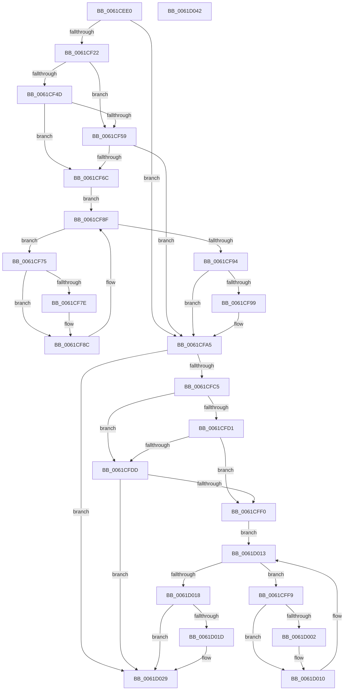

# DifDriverStartIoWrapper

- RVA: `0x0061CEE0`–`0x0061D043` (길이 `355` bytes)
- VA: `0x000000014061CEE0`
- 실행 섹션: `.text`
- PDB 이름 있음: `예`; PDB Function 태그: `아니요`
- unwind 정보 RVA: `0x00093E28`
- 디코드: `96`개 명령, `355/355` bytes 표시
- 미해석 바이트: `0` (있으면 어셈블리에 `.byte`로 보존)

> 이 문서는 커널 이미지의 기계어와 PDB 기호를 분석해 생성했습니다. 4번과 5번은 함수 원형과 자료형을 바이너리 사용 방식에서 추정한 C 해석이며 원본 소스 복구 결과는 아닙니다.

## 1. Dependencies

- 직접 호출 지점: **8**; 고유 호출 대상: **4**
- 직접 호출자로 확인된 함수: **0**
- RIP 상대 이미지 참조: **3**

### Outgoing calls
- `0x0061CF11` → [DifGetAPIThunkContextById](../49/DifGetAPIThunkContextById_function_00495A34.md) (function, `0x00495A34`)
- `0x0061CF60` → [ExAcquireRundownProtection](../21/ExAcquireRundownProtection_function_00216620.md) (function, `0x00216620`)
- `0x0061CF87` → [guard_dispatch_icall](../6B/guard_dispatch_icall_function_006BAAD0.md) (function, `0x006BAAD0`)
- `0x0061CFA0` → [ExReleaseRundownProtection](../34/ExReleaseRundownProtection_function_00349E80.md) (function, `0x00349E80`)
- `0x0061CFBB` → [guard_dispatch_icall](../6B/guard_dispatch_icall_function_006BAAD0.md) (function, `0x006BAAD0`)
- `0x0061CFE4` → [ExAcquireRundownProtection](../21/ExAcquireRundownProtection_function_00216620.md) (function, `0x00216620`)
- `0x0061D00B` → [guard_dispatch_icall](../6B/guard_dispatch_icall_function_006BAAD0.md) (function, `0x006BAAD0`)
- `0x0061D024` → [ExReleaseRundownProtection](../34/ExReleaseRundownProtection_function_00349E80.md) (function, `0x00349E80`)

### Direct callers
- 이 함수 시작 RVA로 연결되는 직접 call은 확인되지 않았습니다. 간접 호출은 완전히 역산할 수 없습니다.

### Static image references
- `0x0061CF29` → RVA `0x00F048B8` (`.data`; read)
- `0x0061CF4D` → RVA `0x00F04980` (`.data`; read)
- `0x0061CF59` → RVA `0x00F03E80` (`.data`; read)

## 2. Other-region calls and transfers

- 다른 실행 섹션으로 향하는 call: **0**
- 별도 외부 분기/꼬리 이동을 확인하지 못했습니다.

## 3. Assembly (complete function range)

```asm
0061CEE0  4C 8B DC                        mov r11, rsp
0061CEE3  49 89 5B 08                     mov qword ptr [r11 + 8], rbx
0061CEE7  49 89 6B 10                     mov qword ptr [r11 + 0x10], rbp
0061CEEB  49 89 73 18                     mov qword ptr [r11 + 0x18], rsi
0061CEEF  57                              push rdi
0061CEF0  41 56                           push r14
0061CEF2  41 57                           push r15
0061CEF4  48 83 EC 40                     sub rsp, 0x40
0061CEF8  33 C0                           xor eax, eax
0061CEFA  0F 57 C0                        xorps xmm0, xmm0
0061CEFD  0F 11 44 24 20                  movups xmmword ptr [rsp + 0x20], xmm0
0061CF02  4C 8B F1                        mov r14, rcx
0061CF05  49 89 43 D8                     mov qword ptr [r11 - 0x28], rax
0061CF09  B9 1D 00 00 10                  mov ecx, 0x1000001d
0061CF0E  4C 8B FA                        mov r15, rdx
0061CF11  E8 1E 8B E7 FF                  call 0x140495a34
0061CF16  48 8B E8                        mov rbp, rax
0061CF19  48 85 C0                        test rax, rax
0061CF1C  0F 84 83 00 00 00               je 0x14061cfa5
0061CF22  49 8B 4E 08                     mov rcx, qword ptr [r14 + 8]
0061CF26  40 32 F6                        xor sil, sil
0061CF29  40 38 35 88 79 8E 00            cmp byte ptr [rip + 0x8e7988], sil
0061CF30  48 8B 51 30                     mov rdx, qword ptr [rcx + 0x30]
0061CF34  48 8B 4A 40                     mov rcx, qword ptr [rdx + 0x40]
0061CF38  48 8B 51 08                     mov rdx, qword ptr [rcx + 8]
0061CF3C  48 89 54 24 20                  mov qword ptr [rsp + 0x20], rdx
0061CF41  4C 89 74 24 30                  mov qword ptr [rsp + 0x30], r14
0061CF46  4C 89 7C 24 28                  mov qword ptr [rsp + 0x28], r15
0061CF4B  75 0C                           jne 0x14061cf59
0061CF4D  F7 05 29 7A 8E 00 00 08 00 00   test dword ptr [rip + 0x8e7a29], 0x800
0061CF57  74 13                           je 0x14061cf6c
0061CF59  48 8D 0D 20 6F 8E 00            lea rcx, [rip + 0x8e6f20]
0061CF60  E8 BB 96 BF FF                  call 0x140216620
0061CF65  40 8A F0                        mov sil, al
0061CF68  84 C0                           test al, al
0061CF6A  74 39                           je 0x14061cfa5
0061CF6C  48 8D 7D 20                     lea rdi, [rbp + 0x20]
0061CF70  48 8B 1F                        mov rbx, qword ptr [rdi]
0061CF73  EB 1A                           jmp 0x14061cf8f
0061CF75  48 8D 43 F0                     lea rax, [rbx - 0x10]
0061CF79  48 85 C0                        test rax, rax
0061CF7C  74 0E                           je 0x14061cf8c
0061CF7E  48 8B 40 08                     mov rax, qword ptr [rax + 8]
0061CF82  48 8D 4C 24 20                  lea rcx, [rsp + 0x20]
0061CF87  E8 44 DB 09 00                  call 0x1406baad0
0061CF8C  48 8B 1B                        mov rbx, qword ptr [rbx]
0061CF8F  48 3B DF                        cmp rbx, rdi
0061CF92  75 E1                           jne 0x14061cf75
0061CF94  40 84 F6                        test sil, sil
0061CF97  74 0C                           je 0x14061cfa5
0061CF99  48 8D 0D E0 6E 8E 00            lea rcx, [rip + 0x8e6ee0]
0061CFA0  E8 DB CE D2 FF                  call 0x140349e80
0061CFA5  49 8B 46 08                     mov rax, qword ptr [r14 + 8]
0061CFA9  49 8B D7                        mov rdx, r15
0061CFAC  48 8B 48 30                     mov rcx, qword ptr [rax + 0x30]
0061CFB0  48 8B 41 40                     mov rax, qword ptr [rcx + 0x40]
0061CFB4  49 8B CE                        mov rcx, r14
0061CFB7  48 8B 40 08                     mov rax, qword ptr [rax + 8]
0061CFBB  E8 10 DB 09 00                  call 0x1406baad0
0061CFC0  48 85 ED                        test rbp, rbp
0061CFC3  74 64                           je 0x14061d029
0061CFC5  40 32 FF                        xor dil, dil
0061CFC8  40 38 3D E9 78 8E 00            cmp byte ptr [rip + 0x8e78e9], dil
0061CFCF  75 0C                           jne 0x14061cfdd
0061CFD1  F7 05 A5 79 8E 00 00 08 00 00   test dword ptr [rip + 0x8e79a5], 0x800
0061CFDB  74 13                           je 0x14061cff0
0061CFDD  48 8D 0D 9C 6E 8E 00            lea rcx, [rip + 0x8e6e9c]
0061CFE4  E8 37 96 BF FF                  call 0x140216620
0061CFE9  40 8A F8                        mov dil, al
0061CFEC  84 C0                           test al, al
0061CFEE  74 39                           je 0x14061d029
0061CFF0  48 8D 75 30                     lea rsi, [rbp + 0x30]
0061CFF4  48 8B 1E                        mov rbx, qword ptr [rsi]
0061CFF7  EB 1A                           jmp 0x14061d013
0061CFF9  48 8D 43 F0                     lea rax, [rbx - 0x10]
0061CFFD  48 85 C0                        test rax, rax
0061D000  74 0E                           je 0x14061d010
0061D002  48 8B 40 08                     mov rax, qword ptr [rax + 8]
0061D006  48 8D 4C 24 20                  lea rcx, [rsp + 0x20]
0061D00B  E8 C0 DA 09 00                  call 0x1406baad0
0061D010  48 8B 1B                        mov rbx, qword ptr [rbx]
0061D013  48 3B DE                        cmp rbx, rsi
0061D016  75 E1                           jne 0x14061cff9
0061D018  40 84 FF                        test dil, dil
0061D01B  74 0C                           je 0x14061d029
0061D01D  48 8D 0D 5C 6E 8E 00            lea rcx, [rip + 0x8e6e5c]
0061D024  E8 57 CE D2 FF                  call 0x140349e80
0061D029  48 8B 5C 24 60                  mov rbx, qword ptr [rsp + 0x60]
0061D02E  48 8B 6C 24 68                  mov rbp, qword ptr [rsp + 0x68]
0061D033  48 8B 74 24 70                  mov rsi, qword ptr [rsp + 0x70]
0061D038  48 83 C4 40                     add rsp, 0x40
0061D03C  41 5F                           pop r15
0061D03E  41 5E                           pop r14
0061D040  5F                              pop rdi
0061D041  C3                              ret
0061D042  CC                              int3
```

## 4. C-style interpretation (structured pseudocode)

```c
__int64 __fastcall DifDriverStartIoWrapper(__int64 a1, __int64 a2)
{
    __int64 result;
    __int64 v_rdi;
    __int64 v_rsi;
    __int64 v_rsp;
    unsigned __int64 v_stack_m28;
    unsigned __int64 v_stack_m30;
    unsigned __int64 v_stack_m38;
    unsigned __int64 v_stack_p10;
    unsigned __int64 v_stack_p18;
    unsigned __int64 v_stack_p8;

    *(unsigned __int64 *)(v_rsp + 8) = v_rbx;
    *(unsigned __int64 *)(v_rsp + 16) = v_rbp;
    *(unsigned __int64 *)(v_rsp + 24) = v_rsi;
    v_rsp = (v_rsp) - (64);
    result = 0;
    v_stack_m38 = v_xmm0;
    *(unsigned __int64 *)(v_rsp - 40) = 0;
    result = DifGetAPIThunkContextById((unsigned int)(0x1000001DULL), a2, a3, a4);
    if (result == 0) goto loc_0061CFA5;
    v_rsi = 0;
    v_stack_m38 = *(unsigned __int64 *)(*(unsigned __int64 *)(*(unsigned __int64 *)(*(unsigned __int64 *)(a1 + 8) + 48) + 64) + 8);
    v_stack_m28 = a1;
    v_stack_m30 = a2;
    if ((*(unsigned __int8 *)(v_rip + 9337224)) != 0) goto loc_0061CF59;
    if (((*(unsigned int *)(v_rip + 9337385)) & (0x800ULL)) == 0) goto loc_0061CF6C;
loc_0061CF59:
    result = ExAcquireRundownProtection(v_rip + 9334560, *(unsigned __int64 *)(*(unsigned __int64 *)(*(unsigned __int64 *)(*(unsigned __int64 *)(a1 + 8) + 48) + 64) + 8), a3, a4);
    if ((unsigned __int8)(result) == 0) goto loc_0061CFA5;
loc_0061CF6C:
    goto loc_0061CF8F;
loc_0061CF75:
    result = *(unsigned __int64 *)(result + 32) - 16;
    if (*(unsigned __int64 *)(result + 32) - 16 != 0) {
        result = *(unsigned __int64 *)(*(unsigned __int64 *)(result + 32) - 16 + 8);
        a1 = v_stack_m38;
        result = guard_dispatch_icall(a1, *(unsigned __int64 *)(*(unsigned __int64 *)(*(unsigned __int64 *)(*(unsigned __int64 *)(a1 + 8) + 48) + 64) + 8), a3, a4);
    }
loc_0061CF8F:
    if ((*(unsigned __int64 *)(*(unsigned __int64 *)(result + 32))) != (result + 32)) goto loc_0061CF75;
    if ((unsigned __int8)((unsigned __int8)(result)) != 0) {
        a1 = v_rip + 9334496;
        result = ExReleaseRundownProtection(a1, *(unsigned __int64 *)(*(unsigned __int64 *)(*(unsigned __int64 *)(*(unsigned __int64 *)(a1 + 8) + 48) + 64) + 8), a3, a4);
    }
    result = guard_dispatch_icall(a1, a2, a3, a4);
    if (result == 0) goto loc_0061D029;
    v_rdi = 0;
    if ((*(unsigned __int8 *)(v_rip + 9337065)) != 0) goto loc_0061CFDD;
    if (((*(unsigned int *)(v_rip + 9337253)) & (0x800ULL)) == 0) goto loc_0061CFF0;
loc_0061CFDD:
    result = ExAcquireRundownProtection(v_rip + 9334428, a2, a3, a4);
    if ((unsigned __int8)(result) == 0) goto loc_0061D029;
loc_0061CFF0:
    goto loc_0061D013;
loc_0061CFF9:
    result = *(unsigned __int64 *)(result + 48) - 16;
    if (*(unsigned __int64 *)(result + 48) - 16 != 0) {
        result = *(unsigned __int64 *)(*(unsigned __int64 *)(result + 48) - 16 + 8);
        a1 = v_stack_m38;
        result = guard_dispatch_icall(a1, a2, a3, a4);
    }
loc_0061D013:
    if ((*(unsigned __int64 *)(*(unsigned __int64 *)(result + 48))) != (result + 48)) goto loc_0061CFF9;
    if ((unsigned __int8)((unsigned __int8)(result)) != 0) {
        a1 = v_rip + 9334364;
        result = ExReleaseRundownProtection(a1, a2, a3, a4);
    }
    v_rsp = (v_rsp) + (64);
    return result;
}
```

## 5. (Beta) C Style

```c
int64_t DifDriverStartIoWrapper(void *Arg1, int64_t Arg2)
{
    uint8_t *arg1 = (uint8_t *)Arg1;

    int64_t result;
    int64_t local_rdi;
    int64_t local_rsi;
    int64_t local_rsp;
    uint64_t v_stack_m28;
    uint64_t v_stack_m30;
    uint64_t v_stack_m38;
    uint64_t v_stack_p10;
    uint64_t v_stack_p18;
    uint64_t v_stack_p8;

    *(uint64_t *)(local_rsp + 0x8) = local_rbx;
    *(uint64_t *)(local_rsp + 0x10) = local_rbp;
    *(uint64_t *)(local_rsp + 0x18) = local_rsi;
    local_rsp = (local_rsp) - (64);
    result = 0;
    v_stack_m38 = v_xmm0;
    *(uint64_t *)(local_rsp - 0x28) = 0;
    result = DifGetAPIThunkContextById((uint32_t)(0x1000001DULL), Arg2, a3, a4);
    if (result == 0) goto loc_0061CFA5;
    local_rsi = 0;
    v_stack_m38 = *(uint64_t *)(*(uint64_t *)(*(uint64_t *)(*(uint64_t *)(arg1 + 0x8) + 0x30) + 0x40) + 0x8);
    v_stack_m28 = Arg1;
    v_stack_m30 = Arg2;
    if ((*(uint8_t *)(v_rip + 0x8E7988)) != 0) goto loc_0061CF59;
    if (((*(uint32_t *)(v_rip + 0x8E7A29)) & (0x800ULL)) == 0) goto loc_0061CF6C;
loc_0061CF59:
    result = ExAcquireRundownProtection(v_rip + 9334560, *(uint64_t *)(*(uint64_t *)(*(uint64_t *)(*(uint64_t *)(arg1 + 0x8) + 0x30) + 0x40) + 0x8), a3, a4);
    if ((uint8_t)(result) == 0) goto loc_0061CFA5;
loc_0061CF6C:
    goto loc_0061CF8F;
loc_0061CF75:
    result = *(uint64_t *)(result + 0x20) - 16;
    if (*(uint64_t *)(result + 0x20) - 16 != 0) {
        result = *(uint64_t *)(*(uint64_t *)(result + 0x20) - 0x10 + 0x8);
        Arg1 = v_stack_m38;
        result = guard_dispatch_icall(Arg1, *(uint64_t *)(*(uint64_t *)(*(uint64_t *)(*(uint64_t *)(arg1 + 0x8) + 0x30) + 0x40) + 0x8), a3, a4);
    }
loc_0061CF8F:
    if ((*(uint64_t *)(*(uint64_t *)(result + 0x20))) != (result + 32)) goto loc_0061CF75;
    if ((uint8_t)((uint8_t)(result)) != 0) {
        Arg1 = v_rip + 9334496;
        result = ExReleaseRundownProtection(Arg1, *(uint64_t *)(*(uint64_t *)(*(uint64_t *)(*(uint64_t *)(arg1 + 0x8) + 0x30) + 0x40) + 0x8), a3, a4);
    }
    result = guard_dispatch_icall(Arg1, Arg2, a3, a4);
    if (result == 0) goto loc_0061D029;
    local_rdi = 0;
    if ((*(uint8_t *)(v_rip + 0x8E78E9)) != 0) goto loc_0061CFDD;
    if (((*(uint32_t *)(v_rip + 0x8E79A5)) & (0x800ULL)) == 0) goto loc_0061CFF0;
loc_0061CFDD:
    result = ExAcquireRundownProtection(v_rip + 9334428, Arg2, a3, a4);
    if ((uint8_t)(result) == 0) goto loc_0061D029;
loc_0061CFF0:
    goto loc_0061D013;
loc_0061CFF9:
    result = *(uint64_t *)(result + 0x30) - 16;
    if (*(uint64_t *)(result + 0x30) - 16 != 0) {
        result = *(uint64_t *)(*(uint64_t *)(result + 0x30) - 0x10 + 0x8);
        Arg1 = v_stack_m38;
        result = guard_dispatch_icall(Arg1, Arg2, a3, a4);
    }
loc_0061D013:
    if ((*(uint64_t *)(*(uint64_t *)(result + 0x30))) != (result + 48)) goto loc_0061CFF9;
    if ((uint8_t)((uint8_t)(result)) != 0) {
        Arg1 = v_rip + 9334364;
        result = ExReleaseRundownProtection(Arg1, Arg2, a3, a4);
    }
    local_rsp = (local_rsp) + (64);
    return result;
}
```

### 관측된 메모리 오프셋

구조체 형식이 확인되지 않은 접근은 인자 기준의 오프셋으로만 기록했습니다.

| 기준 인자 | 오프셋 표현 | 폭 (bit) | 접근 |
|---|---:|---:|---|
| `Arg1` | `+ 0x8` | `64` | `R` |

## 6. Execution-region graph

[열기: 2D/3D 그래프와 함수 탐색 컨트롤 패널](../../../control-panel.html?section=text&rva=0x0061CEE0&view=graph)

- 2D 그래프는 위에서 아래로 흐르고, 3D 그래프는 빈 공간을 드래그해 회전합니다. Shift+드래그는 이동, 휠은 확대·축소, 함수 노드 선택은 대상 보고서 이동입니다.

### Static fallback


