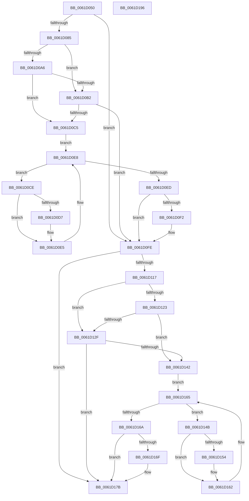

# DifDriverUnloadWrapper

- RVA: `0x0061D050`–`0x0061D197` (길이 `327` bytes)
- VA: `0x000000014061D050`
- 실행 섹션: `.text`
- PDB 이름 있음: `예`; PDB Function 태그: `아니요`
- unwind 정보 RVA: `0x0005D7BC`
- 디코드: `87`개 명령, `327/327` bytes 표시
- 미해석 바이트: `0` (있으면 어셈블리에 `.byte`로 보존)

> 이 문서는 커널 이미지의 기계어와 PDB 기호를 분석해 생성했습니다. 4번과 5번은 함수 원형과 자료형을 바이너리 사용 방식에서 추정한 C 해석이며 원본 소스 복구 결과는 아닙니다.

## 1. Dependencies

- 직접 호출 지점: **8**; 고유 호출 대상: **4**
- 직접 호출자로 확인된 함수: **0**
- RIP 상대 이미지 참조: **3**

### Outgoing calls
- `0x0061D078` → [DifGetAPIThunkContextById](../49/DifGetAPIThunkContextById_function_00495A34.md) (function, `0x00495A34`)
- `0x0061D0B9` → [ExAcquireRundownProtection](../21/ExAcquireRundownProtection_function_00216620.md) (function, `0x00216620`)
- `0x0061D0E0` → [guard_dispatch_icall](../6B/guard_dispatch_icall_function_006BAAD0.md) (function, `0x006BAAD0`)
- `0x0061D0F9` → [ExReleaseRundownProtection](../34/ExReleaseRundownProtection_function_00349E80.md) (function, `0x00349E80`)
- `0x0061D10D` → [guard_dispatch_icall](../6B/guard_dispatch_icall_function_006BAAD0.md) (function, `0x006BAAD0`)
- `0x0061D136` → [ExAcquireRundownProtection](../21/ExAcquireRundownProtection_function_00216620.md) (function, `0x00216620`)
- `0x0061D15D` → [guard_dispatch_icall](../6B/guard_dispatch_icall_function_006BAAD0.md) (function, `0x006BAAD0`)
- `0x0061D176` → [ExReleaseRundownProtection](../34/ExReleaseRundownProtection_function_00349E80.md) (function, `0x00349E80`)

### Direct callers
- 이 함수 시작 RVA로 연결되는 직접 call은 확인되지 않았습니다. 간접 호출은 완전히 역산할 수 없습니다.

### Static image references
- `0x0061D08C` → RVA `0x00F048B8` (`.data`; read)
- `0x0061D0A6` → RVA `0x00F04980` (`.data`; read)
- `0x0061D0B2` → RVA `0x00F03E80` (`.data`; read)

## 2. Other-region calls and transfers

- 다른 실행 섹션으로 향하는 call: **0**
- 별도 외부 분기/꼬리 이동을 확인하지 못했습니다.

## 3. Assembly (complete function range)

```asm
0061D050  48 8B C4                        mov rax, rsp
0061D053  48 89 58 08                     mov qword ptr [rax + 8], rbx
0061D057  48 89 68 10                     mov qword ptr [rax + 0x10], rbp
0061D05B  48 89 70 18                     mov qword ptr [rax + 0x18], rsi
0061D05F  48 89 78 20                     mov qword ptr [rax + 0x20], rdi
0061D063  41 56                           push r14
0061D065  48 83 EC 30                     sub rsp, 0x30
0061D069  4C 8B F1                        mov r14, rcx
0061D06C  0F 57 C0                        xorps xmm0, xmm0
0061D06F  B9 1F 00 00 10                  mov ecx, 0x1000001f
0061D074  0F 11 40 E8                     movups xmmword ptr [rax - 0x18], xmm0
0061D078  E8 B7 89 E7 FF                  call 0x140495a34
0061D07D  48 8B F0                        mov rsi, rax
0061D080  48 85 C0                        test rax, rax
0061D083  74 79                           je 0x14061d0fe
0061D085  49 8B 56 30                     mov rdx, qword ptr [r14 + 0x30]
0061D089  40 32 ED                        xor bpl, bpl
0061D08C  40 38 2D 25 78 8E 00            cmp byte ptr [rip + 0x8e7825], bpl
0061D093  4C 8B 42 40                     mov r8, qword ptr [rdx + 0x40]
0061D097  49 8B 08                        mov rcx, qword ptr [r8]
0061D09A  48 89 4C 24 20                  mov qword ptr [rsp + 0x20], rcx
0061D09F  4C 89 74 24 28                  mov qword ptr [rsp + 0x28], r14
0061D0A4  75 0C                           jne 0x14061d0b2
0061D0A6  F7 05 D0 78 8E 00 00 08 00 00   test dword ptr [rip + 0x8e78d0], 0x800
0061D0B0  74 13                           je 0x14061d0c5
0061D0B2  48 8D 0D C7 6D 8E 00            lea rcx, [rip + 0x8e6dc7]
0061D0B9  E8 62 95 BF FF                  call 0x140216620
0061D0BE  40 8A E8                        mov bpl, al
0061D0C1  84 C0                           test al, al
0061D0C3  74 39                           je 0x14061d0fe
0061D0C5  48 8D 7E 20                     lea rdi, [rsi + 0x20]
0061D0C9  48 8B 1F                        mov rbx, qword ptr [rdi]
0061D0CC  EB 1A                           jmp 0x14061d0e8
0061D0CE  48 8D 43 F0                     lea rax, [rbx - 0x10]
0061D0D2  48 85 C0                        test rax, rax
0061D0D5  74 0E                           je 0x14061d0e5
0061D0D7  48 8B 40 08                     mov rax, qword ptr [rax + 8]
0061D0DB  48 8D 4C 24 20                  lea rcx, [rsp + 0x20]
0061D0E0  E8 EB D9 09 00                  call 0x1406baad0
0061D0E5  48 8B 1B                        mov rbx, qword ptr [rbx]
0061D0E8  48 3B DF                        cmp rbx, rdi
0061D0EB  75 E1                           jne 0x14061d0ce
0061D0ED  40 84 ED                        test bpl, bpl
0061D0F0  74 0C                           je 0x14061d0fe
0061D0F2  48 8D 0D 87 6D 8E 00            lea rcx, [rip + 0x8e6d87]
0061D0F9  E8 82 CD D2 FF                  call 0x140349e80
0061D0FE  49 8B 46 30                     mov rax, qword ptr [r14 + 0x30]
0061D102  48 8B 48 40                     mov rcx, qword ptr [rax + 0x40]
0061D106  48 8B 41 10                     mov rax, qword ptr [rcx + 0x10]
0061D10A  49 8B CE                        mov rcx, r14
0061D10D  E8 BE D9 09 00                  call 0x1406baad0
0061D112  48 85 F6                        test rsi, rsi
0061D115  74 64                           je 0x14061d17b
0061D117  40 32 FF                        xor dil, dil
0061D11A  40 38 3D 97 77 8E 00            cmp byte ptr [rip + 0x8e7797], dil
0061D121  75 0C                           jne 0x14061d12f
0061D123  F7 05 53 78 8E 00 00 08 00 00   test dword ptr [rip + 0x8e7853], 0x800
0061D12D  74 13                           je 0x14061d142
0061D12F  48 8D 0D 4A 6D 8E 00            lea rcx, [rip + 0x8e6d4a]
0061D136  E8 E5 94 BF FF                  call 0x140216620
0061D13B  40 8A F8                        mov dil, al
0061D13E  84 C0                           test al, al
0061D140  74 39                           je 0x14061d17b
0061D142  48 83 C6 30                     add rsi, 0x30
0061D146  48 8B 1E                        mov rbx, qword ptr [rsi]
0061D149  EB 1A                           jmp 0x14061d165
0061D14B  48 8D 43 F0                     lea rax, [rbx - 0x10]
0061D14F  48 85 C0                        test rax, rax
0061D152  74 0E                           je 0x14061d162
0061D154  48 8B 40 08                     mov rax, qword ptr [rax + 8]
0061D158  48 8D 4C 24 20                  lea rcx, [rsp + 0x20]
0061D15D  E8 6E D9 09 00                  call 0x1406baad0
0061D162  48 8B 1B                        mov rbx, qword ptr [rbx]
0061D165  48 3B DE                        cmp rbx, rsi
0061D168  75 E1                           jne 0x14061d14b
0061D16A  40 84 FF                        test dil, dil
0061D16D  74 0C                           je 0x14061d17b
0061D16F  48 8D 0D 0A 6D 8E 00            lea rcx, [rip + 0x8e6d0a]
0061D176  E8 05 CD D2 FF                  call 0x140349e80
0061D17B  48 8B 5C 24 40                  mov rbx, qword ptr [rsp + 0x40]
0061D180  48 8B 6C 24 48                  mov rbp, qword ptr [rsp + 0x48]
0061D185  48 8B 74 24 50                  mov rsi, qword ptr [rsp + 0x50]
0061D18A  48 8B 7C 24 58                  mov rdi, qword ptr [rsp + 0x58]
0061D18F  48 83 C4 30                     add rsp, 0x30
0061D193  41 5E                           pop r14
0061D195  C3                              ret
0061D196  CC                              int3
```

## 4. C-style interpretation (structured pseudocode)

```c
__int64 __fastcall DifDriverUnloadWrapper(__int64 a1)
{
    __int64 result;
    __int64 v_rbp;
    __int64 v_rdi;
    __int64 v_rsi;
    __int64 v_rsp;
    unsigned __int64 v_stack_m10;
    unsigned __int64 v_stack_m18;
    unsigned __int64 v_stack_p10;
    unsigned __int64 v_stack_p18;
    unsigned __int64 v_stack_p20;
    unsigned __int64 v_stack_p8;

    *(unsigned __int64 *)(v_rsp + 8) = v_rbx;
    *(unsigned __int64 *)(v_rsp + 16) = v_rbp;
    *(unsigned __int64 *)(v_rsp + 24) = v_rsi;
    *(unsigned __int64 *)(v_rsp + 32) = v_rdi;
    v_rsp = (v_rsp) - (48);
    *(unsigned __int64 *)(v_rsp - 24) = v_xmm0;
    result = DifGetAPIThunkContextById((unsigned int)(0x1000001FULL), a2, a3, a4);
    if (result == 0) goto loc_0061D0FE;
    v_rbp = 0;
    v_stack_m18 = *(unsigned __int64 *)(*(unsigned __int64 *)(*(unsigned __int64 *)(a1 + 48) + 64));
    v_stack_m10 = a1;
    if ((*(unsigned __int8 *)(v_rip + 9336869)) != 0) goto loc_0061D0B2;
    if (((*(unsigned int *)(v_rip + 9337040)) & (0x800ULL)) == 0) goto loc_0061D0C5;
loc_0061D0B2:
    result = ExAcquireRundownProtection(v_rip + 9334215, *(unsigned __int64 *)(a1 + 48), *(unsigned __int64 *)(*(unsigned __int64 *)(a1 + 48) + 64), a4);
    if ((unsigned __int8)(result) == 0) goto loc_0061D0FE;
loc_0061D0C5:
    goto loc_0061D0E8;
loc_0061D0CE:
    result = *(unsigned __int64 *)(result + 32) - 16;
    if (*(unsigned __int64 *)(result + 32) - 16 != 0) {
        result = *(unsigned __int64 *)(*(unsigned __int64 *)(result + 32) - 16 + 8);
        a1 = v_stack_m18;
        result = guard_dispatch_icall(a1, *(unsigned __int64 *)(a1 + 48), *(unsigned __int64 *)(*(unsigned __int64 *)(a1 + 48) + 64), a4);
    }
loc_0061D0E8:
    if ((*(unsigned __int64 *)(*(unsigned __int64 *)(result + 32))) != (result + 32)) goto loc_0061D0CE;
    if ((unsigned __int8)((unsigned __int8)(result)) != 0) {
        a1 = v_rip + 9334151;
        result = ExReleaseRundownProtection(a1, *(unsigned __int64 *)(a1 + 48), *(unsigned __int64 *)(*(unsigned __int64 *)(a1 + 48) + 64), a4);
    }
    result = guard_dispatch_icall(a1, *(unsigned __int64 *)(a1 + 48), *(unsigned __int64 *)(*(unsigned __int64 *)(a1 + 48) + 64), a4);
    if (result == 0) goto loc_0061D17B;
    v_rdi = 0;
    if ((*(unsigned __int8 *)(v_rip + 9336727)) != 0) goto loc_0061D12F;
    if (((*(unsigned int *)(v_rip + 9336915)) & (0x800ULL)) == 0) goto loc_0061D142;
loc_0061D12F:
    result = ExAcquireRundownProtection(v_rip + 9334090, *(unsigned __int64 *)(a1 + 48), *(unsigned __int64 *)(*(unsigned __int64 *)(a1 + 48) + 64), a4);
    if ((unsigned __int8)(result) == 0) goto loc_0061D17B;
loc_0061D142:
    v_rsi = (result) + (48);
    goto loc_0061D165;
loc_0061D14B:
    result = *(unsigned __int64 *)(v_rsi) - 16;
    if (*(unsigned __int64 *)(v_rsi) - 16 != 0) {
        result = *(unsigned __int64 *)(*(unsigned __int64 *)(v_rsi) - 16 + 8);
        a1 = v_stack_m18;
        result = guard_dispatch_icall(a1, *(unsigned __int64 *)(a1 + 48), *(unsigned __int64 *)(*(unsigned __int64 *)(a1 + 48) + 64), a4);
    }
loc_0061D165:
    if ((*(unsigned __int64 *)(*(unsigned __int64 *)(v_rsi))) != v_rsi) goto loc_0061D14B;
    if ((unsigned __int8)((unsigned __int8)(result)) != 0) {
        a1 = v_rip + 9334026;
        result = ExReleaseRundownProtection(a1, *(unsigned __int64 *)(a1 + 48), *(unsigned __int64 *)(*(unsigned __int64 *)(a1 + 48) + 64), a4);
    }
    v_rsp = (v_rsp) + (48);
    return result;
}
```

## 5. (Beta) C Style

```c
int64_t DifDriverUnloadWrapper(void *Arg1)
{
    uint8_t *arg1 = (uint8_t *)Arg1;

    int64_t result;
    int64_t local_rbp;
    int64_t local_rdi;
    int64_t local_rsi;
    int64_t local_rsp;
    uint64_t v_stack_m10;
    uint64_t v_stack_m18;
    uint64_t v_stack_p10;
    uint64_t v_stack_p18;
    uint64_t v_stack_p20;
    uint64_t v_stack_p8;

    *(uint64_t *)(local_rsp + 0x8) = local_rbx;
    *(uint64_t *)(local_rsp + 0x10) = local_rbp;
    *(uint64_t *)(local_rsp + 0x18) = local_rsi;
    *(uint64_t *)(local_rsp + 0x20) = local_rdi;
    local_rsp = (local_rsp) - (48);
    *(uint64_t *)(local_rsp - 0x18) = v_xmm0;
    result = DifGetAPIThunkContextById((uint32_t)(0x1000001FULL), a2, a3, a4);
    if (result == 0) goto loc_0061D0FE;
    local_rbp = 0;
    v_stack_m18 = *(uint64_t *)(*(uint64_t *)(*(uint64_t *)(arg1 + 0x30) + 0x40));
    v_stack_m10 = Arg1;
    if ((*(uint8_t *)(v_rip + 0x8E7825)) != 0) goto loc_0061D0B2;
    if (((*(uint32_t *)(v_rip + 0x8E78D0)) & (0x800ULL)) == 0) goto loc_0061D0C5;
loc_0061D0B2:
    result = ExAcquireRundownProtection(v_rip + 9334215, *(uint64_t *)(arg1 + 0x30), *(uint64_t *)(*(uint64_t *)(arg1 + 0x30) + 0x40), a4);
    if ((uint8_t)(result) == 0) goto loc_0061D0FE;
loc_0061D0C5:
    goto loc_0061D0E8;
loc_0061D0CE:
    result = *(uint64_t *)(result + 0x20) - 16;
    if (*(uint64_t *)(result + 0x20) - 16 != 0) {
        result = *(uint64_t *)(*(uint64_t *)(result + 0x20) - 0x10 + 0x8);
        Arg1 = v_stack_m18;
        result = guard_dispatch_icall(Arg1, *(uint64_t *)(arg1 + 0x30), *(uint64_t *)(*(uint64_t *)(arg1 + 0x30) + 0x40), a4);
    }
loc_0061D0E8:
    if ((*(uint64_t *)(*(uint64_t *)(result + 0x20))) != (result + 32)) goto loc_0061D0CE;
    if ((uint8_t)((uint8_t)(result)) != 0) {
        Arg1 = v_rip + 9334151;
        result = ExReleaseRundownProtection(Arg1, *(uint64_t *)(arg1 + 0x30), *(uint64_t *)(*(uint64_t *)(arg1 + 0x30) + 0x40), a4);
    }
    result = guard_dispatch_icall(Arg1, *(uint64_t *)(arg1 + 0x30), *(uint64_t *)(*(uint64_t *)(arg1 + 0x30) + 0x40), a4);
    if (result == 0) goto loc_0061D17B;
    local_rdi = 0;
    if ((*(uint8_t *)(v_rip + 0x8E7797)) != 0) goto loc_0061D12F;
    if (((*(uint32_t *)(v_rip + 0x8E7853)) & (0x800ULL)) == 0) goto loc_0061D142;
loc_0061D12F:
    result = ExAcquireRundownProtection(v_rip + 9334090, *(uint64_t *)(arg1 + 0x30), *(uint64_t *)(*(uint64_t *)(arg1 + 0x30) + 0x40), a4);
    if ((uint8_t)(result) == 0) goto loc_0061D17B;
loc_0061D142:
    local_rsi = (result) + (48);
    goto loc_0061D165;
loc_0061D14B:
    result = *(uint64_t *)(local_rsi) - 16;
    if (*(uint64_t *)(local_rsi) - 16 != 0) {
        result = *(uint64_t *)(*(uint64_t *)(local_rsi) - 0x10 + 0x8);
        Arg1 = v_stack_m18;
        result = guard_dispatch_icall(Arg1, *(uint64_t *)(arg1 + 0x30), *(uint64_t *)(*(uint64_t *)(arg1 + 0x30) + 0x40), a4);
    }
loc_0061D165:
    if ((*(uint64_t *)(*(uint64_t *)(local_rsi))) != local_rsi) goto loc_0061D14B;
    if ((uint8_t)((uint8_t)(result)) != 0) {
        Arg1 = v_rip + 9334026;
        result = ExReleaseRundownProtection(Arg1, *(uint64_t *)(arg1 + 0x30), *(uint64_t *)(*(uint64_t *)(arg1 + 0x30) + 0x40), a4);
    }
    local_rsp = (local_rsp) + (48);
    return result;
}
```

### 관측된 메모리 오프셋

구조체 형식이 확인되지 않은 접근은 인자 기준의 오프셋으로만 기록했습니다.

| 기준 인자 | 오프셋 표현 | 폭 (bit) | 접근 |
|---|---:|---:|---|
| `Arg1` | `+ 0x30` | `64` | `R` |

## 6. Execution-region graph

[열기: 2D/3D 그래프와 함수 탐색 컨트롤 패널](../../../control-panel.html?section=text&rva=0x0061D050&view=graph)

- 2D 그래프는 위에서 아래로 흐르고, 3D 그래프는 빈 공간을 드래그해 회전합니다. Shift+드래그는 이동, 휠은 확대·축소, 함수 노드 선택은 대상 보고서 이동입니다.

### Static fallback


