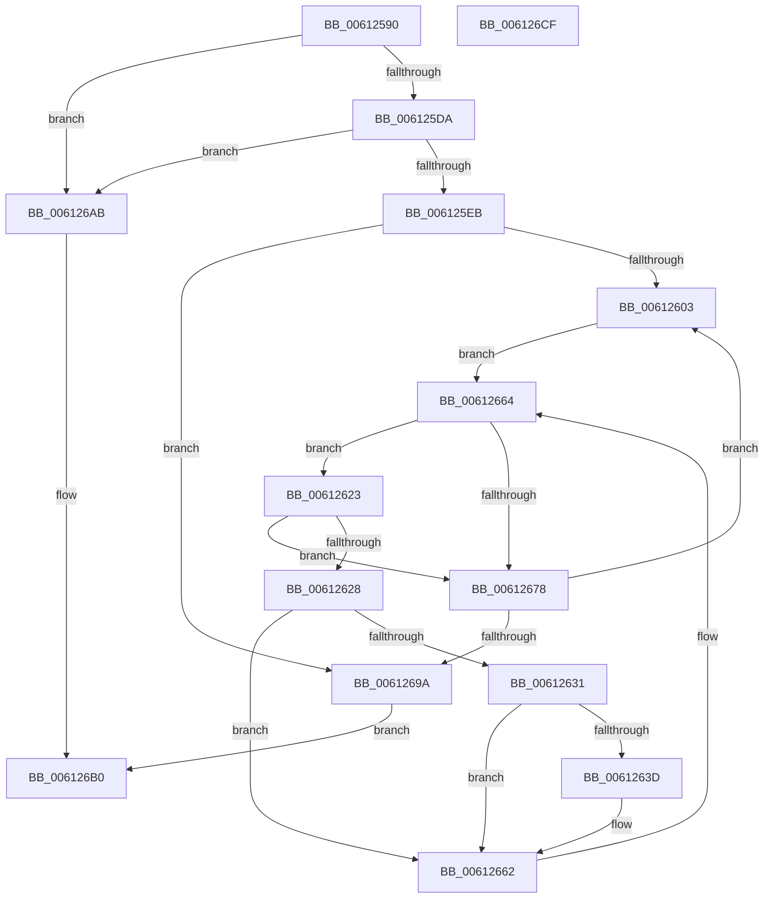

# DifEnumeratePluginData

- RVA: `0x00612590`–`0x006126D0` (길이 `320` bytes)
- VA: `0x0000000140612590`
- 실행 섹션: `.text`
- PDB 이름 있음: `예`; PDB Function 태그: `아니요`
- unwind 정보 RVA: `0x000BD2A0`
- 디코드: `87`개 명령, `320/320` bytes 표시
- 미해석 바이트: `0` (있으면 어셈블리에 `.byte`로 보존)

> 이 문서는 커널 이미지의 기계어와 PDB 기호를 분석해 생성했습니다. 4번과 5번은 함수 원형과 자료형을 바이너리 사용 방식에서 추정한 C 해석이며 원본 소스 복구 결과는 아닙니다.

## 1. Dependencies

- 직접 호출 지점: **7**; 고유 호출 대상: **7**
- 직접 호출자로 확인된 함수: **0**
- RIP 상대 이미지 참조: **2**

### Outgoing calls
- `0x006125CC` → [VfAvlInitializeLockContext](../4A/VfAvlInitializeLockContext_function_004A686C.md) (function, `0x004A686C`)
- `0x006125F0` → [ViAvlRaiseIrqlSafe](../3E/ViAvlRaiseIrqlSafe_function_003EF404.md) (function, `0x003EF404`)
- `0x0061261A` → [ViAvlAcquireTableLockAtDpcLevelSafe](../3E/ViAvlAcquireTableLockAtDpcLevelSafe_function_003EF3A0.md) (function, `0x003EF3A0`)
- `0x0061265B` → [guard_dispatch_icall](../6B/guard_dispatch_icall_function_006BAAD0.md) (function, `0x006BAAD0`)
- `0x0061266E` → [RtlEnumerateGenericTableAvl](../3E/RtlEnumerateGenericTableAvl_function_003E5AB0.md) (function, `0x003E5AB0`)
- `0x00612687` → [ViAvlReleaseTableLockFromDpcLevel](../3E/ViAvlReleaseTableLockFromDpcLevel_function_003EF5D0.md) (function, `0x003EF5D0`)
- `0x0061269F` → [VfAvlCleanupLockContext](../3E/VfAvlCleanupLockContext_function_003EF56C.md) (function, `0x003EF56C`)

### Direct callers
- 이 함수 시작 RVA로 연결되는 직접 call은 확인되지 않았습니다. 간접 호출은 완전히 역산할 수 없습니다.

### Static image references
- `0x006125F7` → RVA `0x00F049B8` (`.data`; read)
- `0x00612603` → RVA `0x00F049B0` (`.data`; read)

## 2. Other-region calls and transfers

- 다른 실행 섹션으로 향하는 call: **0**
- 별도 외부 분기/꼬리 이동을 확인하지 못했습니다.

## 3. Assembly (complete function range)

```asm
00612590  4C 8B DC                        mov r11, rsp
00612593  49 89 5B 08                     mov qword ptr [r11 + 8], rbx
00612597  49 89 6B 10                     mov qword ptr [r11 + 0x10], rbp
0061259B  49 89 73 18                     mov qword ptr [r11 + 0x18], rsi
0061259F  49 89 7B 20                     mov qword ptr [r11 + 0x20], rdi
006125A3  41 54                           push r12
006125A5  41 56                           push r14
006125A7  41 57                           push r15
006125A9  48 83 EC 60                     sub rsp, 0x60
006125AD  0F 57 C0                        xorps xmm0, xmm0
006125B0  49 8D 4B C8                     lea rcx, [r11 - 0x38]
006125B4  33 C0                           xor eax, eax
006125B6  44 8B FA                        mov r15d, edx
006125B9  0F 11 44 24 40                  movups xmmword ptr [rsp + 0x40], xmm0
006125BE  33 D2                           xor edx, edx
006125C0  49 89 43 D8                     mov qword ptr [r11 - 0x28], rax
006125C4  4D 8B E1                        mov r12, r9
006125C7  49 8B E8                        mov rbp, r8
006125CA  33 F6                           xor esi, esi
006125CC  E8 9B 42 E9 FF                  call 0x1404a686c
006125D1  4D 85 C0                        test r8, r8
006125D4  0F 84 D1 00 00 00               je 0x1406126ab
006125DA  4C 8B B4 24 A0 00 00 00         mov r14, qword ptr [rsp + 0xa0]
006125E2  4D 85 F6                        test r14, r14
006125E5  0F 84 C0 00 00 00               je 0x1406126ab
006125EB  48 8D 4C 24 40                  lea rcx, [rsp + 0x40]
006125F0  E8 0F CE DD FF                  call 0x1403ef404
006125F5  33 DB                           xor ebx, ebx
006125F7  39 1D BB 23 8F 00               cmp dword ptr [rip + 0x8f23bb], ebx
006125FD  0F 86 97 00 00 00               jbe 0x14061269a
00612603  48 8B 0D A6 23 8F 00            mov rcx, qword ptr [rip + 0x8f23a6]
0061260A  48 8D 3C 5B                     lea rdi, [rbx + rbx*2]
0061260E  48 C1 E7 06                     shl rdi, 6
00612612  48 8D 54 24 40                  lea rdx, [rsp + 0x40]
00612617  48 03 CF                        add rcx, rdi
0061261A  E8 81 CD DD FF                  call 0x1403ef3a0
0061261F  B2 01                           mov dl, 1
00612621  EB 41                           jmp 0x140612664
00612623  41 3B F7                        cmp esi, r15d
00612626  73 50                           jae 0x140612678
00612628  48 8B 48 40                     mov rcx, qword ptr [rax + 0x40]
0061262C  48 85 C9                        test rcx, rcx
0061262F  74 31                           je 0x140612662
00612631  48 8D 41 60                     lea rax, [rcx + 0x60]
00612635  4C 8B 00                        mov r8, qword ptr [rax]
00612638  4C 3B C0                        cmp r8, rax
0061263B  74 25                           je 0x140612662
0061263D  48 8B 01                        mov rax, qword ptr [rcx]
00612640  48 8D 54 24 30                  lea rdx, [rsp + 0x30]
00612645  4D 8B 40 F8                     mov r8, qword ptr [r8 - 8]
00612649  4D 8B CC                        mov r9, r12
0061264C  8B CE                           mov ecx, esi
0061264E  0F 10 40 28                     movups xmm0, xmmword ptr [rax + 0x28]
00612652  48 8B C5                        mov rax, rbp
00612655  F3 0F 7F 44 24 30               movdqu xmmword ptr [rsp + 0x30], xmm0
0061265B  E8 70 84 0A 00                  call 0x1406baad0
00612660  FF C6                           inc esi
00612662  33 D2                           xor edx, edx
00612664  48 8B 0D 45 23 8F 00            mov rcx, qword ptr [rip + 0x8f2345]
0061266B  48 03 CF                        add rcx, rdi
0061266E  E8 3D 34 DD FF                  call 0x1403e5ab0
00612673  48 85 C0                        test rax, rax
00612676  75 AB                           jne 0x140612623
00612678  48 8B 0D 31 23 8F 00            mov rcx, qword ptr [rip + 0x8f2331]
0061267F  48 8D 54 24 40                  lea rdx, [rsp + 0x40]
00612684  48 03 CF                        add rcx, rdi
00612687  E8 44 CF DD FF                  call 0x1403ef5d0
0061268C  FF C3                           inc ebx
0061268E  3B 1D 24 23 8F 00               cmp ebx, dword ptr [rip + 0x8f2324]
00612694  0F 82 69 FF FF FF               jb 0x140612603
0061269A  48 8D 4C 24 40                  lea rcx, [rsp + 0x40]
0061269F  E8 C8 CE DD FF                  call 0x1403ef56c
006126A4  33 C0                           xor eax, eax
006126A6  41 89 36                        mov dword ptr [r14], esi
006126A9  EB 05                           jmp 0x1406126b0
006126AB  B8 0D 00 00 C0                  mov eax, 0xc000000d
006126B0  4C 8D 5C 24 60                  lea r11, [rsp + 0x60]
006126B5  49 8B 5B 20                     mov rbx, qword ptr [r11 + 0x20]
006126B9  49 8B 6B 28                     mov rbp, qword ptr [r11 + 0x28]
006126BD  49 8B 73 30                     mov rsi, qword ptr [r11 + 0x30]
006126C1  49 8B 7B 38                     mov rdi, qword ptr [r11 + 0x38]
006126C5  49 8B E3                        mov rsp, r11
006126C8  41 5F                           pop r15
006126CA  41 5E                           pop r14
006126CC  41 5C                           pop r12
006126CE  C3                              ret
006126CF  CC                              int3
```

## 4. C-style interpretation (structured pseudocode)

```c
__int64 __fastcall DifEnumeratePluginData(__int64 a1, int a2, __int64 a3, __int64 a4, __int64 a5)
{
    __int64 result;
    __int64 v_rbx;
    __int64 v_rdi;
    __int64 v_rsi;
    __int64 v_rsp;
    unsigned __int64 v_stack_m18;
    unsigned __int64 v_stack_m38;
    unsigned __int64 v_stack_m48;

    *(unsigned __int64 *)(v_rsp + 8) = v_rbx;
    *(unsigned __int64 *)(v_rsp + 16) = v_rbp;
    *(unsigned __int64 *)(v_rsp + 24) = v_rsi;
    *(unsigned __int64 *)(v_rsp + 32) = v_rdi;
    v_rsp = (v_rsp) - (96);
    result = 0;
    v_stack_m38 = v_xmm0;
    a2 = 0;
    *(unsigned __int64 *)(v_rsp - 40) = 0;
    v_rsi = 0;
    result = VfAvlInitializeLockContext(v_rsp - 56, a2, a3, a4);
    if (a3 == 0) goto loc_006126AB;
    if (a5 == 0) goto loc_006126AB;
    result = ViAvlRaiseIrqlSafe(v_stack_m38, a2, a3, a4);
    v_rbx = 0;
    if ((*(unsigned int *)(v_rip + 9380795)) <= 0) goto loc_0061269A;
loc_00612603:
    v_rdi = (v_rbx + v_rbx * 2) << (6);
    a1 = (*(unsigned __int64 *)(v_rip + 9380774)) + (v_rdi);
    result = ViAvlAcquireTableLockAtDpcLevelSafe(a1, v_stack_m38, a3, a4);
    goto loc_00612664;
loc_00612623:
    if (0 >= ((unsigned int)((unsigned int)(a2)))) goto loc_00612678;
    if (*(unsigned __int64 *)(result + 64) == 0) goto loc_00612662;
    result = *(unsigned __int64 *)(result + 64) + 96;
    if ((*(unsigned __int64 *)(*(unsigned __int64 *)(result + 64) + 96)) != (*(unsigned __int64 *)(result + 64) + 96)) {
        result = *(unsigned __int64 *)(*(unsigned __int64 *)(result + 64));
        a2 = v_stack_m48;
        a3 = *(unsigned __int64 *)(*(unsigned __int64 *)(*(unsigned __int64 *)(result + 64) + 96) - 8);
        a4 = a4;
        a1 = 0;
        result = a3;
        v_stack_m48 = v_xmm0;
        result = guard_dispatch_icall(a1, a2, a3, a4);
        v_rsi = (unsigned int)((v_rsi) + 1);
    }
    a2 = 0;
loc_00612664:
    a1 = (*(unsigned __int64 *)(v_rip + 9380677)) + (v_rdi);
    result = RtlEnumerateGenericTableAvl(a1, a2, a3, a4);
    if (result != 0) goto loc_00612623;
loc_00612678:
    a1 = (*(unsigned __int64 *)(v_rip + 9380657)) + (v_rdi);
    result = ViAvlReleaseTableLockFromDpcLevel(a1, v_stack_m38, a3, a4);
    v_rbx = (unsigned int)((v_rbx) + 1);
    if (((unsigned int)(v_rbx)) < (*(unsigned int *)(v_rip + 9380644))) goto loc_00612603;
loc_0061269A:
    result = VfAvlCleanupLockContext(v_stack_m38, v_stack_m38, a3, a4);
    result = 0;
    *(unsigned int *)(a5) = (unsigned int)(v_rsi);
    goto loc_006126B0;
loc_006126AB:
loc_006126B0:
    return (unsigned int)(0xC000000DULL);
}
```

## 5. (Beta) C Style

```c
int64_t DifEnumeratePluginData(int64_t Arg1, int32_t Arg2, int64_t Arg3, int64_t Arg4, int64_t Arg5)
{
    int64_t result;
    int64_t local_rbx;
    int64_t local_rdi;
    int64_t local_rsi;
    int64_t local_rsp;
    uint64_t v_stack_m18;
    uint64_t v_stack_m38;
    uint64_t v_stack_m48;

    *(uint64_t *)(local_rsp + 0x8) = local_rbx;
    *(uint64_t *)(local_rsp + 0x10) = local_rbp;
    *(uint64_t *)(local_rsp + 0x18) = local_rsi;
    *(uint64_t *)(local_rsp + 0x20) = local_rdi;
    local_rsp = (local_rsp) - (96);
    result = 0;
    v_stack_m38 = v_xmm0;
    Arg2 = 0;
    *(uint64_t *)(local_rsp - 0x28) = 0;
    local_rsi = 0;
    result = VfAvlInitializeLockContext(local_rsp - 56, Arg2, Arg3, Arg4);
    if (Arg3 == 0) goto loc_006126AB;
    if (Arg5 == 0) goto loc_006126AB;
    result = ViAvlRaiseIrqlSafe(v_stack_m38, Arg2, Arg3, Arg4);
    local_rbx = 0;
    if ((*(uint32_t *)(v_rip + 0x8F23BB)) <= 0) goto loc_0061269A;
loc_00612603:
    local_rdi = (local_rbx + local_rbx * 2) << (6);
    Arg1 = (*(uint64_t *)(v_rip + 0x8F23A6)) + (local_rdi);
    result = ViAvlAcquireTableLockAtDpcLevelSafe(Arg1, v_stack_m38, Arg3, Arg4);
    goto loc_00612664;
loc_00612623:
    if (0 >= ((uint32_t)((uint32_t)(Arg2)))) goto loc_00612678;
    if (*(uint64_t *)(result + 0x40) == 0) goto loc_00612662;
    result = *(uint64_t *)(result + 0x40) + 96;
    if ((*(uint64_t *)(*(uint64_t *)(result + 0x40) + 0x60)) != (*(uint64_t *)(result + 0x40) + 96)) {
        result = *(uint64_t *)(*(uint64_t *)(result + 0x40));
        Arg2 = v_stack_m48;
        Arg3 = *(uint64_t *)(*(uint64_t *)(*(uint64_t *)(result + 0x40) + 0x60) - 0x8);
        Arg4 = Arg4;
        Arg1 = 0;
        result = Arg3;
        v_stack_m48 = v_xmm0;
        result = guard_dispatch_icall(Arg1, Arg2, Arg3, Arg4);
        local_rsi = (uint32_t)((local_rsi) + 1);
    }
    Arg2 = 0;
loc_00612664:
    Arg1 = (*(uint64_t *)(v_rip + 0x8F2345)) + (local_rdi);
    result = RtlEnumerateGenericTableAvl(Arg1, Arg2, Arg3, Arg4);
    if (result != 0) goto loc_00612623;
loc_00612678:
    Arg1 = (*(uint64_t *)(v_rip + 0x8F2331)) + (local_rdi);
    result = ViAvlReleaseTableLockFromDpcLevel(Arg1, v_stack_m38, Arg3, Arg4);
    local_rbx = (uint32_t)((local_rbx) + 1);
    if (((uint32_t)(local_rbx)) < (*(uint32_t *)(v_rip + 0x8F2324))) goto loc_00612603;
loc_0061269A:
    result = VfAvlCleanupLockContext(v_stack_m38, v_stack_m38, Arg3, Arg4);
    result = 0;
    *(uint32_t *)(Arg5) = (uint32_t)(local_rsi);
    goto loc_006126B0;
loc_006126AB:
loc_006126B0:
    return (uint32_t)(0xC000000DULL);
}
```

## 6. Execution-region graph

[열기: 2D/3D 그래프와 함수 탐색 컨트롤 패널](../../../control-panel.html?section=text&rva=0x00612590&view=graph)

- 2D 그래프는 위에서 아래로 흐르고, 3D 그래프는 빈 공간을 드래그해 회전합니다. Shift+드래그는 이동, 휠은 확대·축소, 함수 노드 선택은 대상 보고서 이동입니다.

### Static fallback


