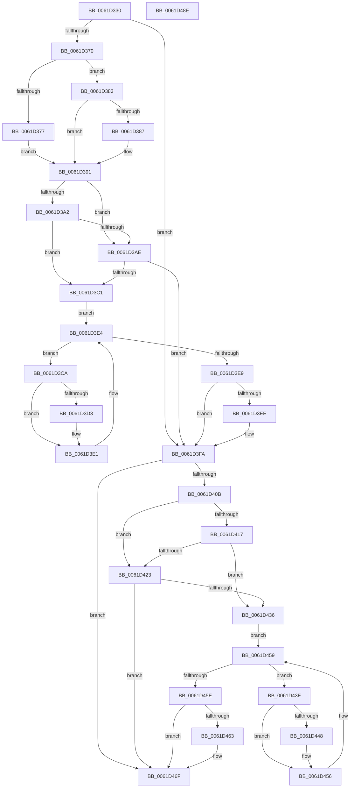

# DifEtwUnregisterWrapper

- RVA: `0x0061D330`–`0x0061D48F` (길이 `351` bytes)
- VA: `0x000000014061D330`
- 실행 섹션: `.text`
- PDB 이름 있음: `예`; PDB Function 태그: `아니요`
- unwind 정보 RVA: `0x00060130`
- 디코드: `94`개 명령, `351/351` bytes 표시
- 미해석 바이트: `0` (있으면 어셈블리에 `.byte`로 보존)

> 이 문서는 커널 이미지의 기계어와 PDB 기호를 분석해 생성했습니다. 4번과 5번은 함수 원형과 자료형을 바이너리 사용 방식에서 추정한 C 해석이며 원본 소스 복구 결과는 아닙니다.

## 1. Dependencies

- 직접 호출 지점: **9**; 고유 호출 대상: **6**
- 직접 호출자로 확인된 함수: **0**
- RIP 상대 이미지 참조: **3**

### Outgoing calls
- `0x0061D35F` → [DifGetAPIThunkContextById](../49/DifGetAPIThunkContextById_function_00495A34.md) (function, `0x00495A34`)
- `0x0061D387` → [DifGetReturnAddressForWrappers](../4D/DifGetReturnAddressForWrappers_function_004D3C08.md) (function, `0x004D3C08`)
- `0x0061D3B5` → [ExAcquireRundownProtection](../21/ExAcquireRundownProtection_function_00216620.md) (function, `0x00216620`)
- `0x0061D3DC` → [guard_dispatch_icall](../6B/guard_dispatch_icall_function_006BAAD0.md) (function, `0x006BAAD0`)
- `0x0061D3F5` → [ExReleaseRundownProtection](../34/ExReleaseRundownProtection_function_00349E80.md) (function, `0x00349E80`)
- `0x0061D3FD` → [EtwUnregister](../../page/A7/EtwUnregister_function_00A723D0.md) (function, `0x00A723D0`)
- `0x0061D42A` → [ExAcquireRundownProtection](../21/ExAcquireRundownProtection_function_00216620.md) (function, `0x00216620`)
- `0x0061D451` → [guard_dispatch_icall](../6B/guard_dispatch_icall_function_006BAAD0.md) (function, `0x006BAAD0`)
- `0x0061D46A` → [ExReleaseRundownProtection](../34/ExReleaseRundownProtection_function_00349E80.md) (function, `0x00349E80`)

### Direct callers
- 이 함수 시작 RVA로 연결되는 직접 call은 확인되지 않았습니다. 간접 호출은 완전히 역산할 수 없습니다.

### Static image references
- `0x0061D399` → RVA `0x00F048B8` (`.data`; read)
- `0x0061D3A2` → RVA `0x00F04980` (`.data`; read)
- `0x0061D3AE` → RVA `0x00F03E80` (`.data`; read)

## 2. Other-region calls and transfers

- 다른 실행 섹션으로 향하는 call: **1**
  - `0x0061D3FD` → [EtwUnregister](../../page/A7/EtwUnregister_function_00A723D0.md) (`.text` → `PAGE`)
- 별도 외부 분기/꼬리 이동을 확인하지 못했습니다.

## 3. Assembly (complete function range)

```asm
0061D330  4C 8B DC                        mov r11, rsp
0061D333  49 89 5B 08                     mov qword ptr [r11 + 8], rbx
0061D337  49 89 6B 10                     mov qword ptr [r11 + 0x10], rbp
0061D33B  49 89 73 18                     mov qword ptr [r11 + 0x18], rsi
0061D33F  49 89 7B 20                     mov qword ptr [r11 + 0x20], rdi
0061D343  41 56                           push r14
0061D345  48 83 EC 40                     sub rsp, 0x40
0061D349  33 C0                           xor eax, eax
0061D34B  0F 57 C0                        xorps xmm0, xmm0
0061D34E  0F 11 44 24 20                  movups xmmword ptr [rsp + 0x20], xmm0
0061D353  48 8B E9                        mov rbp, rcx
0061D356  49 89 43 E8                     mov qword ptr [r11 - 0x18], rax
0061D35A  B9 AA 01 00 00                  mov ecx, 0x1aa
0061D35F  E8 D0 86 E7 FF                  call 0x140495a34
0061D364  48 8B F0                        mov rsi, rax
0061D367  48 85 C0                        test rax, rax
0061D36A  0F 84 8A 00 00 00               je 0x14061d3fa
0061D370  8B 40 0C                        mov eax, dword ptr [rax + 0xc]
0061D373  A8 18                           test al, 0x18
0061D375  74 0C                           je 0x14061d383
0061D377  48 8B 4C 24 48                  mov rcx, qword ptr [rsp + 0x48]
0061D37C  48 89 4C 24 20                  mov qword ptr [rsp + 0x20], rcx
0061D381  EB 0E                           jmp 0x14061d391
0061D383  A8 04                           test al, 4
0061D385  74 0A                           je 0x14061d391
0061D387  E8 7C 68 EB FF                  call 0x1404d3c08
0061D38C  48 89 44 24 20                  mov qword ptr [rsp + 0x20], rax
0061D391  40 32 FF                        xor dil, dil
0061D394  48 89 6C 24 28                  mov qword ptr [rsp + 0x28], rbp
0061D399  40 38 3D 18 75 8E 00            cmp byte ptr [rip + 0x8e7518], dil
0061D3A0  75 0C                           jne 0x14061d3ae
0061D3A2  F7 05 D4 75 8E 00 00 08 00 00   test dword ptr [rip + 0x8e75d4], 0x800
0061D3AC  74 13                           je 0x14061d3c1
0061D3AE  48 8D 0D CB 6A 8E 00            lea rcx, [rip + 0x8e6acb]
0061D3B5  E8 66 92 BF FF                  call 0x140216620
0061D3BA  40 8A F8                        mov dil, al
0061D3BD  84 C0                           test al, al
0061D3BF  74 39                           je 0x14061d3fa
0061D3C1  4C 8D 76 20                     lea r14, [rsi + 0x20]
0061D3C5  49 8B 1E                        mov rbx, qword ptr [r14]
0061D3C8  EB 1A                           jmp 0x14061d3e4
0061D3CA  48 8D 43 F0                     lea rax, [rbx - 0x10]
0061D3CE  48 85 C0                        test rax, rax
0061D3D1  74 0E                           je 0x14061d3e1
0061D3D3  48 8B 40 08                     mov rax, qword ptr [rax + 8]
0061D3D7  48 8D 4C 24 20                  lea rcx, [rsp + 0x20]
0061D3DC  E8 EF D6 09 00                  call 0x1406baad0
0061D3E1  48 8B 1B                        mov rbx, qword ptr [rbx]
0061D3E4  49 3B DE                        cmp rbx, r14
0061D3E7  75 E1                           jne 0x14061d3ca
0061D3E9  40 84 FF                        test dil, dil
0061D3EC  74 0C                           je 0x14061d3fa
0061D3EE  48 8D 0D 8B 6A 8E 00            lea rcx, [rip + 0x8e6a8b]
0061D3F5  E8 86 CA D2 FF                  call 0x140349e80
0061D3FA  48 8B CD                        mov rcx, rbp
0061D3FD  E8 CE 4F 45 00                  call 0x140a723d0
0061D402  89 44 24 30                     mov dword ptr [rsp + 0x30], eax
0061D406  48 85 F6                        test rsi, rsi
0061D409  74 64                           je 0x14061d46f
0061D40B  40 32 FF                        xor dil, dil
0061D40E  40 38 3D A3 74 8E 00            cmp byte ptr [rip + 0x8e74a3], dil
0061D415  75 0C                           jne 0x14061d423
0061D417  F7 05 5F 75 8E 00 00 08 00 00   test dword ptr [rip + 0x8e755f], 0x800
0061D421  74 13                           je 0x14061d436
0061D423  48 8D 0D 56 6A 8E 00            lea rcx, [rip + 0x8e6a56]
0061D42A  E8 F1 91 BF FF                  call 0x140216620
0061D42F  40 8A F8                        mov dil, al
0061D432  84 C0                           test al, al
0061D434  74 39                           je 0x14061d46f
0061D436  48 83 C6 30                     add rsi, 0x30
0061D43A  48 8B 1E                        mov rbx, qword ptr [rsi]
0061D43D  EB 1A                           jmp 0x14061d459
0061D43F  48 8D 43 F0                     lea rax, [rbx - 0x10]
0061D443  48 85 C0                        test rax, rax
0061D446  74 0E                           je 0x14061d456
0061D448  48 8B 40 08                     mov rax, qword ptr [rax + 8]
0061D44C  48 8D 4C 24 20                  lea rcx, [rsp + 0x20]
0061D451  E8 7A D6 09 00                  call 0x1406baad0
0061D456  48 8B 1B                        mov rbx, qword ptr [rbx]
0061D459  48 3B DE                        cmp rbx, rsi
0061D45C  75 E1                           jne 0x14061d43f
0061D45E  40 84 FF                        test dil, dil
0061D461  74 0C                           je 0x14061d46f
0061D463  48 8D 0D 16 6A 8E 00            lea rcx, [rip + 0x8e6a16]
0061D46A  E8 11 CA D2 FF                  call 0x140349e80
0061D46F  8B 44 24 30                     mov eax, dword ptr [rsp + 0x30]
0061D473  48 8B 5C 24 50                  mov rbx, qword ptr [rsp + 0x50]
0061D478  48 8B 6C 24 58                  mov rbp, qword ptr [rsp + 0x58]
0061D47D  48 8B 74 24 60                  mov rsi, qword ptr [rsp + 0x60]
0061D482  48 8B 7C 24 68                  mov rdi, qword ptr [rsp + 0x68]
0061D487  48 83 C4 40                     add rsp, 0x40
0061D48B  41 5E                           pop r14
0061D48D  C3                              ret
0061D48E  CC                              int3
```

## 4. C-style interpretation (structured pseudocode)

```c
__int64 __fastcall DifEtwUnregisterWrapper(__int64 a1)
{
    __int64 result;
    __int64 v_rdi;
    __int64 v_rsi;
    __int64 v_rsp;
    unsigned int v_stack_m18;
    unsigned __int64 v_stack_m20;
    unsigned __int64 v_stack_m28;
    unsigned __int64 v_stack_p0;
    unsigned __int64 v_stack_p10;
    unsigned __int64 v_stack_p18;
    unsigned __int64 v_stack_p20;
    unsigned __int64 v_stack_p8;

    *(unsigned __int64 *)(v_rsp + 8) = v_rbx;
    *(unsigned __int64 *)(v_rsp + 16) = v_rbp;
    *(unsigned __int64 *)(v_rsp + 24) = v_rsi;
    *(unsigned __int64 *)(v_rsp + 32) = v_rdi;
    v_rsp = (v_rsp) - (64);
    result = 0;
    v_stack_m28 = v_xmm0;
    *(unsigned __int64 *)(v_rsp - 24) = 0;
    result = DifGetAPIThunkContextById(426, a2, a3, a4);
    if (result == 0) goto loc_0061D3FA;
    if ((((unsigned __int8)((unsigned int)(*(unsigned int *)(result + 12)))) & (24)) == 0) goto loc_0061D383;
    v_stack_m28 = v_stack_p0;
    goto loc_0061D391;
loc_0061D383:
    result = (unsigned int)(*(unsigned int *)(result + 12));
    if ((((unsigned __int8)((unsigned int)(*(unsigned int *)(result + 12)))) & (4)) != 0) {
        result = DifGetReturnAddressForWrappers(v_stack_p0, a2, a3, a4);
        v_stack_m28 = result;
    }
    v_rdi = 0;
    v_stack_m20 = a1;
    if ((*(unsigned __int8 *)(v_rip + 9336088)) != 0) goto loc_0061D3AE;
    if (((*(unsigned int *)(v_rip + 9336276)) & (0x800ULL)) == 0) goto loc_0061D3C1;
loc_0061D3AE:
    result = ExAcquireRundownProtection(v_rip + 9333451, a2, a3, a4);
    if ((unsigned __int8)(result) == 0) goto loc_0061D3FA;
loc_0061D3C1:
    goto loc_0061D3E4;
loc_0061D3CA:
    result = *(unsigned __int64 *)(result + 32) - 16;
    if (*(unsigned __int64 *)(result + 32) - 16 != 0) {
        result = *(unsigned __int64 *)(*(unsigned __int64 *)(result + 32) - 16 + 8);
        a1 = v_stack_m28;
        result = guard_dispatch_icall(a1, a2, a3, a4);
    }
loc_0061D3E4:
    if ((*(unsigned __int64 *)(*(unsigned __int64 *)(result + 32))) != (result + 32)) goto loc_0061D3CA;
    if ((unsigned __int8)((unsigned __int8)(result)) != 0) {
        a1 = v_rip + 9333387;
        result = ExReleaseRundownProtection(a1, a2, a3, a4);
    }
    result = EtwUnregister(a1, a2, a3, a4);
    v_stack_m18 = (unsigned int)(result);
    if (result == 0) goto loc_0061D46F;
    v_rdi = 0;
    if ((*(unsigned __int8 *)(v_rip + 9335971)) != 0) goto loc_0061D423;
    if (((*(unsigned int *)(v_rip + 9336159)) & (0x800ULL)) == 0) goto loc_0061D436;
loc_0061D423:
    result = ExAcquireRundownProtection(v_rip + 9333334, a2, a3, a4);
    if ((unsigned __int8)(result) == 0) goto loc_0061D46F;
loc_0061D436:
    v_rsi = (result) + (48);
    goto loc_0061D459;
loc_0061D43F:
    result = *(unsigned __int64 *)(v_rsi) - 16;
    if (*(unsigned __int64 *)(v_rsi) - 16 != 0) {
        result = *(unsigned __int64 *)(*(unsigned __int64 *)(v_rsi) - 16 + 8);
        a1 = v_stack_m28;
        result = guard_dispatch_icall(a1, a2, a3, a4);
    }
loc_0061D459:
    if ((*(unsigned __int64 *)(*(unsigned __int64 *)(v_rsi))) != v_rsi) goto loc_0061D43F;
    if ((unsigned __int8)((unsigned __int8)(result)) != 0) {
        a1 = v_rip + 9333270;
        result = ExReleaseRundownProtection(a1, a2, a3, a4);
    }
    v_rsp = (v_rsp) + (64);
    return (unsigned int)(v_stack_m18);
}
```

## 5. (Beta) C Style

```c
int64_t DifEtwUnregisterWrapper(int64_t Arg1)
{
    int64_t result;
    int64_t local_rdi;
    int64_t local_rsi;
    int64_t local_rsp;
    uint32_t v_stack_m18;
    uint64_t v_stack_m20;
    uint64_t v_stack_m28;
    uint64_t v_stack_p0;
    uint64_t v_stack_p10;
    uint64_t v_stack_p18;
    uint64_t v_stack_p20;
    uint64_t v_stack_p8;

    *(uint64_t *)(local_rsp + 0x8) = local_rbx;
    *(uint64_t *)(local_rsp + 0x10) = local_rbp;
    *(uint64_t *)(local_rsp + 0x18) = local_rsi;
    *(uint64_t *)(local_rsp + 0x20) = local_rdi;
    local_rsp = (local_rsp) - (64);
    result = 0;
    v_stack_m28 = v_xmm0;
    *(uint64_t *)(local_rsp - 0x18) = 0;
    result = DifGetAPIThunkContextById(426, a2, a3, a4);
    if (result == 0) goto loc_0061D3FA;
    if ((((uint8_t)((uint32_t)(*(uint32_t *)(result + 0xC)))) & (24)) == 0) goto loc_0061D383;
    v_stack_m28 = v_stack_p0;
    goto loc_0061D391;
loc_0061D383:
    result = (uint32_t)(*(uint32_t *)(result + 0xC));
    if ((((uint8_t)((uint32_t)(*(uint32_t *)(result + 0xC)))) & (4)) != 0) {
        result = DifGetReturnAddressForWrappers(v_stack_p0, a2, a3, a4);
        v_stack_m28 = result;
    }
    local_rdi = 0;
    v_stack_m20 = Arg1;
    if ((*(uint8_t *)(v_rip + 0x8E7518)) != 0) goto loc_0061D3AE;
    if (((*(uint32_t *)(v_rip + 0x8E75D4)) & (0x800ULL)) == 0) goto loc_0061D3C1;
loc_0061D3AE:
    result = ExAcquireRundownProtection(v_rip + 9333451, a2, a3, a4);
    if ((uint8_t)(result) == 0) goto loc_0061D3FA;
loc_0061D3C1:
    goto loc_0061D3E4;
loc_0061D3CA:
    result = *(uint64_t *)(result + 0x20) - 16;
    if (*(uint64_t *)(result + 0x20) - 16 != 0) {
        result = *(uint64_t *)(*(uint64_t *)(result + 0x20) - 0x10 + 0x8);
        Arg1 = v_stack_m28;
        result = guard_dispatch_icall(Arg1, a2, a3, a4);
    }
loc_0061D3E4:
    if ((*(uint64_t *)(*(uint64_t *)(result + 0x20))) != (result + 32)) goto loc_0061D3CA;
    if ((uint8_t)((uint8_t)(result)) != 0) {
        Arg1 = v_rip + 9333387;
        result = ExReleaseRundownProtection(Arg1, a2, a3, a4);
    }
    result = EtwUnregister(Arg1, a2, a3, a4);
    v_stack_m18 = (uint32_t)(result);
    if (result == 0) goto loc_0061D46F;
    local_rdi = 0;
    if ((*(uint8_t *)(v_rip + 0x8E74A3)) != 0) goto loc_0061D423;
    if (((*(uint32_t *)(v_rip + 0x8E755F)) & (0x800ULL)) == 0) goto loc_0061D436;
loc_0061D423:
    result = ExAcquireRundownProtection(v_rip + 9333334, a2, a3, a4);
    if ((uint8_t)(result) == 0) goto loc_0061D46F;
loc_0061D436:
    local_rsi = (result) + (48);
    goto loc_0061D459;
loc_0061D43F:
    result = *(uint64_t *)(local_rsi) - 16;
    if (*(uint64_t *)(local_rsi) - 16 != 0) {
        result = *(uint64_t *)(*(uint64_t *)(local_rsi) - 0x10 + 0x8);
        Arg1 = v_stack_m28;
        result = guard_dispatch_icall(Arg1, a2, a3, a4);
    }
loc_0061D459:
    if ((*(uint64_t *)(*(uint64_t *)(local_rsi))) != local_rsi) goto loc_0061D43F;
    if ((uint8_t)((uint8_t)(result)) != 0) {
        Arg1 = v_rip + 9333270;
        result = ExReleaseRundownProtection(Arg1, a2, a3, a4);
    }
    local_rsp = (local_rsp) + (64);
    return (uint32_t)(v_stack_m18);
}
```

## 6. Execution-region graph

[열기: 2D/3D 그래프와 함수 탐색 컨트롤 패널](../../../control-panel.html?section=text&rva=0x0061D330&view=graph)

- 2D 그래프는 위에서 아래로 흐르고, 3D 그래프는 빈 공간을 드래그해 회전합니다. Shift+드래그는 이동, 휠은 확대·축소, 함수 노드 선택은 대상 보고서 이동입니다.

### Static fallback


