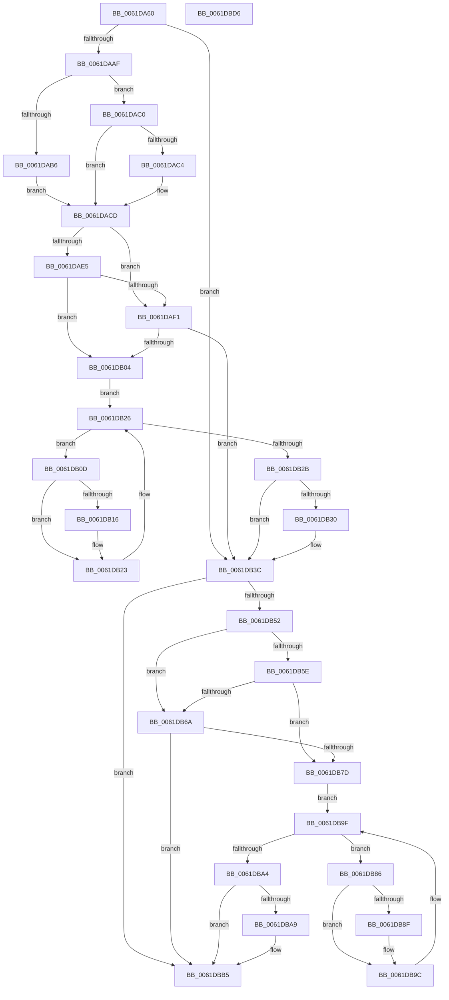

# DifExAcquireFastResourceSharedWrapper

- RVA: `0x0061DA60`–`0x0061DBD7` (길이 `375` bytes)
- VA: `0x000000014061DA60`
- 실행 섹션: `.text`
- PDB 이름 있음: `예`; PDB Function 태그: `아니요`
- unwind 정보 RVA: `0x000A9A64`
- 디코드: `108`개 명령, `375/375` bytes 표시
- 미해석 바이트: `0` (있으면 어셈블리에 `.byte`로 보존)

> 이 문서는 커널 이미지의 기계어와 PDB 기호를 분석해 생성했습니다. 4번과 5번은 함수 원형과 자료형을 바이너리 사용 방식에서 추정한 C 해석이며 원본 소스 복구 결과는 아닙니다.

## 1. Dependencies

- 직접 호출 지점: **9**; 고유 호출 대상: **6**
- 직접 호출자로 확인된 함수: **0**
- RIP 상대 이미지 참조: **3**

### Outgoing calls
- `0x0061DA9E` → [DifGetAPIThunkContextById](../49/DifGetAPIThunkContextById_function_00495A34.md) (function, `0x00495A34`)
- `0x0061DAC4` → [DifGetReturnAddressForWrappers](../4D/DifGetReturnAddressForWrappers_function_004D3C08.md) (function, `0x004D3C08`)
- `0x0061DAF8` → [ExAcquireRundownProtection](../21/ExAcquireRundownProtection_function_00216620.md) (function, `0x00216620`)
- `0x0061DB1E` → [guard_dispatch_icall](../6B/guard_dispatch_icall_function_006BAAD0.md) (function, `0x006BAAD0`)
- `0x0061DB37` → [ExReleaseRundownProtection](../34/ExReleaseRundownProtection_function_00349E80.md) (function, `0x00349E80`)
- `0x0061DB45` → [ExAcquireFastResourceShared](../21/ExAcquireFastResourceShared_function_00210F40.md) (function, `0x00210F40`)
- `0x0061DB71` → [ExAcquireRundownProtection](../21/ExAcquireRundownProtection_function_00216620.md) (function, `0x00216620`)
- `0x0061DB97` → [guard_dispatch_icall](../6B/guard_dispatch_icall_function_006BAAD0.md) (function, `0x006BAAD0`)
- `0x0061DBB0` → [ExReleaseRundownProtection](../34/ExReleaseRundownProtection_function_00349E80.md) (function, `0x00349E80`)

### Direct callers
- 이 함수 시작 RVA로 연결되는 직접 call은 확인되지 않았습니다. 간접 호출은 완전히 역산할 수 없습니다.

### Static image references
- `0x0061DAD4` → RVA `0x00F048B8` (`.data`; read)
- `0x0061DAE5` → RVA `0x00F04980` (`.data`; read)
- `0x0061DAF1` → RVA `0x00F03E80` (`.data`; read)

## 2. Other-region calls and transfers

- 다른 실행 섹션으로 향하는 call: **0**
- 별도 외부 분기/꼬리 이동을 확인하지 못했습니다.

## 3. Assembly (complete function range)

```asm
0061DA60  48 89 5C 24 08                  mov qword ptr [rsp + 8], rbx
0061DA65  48 89 74 24 10                  mov qword ptr [rsp + 0x10], rsi
0061DA6A  48 89 7C 24 18                  mov qword ptr [rsp + 0x18], rdi
0061DA6F  55                              push rbp
0061DA70  41 54                           push r12
0061DA72  41 55                           push r13
0061DA74  41 56                           push r14
0061DA76  41 57                           push r15
0061DA78  48 8B EC                        mov rbp, rsp
0061DA7B  48 83 EC 50                     sub rsp, 0x50
0061DA7F  0F 57 C0                        xorps xmm0, xmm0
0061DA82  33 C0                           xor eax, eax
0061DA84  4C 8B E9                        mov r13, rcx
0061DA87  48 89 45 F0                     mov qword ptr [rbp - 0x10], rax
0061DA8B  B9 BB 01 00 00                  mov ecx, 0x1bb
0061DA90  45 8A F8                        mov r15b, r8b
0061DA93  0F 11 45 D0                     movups xmmword ptr [rbp - 0x30], xmm0
0061DA97  4C 8B E2                        mov r12, rdx
0061DA9A  0F 11 45 E0                     movups xmmword ptr [rbp - 0x20], xmm0
0061DA9E  E8 91 7F E7 FF                  call 0x140495a34
0061DAA3  48 8B F0                        mov rsi, rax
0061DAA6  48 85 C0                        test rax, rax
0061DAA9  0F 84 8D 00 00 00               je 0x14061db3c
0061DAAF  8B 40 0C                        mov eax, dword ptr [rax + 0xc]
0061DAB2  A8 18                           test al, 0x18
0061DAB4  74 0A                           je 0x14061dac0
0061DAB6  48 8B 4D 28                     mov rcx, qword ptr [rbp + 0x28]
0061DABA  48 89 4D D0                     mov qword ptr [rbp - 0x30], rcx
0061DABE  EB 0D                           jmp 0x14061dacd
0061DAC0  A8 04                           test al, 4
0061DAC2  74 09                           je 0x14061dacd
0061DAC4  E8 3F 61 EB FF                  call 0x1404d3c08
0061DAC9  48 89 45 D0                     mov qword ptr [rbp - 0x30], rax
0061DACD  45 32 F6                        xor r14b, r14b
0061DAD0  4C 89 6D E8                     mov qword ptr [rbp - 0x18], r13
0061DAD4  44 38 35 DD 6D 8E 00            cmp byte ptr [rip + 0x8e6ddd], r14b
0061DADB  4C 89 65 E0                     mov qword ptr [rbp - 0x20], r12
0061DADF  44 88 7D D8                     mov byte ptr [rbp - 0x28], r15b
0061DAE3  75 0C                           jne 0x14061daf1
0061DAE5  F7 05 91 6E 8E 00 00 08 00 00   test dword ptr [rip + 0x8e6e91], 0x800
0061DAEF  74 13                           je 0x14061db04
0061DAF1  48 8D 0D 88 63 8E 00            lea rcx, [rip + 0x8e6388]
0061DAF8  E8 23 8B BF FF                  call 0x140216620
0061DAFD  44 8A F0                        mov r14b, al
0061DB00  84 C0                           test al, al
0061DB02  74 38                           je 0x14061db3c
0061DB04  48 8D 7E 20                     lea rdi, [rsi + 0x20]
0061DB08  48 8B 1F                        mov rbx, qword ptr [rdi]
0061DB0B  EB 19                           jmp 0x14061db26
0061DB0D  48 8D 43 F0                     lea rax, [rbx - 0x10]
0061DB11  48 85 C0                        test rax, rax
0061DB14  74 0D                           je 0x14061db23
0061DB16  48 8B 40 08                     mov rax, qword ptr [rax + 8]
0061DB1A  48 8D 4D D0                     lea rcx, [rbp - 0x30]
0061DB1E  E8 AD CF 09 00                  call 0x1406baad0
0061DB23  48 8B 1B                        mov rbx, qword ptr [rbx]
0061DB26  48 3B DF                        cmp rbx, rdi
0061DB29  75 E2                           jne 0x14061db0d
0061DB2B  45 84 F6                        test r14b, r14b
0061DB2E  74 0C                           je 0x14061db3c
0061DB30  48 8D 0D 49 63 8E 00            lea rcx, [rip + 0x8e6349]
0061DB37  E8 44 C3 D2 FF                  call 0x140349e80
0061DB3C  45 8A C7                        mov r8b, r15b
0061DB3F  49 8B D4                        mov rdx, r12
0061DB42  49 8B CD                        mov rcx, r13
0061DB45  E8 F6 33 BF FF                  call 0x140210f40
0061DB4A  88 45 F0                        mov byte ptr [rbp - 0x10], al
0061DB4D  48 85 F6                        test rsi, rsi
0061DB50  74 63                           je 0x14061dbb5
0061DB52  40 32 FF                        xor dil, dil
0061DB55  40 38 3D 5C 6D 8E 00            cmp byte ptr [rip + 0x8e6d5c], dil
0061DB5C  75 0C                           jne 0x14061db6a
0061DB5E  F7 05 18 6E 8E 00 00 08 00 00   test dword ptr [rip + 0x8e6e18], 0x800
0061DB68  74 13                           je 0x14061db7d
0061DB6A  48 8D 0D 0F 63 8E 00            lea rcx, [rip + 0x8e630f]
0061DB71  E8 AA 8A BF FF                  call 0x140216620
0061DB76  40 8A F8                        mov dil, al
0061DB79  84 C0                           test al, al
0061DB7B  74 38                           je 0x14061dbb5
0061DB7D  48 83 C6 30                     add rsi, 0x30
0061DB81  48 8B 1E                        mov rbx, qword ptr [rsi]
0061DB84  EB 19                           jmp 0x14061db9f
0061DB86  48 8D 43 F0                     lea rax, [rbx - 0x10]
0061DB8A  48 85 C0                        test rax, rax
0061DB8D  74 0D                           je 0x14061db9c
0061DB8F  48 8B 40 08                     mov rax, qword ptr [rax + 8]
0061DB93  48 8D 4D D0                     lea rcx, [rbp - 0x30]
0061DB97  E8 34 CF 09 00                  call 0x1406baad0
0061DB9C  48 8B 1B                        mov rbx, qword ptr [rbx]
0061DB9F  48 3B DE                        cmp rbx, rsi
0061DBA2  75 E2                           jne 0x14061db86
0061DBA4  40 84 FF                        test dil, dil
0061DBA7  74 0C                           je 0x14061dbb5
0061DBA9  48 8D 0D D0 62 8E 00            lea rcx, [rip + 0x8e62d0]
0061DBB0  E8 CB C2 D2 FF                  call 0x140349e80
0061DBB5  8A 45 F0                        mov al, byte ptr [rbp - 0x10]
0061DBB8  4C 8D 5C 24 50                  lea r11, [rsp + 0x50]
0061DBBD  49 8B 5B 30                     mov rbx, qword ptr [r11 + 0x30]
0061DBC1  49 8B 73 38                     mov rsi, qword ptr [r11 + 0x38]
0061DBC5  49 8B 7B 40                     mov rdi, qword ptr [r11 + 0x40]
0061DBC9  49 8B E3                        mov rsp, r11
0061DBCC  41 5F                           pop r15
0061DBCE  41 5E                           pop r14
0061DBD0  41 5D                           pop r13
0061DBD2  41 5C                           pop r12
0061DBD4  5D                              pop rbp
0061DBD5  C3                              ret
0061DBD6  CC                              int3
```

## 4. C-style interpretation (structured pseudocode)

```c
__int64 __fastcall DifExAcquireFastResourceSharedWrapper(__int64 a1, __int64 a2, unsigned __int8 a3)
{
    __int64 result;
    __int64 v_r14;
    __int64 v_rdi;
    __int64 v_rsi;
    __int64 v_rsp;
    unsigned __int64 v_stack_m28;
    unsigned __int64 v_stack_m38;
    unsigned __int64 v_stack_m40;
    unsigned __int64 v_stack_m48;
    unsigned __int8 v_stack_m50;
    unsigned __int64 v_stack_m58;
    unsigned __int64 v_stack_p0;
    unsigned __int64 v_stack_p10;
    unsigned __int64 v_stack_p18;
    unsigned __int64 v_stack_p8;

    v_stack_p8 = v_rbx;
    v_stack_p10 = v_rsi;
    v_stack_p18 = v_rdi;
    v_rsp = (v_rsp) - (80);
    result = 0;
    v_stack_m38 = 0;
    v_stack_m58 = v_xmm0;
    v_stack_m48 = v_xmm0;
    result = DifGetAPIThunkContextById(443, a2, a3, a4);
    if (result == 0) goto loc_0061DB3C;
    if ((((unsigned __int8)((unsigned int)(*(unsigned int *)(result + 12)))) & (24)) == 0) goto loc_0061DAC0;
    v_stack_m58 = v_stack_p0;
    goto loc_0061DACD;
loc_0061DAC0:
    result = (unsigned int)(*(unsigned int *)(result + 12));
    if ((((unsigned __int8)((unsigned int)(*(unsigned int *)(result + 12)))) & (4)) != 0) {
        result = DifGetReturnAddressForWrappers(v_stack_p0, a2, a3, a4);
        v_stack_m58 = result;
    }
    v_r14 = 0;
    v_stack_m40 = a1;
    v_stack_m48 = a2;
    v_stack_m50 = a3;
    if ((*(unsigned __int8 *)(v_rip + 9334237)) != 0) goto loc_0061DAF1;
    if (((*(unsigned int *)(v_rip + 9334417)) & (0x800ULL)) == 0) goto loc_0061DB04;
loc_0061DAF1:
    result = ExAcquireRundownProtection(v_rip + 9331592, a2, a3, a4);
    if ((unsigned __int8)(result) == 0) goto loc_0061DB3C;
loc_0061DB04:
    goto loc_0061DB26;
loc_0061DB0D:
    result = *(unsigned __int64 *)(result + 32) - 16;
    if (*(unsigned __int64 *)(result + 32) - 16 != 0) {
        result = *(unsigned __int64 *)(*(unsigned __int64 *)(result + 32) - 16 + 8);
        a1 = v_stack_m58;
        result = guard_dispatch_icall(a1, a2, a3, a4);
    }
loc_0061DB26:
    if ((*(unsigned __int64 *)(*(unsigned __int64 *)(result + 32))) != (result + 32)) goto loc_0061DB0D;
    if ((unsigned __int8)((unsigned __int8)(result)) != 0) {
        a1 = v_rip + 9331529;
        result = ExReleaseRundownProtection(a1, a2, a3, a4);
    }
    result = ExAcquireFastResourceShared(a1, a2, a3, a4);
    v_stack_m38 = (unsigned __int8)(result);
    if (result == 0) goto loc_0061DBB5;
    v_rdi = 0;
    if ((*(unsigned __int8 *)(v_rip + 9334108)) != 0) goto loc_0061DB6A;
    if (((*(unsigned int *)(v_rip + 9334296)) & (0x800ULL)) == 0) goto loc_0061DB7D;
loc_0061DB6A:
    result = ExAcquireRundownProtection(v_rip + 9331471, a2, a3, a4);
    if ((unsigned __int8)(result) == 0) goto loc_0061DBB5;
loc_0061DB7D:
    v_rsi = (result) + (48);
    goto loc_0061DB9F;
loc_0061DB86:
    result = *(unsigned __int64 *)(v_rsi) - 16;
    if (*(unsigned __int64 *)(v_rsi) - 16 != 0) {
        result = *(unsigned __int64 *)(*(unsigned __int64 *)(v_rsi) - 16 + 8);
        a1 = v_stack_m58;
        result = guard_dispatch_icall(a1, a2, a3, a4);
    }
loc_0061DB9F:
    if ((*(unsigned __int64 *)(*(unsigned __int64 *)(v_rsi))) != v_rsi) goto loc_0061DB86;
    if ((unsigned __int8)((unsigned __int8)(result)) != 0) {
        a1 = v_rip + 9331408;
        result = ExReleaseRundownProtection(a1, a2, a3, a4);
    }
    return v_stack_m38;
}
```

## 5. (Beta) C Style

```c
int64_t DifExAcquireFastResourceSharedWrapper(int64_t Arg1, int64_t Arg2, uint8_t Arg3)
{
    int64_t result;
    int64_t local_r14;
    int64_t local_rdi;
    int64_t local_rsi;
    int64_t local_rsp;
    uint64_t v_stack_m28;
    uint64_t v_stack_m38;
    uint64_t v_stack_m40;
    uint64_t v_stack_m48;
    uint8_t v_stack_m50;
    uint64_t v_stack_m58;
    uint64_t v_stack_p0;
    uint64_t v_stack_p10;
    uint64_t v_stack_p18;
    uint64_t v_stack_p8;

    v_stack_p8 = local_rbx;
    v_stack_p10 = local_rsi;
    v_stack_p18 = local_rdi;
    local_rsp = (local_rsp) - (80);
    result = 0;
    v_stack_m38 = 0;
    v_stack_m58 = v_xmm0;
    v_stack_m48 = v_xmm0;
    result = DifGetAPIThunkContextById(443, Arg2, Arg3, a4);
    if (result == 0) goto loc_0061DB3C;
    if ((((uint8_t)((uint32_t)(*(uint32_t *)(result + 0xC)))) & (24)) == 0) goto loc_0061DAC0;
    v_stack_m58 = v_stack_p0;
    goto loc_0061DACD;
loc_0061DAC0:
    result = (uint32_t)(*(uint32_t *)(result + 0xC));
    if ((((uint8_t)((uint32_t)(*(uint32_t *)(result + 0xC)))) & (4)) != 0) {
        result = DifGetReturnAddressForWrappers(v_stack_p0, Arg2, Arg3, a4);
        v_stack_m58 = result;
    }
    local_r14 = 0;
    v_stack_m40 = Arg1;
    v_stack_m48 = Arg2;
    v_stack_m50 = Arg3;
    if ((*(uint8_t *)(v_rip + 0x8E6DDD)) != 0) goto loc_0061DAF1;
    if (((*(uint32_t *)(v_rip + 0x8E6E91)) & (0x800ULL)) == 0) goto loc_0061DB04;
loc_0061DAF1:
    result = ExAcquireRundownProtection(v_rip + 9331592, Arg2, Arg3, a4);
    if ((uint8_t)(result) == 0) goto loc_0061DB3C;
loc_0061DB04:
    goto loc_0061DB26;
loc_0061DB0D:
    result = *(uint64_t *)(result + 0x20) - 16;
    if (*(uint64_t *)(result + 0x20) - 16 != 0) {
        result = *(uint64_t *)(*(uint64_t *)(result + 0x20) - 0x10 + 0x8);
        Arg1 = v_stack_m58;
        result = guard_dispatch_icall(Arg1, Arg2, Arg3, a4);
    }
loc_0061DB26:
    if ((*(uint64_t *)(*(uint64_t *)(result + 0x20))) != (result + 32)) goto loc_0061DB0D;
    if ((uint8_t)((uint8_t)(result)) != 0) {
        Arg1 = v_rip + 9331529;
        result = ExReleaseRundownProtection(Arg1, Arg2, Arg3, a4);
    }
    result = ExAcquireFastResourceShared(Arg1, Arg2, Arg3, a4);
    v_stack_m38 = (uint8_t)(result);
    if (result == 0) goto loc_0061DBB5;
    local_rdi = 0;
    if ((*(uint8_t *)(v_rip + 0x8E6D5C)) != 0) goto loc_0061DB6A;
    if (((*(uint32_t *)(v_rip + 0x8E6E18)) & (0x800ULL)) == 0) goto loc_0061DB7D;
loc_0061DB6A:
    result = ExAcquireRundownProtection(v_rip + 9331471, Arg2, Arg3, a4);
    if ((uint8_t)(result) == 0) goto loc_0061DBB5;
loc_0061DB7D:
    local_rsi = (result) + (48);
    goto loc_0061DB9F;
loc_0061DB86:
    result = *(uint64_t *)(local_rsi) - 16;
    if (*(uint64_t *)(local_rsi) - 16 != 0) {
        result = *(uint64_t *)(*(uint64_t *)(local_rsi) - 0x10 + 0x8);
        Arg1 = v_stack_m58;
        result = guard_dispatch_icall(Arg1, Arg2, Arg3, a4);
    }
loc_0061DB9F:
    if ((*(uint64_t *)(*(uint64_t *)(local_rsi))) != local_rsi) goto loc_0061DB86;
    if ((uint8_t)((uint8_t)(result)) != 0) {
        Arg1 = v_rip + 9331408;
        result = ExReleaseRundownProtection(Arg1, Arg2, Arg3, a4);
    }
    return v_stack_m38;
}
```

## 6. Execution-region graph

[열기: 2D/3D 그래프와 함수 탐색 컨트롤 패널](../../../control-panel.html?section=text&rva=0x0061DA60&view=graph)

- 2D 그래프는 위에서 아래로 흐르고, 3D 그래프는 빈 공간을 드래그해 회전합니다. Shift+드래그는 이동, 휠은 확대·축소, 함수 노드 선택은 대상 보고서 이동입니다.

### Static fallback


