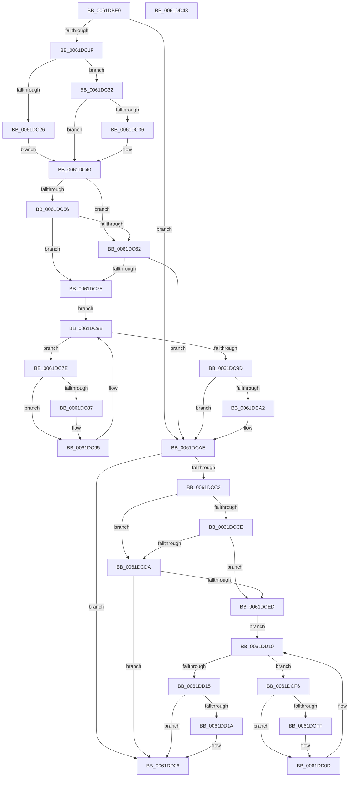

# DifExAcquireResourceExclusiveLiteWrapper

- RVA: `0x0061DBE0`–`0x0061DD44` (길이 `356` bytes)
- VA: `0x000000014061DBE0`
- 실행 섹션: `.text`
- PDB 이름 있음: `예`; PDB Function 태그: `아니요`
- unwind 정보 RVA: `0x00093E28`
- 디코드: `98`개 명령, `356/356` bytes 표시
- 미해석 바이트: `0` (있으면 어셈블리에 `.byte`로 보존)

> 이 문서는 커널 이미지의 기계어와 PDB 기호를 분석해 생성했습니다. 4번과 5번은 함수 원형과 자료형을 바이너리 사용 방식에서 추정한 C 해석이며 원본 소스 복구 결과는 아닙니다.

## 1. Dependencies

- 직접 호출 지점: **9**; 고유 호출 대상: **6**
- 직접 호출자로 확인된 함수: **0**
- RIP 상대 이미지 참조: **3**

### Outgoing calls
- `0x0061DC0E` → [DifGetAPIThunkContextById](../49/DifGetAPIThunkContextById_function_00495A34.md) (function, `0x00495A34`)
- `0x0061DC36` → [DifGetReturnAddressForWrappers](../4D/DifGetReturnAddressForWrappers_function_004D3C08.md) (function, `0x004D3C08`)
- `0x0061DC69` → [ExAcquireRundownProtection](../21/ExAcquireRundownProtection_function_00216620.md) (function, `0x00216620`)
- `0x0061DC90` → [guard_dispatch_icall](../6B/guard_dispatch_icall_function_006BAAD0.md) (function, `0x006BAAD0`)
- `0x0061DCA9` → [ExReleaseRundownProtection](../34/ExReleaseRundownProtection_function_00349E80.md) (function, `0x00349E80`)
- `0x0061DCB4` → [ExAcquireResourceExclusiveLite](../21/ExAcquireResourceExclusiveLite_function_00214E20.md) (function, `0x00214E20`)
- `0x0061DCE1` → [ExAcquireRundownProtection](../21/ExAcquireRundownProtection_function_00216620.md) (function, `0x00216620`)
- `0x0061DD08` → [guard_dispatch_icall](../6B/guard_dispatch_icall_function_006BAAD0.md) (function, `0x006BAAD0`)
- `0x0061DD21` → [ExReleaseRundownProtection](../34/ExReleaseRundownProtection_function_00349E80.md) (function, `0x00349E80`)

### Direct callers
- 이 함수 시작 RVA로 연결되는 직접 call은 확인되지 않았습니다. 간접 호출은 완전히 역산할 수 없습니다.

### Static image references
- `0x0061DC48` → RVA `0x00F048B8` (`.data`; read)
- `0x0061DC56` → RVA `0x00F04980` (`.data`; read)
- `0x0061DC62` → RVA `0x00F03E80` (`.data`; read)

## 2. Other-region calls and transfers

- 다른 실행 섹션으로 향하는 call: **0**
- 별도 외부 분기/꼬리 이동을 확인하지 못했습니다.

## 3. Assembly (complete function range)

```asm
0061DBE0  48 8B C4                        mov rax, rsp
0061DBE3  48 89 58 08                     mov qword ptr [rax + 8], rbx
0061DBE7  48 89 68 10                     mov qword ptr [rax + 0x10], rbp
0061DBEB  48 89 70 18                     mov qword ptr [rax + 0x18], rsi
0061DBEF  57                              push rdi
0061DBF0  41 56                           push r14
0061DBF2  41 57                           push r15
0061DBF4  48 83 EC 40                     sub rsp, 0x40
0061DBF8  0F 57 C0                        xorps xmm0, xmm0
0061DBFB  4C 8B F9                        mov r15, rcx
0061DBFE  B9 A7 01 00 00                  mov ecx, 0x1a7
0061DC03  44 8A F2                        mov r14b, dl
0061DC06  0F 11 40 C8                     movups xmmword ptr [rax - 0x38], xmm0
0061DC0A  0F 11 40 D8                     movups xmmword ptr [rax - 0x28], xmm0
0061DC0E  E8 21 7E E7 FF                  call 0x140495a34
0061DC13  48 8B F0                        mov rsi, rax
0061DC16  48 85 C0                        test rax, rax
0061DC19  0F 84 8F 00 00 00               je 0x14061dcae
0061DC1F  8B 40 0C                        mov eax, dword ptr [rax + 0xc]
0061DC22  A8 18                           test al, 0x18
0061DC24  74 0C                           je 0x14061dc32
0061DC26  48 8B 4C 24 58                  mov rcx, qword ptr [rsp + 0x58]
0061DC2B  48 89 4C 24 20                  mov qword ptr [rsp + 0x20], rcx
0061DC30  EB 0E                           jmp 0x14061dc40
0061DC32  A8 04                           test al, 4
0061DC34  74 0A                           je 0x14061dc40
0061DC36  E8 CD 5F EB FF                  call 0x1404d3c08
0061DC3B  48 89 44 24 20                  mov qword ptr [rsp + 0x20], rax
0061DC40  40 32 ED                        xor bpl, bpl
0061DC43  4C 89 7C 24 30                  mov qword ptr [rsp + 0x30], r15
0061DC48  40 38 2D 69 6C 8E 00            cmp byte ptr [rip + 0x8e6c69], bpl
0061DC4F  44 88 74 24 28                  mov byte ptr [rsp + 0x28], r14b
0061DC54  75 0C                           jne 0x14061dc62
0061DC56  F7 05 20 6D 8E 00 00 08 00 00   test dword ptr [rip + 0x8e6d20], 0x800
0061DC60  74 13                           je 0x14061dc75
0061DC62  48 8D 0D 17 62 8E 00            lea rcx, [rip + 0x8e6217]
0061DC69  E8 B2 89 BF FF                  call 0x140216620
0061DC6E  40 8A E8                        mov bpl, al
0061DC71  84 C0                           test al, al
0061DC73  74 39                           je 0x14061dcae
0061DC75  48 8D 7E 20                     lea rdi, [rsi + 0x20]
0061DC79  48 8B 1F                        mov rbx, qword ptr [rdi]
0061DC7C  EB 1A                           jmp 0x14061dc98
0061DC7E  48 8D 43 F0                     lea rax, [rbx - 0x10]
0061DC82  48 85 C0                        test rax, rax
0061DC85  74 0E                           je 0x14061dc95
0061DC87  48 8B 40 08                     mov rax, qword ptr [rax + 8]
0061DC8B  48 8D 4C 24 20                  lea rcx, [rsp + 0x20]
0061DC90  E8 3B CE 09 00                  call 0x1406baad0
0061DC95  48 8B 1B                        mov rbx, qword ptr [rbx]
0061DC98  48 3B DF                        cmp rbx, rdi
0061DC9B  75 E1                           jne 0x14061dc7e
0061DC9D  40 84 ED                        test bpl, bpl
0061DCA0  74 0C                           je 0x14061dcae
0061DCA2  48 8D 0D D7 61 8E 00            lea rcx, [rip + 0x8e61d7]
0061DCA9  E8 D2 C1 D2 FF                  call 0x140349e80
0061DCAE  41 8A D6                        mov dl, r14b
0061DCB1  49 8B CF                        mov rcx, r15
0061DCB4  E8 67 71 BF FF                  call 0x140214e20
0061DCB9  88 44 24 38                     mov byte ptr [rsp + 0x38], al
0061DCBD  48 85 F6                        test rsi, rsi
0061DCC0  74 64                           je 0x14061dd26
0061DCC2  40 32 FF                        xor dil, dil
0061DCC5  40 38 3D EC 6B 8E 00            cmp byte ptr [rip + 0x8e6bec], dil
0061DCCC  75 0C                           jne 0x14061dcda
0061DCCE  F7 05 A8 6C 8E 00 00 08 00 00   test dword ptr [rip + 0x8e6ca8], 0x800
0061DCD8  74 13                           je 0x14061dced
0061DCDA  48 8D 0D 9F 61 8E 00            lea rcx, [rip + 0x8e619f]
0061DCE1  E8 3A 89 BF FF                  call 0x140216620
0061DCE6  40 8A F8                        mov dil, al
0061DCE9  84 C0                           test al, al
0061DCEB  74 39                           je 0x14061dd26
0061DCED  48 83 C6 30                     add rsi, 0x30
0061DCF1  48 8B 1E                        mov rbx, qword ptr [rsi]
0061DCF4  EB 1A                           jmp 0x14061dd10
0061DCF6  48 8D 43 F0                     lea rax, [rbx - 0x10]
0061DCFA  48 85 C0                        test rax, rax
0061DCFD  74 0E                           je 0x14061dd0d
0061DCFF  48 8B 40 08                     mov rax, qword ptr [rax + 8]
0061DD03  48 8D 4C 24 20                  lea rcx, [rsp + 0x20]
0061DD08  E8 C3 CD 09 00                  call 0x1406baad0
0061DD0D  48 8B 1B                        mov rbx, qword ptr [rbx]
0061DD10  48 3B DE                        cmp rbx, rsi
0061DD13  75 E1                           jne 0x14061dcf6
0061DD15  40 84 FF                        test dil, dil
0061DD18  74 0C                           je 0x14061dd26
0061DD1A  48 8D 0D 5F 61 8E 00            lea rcx, [rip + 0x8e615f]
0061DD21  E8 5A C1 D2 FF                  call 0x140349e80
0061DD26  8A 44 24 38                     mov al, byte ptr [rsp + 0x38]
0061DD2A  48 8B 5C 24 60                  mov rbx, qword ptr [rsp + 0x60]
0061DD2F  48 8B 6C 24 68                  mov rbp, qword ptr [rsp + 0x68]
0061DD34  48 8B 74 24 70                  mov rsi, qword ptr [rsp + 0x70]
0061DD39  48 83 C4 40                     add rsp, 0x40
0061DD3D  41 5F                           pop r15
0061DD3F  41 5E                           pop r14
0061DD41  5F                              pop rdi
0061DD42  C3                              ret
0061DD43  CC                              int3
```

## 4. C-style interpretation (structured pseudocode)

```c
__int64 __fastcall DifExAcquireResourceExclusiveLiteWrapper(__int64 a1, unsigned __int8 a2)
{
    __int64 result;
    __int64 v_rbp;
    __int64 v_rdi;
    __int64 v_rsi;
    __int64 v_rsp;
    unsigned __int8 v_stack_m20;
    unsigned __int64 v_stack_m28;
    unsigned __int8 v_stack_m30;
    unsigned __int64 v_stack_m38;
    unsigned __int64 v_stack_p0;
    unsigned __int64 v_stack_p10;
    unsigned __int64 v_stack_p18;
    unsigned __int64 v_stack_p8;

    *(unsigned __int64 *)(v_rsp + 8) = v_rbx;
    *(unsigned __int64 *)(v_rsp + 16) = v_rbp;
    *(unsigned __int64 *)(v_rsp + 24) = v_rsi;
    v_rsp = (v_rsp) - (64);
    *(unsigned __int64 *)(v_rsp - 56) = v_xmm0;
    *(unsigned __int64 *)(v_rsp - 40) = v_xmm0;
    result = DifGetAPIThunkContextById(423, a2, a3, a4);
    if (result == 0) goto loc_0061DCAE;
    if ((((unsigned __int8)((unsigned int)(*(unsigned int *)(result + 12)))) & (24)) == 0) goto loc_0061DC32;
    v_stack_m38 = v_stack_p0;
    goto loc_0061DC40;
loc_0061DC32:
    result = (unsigned int)(*(unsigned int *)(result + 12));
    if ((((unsigned __int8)((unsigned int)(*(unsigned int *)(result + 12)))) & (4)) != 0) {
        result = DifGetReturnAddressForWrappers(v_stack_p0, a2, a3, a4);
        v_stack_m38 = result;
    }
    v_rbp = 0;
    v_stack_m28 = a1;
    v_stack_m30 = a2;
    if ((*(unsigned __int8 *)(v_rip + 9333865)) != 0) goto loc_0061DC62;
    if (((*(unsigned int *)(v_rip + 9334048)) & (0x800ULL)) == 0) goto loc_0061DC75;
loc_0061DC62:
    result = ExAcquireRundownProtection(v_rip + 9331223, a2, a3, a4);
    if ((unsigned __int8)(result) == 0) goto loc_0061DCAE;
loc_0061DC75:
    goto loc_0061DC98;
loc_0061DC7E:
    result = *(unsigned __int64 *)(result + 32) - 16;
    if (*(unsigned __int64 *)(result + 32) - 16 != 0) {
        result = *(unsigned __int64 *)(*(unsigned __int64 *)(result + 32) - 16 + 8);
        a1 = v_stack_m38;
        result = guard_dispatch_icall(a1, a2, a3, a4);
    }
loc_0061DC98:
    if ((*(unsigned __int64 *)(*(unsigned __int64 *)(result + 32))) != (result + 32)) goto loc_0061DC7E;
    if ((unsigned __int8)((unsigned __int8)(result)) != 0) {
        a1 = v_rip + 9331159;
        result = ExReleaseRundownProtection(a1, a2, a3, a4);
    }
    result = ExAcquireResourceExclusiveLite(a1, a2, a3, a4);
    v_stack_m20 = (unsigned __int8)(result);
    if (result == 0) goto loc_0061DD26;
    v_rdi = 0;
    if ((*(unsigned __int8 *)(v_rip + 9333740)) != 0) goto loc_0061DCDA;
    if (((*(unsigned int *)(v_rip + 9333928)) & (0x800ULL)) == 0) goto loc_0061DCED;
loc_0061DCDA:
    result = ExAcquireRundownProtection(v_rip + 9331103, a2, a3, a4);
    if ((unsigned __int8)(result) == 0) goto loc_0061DD26;
loc_0061DCED:
    v_rsi = (result) + (48);
    goto loc_0061DD10;
loc_0061DCF6:
    result = *(unsigned __int64 *)(v_rsi) - 16;
    if (*(unsigned __int64 *)(v_rsi) - 16 != 0) {
        result = *(unsigned __int64 *)(*(unsigned __int64 *)(v_rsi) - 16 + 8);
        a1 = v_stack_m38;
        result = guard_dispatch_icall(a1, a2, a3, a4);
    }
loc_0061DD10:
    if ((*(unsigned __int64 *)(*(unsigned __int64 *)(v_rsi))) != v_rsi) goto loc_0061DCF6;
    if ((unsigned __int8)((unsigned __int8)(result)) != 0) {
        a1 = v_rip + 9331039;
        result = ExReleaseRundownProtection(a1, a2, a3, a4);
    }
    v_rsp = (v_rsp) + (64);
    return v_stack_m20;
}
```

## 5. (Beta) C Style

```c
int64_t DifExAcquireResourceExclusiveLiteWrapper(int64_t Arg1, uint8_t Arg2)
{
    int64_t result;
    int64_t local_rbp;
    int64_t local_rdi;
    int64_t local_rsi;
    int64_t local_rsp;
    uint8_t v_stack_m20;
    uint64_t v_stack_m28;
    uint8_t v_stack_m30;
    uint64_t v_stack_m38;
    uint64_t v_stack_p0;
    uint64_t v_stack_p10;
    uint64_t v_stack_p18;
    uint64_t v_stack_p8;

    *(uint64_t *)(local_rsp + 0x8) = local_rbx;
    *(uint64_t *)(local_rsp + 0x10) = local_rbp;
    *(uint64_t *)(local_rsp + 0x18) = local_rsi;
    local_rsp = (local_rsp) - (64);
    *(uint64_t *)(local_rsp - 0x38) = v_xmm0;
    *(uint64_t *)(local_rsp - 0x28) = v_xmm0;
    result = DifGetAPIThunkContextById(423, Arg2, a3, a4);
    if (result == 0) goto loc_0061DCAE;
    if ((((uint8_t)((uint32_t)(*(uint32_t *)(result + 0xC)))) & (24)) == 0) goto loc_0061DC32;
    v_stack_m38 = v_stack_p0;
    goto loc_0061DC40;
loc_0061DC32:
    result = (uint32_t)(*(uint32_t *)(result + 0xC));
    if ((((uint8_t)((uint32_t)(*(uint32_t *)(result + 0xC)))) & (4)) != 0) {
        result = DifGetReturnAddressForWrappers(v_stack_p0, Arg2, a3, a4);
        v_stack_m38 = result;
    }
    local_rbp = 0;
    v_stack_m28 = Arg1;
    v_stack_m30 = Arg2;
    if ((*(uint8_t *)(v_rip + 0x8E6C69)) != 0) goto loc_0061DC62;
    if (((*(uint32_t *)(v_rip + 0x8E6D20)) & (0x800ULL)) == 0) goto loc_0061DC75;
loc_0061DC62:
    result = ExAcquireRundownProtection(v_rip + 9331223, Arg2, a3, a4);
    if ((uint8_t)(result) == 0) goto loc_0061DCAE;
loc_0061DC75:
    goto loc_0061DC98;
loc_0061DC7E:
    result = *(uint64_t *)(result + 0x20) - 16;
    if (*(uint64_t *)(result + 0x20) - 16 != 0) {
        result = *(uint64_t *)(*(uint64_t *)(result + 0x20) - 0x10 + 0x8);
        Arg1 = v_stack_m38;
        result = guard_dispatch_icall(Arg1, Arg2, a3, a4);
    }
loc_0061DC98:
    if ((*(uint64_t *)(*(uint64_t *)(result + 0x20))) != (result + 32)) goto loc_0061DC7E;
    if ((uint8_t)((uint8_t)(result)) != 0) {
        Arg1 = v_rip + 9331159;
        result = ExReleaseRundownProtection(Arg1, Arg2, a3, a4);
    }
    result = ExAcquireResourceExclusiveLite(Arg1, Arg2, a3, a4);
    v_stack_m20 = (uint8_t)(result);
    if (result == 0) goto loc_0061DD26;
    local_rdi = 0;
    if ((*(uint8_t *)(v_rip + 0x8E6BEC)) != 0) goto loc_0061DCDA;
    if (((*(uint32_t *)(v_rip + 0x8E6CA8)) & (0x800ULL)) == 0) goto loc_0061DCED;
loc_0061DCDA:
    result = ExAcquireRundownProtection(v_rip + 9331103, Arg2, a3, a4);
    if ((uint8_t)(result) == 0) goto loc_0061DD26;
loc_0061DCED:
    local_rsi = (result) + (48);
    goto loc_0061DD10;
loc_0061DCF6:
    result = *(uint64_t *)(local_rsi) - 16;
    if (*(uint64_t *)(local_rsi) - 16 != 0) {
        result = *(uint64_t *)(*(uint64_t *)(local_rsi) - 0x10 + 0x8);
        Arg1 = v_stack_m38;
        result = guard_dispatch_icall(Arg1, Arg2, a3, a4);
    }
loc_0061DD10:
    if ((*(uint64_t *)(*(uint64_t *)(local_rsi))) != local_rsi) goto loc_0061DCF6;
    if ((uint8_t)((uint8_t)(result)) != 0) {
        Arg1 = v_rip + 9331039;
        result = ExReleaseRundownProtection(Arg1, Arg2, a3, a4);
    }
    local_rsp = (local_rsp) + (64);
    return v_stack_m20;
}
```

## 6. Execution-region graph

[열기: 2D/3D 그래프와 함수 탐색 컨트롤 패널](../../../control-panel.html?section=text&rva=0x0061DBE0&view=graph)

- 2D 그래프는 위에서 아래로 흐르고, 3D 그래프는 빈 공간을 드래그해 회전합니다. Shift+드래그는 이동, 휠은 확대·축소, 함수 노드 선택은 대상 보고서 이동입니다.

### Static fallback


