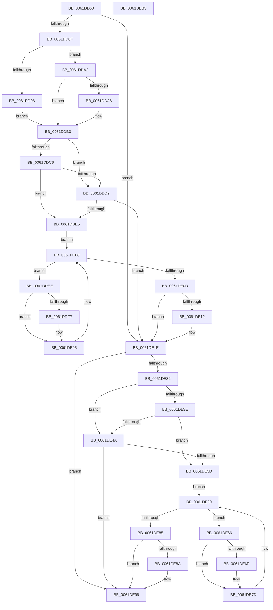

# DifExAcquireResourceSharedLiteWrapper

- RVA: `0x0061DD50`–`0x0061DEB4` (길이 `356` bytes)
- VA: `0x000000014061DD50`
- 실행 섹션: `.text`
- PDB 이름 있음: `예`; PDB Function 태그: `아니요`
- unwind 정보 RVA: `0x00093E28`
- 디코드: `98`개 명령, `356/356` bytes 표시
- 미해석 바이트: `0` (있으면 어셈블리에 `.byte`로 보존)

> 이 문서는 커널 이미지의 기계어와 PDB 기호를 분석해 생성했습니다. 4번과 5번은 함수 원형과 자료형을 바이너리 사용 방식에서 추정한 C 해석이며 원본 소스 복구 결과는 아닙니다.

## 1. Dependencies

- 직접 호출 지점: **9**; 고유 호출 대상: **6**
- 직접 호출자로 확인된 함수: **0**
- RIP 상대 이미지 참조: **3**

### Outgoing calls
- `0x0061DD7E` → [DifGetAPIThunkContextById](../49/DifGetAPIThunkContextById_function_00495A34.md) (function, `0x00495A34`)
- `0x0061DDA6` → [DifGetReturnAddressForWrappers](../4D/DifGetReturnAddressForWrappers_function_004D3C08.md) (function, `0x004D3C08`)
- `0x0061DDD9` → [ExAcquireRundownProtection](../21/ExAcquireRundownProtection_function_00216620.md) (function, `0x00216620`)
- `0x0061DE00` → [guard_dispatch_icall](../6B/guard_dispatch_icall_function_006BAAD0.md) (function, `0x006BAAD0`)
- `0x0061DE19` → [ExReleaseRundownProtection](../34/ExReleaseRundownProtection_function_00349E80.md) (function, `0x00349E80`)
- `0x0061DE24` → [ExAcquireResourceSharedLite](../21/ExAcquireResourceSharedLite_function_00211BC0.md) (function, `0x00211BC0`)
- `0x0061DE51` → [ExAcquireRundownProtection](../21/ExAcquireRundownProtection_function_00216620.md) (function, `0x00216620`)
- `0x0061DE78` → [guard_dispatch_icall](../6B/guard_dispatch_icall_function_006BAAD0.md) (function, `0x006BAAD0`)
- `0x0061DE91` → [ExReleaseRundownProtection](../34/ExReleaseRundownProtection_function_00349E80.md) (function, `0x00349E80`)

### Direct callers
- 이 함수 시작 RVA로 연결되는 직접 call은 확인되지 않았습니다. 간접 호출은 완전히 역산할 수 없습니다.

### Static image references
- `0x0061DDB8` → RVA `0x00F048B8` (`.data`; read)
- `0x0061DDC6` → RVA `0x00F04980` (`.data`; read)
- `0x0061DDD2` → RVA `0x00F03E80` (`.data`; read)

## 2. Other-region calls and transfers

- 다른 실행 섹션으로 향하는 call: **0**
- 별도 외부 분기/꼬리 이동을 확인하지 못했습니다.

## 3. Assembly (complete function range)

```asm
0061DD50  48 8B C4                        mov rax, rsp
0061DD53  48 89 58 08                     mov qword ptr [rax + 8], rbx
0061DD57  48 89 68 10                     mov qword ptr [rax + 0x10], rbp
0061DD5B  48 89 70 18                     mov qword ptr [rax + 0x18], rsi
0061DD5F  57                              push rdi
0061DD60  41 56                           push r14
0061DD62  41 57                           push r15
0061DD64  48 83 EC 40                     sub rsp, 0x40
0061DD68  0F 57 C0                        xorps xmm0, xmm0
0061DD6B  4C 8B F9                        mov r15, rcx
0061DD6E  B9 A6 01 00 00                  mov ecx, 0x1a6
0061DD73  44 8A F2                        mov r14b, dl
0061DD76  0F 11 40 C8                     movups xmmword ptr [rax - 0x38], xmm0
0061DD7A  0F 11 40 D8                     movups xmmword ptr [rax - 0x28], xmm0
0061DD7E  E8 B1 7C E7 FF                  call 0x140495a34
0061DD83  48 8B F0                        mov rsi, rax
0061DD86  48 85 C0                        test rax, rax
0061DD89  0F 84 8F 00 00 00               je 0x14061de1e
0061DD8F  8B 40 0C                        mov eax, dword ptr [rax + 0xc]
0061DD92  A8 18                           test al, 0x18
0061DD94  74 0C                           je 0x14061dda2
0061DD96  48 8B 4C 24 58                  mov rcx, qword ptr [rsp + 0x58]
0061DD9B  48 89 4C 24 20                  mov qword ptr [rsp + 0x20], rcx
0061DDA0  EB 0E                           jmp 0x14061ddb0
0061DDA2  A8 04                           test al, 4
0061DDA4  74 0A                           je 0x14061ddb0
0061DDA6  E8 5D 5E EB FF                  call 0x1404d3c08
0061DDAB  48 89 44 24 20                  mov qword ptr [rsp + 0x20], rax
0061DDB0  40 32 ED                        xor bpl, bpl
0061DDB3  4C 89 7C 24 30                  mov qword ptr [rsp + 0x30], r15
0061DDB8  40 38 2D F9 6A 8E 00            cmp byte ptr [rip + 0x8e6af9], bpl
0061DDBF  44 88 74 24 28                  mov byte ptr [rsp + 0x28], r14b
0061DDC4  75 0C                           jne 0x14061ddd2
0061DDC6  F7 05 B0 6B 8E 00 00 08 00 00   test dword ptr [rip + 0x8e6bb0], 0x800
0061DDD0  74 13                           je 0x14061dde5
0061DDD2  48 8D 0D A7 60 8E 00            lea rcx, [rip + 0x8e60a7]
0061DDD9  E8 42 88 BF FF                  call 0x140216620
0061DDDE  40 8A E8                        mov bpl, al
0061DDE1  84 C0                           test al, al
0061DDE3  74 39                           je 0x14061de1e
0061DDE5  48 8D 7E 20                     lea rdi, [rsi + 0x20]
0061DDE9  48 8B 1F                        mov rbx, qword ptr [rdi]
0061DDEC  EB 1A                           jmp 0x14061de08
0061DDEE  48 8D 43 F0                     lea rax, [rbx - 0x10]
0061DDF2  48 85 C0                        test rax, rax
0061DDF5  74 0E                           je 0x14061de05
0061DDF7  48 8B 40 08                     mov rax, qword ptr [rax + 8]
0061DDFB  48 8D 4C 24 20                  lea rcx, [rsp + 0x20]
0061DE00  E8 CB CC 09 00                  call 0x1406baad0
0061DE05  48 8B 1B                        mov rbx, qword ptr [rbx]
0061DE08  48 3B DF                        cmp rbx, rdi
0061DE0B  75 E1                           jne 0x14061ddee
0061DE0D  40 84 ED                        test bpl, bpl
0061DE10  74 0C                           je 0x14061de1e
0061DE12  48 8D 0D 67 60 8E 00            lea rcx, [rip + 0x8e6067]
0061DE19  E8 62 C0 D2 FF                  call 0x140349e80
0061DE1E  41 8A D6                        mov dl, r14b
0061DE21  49 8B CF                        mov rcx, r15
0061DE24  E8 97 3D BF FF                  call 0x140211bc0
0061DE29  88 44 24 38                     mov byte ptr [rsp + 0x38], al
0061DE2D  48 85 F6                        test rsi, rsi
0061DE30  74 64                           je 0x14061de96
0061DE32  40 32 FF                        xor dil, dil
0061DE35  40 38 3D 7C 6A 8E 00            cmp byte ptr [rip + 0x8e6a7c], dil
0061DE3C  75 0C                           jne 0x14061de4a
0061DE3E  F7 05 38 6B 8E 00 00 08 00 00   test dword ptr [rip + 0x8e6b38], 0x800
0061DE48  74 13                           je 0x14061de5d
0061DE4A  48 8D 0D 2F 60 8E 00            lea rcx, [rip + 0x8e602f]
0061DE51  E8 CA 87 BF FF                  call 0x140216620
0061DE56  40 8A F8                        mov dil, al
0061DE59  84 C0                           test al, al
0061DE5B  74 39                           je 0x14061de96
0061DE5D  48 83 C6 30                     add rsi, 0x30
0061DE61  48 8B 1E                        mov rbx, qword ptr [rsi]
0061DE64  EB 1A                           jmp 0x14061de80
0061DE66  48 8D 43 F0                     lea rax, [rbx - 0x10]
0061DE6A  48 85 C0                        test rax, rax
0061DE6D  74 0E                           je 0x14061de7d
0061DE6F  48 8B 40 08                     mov rax, qword ptr [rax + 8]
0061DE73  48 8D 4C 24 20                  lea rcx, [rsp + 0x20]
0061DE78  E8 53 CC 09 00                  call 0x1406baad0
0061DE7D  48 8B 1B                        mov rbx, qword ptr [rbx]
0061DE80  48 3B DE                        cmp rbx, rsi
0061DE83  75 E1                           jne 0x14061de66
0061DE85  40 84 FF                        test dil, dil
0061DE88  74 0C                           je 0x14061de96
0061DE8A  48 8D 0D EF 5F 8E 00            lea rcx, [rip + 0x8e5fef]
0061DE91  E8 EA BF D2 FF                  call 0x140349e80
0061DE96  8A 44 24 38                     mov al, byte ptr [rsp + 0x38]
0061DE9A  48 8B 5C 24 60                  mov rbx, qword ptr [rsp + 0x60]
0061DE9F  48 8B 6C 24 68                  mov rbp, qword ptr [rsp + 0x68]
0061DEA4  48 8B 74 24 70                  mov rsi, qword ptr [rsp + 0x70]
0061DEA9  48 83 C4 40                     add rsp, 0x40
0061DEAD  41 5F                           pop r15
0061DEAF  41 5E                           pop r14
0061DEB1  5F                              pop rdi
0061DEB2  C3                              ret
0061DEB3  CC                              int3
```

## 4. C-style interpretation (structured pseudocode)

```c
__int64 __fastcall DifExAcquireResourceSharedLiteWrapper(__int64 a1, unsigned __int8 a2)
{
    __int64 result;
    __int64 v_rbp;
    __int64 v_rdi;
    __int64 v_rsi;
    __int64 v_rsp;
    unsigned __int8 v_stack_m20;
    unsigned __int64 v_stack_m28;
    unsigned __int8 v_stack_m30;
    unsigned __int64 v_stack_m38;
    unsigned __int64 v_stack_p0;
    unsigned __int64 v_stack_p10;
    unsigned __int64 v_stack_p18;
    unsigned __int64 v_stack_p8;

    *(unsigned __int64 *)(v_rsp + 8) = v_rbx;
    *(unsigned __int64 *)(v_rsp + 16) = v_rbp;
    *(unsigned __int64 *)(v_rsp + 24) = v_rsi;
    v_rsp = (v_rsp) - (64);
    *(unsigned __int64 *)(v_rsp - 56) = v_xmm0;
    *(unsigned __int64 *)(v_rsp - 40) = v_xmm0;
    result = DifGetAPIThunkContextById(422, a2, a3, a4);
    if (result == 0) goto loc_0061DE1E;
    if ((((unsigned __int8)((unsigned int)(*(unsigned int *)(result + 12)))) & (24)) == 0) goto loc_0061DDA2;
    v_stack_m38 = v_stack_p0;
    goto loc_0061DDB0;
loc_0061DDA2:
    result = (unsigned int)(*(unsigned int *)(result + 12));
    if ((((unsigned __int8)((unsigned int)(*(unsigned int *)(result + 12)))) & (4)) != 0) {
        result = DifGetReturnAddressForWrappers(v_stack_p0, a2, a3, a4);
        v_stack_m38 = result;
    }
    v_rbp = 0;
    v_stack_m28 = a1;
    v_stack_m30 = a2;
    if ((*(unsigned __int8 *)(v_rip + 9333497)) != 0) goto loc_0061DDD2;
    if (((*(unsigned int *)(v_rip + 9333680)) & (0x800ULL)) == 0) goto loc_0061DDE5;
loc_0061DDD2:
    result = ExAcquireRundownProtection(v_rip + 9330855, a2, a3, a4);
    if ((unsigned __int8)(result) == 0) goto loc_0061DE1E;
loc_0061DDE5:
    goto loc_0061DE08;
loc_0061DDEE:
    result = *(unsigned __int64 *)(result + 32) - 16;
    if (*(unsigned __int64 *)(result + 32) - 16 != 0) {
        result = *(unsigned __int64 *)(*(unsigned __int64 *)(result + 32) - 16 + 8);
        a1 = v_stack_m38;
        result = guard_dispatch_icall(a1, a2, a3, a4);
    }
loc_0061DE08:
    if ((*(unsigned __int64 *)(*(unsigned __int64 *)(result + 32))) != (result + 32)) goto loc_0061DDEE;
    if ((unsigned __int8)((unsigned __int8)(result)) != 0) {
        a1 = v_rip + 9330791;
        result = ExReleaseRundownProtection(a1, a2, a3, a4);
    }
    result = ExAcquireResourceSharedLite(a1, a2, a3, a4);
    v_stack_m20 = (unsigned __int8)(result);
    if (result == 0) goto loc_0061DE96;
    v_rdi = 0;
    if ((*(unsigned __int8 *)(v_rip + 9333372)) != 0) goto loc_0061DE4A;
    if (((*(unsigned int *)(v_rip + 9333560)) & (0x800ULL)) == 0) goto loc_0061DE5D;
loc_0061DE4A:
    result = ExAcquireRundownProtection(v_rip + 9330735, a2, a3, a4);
    if ((unsigned __int8)(result) == 0) goto loc_0061DE96;
loc_0061DE5D:
    v_rsi = (result) + (48);
    goto loc_0061DE80;
loc_0061DE66:
    result = *(unsigned __int64 *)(v_rsi) - 16;
    if (*(unsigned __int64 *)(v_rsi) - 16 != 0) {
        result = *(unsigned __int64 *)(*(unsigned __int64 *)(v_rsi) - 16 + 8);
        a1 = v_stack_m38;
        result = guard_dispatch_icall(a1, a2, a3, a4);
    }
loc_0061DE80:
    if ((*(unsigned __int64 *)(*(unsigned __int64 *)(v_rsi))) != v_rsi) goto loc_0061DE66;
    if ((unsigned __int8)((unsigned __int8)(result)) != 0) {
        a1 = v_rip + 9330671;
        result = ExReleaseRundownProtection(a1, a2, a3, a4);
    }
    v_rsp = (v_rsp) + (64);
    return v_stack_m20;
}
```

## 5. (Beta) C Style

```c
int64_t DifExAcquireResourceSharedLiteWrapper(int64_t Arg1, uint8_t Arg2)
{
    int64_t result;
    int64_t local_rbp;
    int64_t local_rdi;
    int64_t local_rsi;
    int64_t local_rsp;
    uint8_t v_stack_m20;
    uint64_t v_stack_m28;
    uint8_t v_stack_m30;
    uint64_t v_stack_m38;
    uint64_t v_stack_p0;
    uint64_t v_stack_p10;
    uint64_t v_stack_p18;
    uint64_t v_stack_p8;

    *(uint64_t *)(local_rsp + 0x8) = local_rbx;
    *(uint64_t *)(local_rsp + 0x10) = local_rbp;
    *(uint64_t *)(local_rsp + 0x18) = local_rsi;
    local_rsp = (local_rsp) - (64);
    *(uint64_t *)(local_rsp - 0x38) = v_xmm0;
    *(uint64_t *)(local_rsp - 0x28) = v_xmm0;
    result = DifGetAPIThunkContextById(422, Arg2, a3, a4);
    if (result == 0) goto loc_0061DE1E;
    if ((((uint8_t)((uint32_t)(*(uint32_t *)(result + 0xC)))) & (24)) == 0) goto loc_0061DDA2;
    v_stack_m38 = v_stack_p0;
    goto loc_0061DDB0;
loc_0061DDA2:
    result = (uint32_t)(*(uint32_t *)(result + 0xC));
    if ((((uint8_t)((uint32_t)(*(uint32_t *)(result + 0xC)))) & (4)) != 0) {
        result = DifGetReturnAddressForWrappers(v_stack_p0, Arg2, a3, a4);
        v_stack_m38 = result;
    }
    local_rbp = 0;
    v_stack_m28 = Arg1;
    v_stack_m30 = Arg2;
    if ((*(uint8_t *)(v_rip + 0x8E6AF9)) != 0) goto loc_0061DDD2;
    if (((*(uint32_t *)(v_rip + 0x8E6BB0)) & (0x800ULL)) == 0) goto loc_0061DDE5;
loc_0061DDD2:
    result = ExAcquireRundownProtection(v_rip + 9330855, Arg2, a3, a4);
    if ((uint8_t)(result) == 0) goto loc_0061DE1E;
loc_0061DDE5:
    goto loc_0061DE08;
loc_0061DDEE:
    result = *(uint64_t *)(result + 0x20) - 16;
    if (*(uint64_t *)(result + 0x20) - 16 != 0) {
        result = *(uint64_t *)(*(uint64_t *)(result + 0x20) - 0x10 + 0x8);
        Arg1 = v_stack_m38;
        result = guard_dispatch_icall(Arg1, Arg2, a3, a4);
    }
loc_0061DE08:
    if ((*(uint64_t *)(*(uint64_t *)(result + 0x20))) != (result + 32)) goto loc_0061DDEE;
    if ((uint8_t)((uint8_t)(result)) != 0) {
        Arg1 = v_rip + 9330791;
        result = ExReleaseRundownProtection(Arg1, Arg2, a3, a4);
    }
    result = ExAcquireResourceSharedLite(Arg1, Arg2, a3, a4);
    v_stack_m20 = (uint8_t)(result);
    if (result == 0) goto loc_0061DE96;
    local_rdi = 0;
    if ((*(uint8_t *)(v_rip + 0x8E6A7C)) != 0) goto loc_0061DE4A;
    if (((*(uint32_t *)(v_rip + 0x8E6B38)) & (0x800ULL)) == 0) goto loc_0061DE5D;
loc_0061DE4A:
    result = ExAcquireRundownProtection(v_rip + 9330735, Arg2, a3, a4);
    if ((uint8_t)(result) == 0) goto loc_0061DE96;
loc_0061DE5D:
    local_rsi = (result) + (48);
    goto loc_0061DE80;
loc_0061DE66:
    result = *(uint64_t *)(local_rsi) - 16;
    if (*(uint64_t *)(local_rsi) - 16 != 0) {
        result = *(uint64_t *)(*(uint64_t *)(local_rsi) - 0x10 + 0x8);
        Arg1 = v_stack_m38;
        result = guard_dispatch_icall(Arg1, Arg2, a3, a4);
    }
loc_0061DE80:
    if ((*(uint64_t *)(*(uint64_t *)(local_rsi))) != local_rsi) goto loc_0061DE66;
    if ((uint8_t)((uint8_t)(result)) != 0) {
        Arg1 = v_rip + 9330671;
        result = ExReleaseRundownProtection(Arg1, Arg2, a3, a4);
    }
    local_rsp = (local_rsp) + (64);
    return v_stack_m20;
}
```

## 6. Execution-region graph

[열기: 2D/3D 그래프와 함수 탐색 컨트롤 패널](../../../control-panel.html?section=text&rva=0x0061DD50&view=graph)

- 2D 그래프는 위에서 아래로 흐르고, 3D 그래프는 빈 공간을 드래그해 회전합니다. Shift+드래그는 이동, 휠은 확대·축소, 함수 노드 선택은 대상 보고서 이동입니다.

### Static fallback


