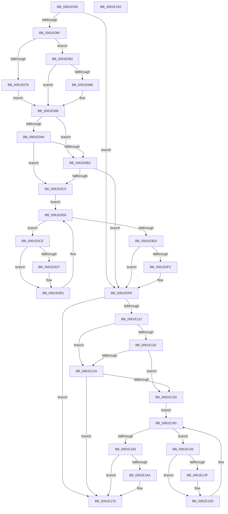

# DifExAcquireSharedWaitForExclusiveWrapper

- RVA: `0x0061E030`–`0x0061E194` (길이 `356` bytes)
- VA: `0x000000014061E030`
- 실행 섹션: `.text`
- PDB 이름 있음: `예`; PDB Function 태그: `아니요`
- unwind 정보 RVA: `0x00093E28`
- 디코드: `98`개 명령, `356/356` bytes 표시
- 미해석 바이트: `0` (있으면 어셈블리에 `.byte`로 보존)

> 이 문서는 커널 이미지의 기계어와 PDB 기호를 분석해 생성했습니다. 4번과 5번은 함수 원형과 자료형을 바이너리 사용 방식에서 추정한 C 해석이며 원본 소스 복구 결과는 아닙니다.

## 1. Dependencies

- 직접 호출 지점: **9**; 고유 호출 대상: **6**
- 직접 호출자로 확인된 함수: **0**
- RIP 상대 이미지 참조: **3**

### Outgoing calls
- `0x0061E05E` → [DifGetAPIThunkContextById](../49/DifGetAPIThunkContextById_function_00495A34.md) (function, `0x00495A34`)
- `0x0061E086` → [DifGetReturnAddressForWrappers](../4D/DifGetReturnAddressForWrappers_function_004D3C08.md) (function, `0x004D3C08`)
- `0x0061E0B9` → [ExAcquireRundownProtection](../21/ExAcquireRundownProtection_function_00216620.md) (function, `0x00216620`)
- `0x0061E0E0` → [guard_dispatch_icall](../6B/guard_dispatch_icall_function_006BAAD0.md) (function, `0x006BAAD0`)
- `0x0061E0F9` → [ExReleaseRundownProtection](../34/ExReleaseRundownProtection_function_00349E80.md) (function, `0x00349E80`)
- `0x0061E104` → [ExAcquireSharedWaitForExclusive](../3D/ExAcquireSharedWaitForExclusive_function_003D43F0.md) (function, `0x003D43F0`)
- `0x0061E131` → [ExAcquireRundownProtection](../21/ExAcquireRundownProtection_function_00216620.md) (function, `0x00216620`)
- `0x0061E158` → [guard_dispatch_icall](../6B/guard_dispatch_icall_function_006BAAD0.md) (function, `0x006BAAD0`)
- `0x0061E171` → [ExReleaseRundownProtection](../34/ExReleaseRundownProtection_function_00349E80.md) (function, `0x00349E80`)

### Direct callers
- 이 함수 시작 RVA로 연결되는 직접 call은 확인되지 않았습니다. 간접 호출은 완전히 역산할 수 없습니다.

### Static image references
- `0x0061E098` → RVA `0x00F048B8` (`.data`; read)
- `0x0061E0A6` → RVA `0x00F04980` (`.data`; read)
- `0x0061E0B2` → RVA `0x00F03E80` (`.data`; read)

## 2. Other-region calls and transfers

- 다른 실행 섹션으로 향하는 call: **0**
- 별도 외부 분기/꼬리 이동을 확인하지 못했습니다.

## 3. Assembly (complete function range)

```asm
0061E030  48 8B C4                        mov rax, rsp
0061E033  48 89 58 08                     mov qword ptr [rax + 8], rbx
0061E037  48 89 68 10                     mov qword ptr [rax + 0x10], rbp
0061E03B  48 89 70 18                     mov qword ptr [rax + 0x18], rsi
0061E03F  57                              push rdi
0061E040  41 56                           push r14
0061E042  41 57                           push r15
0061E044  48 83 EC 40                     sub rsp, 0x40
0061E048  0F 57 C0                        xorps xmm0, xmm0
0061E04B  4C 8B F9                        mov r15, rcx
0061E04E  B9 A4 01 00 00                  mov ecx, 0x1a4
0061E053  44 8A F2                        mov r14b, dl
0061E056  0F 11 40 C8                     movups xmmword ptr [rax - 0x38], xmm0
0061E05A  0F 11 40 D8                     movups xmmword ptr [rax - 0x28], xmm0
0061E05E  E8 D1 79 E7 FF                  call 0x140495a34
0061E063  48 8B F0                        mov rsi, rax
0061E066  48 85 C0                        test rax, rax
0061E069  0F 84 8F 00 00 00               je 0x14061e0fe
0061E06F  8B 40 0C                        mov eax, dword ptr [rax + 0xc]
0061E072  A8 18                           test al, 0x18
0061E074  74 0C                           je 0x14061e082
0061E076  48 8B 4C 24 58                  mov rcx, qword ptr [rsp + 0x58]
0061E07B  48 89 4C 24 20                  mov qword ptr [rsp + 0x20], rcx
0061E080  EB 0E                           jmp 0x14061e090
0061E082  A8 04                           test al, 4
0061E084  74 0A                           je 0x14061e090
0061E086  E8 7D 5B EB FF                  call 0x1404d3c08
0061E08B  48 89 44 24 20                  mov qword ptr [rsp + 0x20], rax
0061E090  40 32 ED                        xor bpl, bpl
0061E093  4C 89 7C 24 30                  mov qword ptr [rsp + 0x30], r15
0061E098  40 38 2D 19 68 8E 00            cmp byte ptr [rip + 0x8e6819], bpl
0061E09F  44 88 74 24 28                  mov byte ptr [rsp + 0x28], r14b
0061E0A4  75 0C                           jne 0x14061e0b2
0061E0A6  F7 05 D0 68 8E 00 00 08 00 00   test dword ptr [rip + 0x8e68d0], 0x800
0061E0B0  74 13                           je 0x14061e0c5
0061E0B2  48 8D 0D C7 5D 8E 00            lea rcx, [rip + 0x8e5dc7]
0061E0B9  E8 62 85 BF FF                  call 0x140216620
0061E0BE  40 8A E8                        mov bpl, al
0061E0C1  84 C0                           test al, al
0061E0C3  74 39                           je 0x14061e0fe
0061E0C5  48 8D 7E 20                     lea rdi, [rsi + 0x20]
0061E0C9  48 8B 1F                        mov rbx, qword ptr [rdi]
0061E0CC  EB 1A                           jmp 0x14061e0e8
0061E0CE  48 8D 43 F0                     lea rax, [rbx - 0x10]
0061E0D2  48 85 C0                        test rax, rax
0061E0D5  74 0E                           je 0x14061e0e5
0061E0D7  48 8B 40 08                     mov rax, qword ptr [rax + 8]
0061E0DB  48 8D 4C 24 20                  lea rcx, [rsp + 0x20]
0061E0E0  E8 EB C9 09 00                  call 0x1406baad0
0061E0E5  48 8B 1B                        mov rbx, qword ptr [rbx]
0061E0E8  48 3B DF                        cmp rbx, rdi
0061E0EB  75 E1                           jne 0x14061e0ce
0061E0ED  40 84 ED                        test bpl, bpl
0061E0F0  74 0C                           je 0x14061e0fe
0061E0F2  48 8D 0D 87 5D 8E 00            lea rcx, [rip + 0x8e5d87]
0061E0F9  E8 82 BD D2 FF                  call 0x140349e80
0061E0FE  41 8A D6                        mov dl, r14b
0061E101  49 8B CF                        mov rcx, r15
0061E104  E8 E7 62 DB FF                  call 0x1403d43f0
0061E109  88 44 24 38                     mov byte ptr [rsp + 0x38], al
0061E10D  48 85 F6                        test rsi, rsi
0061E110  74 64                           je 0x14061e176
0061E112  40 32 FF                        xor dil, dil
0061E115  40 38 3D 9C 67 8E 00            cmp byte ptr [rip + 0x8e679c], dil
0061E11C  75 0C                           jne 0x14061e12a
0061E11E  F7 05 58 68 8E 00 00 08 00 00   test dword ptr [rip + 0x8e6858], 0x800
0061E128  74 13                           je 0x14061e13d
0061E12A  48 8D 0D 4F 5D 8E 00            lea rcx, [rip + 0x8e5d4f]
0061E131  E8 EA 84 BF FF                  call 0x140216620
0061E136  40 8A F8                        mov dil, al
0061E139  84 C0                           test al, al
0061E13B  74 39                           je 0x14061e176
0061E13D  48 83 C6 30                     add rsi, 0x30
0061E141  48 8B 1E                        mov rbx, qword ptr [rsi]
0061E144  EB 1A                           jmp 0x14061e160
0061E146  48 8D 43 F0                     lea rax, [rbx - 0x10]
0061E14A  48 85 C0                        test rax, rax
0061E14D  74 0E                           je 0x14061e15d
0061E14F  48 8B 40 08                     mov rax, qword ptr [rax + 8]
0061E153  48 8D 4C 24 20                  lea rcx, [rsp + 0x20]
0061E158  E8 73 C9 09 00                  call 0x1406baad0
0061E15D  48 8B 1B                        mov rbx, qword ptr [rbx]
0061E160  48 3B DE                        cmp rbx, rsi
0061E163  75 E1                           jne 0x14061e146
0061E165  40 84 FF                        test dil, dil
0061E168  74 0C                           je 0x14061e176
0061E16A  48 8D 0D 0F 5D 8E 00            lea rcx, [rip + 0x8e5d0f]
0061E171  E8 0A BD D2 FF                  call 0x140349e80
0061E176  8A 44 24 38                     mov al, byte ptr [rsp + 0x38]
0061E17A  48 8B 5C 24 60                  mov rbx, qword ptr [rsp + 0x60]
0061E17F  48 8B 6C 24 68                  mov rbp, qword ptr [rsp + 0x68]
0061E184  48 8B 74 24 70                  mov rsi, qword ptr [rsp + 0x70]
0061E189  48 83 C4 40                     add rsp, 0x40
0061E18D  41 5F                           pop r15
0061E18F  41 5E                           pop r14
0061E191  5F                              pop rdi
0061E192  C3                              ret
0061E193  CC                              int3
```

## 4. C-style interpretation (structured pseudocode)

```c
__int64 __fastcall DifExAcquireSharedWaitForExclusiveWrapper(__int64 a1, unsigned __int8 a2)
{
    __int64 result;
    __int64 v_rbp;
    __int64 v_rdi;
    __int64 v_rsi;
    __int64 v_rsp;
    unsigned __int8 v_stack_m20;
    unsigned __int64 v_stack_m28;
    unsigned __int8 v_stack_m30;
    unsigned __int64 v_stack_m38;
    unsigned __int64 v_stack_p0;
    unsigned __int64 v_stack_p10;
    unsigned __int64 v_stack_p18;
    unsigned __int64 v_stack_p8;

    *(unsigned __int64 *)(v_rsp + 8) = v_rbx;
    *(unsigned __int64 *)(v_rsp + 16) = v_rbp;
    *(unsigned __int64 *)(v_rsp + 24) = v_rsi;
    v_rsp = (v_rsp) - (64);
    *(unsigned __int64 *)(v_rsp - 56) = v_xmm0;
    *(unsigned __int64 *)(v_rsp - 40) = v_xmm0;
    result = DifGetAPIThunkContextById(420, a2, a3, a4);
    if (result == 0) goto loc_0061E0FE;
    if ((((unsigned __int8)((unsigned int)(*(unsigned int *)(result + 12)))) & (24)) == 0) goto loc_0061E082;
    v_stack_m38 = v_stack_p0;
    goto loc_0061E090;
loc_0061E082:
    result = (unsigned int)(*(unsigned int *)(result + 12));
    if ((((unsigned __int8)((unsigned int)(*(unsigned int *)(result + 12)))) & (4)) != 0) {
        result = DifGetReturnAddressForWrappers(v_stack_p0, a2, a3, a4);
        v_stack_m38 = result;
    }
    v_rbp = 0;
    v_stack_m28 = a1;
    v_stack_m30 = a2;
    if ((*(unsigned __int8 *)(v_rip + 9332761)) != 0) goto loc_0061E0B2;
    if (((*(unsigned int *)(v_rip + 9332944)) & (0x800ULL)) == 0) goto loc_0061E0C5;
loc_0061E0B2:
    result = ExAcquireRundownProtection(v_rip + 9330119, a2, a3, a4);
    if ((unsigned __int8)(result) == 0) goto loc_0061E0FE;
loc_0061E0C5:
    goto loc_0061E0E8;
loc_0061E0CE:
    result = *(unsigned __int64 *)(result + 32) - 16;
    if (*(unsigned __int64 *)(result + 32) - 16 != 0) {
        result = *(unsigned __int64 *)(*(unsigned __int64 *)(result + 32) - 16 + 8);
        a1 = v_stack_m38;
        result = guard_dispatch_icall(a1, a2, a3, a4);
    }
loc_0061E0E8:
    if ((*(unsigned __int64 *)(*(unsigned __int64 *)(result + 32))) != (result + 32)) goto loc_0061E0CE;
    if ((unsigned __int8)((unsigned __int8)(result)) != 0) {
        a1 = v_rip + 9330055;
        result = ExReleaseRundownProtection(a1, a2, a3, a4);
    }
    result = ExAcquireSharedWaitForExclusive(a1, a2, a3, a4);
    v_stack_m20 = (unsigned __int8)(result);
    if (result == 0) goto loc_0061E176;
    v_rdi = 0;
    if ((*(unsigned __int8 *)(v_rip + 9332636)) != 0) goto loc_0061E12A;
    if (((*(unsigned int *)(v_rip + 9332824)) & (0x800ULL)) == 0) goto loc_0061E13D;
loc_0061E12A:
    result = ExAcquireRundownProtection(v_rip + 9329999, a2, a3, a4);
    if ((unsigned __int8)(result) == 0) goto loc_0061E176;
loc_0061E13D:
    v_rsi = (result) + (48);
    goto loc_0061E160;
loc_0061E146:
    result = *(unsigned __int64 *)(v_rsi) - 16;
    if (*(unsigned __int64 *)(v_rsi) - 16 != 0) {
        result = *(unsigned __int64 *)(*(unsigned __int64 *)(v_rsi) - 16 + 8);
        a1 = v_stack_m38;
        result = guard_dispatch_icall(a1, a2, a3, a4);
    }
loc_0061E160:
    if ((*(unsigned __int64 *)(*(unsigned __int64 *)(v_rsi))) != v_rsi) goto loc_0061E146;
    if ((unsigned __int8)((unsigned __int8)(result)) != 0) {
        a1 = v_rip + 9329935;
        result = ExReleaseRundownProtection(a1, a2, a3, a4);
    }
    v_rsp = (v_rsp) + (64);
    return v_stack_m20;
}
```

## 5. (Beta) C Style

```c
int64_t DifExAcquireSharedWaitForExclusiveWrapper(int64_t Arg1, uint8_t Arg2)
{
    int64_t result;
    int64_t local_rbp;
    int64_t local_rdi;
    int64_t local_rsi;
    int64_t local_rsp;
    uint8_t v_stack_m20;
    uint64_t v_stack_m28;
    uint8_t v_stack_m30;
    uint64_t v_stack_m38;
    uint64_t v_stack_p0;
    uint64_t v_stack_p10;
    uint64_t v_stack_p18;
    uint64_t v_stack_p8;

    *(uint64_t *)(local_rsp + 0x8) = local_rbx;
    *(uint64_t *)(local_rsp + 0x10) = local_rbp;
    *(uint64_t *)(local_rsp + 0x18) = local_rsi;
    local_rsp = (local_rsp) - (64);
    *(uint64_t *)(local_rsp - 0x38) = v_xmm0;
    *(uint64_t *)(local_rsp - 0x28) = v_xmm0;
    result = DifGetAPIThunkContextById(420, Arg2, a3, a4);
    if (result == 0) goto loc_0061E0FE;
    if ((((uint8_t)((uint32_t)(*(uint32_t *)(result + 0xC)))) & (24)) == 0) goto loc_0061E082;
    v_stack_m38 = v_stack_p0;
    goto loc_0061E090;
loc_0061E082:
    result = (uint32_t)(*(uint32_t *)(result + 0xC));
    if ((((uint8_t)((uint32_t)(*(uint32_t *)(result + 0xC)))) & (4)) != 0) {
        result = DifGetReturnAddressForWrappers(v_stack_p0, Arg2, a3, a4);
        v_stack_m38 = result;
    }
    local_rbp = 0;
    v_stack_m28 = Arg1;
    v_stack_m30 = Arg2;
    if ((*(uint8_t *)(v_rip + 0x8E6819)) != 0) goto loc_0061E0B2;
    if (((*(uint32_t *)(v_rip + 0x8E68D0)) & (0x800ULL)) == 0) goto loc_0061E0C5;
loc_0061E0B2:
    result = ExAcquireRundownProtection(v_rip + 9330119, Arg2, a3, a4);
    if ((uint8_t)(result) == 0) goto loc_0061E0FE;
loc_0061E0C5:
    goto loc_0061E0E8;
loc_0061E0CE:
    result = *(uint64_t *)(result + 0x20) - 16;
    if (*(uint64_t *)(result + 0x20) - 16 != 0) {
        result = *(uint64_t *)(*(uint64_t *)(result + 0x20) - 0x10 + 0x8);
        Arg1 = v_stack_m38;
        result = guard_dispatch_icall(Arg1, Arg2, a3, a4);
    }
loc_0061E0E8:
    if ((*(uint64_t *)(*(uint64_t *)(result + 0x20))) != (result + 32)) goto loc_0061E0CE;
    if ((uint8_t)((uint8_t)(result)) != 0) {
        Arg1 = v_rip + 9330055;
        result = ExReleaseRundownProtection(Arg1, Arg2, a3, a4);
    }
    result = ExAcquireSharedWaitForExclusive(Arg1, Arg2, a3, a4);
    v_stack_m20 = (uint8_t)(result);
    if (result == 0) goto loc_0061E176;
    local_rdi = 0;
    if ((*(uint8_t *)(v_rip + 0x8E679C)) != 0) goto loc_0061E12A;
    if (((*(uint32_t *)(v_rip + 0x8E6858)) & (0x800ULL)) == 0) goto loc_0061E13D;
loc_0061E12A:
    result = ExAcquireRundownProtection(v_rip + 9329999, Arg2, a3, a4);
    if ((uint8_t)(result) == 0) goto loc_0061E176;
loc_0061E13D:
    local_rsi = (result) + (48);
    goto loc_0061E160;
loc_0061E146:
    result = *(uint64_t *)(local_rsi) - 16;
    if (*(uint64_t *)(local_rsi) - 16 != 0) {
        result = *(uint64_t *)(*(uint64_t *)(local_rsi) - 0x10 + 0x8);
        Arg1 = v_stack_m38;
        result = guard_dispatch_icall(Arg1, Arg2, a3, a4);
    }
loc_0061E160:
    if ((*(uint64_t *)(*(uint64_t *)(local_rsi))) != local_rsi) goto loc_0061E146;
    if ((uint8_t)((uint8_t)(result)) != 0) {
        Arg1 = v_rip + 9329935;
        result = ExReleaseRundownProtection(Arg1, Arg2, a3, a4);
    }
    local_rsp = (local_rsp) + (64);
    return v_stack_m20;
}
```

## 6. Execution-region graph

[열기: 2D/3D 그래프와 함수 탐색 컨트롤 패널](../../../control-panel.html?section=text&rva=0x0061E030&view=graph)

- 2D 그래프는 위에서 아래로 흐르고, 3D 그래프는 빈 공간을 드래그해 회전합니다. Shift+드래그는 이동, 휠은 확대·축소, 함수 노드 선택은 대상 보고서 이동입니다.

### Static fallback


