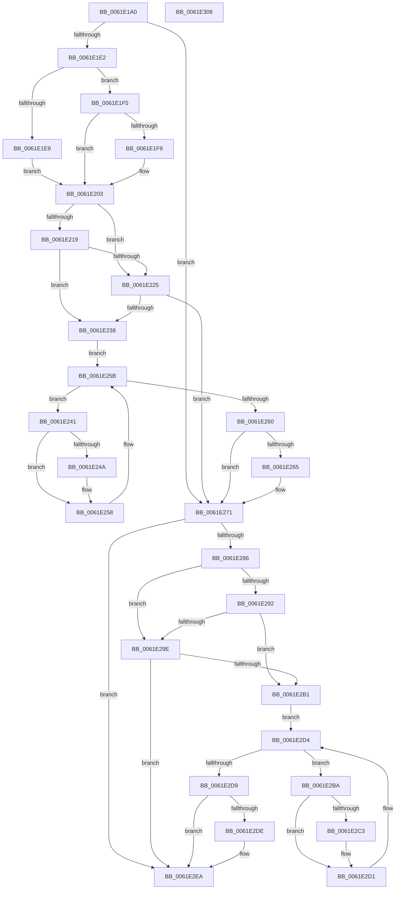

# DifExAllocateCacheAwareRundownProtectionWrapper

- RVA: `0x0061E1A0`–`0x0061E309` (길이 `361` bytes)
- VA: `0x000000014061E1A0`
- 실행 섹션: `.text`
- PDB 이름 있음: `예`; PDB Function 태그: `아니요`
- unwind 정보 RVA: `0x00093E28`
- 디코드: `99`개 명령, `361/361` bytes 표시
- 미해석 바이트: `0` (있으면 어셈블리에 `.byte`로 보존)

> 이 문서는 커널 이미지의 기계어와 PDB 기호를 분석해 생성했습니다. 4번과 5번은 함수 원형과 자료형을 바이너리 사용 방식에서 추정한 C 해석이며 원본 소스 복구 결과는 아닙니다.

## 1. Dependencies

- 직접 호출 지점: **9**; 고유 호출 대상: **6**
- 직접 호출자로 확인된 함수: **0**
- RIP 상대 이미지 참조: **3**

### Outgoing calls
- `0x0061E1D1` → [DifGetAPIThunkContextById](../49/DifGetAPIThunkContextById_function_00495A34.md) (function, `0x00495A34`)
- `0x0061E1F9` → [DifGetReturnAddressForWrappers](../4D/DifGetReturnAddressForWrappers_function_004D3C08.md) (function, `0x004D3C08`)
- `0x0061E22C` → [ExAcquireRundownProtection](../21/ExAcquireRundownProtection_function_00216620.md) (function, `0x00216620`)
- `0x0061E253` → [guard_dispatch_icall](../6B/guard_dispatch_icall_function_006BAAD0.md) (function, `0x006BAAD0`)
- `0x0061E26C` → [ExReleaseRundownProtection](../34/ExReleaseRundownProtection_function_00349E80.md) (function, `0x00349E80`)
- `0x0061E277` → [ExAllocateCacheAwareRundownProtection](../../page/9A/ExAllocateCacheAwareRundownProtection_function_009A5790.md) (function, `0x009A5790`)
- `0x0061E2A5` → [ExAcquireRundownProtection](../21/ExAcquireRundownProtection_function_00216620.md) (function, `0x00216620`)
- `0x0061E2CC` → [guard_dispatch_icall](../6B/guard_dispatch_icall_function_006BAAD0.md) (function, `0x006BAAD0`)
- `0x0061E2E5` → [ExReleaseRundownProtection](../34/ExReleaseRundownProtection_function_00349E80.md) (function, `0x00349E80`)

### Direct callers
- 이 함수 시작 RVA로 연결되는 직접 call은 확인되지 않았습니다. 간접 호출은 완전히 역산할 수 없습니다.

### Static image references
- `0x0061E20B` → RVA `0x00F048B8` (`.data`; read)
- `0x0061E219` → RVA `0x00F04980` (`.data`; read)
- `0x0061E225` → RVA `0x00F03E80` (`.data`; read)

## 2. Other-region calls and transfers

- 다른 실행 섹션으로 향하는 call: **1**
  - `0x0061E277` → [ExAllocateCacheAwareRundownProtection](../../page/9A/ExAllocateCacheAwareRundownProtection_function_009A5790.md) (`.text` → `PAGE`)
- 별도 외부 분기/꼬리 이동을 확인하지 못했습니다.

## 3. Assembly (complete function range)

```asm
0061E1A0  4C 8B DC                        mov r11, rsp
0061E1A3  49 89 5B 08                     mov qword ptr [r11 + 8], rbx
0061E1A7  49 89 6B 10                     mov qword ptr [r11 + 0x10], rbp
0061E1AB  49 89 73 18                     mov qword ptr [r11 + 0x18], rsi
0061E1AF  57                              push rdi
0061E1B0  41 56                           push r14
0061E1B2  41 57                           push r15
0061E1B4  48 83 EC 40                     sub rsp, 0x40
0061E1B8  33 C0                           xor eax, eax
0061E1BA  0F 57 C0                        xorps xmm0, xmm0
0061E1BD  0F 11 44 24 20                  movups xmmword ptr [rsp + 0x20], xmm0
0061E1C2  44 8B F9                        mov r15d, ecx
0061E1C5  49 89 43 D8                     mov qword ptr [r11 - 0x28], rax
0061E1C9  B9 B9 01 00 00                  mov ecx, 0x1b9
0061E1CE  44 8B F2                        mov r14d, edx
0061E1D1  E8 5E 78 E7 FF                  call 0x140495a34
0061E1D6  48 8B F0                        mov rsi, rax
0061E1D9  48 85 C0                        test rax, rax
0061E1DC  0F 84 8F 00 00 00               je 0x14061e271
0061E1E2  8B 40 0C                        mov eax, dword ptr [rax + 0xc]
0061E1E5  A8 18                           test al, 0x18
0061E1E7  74 0C                           je 0x14061e1f5
0061E1E9  48 8B 4C 24 58                  mov rcx, qword ptr [rsp + 0x58]
0061E1EE  48 89 4C 24 20                  mov qword ptr [rsp + 0x20], rcx
0061E1F3  EB 0E                           jmp 0x14061e203
0061E1F5  A8 04                           test al, 4
0061E1F7  74 0A                           je 0x14061e203
0061E1F9  E8 0A 5A EB FF                  call 0x1404d3c08
0061E1FE  48 89 44 24 20                  mov qword ptr [rsp + 0x20], rax
0061E203  40 32 ED                        xor bpl, bpl
0061E206  44 89 7C 24 2C                  mov dword ptr [rsp + 0x2c], r15d
0061E20B  40 38 2D A6 66 8E 00            cmp byte ptr [rip + 0x8e66a6], bpl
0061E212  44 89 74 24 28                  mov dword ptr [rsp + 0x28], r14d
0061E217  75 0C                           jne 0x14061e225
0061E219  F7 05 5D 67 8E 00 00 08 00 00   test dword ptr [rip + 0x8e675d], 0x800
0061E223  74 13                           je 0x14061e238
0061E225  48 8D 0D 54 5C 8E 00            lea rcx, [rip + 0x8e5c54]
0061E22C  E8 EF 83 BF FF                  call 0x140216620
0061E231  40 8A E8                        mov bpl, al
0061E234  84 C0                           test al, al
0061E236  74 39                           je 0x14061e271
0061E238  48 8D 7E 20                     lea rdi, [rsi + 0x20]
0061E23C  48 8B 1F                        mov rbx, qword ptr [rdi]
0061E23F  EB 1A                           jmp 0x14061e25b
0061E241  48 8D 43 F0                     lea rax, [rbx - 0x10]
0061E245  48 85 C0                        test rax, rax
0061E248  74 0E                           je 0x14061e258
0061E24A  48 8B 40 08                     mov rax, qword ptr [rax + 8]
0061E24E  48 8D 4C 24 20                  lea rcx, [rsp + 0x20]
0061E253  E8 78 C8 09 00                  call 0x1406baad0
0061E258  48 8B 1B                        mov rbx, qword ptr [rbx]
0061E25B  48 3B DF                        cmp rbx, rdi
0061E25E  75 E1                           jne 0x14061e241
0061E260  40 84 ED                        test bpl, bpl
0061E263  74 0C                           je 0x14061e271
0061E265  48 8D 0D 14 5C 8E 00            lea rcx, [rip + 0x8e5c14]
0061E26C  E8 0F BC D2 FF                  call 0x140349e80
0061E271  41 8B D6                        mov edx, r14d
0061E274  41 8B CF                        mov ecx, r15d
0061E277  E8 14 75 38 00                  call 0x1409a5790
0061E27C  48 89 44 24 30                  mov qword ptr [rsp + 0x30], rax
0061E281  48 85 F6                        test rsi, rsi
0061E284  74 64                           je 0x14061e2ea
0061E286  40 32 FF                        xor dil, dil
0061E289  40 38 3D 28 66 8E 00            cmp byte ptr [rip + 0x8e6628], dil
0061E290  75 0C                           jne 0x14061e29e
0061E292  F7 05 E4 66 8E 00 00 08 00 00   test dword ptr [rip + 0x8e66e4], 0x800
0061E29C  74 13                           je 0x14061e2b1
0061E29E  48 8D 0D DB 5B 8E 00            lea rcx, [rip + 0x8e5bdb]
0061E2A5  E8 76 83 BF FF                  call 0x140216620
0061E2AA  40 8A F8                        mov dil, al
0061E2AD  84 C0                           test al, al
0061E2AF  74 39                           je 0x14061e2ea
0061E2B1  48 83 C6 30                     add rsi, 0x30
0061E2B5  48 8B 1E                        mov rbx, qword ptr [rsi]
0061E2B8  EB 1A                           jmp 0x14061e2d4
0061E2BA  48 8D 43 F0                     lea rax, [rbx - 0x10]
0061E2BE  48 85 C0                        test rax, rax
0061E2C1  74 0E                           je 0x14061e2d1
0061E2C3  48 8B 40 08                     mov rax, qword ptr [rax + 8]
0061E2C7  48 8D 4C 24 20                  lea rcx, [rsp + 0x20]
0061E2CC  E8 FF C7 09 00                  call 0x1406baad0
0061E2D1  48 8B 1B                        mov rbx, qword ptr [rbx]
0061E2D4  48 3B DE                        cmp rbx, rsi
0061E2D7  75 E1                           jne 0x14061e2ba
0061E2D9  40 84 FF                        test dil, dil
0061E2DC  74 0C                           je 0x14061e2ea
0061E2DE  48 8D 0D 9B 5B 8E 00            lea rcx, [rip + 0x8e5b9b]
0061E2E5  E8 96 BB D2 FF                  call 0x140349e80
0061E2EA  48 8B 44 24 30                  mov rax, qword ptr [rsp + 0x30]
0061E2EF  48 8B 5C 24 60                  mov rbx, qword ptr [rsp + 0x60]
0061E2F4  48 8B 6C 24 68                  mov rbp, qword ptr [rsp + 0x68]
0061E2F9  48 8B 74 24 70                  mov rsi, qword ptr [rsp + 0x70]
0061E2FE  48 83 C4 40                     add rsp, 0x40
0061E302  41 5F                           pop r15
0061E304  41 5E                           pop r14
0061E306  5F                              pop rdi
0061E307  C3                              ret
0061E308  CC                              int3
```

## 4. C-style interpretation (structured pseudocode)

```c
__int64 __fastcall DifExAllocateCacheAwareRundownProtectionWrapper(int a1, int a2)
{
    __int64 result;
    __int64 v_rbp;
    __int64 v_rdi;
    __int64 v_rsi;
    __int64 v_rsp;
    unsigned __int64 v_stack_m28;
    unsigned int v_stack_m2C;
    unsigned int v_stack_m30;
    unsigned __int64 v_stack_m38;
    unsigned __int64 v_stack_p0;
    unsigned __int64 v_stack_p10;
    unsigned __int64 v_stack_p18;
    unsigned __int64 v_stack_p8;

    *(unsigned __int64 *)(v_rsp + 8) = v_rbx;
    *(unsigned __int64 *)(v_rsp + 16) = v_rbp;
    *(unsigned __int64 *)(v_rsp + 24) = v_rsi;
    v_rsp = (v_rsp) - (64);
    result = 0;
    v_stack_m38 = v_xmm0;
    *(unsigned __int64 *)(v_rsp - 40) = 0;
    result = DifGetAPIThunkContextById(441, a2, a3, a4);
    if (result == 0) goto loc_0061E271;
    if ((((unsigned __int8)((unsigned int)(*(unsigned int *)(result + 12)))) & (24)) == 0) goto loc_0061E1F5;
    v_stack_m38 = v_stack_p0;
    goto loc_0061E203;
loc_0061E1F5:
    result = (unsigned int)(*(unsigned int *)(result + 12));
    if ((((unsigned __int8)((unsigned int)(*(unsigned int *)(result + 12)))) & (4)) != 0) {
        result = DifGetReturnAddressForWrappers(v_stack_p0, a2, a3, a4);
        v_stack_m38 = result;
    }
    v_rbp = 0;
    v_stack_m2C = (unsigned int)((unsigned int)(a1));
    v_stack_m30 = (unsigned int)((unsigned int)(a2));
    if ((*(unsigned __int8 *)(v_rip + 9332390)) != 0) goto loc_0061E225;
    if (((*(unsigned int *)(v_rip + 9332573)) & (0x800ULL)) == 0) goto loc_0061E238;
loc_0061E225:
    result = ExAcquireRundownProtection(v_rip + 9329748, a2, a3, a4);
    if ((unsigned __int8)(result) == 0) goto loc_0061E271;
loc_0061E238:
    goto loc_0061E25B;
loc_0061E241:
    result = *(unsigned __int64 *)(result + 32) - 16;
    if (*(unsigned __int64 *)(result + 32) - 16 != 0) {
        result = *(unsigned __int64 *)(*(unsigned __int64 *)(result + 32) - 16 + 8);
        a1 = v_stack_m38;
        result = guard_dispatch_icall(a1, a2, a3, a4);
    }
loc_0061E25B:
    if ((*(unsigned __int64 *)(*(unsigned __int64 *)(result + 32))) != (result + 32)) goto loc_0061E241;
    if ((unsigned __int8)((unsigned __int8)(result)) != 0) {
        a1 = v_rip + 9329684;
        result = ExReleaseRundownProtection(a1, a2, a3, a4);
    }
    result = ExAllocateCacheAwareRundownProtection((unsigned int)((unsigned int)((unsigned int)(a1))), (unsigned int)((unsigned int)((unsigned int)(a2))), a3, a4);
    v_stack_m28 = result;
    if (result == 0) goto loc_0061E2EA;
    v_rdi = 0;
    if ((*(unsigned __int8 *)(v_rip + 9332264)) != 0) goto loc_0061E29E;
    if (((*(unsigned int *)(v_rip + 9332452)) & (0x800ULL)) == 0) goto loc_0061E2B1;
loc_0061E29E:
    result = ExAcquireRundownProtection(v_rip + 9329627, (unsigned int)((unsigned int)((unsigned int)(a2))), a3, a4);
    if ((unsigned __int8)(result) == 0) goto loc_0061E2EA;
loc_0061E2B1:
    v_rsi = (result) + (48);
    goto loc_0061E2D4;
loc_0061E2BA:
    result = *(unsigned __int64 *)(v_rsi) - 16;
    if (*(unsigned __int64 *)(v_rsi) - 16 != 0) {
        result = *(unsigned __int64 *)(*(unsigned __int64 *)(v_rsi) - 16 + 8);
        a1 = v_stack_m38;
        result = guard_dispatch_icall(a1, (unsigned int)((unsigned int)((unsigned int)(a2))), a3, a4);
    }
loc_0061E2D4:
    if ((*(unsigned __int64 *)(*(unsigned __int64 *)(v_rsi))) != v_rsi) goto loc_0061E2BA;
    if ((unsigned __int8)((unsigned __int8)(result)) != 0) {
        a1 = v_rip + 9329563;
        result = ExReleaseRundownProtection(a1, (unsigned int)((unsigned int)((unsigned int)(a2))), a3, a4);
    }
    v_rsp = (v_rsp) + (64);
    return v_stack_m28;
}
```

## 5. (Beta) C Style

```c
int64_t DifExAllocateCacheAwareRundownProtectionWrapper(int32_t Arg1, int32_t Arg2)
{
    int64_t result;
    int64_t local_rbp;
    int64_t local_rdi;
    int64_t local_rsi;
    int64_t local_rsp;
    uint64_t v_stack_m28;
    uint32_t v_stack_m2C;
    uint32_t v_stack_m30;
    uint64_t v_stack_m38;
    uint64_t v_stack_p0;
    uint64_t v_stack_p10;
    uint64_t v_stack_p18;
    uint64_t v_stack_p8;

    *(uint64_t *)(local_rsp + 0x8) = local_rbx;
    *(uint64_t *)(local_rsp + 0x10) = local_rbp;
    *(uint64_t *)(local_rsp + 0x18) = local_rsi;
    local_rsp = (local_rsp) - (64);
    result = 0;
    v_stack_m38 = v_xmm0;
    *(uint64_t *)(local_rsp - 0x28) = 0;
    result = DifGetAPIThunkContextById(441, Arg2, a3, a4);
    if (result == 0) goto loc_0061E271;
    if ((((uint8_t)((uint32_t)(*(uint32_t *)(result + 0xC)))) & (24)) == 0) goto loc_0061E1F5;
    v_stack_m38 = v_stack_p0;
    goto loc_0061E203;
loc_0061E1F5:
    result = (uint32_t)(*(uint32_t *)(result + 0xC));
    if ((((uint8_t)((uint32_t)(*(uint32_t *)(result + 0xC)))) & (4)) != 0) {
        result = DifGetReturnAddressForWrappers(v_stack_p0, Arg2, a3, a4);
        v_stack_m38 = result;
    }
    local_rbp = 0;
    v_stack_m2C = (uint32_t)((uint32_t)(Arg1));
    v_stack_m30 = (uint32_t)((uint32_t)(Arg2));
    if ((*(uint8_t *)(v_rip + 0x8E66A6)) != 0) goto loc_0061E225;
    if (((*(uint32_t *)(v_rip + 0x8E675D)) & (0x800ULL)) == 0) goto loc_0061E238;
loc_0061E225:
    result = ExAcquireRundownProtection(v_rip + 9329748, Arg2, a3, a4);
    if ((uint8_t)(result) == 0) goto loc_0061E271;
loc_0061E238:
    goto loc_0061E25B;
loc_0061E241:
    result = *(uint64_t *)(result + 0x20) - 16;
    if (*(uint64_t *)(result + 0x20) - 16 != 0) {
        result = *(uint64_t *)(*(uint64_t *)(result + 0x20) - 0x10 + 0x8);
        Arg1 = v_stack_m38;
        result = guard_dispatch_icall(Arg1, Arg2, a3, a4);
    }
loc_0061E25B:
    if ((*(uint64_t *)(*(uint64_t *)(result + 0x20))) != (result + 32)) goto loc_0061E241;
    if ((uint8_t)((uint8_t)(result)) != 0) {
        Arg1 = v_rip + 9329684;
        result = ExReleaseRundownProtection(Arg1, Arg2, a3, a4);
    }
    result = ExAllocateCacheAwareRundownProtection((uint32_t)((uint32_t)((uint32_t)(Arg1))), (uint32_t)((uint32_t)((uint32_t)(Arg2))), a3, a4);
    v_stack_m28 = result;
    if (result == 0) goto loc_0061E2EA;
    local_rdi = 0;
    if ((*(uint8_t *)(v_rip + 0x8E6628)) != 0) goto loc_0061E29E;
    if (((*(uint32_t *)(v_rip + 0x8E66E4)) & (0x800ULL)) == 0) goto loc_0061E2B1;
loc_0061E29E:
    result = ExAcquireRundownProtection(v_rip + 9329627, (uint32_t)((uint32_t)((uint32_t)(Arg2))), a3, a4);
    if ((uint8_t)(result) == 0) goto loc_0061E2EA;
loc_0061E2B1:
    local_rsi = (result) + (48);
    goto loc_0061E2D4;
loc_0061E2BA:
    result = *(uint64_t *)(local_rsi) - 16;
    if (*(uint64_t *)(local_rsi) - 16 != 0) {
        result = *(uint64_t *)(*(uint64_t *)(local_rsi) - 0x10 + 0x8);
        Arg1 = v_stack_m38;
        result = guard_dispatch_icall(Arg1, (uint32_t)((uint32_t)((uint32_t)(Arg2))), a3, a4);
    }
loc_0061E2D4:
    if ((*(uint64_t *)(*(uint64_t *)(local_rsi))) != local_rsi) goto loc_0061E2BA;
    if ((uint8_t)((uint8_t)(result)) != 0) {
        Arg1 = v_rip + 9329563;
        result = ExReleaseRundownProtection(Arg1, (uint32_t)((uint32_t)((uint32_t)(Arg2))), a3, a4);
    }
    local_rsp = (local_rsp) + (64);
    return v_stack_m28;
}
```

## 6. Execution-region graph

[열기: 2D/3D 그래프와 함수 탐색 컨트롤 패널](../../../control-panel.html?section=text&rva=0x0061E1A0&view=graph)

- 2D 그래프는 위에서 아래로 흐르고, 3D 그래프는 빈 공간을 드래그해 회전합니다. Shift+드래그는 이동, 휠은 확대·축소, 함수 노드 선택은 대상 보고서 이동입니다.

### Static fallback


