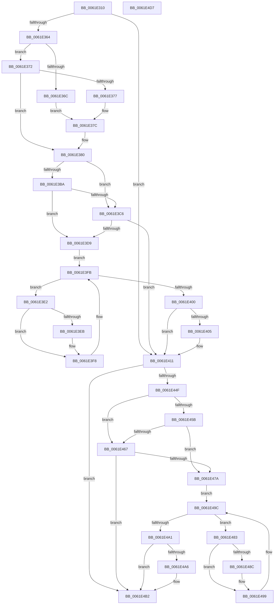

# DifExAllocatePool2Wrapper

- RVA: `0x0061E310`–`0x0061E4D8` (길이 `456` bytes)
- VA: `0x000000014061E310`
- 실행 섹션: `.text`
- PDB 이름 있음: `예`; PDB Function 태그: `아니요`
- unwind 정보 RVA: `0x000D2CDC`
- 디코드: `128`개 명령, `456/456` bytes 표시
- 미해석 바이트: `0` (있으면 어셈블리에 `.byte`로 보존)

> 이 문서는 커널 이미지의 기계어와 PDB 기호를 분석해 생성했습니다. 4번과 5번은 함수 원형과 자료형을 바이너리 사용 방식에서 추정한 C 해석이며 원본 소스 복구 결과는 아닙니다.

## 1. Dependencies

- 직접 호출 지점: **10**; 고유 호출 대상: **6**
- 직접 호출자로 확인된 함수: **0**
- RIP 상대 이미지 참조: **3**

### Outgoing calls
- `0x0061E349` → [memset](../6C/memset_function_006C6C40.md) (function, `0x006C6C40`)
- `0x0061E353` → [DifGetAPIThunkContextById](../49/DifGetAPIThunkContextById_function_00495A34.md) (function, `0x00495A34`)
- `0x0061E377` → [DifGetReturnAddressForWrappers](../4D/DifGetReturnAddressForWrappers_function_004D3C08.md) (function, `0x004D3C08`)
- `0x0061E3CD` → [ExAcquireRundownProtection](../21/ExAcquireRundownProtection_function_00216620.md) (function, `0x00216620`)
- `0x0061E3F3` → [guard_dispatch_icall](../6B/guard_dispatch_icall_function_006BAAD0.md) (function, `0x006BAAD0`)
- `0x0061E40C` → [ExReleaseRundownProtection](../34/ExReleaseRundownProtection_function_00349E80.md) (function, `0x00349E80`)
- `0x0061E441` → [guard_dispatch_icall](../6B/guard_dispatch_icall_function_006BAAD0.md) (function, `0x006BAAD0`)
- `0x0061E46E` → [ExAcquireRundownProtection](../21/ExAcquireRundownProtection_function_00216620.md) (function, `0x00216620`)
- `0x0061E494` → [guard_dispatch_icall](../6B/guard_dispatch_icall_function_006BAAD0.md) (function, `0x006BAAD0`)
- `0x0061E4AD` → [ExReleaseRundownProtection](../34/ExReleaseRundownProtection_function_00349E80.md) (function, `0x00349E80`)

### Direct callers
- 이 함수 시작 RVA로 연결되는 직접 call은 확인되지 않았습니다. 간접 호출은 완전히 역산할 수 없습니다.

### Static image references
- `0x0061E386` → RVA `0x00F048B8` (`.data`; read)
- `0x0061E3BA` → RVA `0x00F04980` (`.data`; read)
- `0x0061E3C6` → RVA `0x00F03E80` (`.data`; read)

## 2. Other-region calls and transfers

- 다른 실행 섹션으로 향하는 call: **0**
- 별도 외부 분기/꼬리 이동을 확인하지 못했습니다.

## 3. Assembly (complete function range)

```asm
0061E310  48 8B C4                        mov rax, rsp
0061E313  48 89 58 10                     mov qword ptr [rax + 0x10], rbx
0061E317  48 89 70 18                     mov qword ptr [rax + 0x18], rsi
0061E31B  48 89 78 20                     mov qword ptr [rax + 0x20], rdi
0061E31F  89 48 08                        mov dword ptr [rax + 8], ecx
0061E322  55                              push rbp
0061E323  41 54                           push r12
0061E325  41 55                           push r13
0061E327  41 56                           push r14
0061E329  41 57                           push r15
0061E32B  48 8D 68 C9                     lea rbp, [rax - 0x37]
0061E32F  48 81 EC A0 00 00 00            sub rsp, 0xa0
0061E336  4C 8B EA                        mov r13, rdx
0061E339  48 8D 4D BF                     lea rcx, [rbp - 0x41]
0061E33D  33 D2                           xor edx, edx
0061E33F  4D 8B E0                        mov r12, r8
0061E342  45 8B F9                        mov r15d, r9d
0061E345  44 8D 42 48                     lea r8d, [rdx + 0x48]
0061E349  E8 F2 88 0A 00                  call 0x1406c6c40
0061E34E  B9 A3 01 00 00                  mov ecx, 0x1a3
0061E353  E8 DC 76 E7 FF                  call 0x140495a34
0061E358  4C 8B F0                        mov r14, rax
0061E35B  48 85 C0                        test rax, rax
0061E35E  0F 84 AD 00 00 00               je 0x14061e411
0061E364  8B 48 0C                        mov ecx, dword ptr [rax + 0xc]
0061E367  F6 C1 18                        test cl, 0x18
0061E36A  74 06                           je 0x14061e372
0061E36C  48 8B 45 37                     mov rax, qword ptr [rbp + 0x37]
0061E370  EB 0A                           jmp 0x14061e37c
0061E372  F6 C1 04                        test cl, 4
0061E375  74 09                           je 0x14061e380
0061E377  E8 8C 58 EB FF                  call 0x1404d3c08
0061E37C  48 89 45 BF                     mov qword ptr [rbp - 0x41], rax
0061E380  8B 45 3F                        mov eax, dword ptr [rbp + 0x3f]
0061E383  40 32 F6                        xor sil, sil
0061E386  40 38 35 2B 65 8E 00            cmp byte ptr [rip + 0x8e652b], sil
0061E38D  89 45 F7                        mov dword ptr [rbp - 9], eax
0061E390  8B 45 5F                        mov eax, dword ptr [rbp + 0x5f]
0061E393  89 45 DF                        mov dword ptr [rbp - 0x21], eax
0061E396  48 8B 45 67                     mov rax, qword ptr [rbp + 0x67]
0061E39A  48 89 45 D7                     mov qword ptr [rbp - 0x29], rax
0061E39E  8B 45 6F                        mov eax, dword ptr [rbp + 0x6f]
0061E3A1  89 45 CF                        mov dword ptr [rbp - 0x31], eax
0061E3A4  48 8B 45 77                     mov rax, qword ptr [rbp + 0x77]
0061E3A8  48 89 45 C7                     mov qword ptr [rbp - 0x39], rax
0061E3AC  4C 89 6D EF                     mov qword ptr [rbp - 0x11], r13
0061E3B0  4C 89 65 E7                     mov qword ptr [rbp - 0x19], r12
0061E3B4  44 89 7D E3                     mov dword ptr [rbp - 0x1d], r15d
0061E3B8  75 0C                           jne 0x14061e3c6
0061E3BA  F7 05 BC 65 8E 00 00 08 00 00   test dword ptr [rip + 0x8e65bc], 0x800
0061E3C4  74 13                           je 0x14061e3d9
0061E3C6  48 8D 0D B3 5A 8E 00            lea rcx, [rip + 0x8e5ab3]
0061E3CD  E8 4E 82 BF FF                  call 0x140216620
0061E3D2  40 8A F0                        mov sil, al
0061E3D5  84 C0                           test al, al
0061E3D7  74 38                           je 0x14061e411
0061E3D9  49 8D 7E 20                     lea rdi, [r14 + 0x20]
0061E3DD  48 8B 1F                        mov rbx, qword ptr [rdi]
0061E3E0  EB 19                           jmp 0x14061e3fb
0061E3E2  48 8D 43 F0                     lea rax, [rbx - 0x10]
0061E3E6  48 85 C0                        test rax, rax
0061E3E9  74 0D                           je 0x14061e3f8
0061E3EB  48 8B 40 08                     mov rax, qword ptr [rax + 8]
0061E3EF  48 8D 4D BF                     lea rcx, [rbp - 0x41]
0061E3F3  E8 D8 C6 09 00                  call 0x1406baad0
0061E3F8  48 8B 1B                        mov rbx, qword ptr [rbx]
0061E3FB  48 3B DF                        cmp rbx, rdi
0061E3FE  75 E2                           jne 0x14061e3e2
0061E400  40 84 F6                        test sil, sil
0061E403  74 0C                           je 0x14061e411
0061E405  48 8D 0D 74 5A 8E 00            lea rcx, [rip + 0x8e5a74]
0061E40C  E8 6F BA D2 FF                  call 0x140349e80
0061E411  48 8B 45 77                     mov rax, qword ptr [rbp + 0x77]
0061E415  45 8B CF                        mov r9d, r15d
0061E418  8B 4D 3F                        mov ecx, dword ptr [rbp + 0x3f]
0061E41B  4D 8B C4                        mov r8, r12
0061E41E  48 89 44 24 38                  mov qword ptr [rsp + 0x38], rax
0061E423  49 8B D5                        mov rdx, r13
0061E426  8B 45 6F                        mov eax, dword ptr [rbp + 0x6f]
0061E429  89 44 24 30                     mov dword ptr [rsp + 0x30], eax
0061E42D  48 8B 45 67                     mov rax, qword ptr [rbp + 0x67]
0061E431  48 89 44 24 28                  mov qword ptr [rsp + 0x28], rax
0061E436  8B 45 5F                        mov eax, dword ptr [rbp + 0x5f]
0061E439  89 44 24 20                     mov dword ptr [rsp + 0x20], eax
0061E43D  48 8B 45 7F                     mov rax, qword ptr [rbp + 0x7f]
0061E441  E8 8A C6 09 00                  call 0x1406baad0
0061E446  48 89 45 FF                     mov qword ptr [rbp - 1], rax
0061E44A  4D 85 F6                        test r14, r14
0061E44D  74 63                           je 0x14061e4b2
0061E44F  40 32 FF                        xor dil, dil
0061E452  40 38 3D 5F 64 8E 00            cmp byte ptr [rip + 0x8e645f], dil
0061E459  75 0C                           jne 0x14061e467
0061E45B  F7 05 1B 65 8E 00 00 08 00 00   test dword ptr [rip + 0x8e651b], 0x800
0061E465  74 13                           je 0x14061e47a
0061E467  48 8D 0D 12 5A 8E 00            lea rcx, [rip + 0x8e5a12]
0061E46E  E8 AD 81 BF FF                  call 0x140216620
0061E473  40 8A F8                        mov dil, al
0061E476  84 C0                           test al, al
0061E478  74 38                           je 0x14061e4b2
0061E47A  49 8D 76 30                     lea rsi, [r14 + 0x30]
0061E47E  48 8B 1E                        mov rbx, qword ptr [rsi]
0061E481  EB 19                           jmp 0x14061e49c
0061E483  48 8D 43 F0                     lea rax, [rbx - 0x10]
0061E487  48 85 C0                        test rax, rax
0061E48A  74 0D                           je 0x14061e499
0061E48C  48 8B 40 08                     mov rax, qword ptr [rax + 8]
0061E490  48 8D 4D BF                     lea rcx, [rbp - 0x41]
0061E494  E8 37 C6 09 00                  call 0x1406baad0
0061E499  48 8B 1B                        mov rbx, qword ptr [rbx]
0061E49C  48 3B DE                        cmp rbx, rsi
0061E49F  75 E2                           jne 0x14061e483
0061E4A1  40 84 FF                        test dil, dil
0061E4A4  74 0C                           je 0x14061e4b2
0061E4A6  48 8D 0D D3 59 8E 00            lea rcx, [rip + 0x8e59d3]
0061E4AD  E8 CE B9 D2 FF                  call 0x140349e80
0061E4B2  48 8B 45 FF                     mov rax, qword ptr [rbp - 1]
0061E4B6  4C 8D 9C 24 A0 00 00 00         lea r11, [rsp + 0xa0]
0061E4BE  49 8B 5B 38                     mov rbx, qword ptr [r11 + 0x38]
0061E4C2  49 8B 73 40                     mov rsi, qword ptr [r11 + 0x40]
0061E4C6  49 8B 7B 48                     mov rdi, qword ptr [r11 + 0x48]
0061E4CA  49 8B E3                        mov rsp, r11
0061E4CD  41 5F                           pop r15
0061E4CF  41 5E                           pop r14
0061E4D1  41 5D                           pop r13
0061E4D3  41 5C                           pop r12
0061E4D5  5D                              pop rbp
0061E4D6  C3                              ret
0061E4D7  CC                              int3
```

## 4. C-style interpretation (structured pseudocode)

```c
__int64 __fastcall DifExAllocatePool2Wrapper(int a1, __int64 a2, __int64 a3, int a4)
{
    __int64 result;
    __int64 v_rdi;
    __int64 v_rsi;
    __int64 v_rsp;
    unsigned __int64 v_stack_m28;
    unsigned __int64 v_stack_m90;
    unsigned int v_stack_m98;
    unsigned __int64 v_stack_mA0;
    unsigned int v_stack_mA8;

    *(unsigned __int64 *)(v_rsp + 16) = v_rbx;
    *(unsigned __int64 *)(v_rsp + 24) = v_rsi;
    *(unsigned __int64 *)(v_rsp + 32) = v_rdi;
    *(unsigned int *)(v_rsp + 8) = a1;
    v_rsp = (v_rsp) - (160);
    a2 = 0;
    result = memset(v_rsp - 55 - 65, a2, a2 + 72, a4);
    result = DifGetAPIThunkContextById(419, a2, a2 + 72, a4);
    if (result == 0) goto loc_0061E411;
    if ((((unsigned __int8)((unsigned int)(*(unsigned int *)(result + 12)))) & (24)) == 0) goto loc_0061E372;
    goto loc_0061E37C;
loc_0061E372:
    if ((((unsigned __int8)((unsigned int)(*(unsigned int *)(result + 12)))) & (4)) == 0) goto loc_0061E380;
    result = DifGetReturnAddressForWrappers((unsigned int)(*(unsigned int *)(result + 12)), a2, a2 + 72, a4);
loc_0061E37C:
    *(unsigned __int64 *)(v_rsp - 55 - 65) = result;
loc_0061E380:
    v_rsi = 0;
    *(unsigned int *)(v_rsp - 55 - 9) = (unsigned int)((unsigned int)(*(unsigned int *)(v_rsp - 55 + 63)));
    *(unsigned int *)(v_rsp - 55 - 33) = (unsigned int)((unsigned int)(*(unsigned int *)(v_rsp - 55 + 95)));
    *(unsigned __int64 *)(v_rsp - 55 - 41) = *(unsigned __int64 *)(v_rsp - 55 + 103);
    *(unsigned int *)(v_rsp - 55 - 49) = (unsigned int)((unsigned int)(*(unsigned int *)(v_rsp - 55 + 111)));
    *(unsigned __int64 *)(v_rsp - 55 - 57) = *(unsigned __int64 *)(v_rsp - 55 + 119);
    *(unsigned __int64 *)(v_rsp - 55 - 17) = 0;
    *(unsigned __int64 *)(v_rsp - 55 - 25) = a3;
    *(unsigned int *)(v_rsp - 55 - 29) = (unsigned int)((unsigned int)(a4));
    if ((*(unsigned __int8 *)(v_rip + 9332011)) != 0) goto loc_0061E3C6;
    if (((*(unsigned int *)(v_rip + 9332156)) & (0x800ULL)) == 0) goto loc_0061E3D9;
loc_0061E3C6:
    result = ExAcquireRundownProtection(v_rip + 9329331, a2, a2 + 72, a4);
    if ((unsigned __int8)(result) == 0) goto loc_0061E411;
loc_0061E3D9:
    goto loc_0061E3FB;
loc_0061E3E2:
    result = *(unsigned __int64 *)(result + 32) - 16;
    if (*(unsigned __int64 *)(result + 32) - 16 != 0) {
        result = *(unsigned __int64 *)(*(unsigned __int64 *)(result + 32) - 16 + 8);
        a1 = v_rsp - 55 - 65;
        result = guard_dispatch_icall(a1, a2, a2 + 72, a4);
    }
loc_0061E3FB:
    if ((*(unsigned __int64 *)(*(unsigned __int64 *)(result + 32))) != (result + 32)) goto loc_0061E3E2;
    if ((unsigned __int8)((unsigned __int8)(result)) != 0) {
        a1 = v_rip + 9329268;
        result = ExReleaseRundownProtection(a1, a2, a2 + 72, a4);
    }
    v_stack_m90 = *(unsigned __int64 *)(v_rsp - 55 + 119);
    v_stack_m98 = (unsigned int)((unsigned int)(*(unsigned int *)(v_rsp - 55 + 111)));
    v_stack_mA0 = *(unsigned __int64 *)(v_rsp - 55 + 103);
    v_stack_mA8 = (unsigned int)((unsigned int)(*(unsigned int *)(v_rsp - 55 + 95)));
    result = guard_dispatch_icall((unsigned int)(*(unsigned int *)(v_rsp - 55 + 63)), 0, a3, (unsigned int)((unsigned int)((unsigned int)(a4))));
    *(unsigned __int64 *)(v_rsp - 55 - 1) = result;
    if (result == 0) goto loc_0061E4B2;
    v_rdi = 0;
    if ((*(unsigned __int8 *)(v_rip + 9331807)) != 0) goto loc_0061E467;
    if (((*(unsigned int *)(v_rip + 9331995)) & (0x800ULL)) == 0) goto loc_0061E47A;
loc_0061E467:
    result = ExAcquireRundownProtection(v_rip + 9329170, 0, a3, (unsigned int)((unsigned int)((unsigned int)(a4))));
    if ((unsigned __int8)(result) == 0) goto loc_0061E4B2;
loc_0061E47A:
    goto loc_0061E49C;
loc_0061E483:
    result = *(unsigned __int64 *)(result + 48) - 16;
    if (*(unsigned __int64 *)(result + 48) - 16 != 0) {
        result = *(unsigned __int64 *)(*(unsigned __int64 *)(result + 48) - 16 + 8);
        a1 = v_rsp - 55 - 65;
        result = guard_dispatch_icall(a1, 0, a3, (unsigned int)((unsigned int)((unsigned int)(a4))));
    }
loc_0061E49C:
    if ((*(unsigned __int64 *)(*(unsigned __int64 *)(result + 48))) != (result + 48)) goto loc_0061E483;
    if ((unsigned __int8)((unsigned __int8)(result)) != 0) {
        a1 = v_rip + 9329107;
        result = ExReleaseRundownProtection(a1, 0, a3, (unsigned int)((unsigned int)((unsigned int)(a4))));
    }
    return *(unsigned __int64 *)(v_rsp - 55 - 1);
}
```

## 5. (Beta) C Style

```c
int64_t DifExAllocatePool2Wrapper(int32_t Arg1, int64_t Arg2, int64_t Arg3, int32_t Arg4)
{
    int64_t result;
    int64_t local_rdi;
    int64_t local_rsi;
    int64_t local_rsp;
    uint64_t v_stack_m28;
    uint64_t v_stack_m90;
    uint32_t v_stack_m98;
    uint64_t v_stack_mA0;
    uint32_t v_stack_mA8;

    *(uint64_t *)(local_rsp + 0x10) = local_rbx;
    *(uint64_t *)(local_rsp + 0x18) = local_rsi;
    *(uint64_t *)(local_rsp + 0x20) = local_rdi;
    *(uint32_t *)(local_rsp + 0x8) = Arg1;
    local_rsp = (local_rsp) - (160);
    Arg2 = 0;
    result = memset(local_rsp - 55 - 65, Arg2, Arg2 + 72, Arg4);
    result = DifGetAPIThunkContextById(419, Arg2, Arg2 + 72, Arg4);
    if (result == 0) goto loc_0061E411;
    if ((((uint8_t)((uint32_t)(*(uint32_t *)(result + 0xC)))) & (24)) == 0) goto loc_0061E372;
    goto loc_0061E37C;
loc_0061E372:
    if ((((uint8_t)((uint32_t)(*(uint32_t *)(result + 0xC)))) & (4)) == 0) goto loc_0061E380;
    result = DifGetReturnAddressForWrappers((uint32_t)(*(uint32_t *)(result + 0xC)), Arg2, Arg2 + 72, Arg4);
loc_0061E37C:
    *(uint64_t *)(local_rsp - 0x37 - 0x41) = result;
loc_0061E380:
    local_rsi = 0;
    *(uint32_t *)(local_rsp - 0x37 - 0x9) = (uint32_t)((uint32_t)(*(uint32_t *)(local_rsp - 0x37 + 0x3F)));
    *(uint32_t *)(local_rsp - 0x37 - 0x21) = (uint32_t)((uint32_t)(*(uint32_t *)(local_rsp - 0x37 + 0x5F)));
    *(uint64_t *)(local_rsp - 0x37 - 0x29) = *(uint64_t *)(local_rsp - 0x37 + 0x67);
    *(uint32_t *)(local_rsp - 0x37 - 0x31) = (uint32_t)((uint32_t)(*(uint32_t *)(local_rsp - 0x37 + 0x6F)));
    *(uint64_t *)(local_rsp - 0x37 - 0x39) = *(uint64_t *)(local_rsp - 0x37 + 0x77);
    *(uint64_t *)(local_rsp - 0x37 - 0x11) = 0;
    *(uint64_t *)(local_rsp - 0x37 - 0x19) = Arg3;
    *(uint32_t *)(local_rsp - 0x37 - 0x1D) = (uint32_t)((uint32_t)(Arg4));
    if ((*(uint8_t *)(v_rip + 0x8E652B)) != 0) goto loc_0061E3C6;
    if (((*(uint32_t *)(v_rip + 0x8E65BC)) & (0x800ULL)) == 0) goto loc_0061E3D9;
loc_0061E3C6:
    result = ExAcquireRundownProtection(v_rip + 9329331, Arg2, Arg2 + 72, Arg4);
    if ((uint8_t)(result) == 0) goto loc_0061E411;
loc_0061E3D9:
    goto loc_0061E3FB;
loc_0061E3E2:
    result = *(uint64_t *)(result + 0x20) - 16;
    if (*(uint64_t *)(result + 0x20) - 16 != 0) {
        result = *(uint64_t *)(*(uint64_t *)(result + 0x20) - 0x10 + 0x8);
        Arg1 = local_rsp - 55 - 65;
        result = guard_dispatch_icall(Arg1, Arg2, Arg2 + 72, Arg4);
    }
loc_0061E3FB:
    if ((*(uint64_t *)(*(uint64_t *)(result + 0x20))) != (result + 32)) goto loc_0061E3E2;
    if ((uint8_t)((uint8_t)(result)) != 0) {
        Arg1 = v_rip + 9329268;
        result = ExReleaseRundownProtection(Arg1, Arg2, Arg2 + 72, Arg4);
    }
    v_stack_m90 = *(uint64_t *)(local_rsp - 0x37 + 0x77);
    v_stack_m98 = (uint32_t)((uint32_t)(*(uint32_t *)(local_rsp - 0x37 + 0x6F)));
    v_stack_mA0 = *(uint64_t *)(local_rsp - 0x37 + 0x67);
    v_stack_mA8 = (uint32_t)((uint32_t)(*(uint32_t *)(local_rsp - 0x37 + 0x5F)));
    result = guard_dispatch_icall((uint32_t)(*(uint32_t *)(local_rsp - 0x37 + 0x3F)), 0, Arg3, (uint32_t)((uint32_t)((uint32_t)(Arg4))));
    *(uint64_t *)(local_rsp - 0x37 - 0x1) = result;
    if (result == 0) goto loc_0061E4B2;
    local_rdi = 0;
    if ((*(uint8_t *)(v_rip + 0x8E645F)) != 0) goto loc_0061E467;
    if (((*(uint32_t *)(v_rip + 0x8E651B)) & (0x800ULL)) == 0) goto loc_0061E47A;
loc_0061E467:
    result = ExAcquireRundownProtection(v_rip + 9329170, 0, Arg3, (uint32_t)((uint32_t)((uint32_t)(Arg4))));
    if ((uint8_t)(result) == 0) goto loc_0061E4B2;
loc_0061E47A:
    goto loc_0061E49C;
loc_0061E483:
    result = *(uint64_t *)(result + 0x30) - 16;
    if (*(uint64_t *)(result + 0x30) - 16 != 0) {
        result = *(uint64_t *)(*(uint64_t *)(result + 0x30) - 0x10 + 0x8);
        Arg1 = local_rsp - 55 - 65;
        result = guard_dispatch_icall(Arg1, 0, Arg3, (uint32_t)((uint32_t)((uint32_t)(Arg4))));
    }
loc_0061E49C:
    if ((*(uint64_t *)(*(uint64_t *)(result + 0x30))) != (result + 48)) goto loc_0061E483;
    if ((uint8_t)((uint8_t)(result)) != 0) {
        Arg1 = v_rip + 9329107;
        result = ExReleaseRundownProtection(Arg1, 0, Arg3, (uint32_t)((uint32_t)((uint32_t)(Arg4))));
    }
    return *(uint64_t *)(local_rsp - 0x37 - 0x1);
}
```

## 6. Execution-region graph

[열기: 2D/3D 그래프와 함수 탐색 컨트롤 패널](../../../control-panel.html?section=text&rva=0x0061E310&view=graph)

- 2D 그래프는 위에서 아래로 흐르고, 3D 그래프는 빈 공간을 드래그해 회전합니다. Shift+드래그는 이동, 휠은 확대·축소, 함수 노드 선택은 대상 보고서 이동입니다.

### Static fallback


