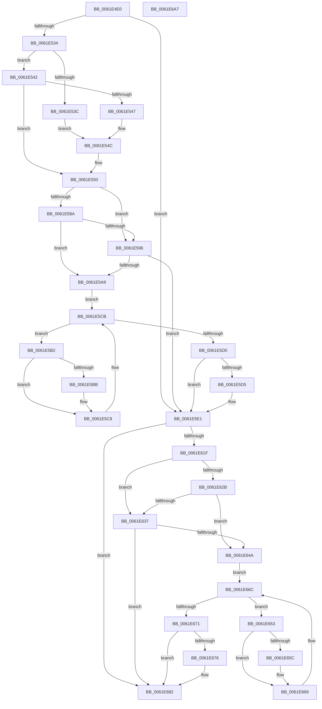

# DifExAllocatePool3Wrapper

- RVA: `0x0061E4E0`–`0x0061E6A8` (길이 `456` bytes)
- VA: `0x000000014061E4E0`
- 실행 섹션: `.text`
- PDB 이름 있음: `예`; PDB Function 태그: `아니요`
- unwind 정보 RVA: `0x000D2CDC`
- 디코드: `128`개 명령, `456/456` bytes 표시
- 미해석 바이트: `0` (있으면 어셈블리에 `.byte`로 보존)

> 이 문서는 커널 이미지의 기계어와 PDB 기호를 분석해 생성했습니다. 4번과 5번은 함수 원형과 자료형을 바이너리 사용 방식에서 추정한 C 해석이며 원본 소스 복구 결과는 아닙니다.

## 1. Dependencies

- 직접 호출 지점: **10**; 고유 호출 대상: **6**
- 직접 호출자로 확인된 함수: **0**
- RIP 상대 이미지 참조: **3**

### Outgoing calls
- `0x0061E519` → [memset](../6C/memset_function_006C6C40.md) (function, `0x006C6C40`)
- `0x0061E523` → [DifGetAPIThunkContextById](../49/DifGetAPIThunkContextById_function_00495A34.md) (function, `0x00495A34`)
- `0x0061E547` → [DifGetReturnAddressForWrappers](../4D/DifGetReturnAddressForWrappers_function_004D3C08.md) (function, `0x004D3C08`)
- `0x0061E59D` → [ExAcquireRundownProtection](../21/ExAcquireRundownProtection_function_00216620.md) (function, `0x00216620`)
- `0x0061E5C3` → [guard_dispatch_icall](../6B/guard_dispatch_icall_function_006BAAD0.md) (function, `0x006BAAD0`)
- `0x0061E5DC` → [ExReleaseRundownProtection](../34/ExReleaseRundownProtection_function_00349E80.md) (function, `0x00349E80`)
- `0x0061E611` → [guard_dispatch_icall](../6B/guard_dispatch_icall_function_006BAAD0.md) (function, `0x006BAAD0`)
- `0x0061E63E` → [ExAcquireRundownProtection](../21/ExAcquireRundownProtection_function_00216620.md) (function, `0x00216620`)
- `0x0061E664` → [guard_dispatch_icall](../6B/guard_dispatch_icall_function_006BAAD0.md) (function, `0x006BAAD0`)
- `0x0061E67D` → [ExReleaseRundownProtection](../34/ExReleaseRundownProtection_function_00349E80.md) (function, `0x00349E80`)

### Direct callers
- 이 함수 시작 RVA로 연결되는 직접 call은 확인되지 않았습니다. 간접 호출은 완전히 역산할 수 없습니다.

### Static image references
- `0x0061E556` → RVA `0x00F048B8` (`.data`; read)
- `0x0061E58A` → RVA `0x00F04980` (`.data`; read)
- `0x0061E596` → RVA `0x00F03E80` (`.data`; read)

## 2. Other-region calls and transfers

- 다른 실행 섹션으로 향하는 call: **0**
- 별도 외부 분기/꼬리 이동을 확인하지 못했습니다.

## 3. Assembly (complete function range)

```asm
0061E4E0  48 8B C4                        mov rax, rsp
0061E4E3  48 89 58 10                     mov qword ptr [rax + 0x10], rbx
0061E4E7  48 89 70 18                     mov qword ptr [rax + 0x18], rsi
0061E4EB  48 89 78 20                     mov qword ptr [rax + 0x20], rdi
0061E4EF  89 48 08                        mov dword ptr [rax + 8], ecx
0061E4F2  55                              push rbp
0061E4F3  41 54                           push r12
0061E4F5  41 55                           push r13
0061E4F7  41 56                           push r14
0061E4F9  41 57                           push r15
0061E4FB  48 8D 68 C9                     lea rbp, [rax - 0x37]
0061E4FF  48 81 EC A0 00 00 00            sub rsp, 0xa0
0061E506  4C 8B EA                        mov r13, rdx
0061E509  48 8D 4D BF                     lea rcx, [rbp - 0x41]
0061E50D  33 D2                           xor edx, edx
0061E50F  4D 8B E0                        mov r12, r8
0061E512  45 8B F9                        mov r15d, r9d
0061E515  44 8D 42 48                     lea r8d, [rdx + 0x48]
0061E519  E8 22 87 0A 00                  call 0x1406c6c40
0061E51E  B9 A2 01 00 00                  mov ecx, 0x1a2
0061E523  E8 0C 75 E7 FF                  call 0x140495a34
0061E528  4C 8B F0                        mov r14, rax
0061E52B  48 85 C0                        test rax, rax
0061E52E  0F 84 AD 00 00 00               je 0x14061e5e1
0061E534  8B 48 0C                        mov ecx, dword ptr [rax + 0xc]
0061E537  F6 C1 18                        test cl, 0x18
0061E53A  74 06                           je 0x14061e542
0061E53C  48 8B 45 37                     mov rax, qword ptr [rbp + 0x37]
0061E540  EB 0A                           jmp 0x14061e54c
0061E542  F6 C1 04                        test cl, 4
0061E545  74 09                           je 0x14061e550
0061E547  E8 BC 56 EB FF                  call 0x1404d3c08
0061E54C  48 89 45 BF                     mov qword ptr [rbp - 0x41], rax
0061E550  8B 45 3F                        mov eax, dword ptr [rbp + 0x3f]
0061E553  40 32 F6                        xor sil, sil
0061E556  40 38 35 5B 63 8E 00            cmp byte ptr [rip + 0x8e635b], sil
0061E55D  89 45 F7                        mov dword ptr [rbp - 9], eax
0061E560  8B 45 5F                        mov eax, dword ptr [rbp + 0x5f]
0061E563  89 45 DF                        mov dword ptr [rbp - 0x21], eax
0061E566  48 8B 45 67                     mov rax, qword ptr [rbp + 0x67]
0061E56A  48 89 45 D7                     mov qword ptr [rbp - 0x29], rax
0061E56E  8B 45 6F                        mov eax, dword ptr [rbp + 0x6f]
0061E571  89 45 CF                        mov dword ptr [rbp - 0x31], eax
0061E574  48 8B 45 77                     mov rax, qword ptr [rbp + 0x77]
0061E578  48 89 45 C7                     mov qword ptr [rbp - 0x39], rax
0061E57C  4C 89 6D EF                     mov qword ptr [rbp - 0x11], r13
0061E580  4C 89 65 E7                     mov qword ptr [rbp - 0x19], r12
0061E584  44 89 7D E3                     mov dword ptr [rbp - 0x1d], r15d
0061E588  75 0C                           jne 0x14061e596
0061E58A  F7 05 EC 63 8E 00 00 08 00 00   test dword ptr [rip + 0x8e63ec], 0x800
0061E594  74 13                           je 0x14061e5a9
0061E596  48 8D 0D E3 58 8E 00            lea rcx, [rip + 0x8e58e3]
0061E59D  E8 7E 80 BF FF                  call 0x140216620
0061E5A2  40 8A F0                        mov sil, al
0061E5A5  84 C0                           test al, al
0061E5A7  74 38                           je 0x14061e5e1
0061E5A9  49 8D 7E 20                     lea rdi, [r14 + 0x20]
0061E5AD  48 8B 1F                        mov rbx, qword ptr [rdi]
0061E5B0  EB 19                           jmp 0x14061e5cb
0061E5B2  48 8D 43 F0                     lea rax, [rbx - 0x10]
0061E5B6  48 85 C0                        test rax, rax
0061E5B9  74 0D                           je 0x14061e5c8
0061E5BB  48 8B 40 08                     mov rax, qword ptr [rax + 8]
0061E5BF  48 8D 4D BF                     lea rcx, [rbp - 0x41]
0061E5C3  E8 08 C5 09 00                  call 0x1406baad0
0061E5C8  48 8B 1B                        mov rbx, qword ptr [rbx]
0061E5CB  48 3B DF                        cmp rbx, rdi
0061E5CE  75 E2                           jne 0x14061e5b2
0061E5D0  40 84 F6                        test sil, sil
0061E5D3  74 0C                           je 0x14061e5e1
0061E5D5  48 8D 0D A4 58 8E 00            lea rcx, [rip + 0x8e58a4]
0061E5DC  E8 9F B8 D2 FF                  call 0x140349e80
0061E5E1  48 8B 45 77                     mov rax, qword ptr [rbp + 0x77]
0061E5E5  45 8B CF                        mov r9d, r15d
0061E5E8  8B 4D 3F                        mov ecx, dword ptr [rbp + 0x3f]
0061E5EB  4D 8B C4                        mov r8, r12
0061E5EE  48 89 44 24 38                  mov qword ptr [rsp + 0x38], rax
0061E5F3  49 8B D5                        mov rdx, r13
0061E5F6  8B 45 6F                        mov eax, dword ptr [rbp + 0x6f]
0061E5F9  89 44 24 30                     mov dword ptr [rsp + 0x30], eax
0061E5FD  48 8B 45 67                     mov rax, qword ptr [rbp + 0x67]
0061E601  48 89 44 24 28                  mov qword ptr [rsp + 0x28], rax
0061E606  8B 45 5F                        mov eax, dword ptr [rbp + 0x5f]
0061E609  89 44 24 20                     mov dword ptr [rsp + 0x20], eax
0061E60D  48 8B 45 7F                     mov rax, qword ptr [rbp + 0x7f]
0061E611  E8 BA C4 09 00                  call 0x1406baad0
0061E616  48 89 45 FF                     mov qword ptr [rbp - 1], rax
0061E61A  4D 85 F6                        test r14, r14
0061E61D  74 63                           je 0x14061e682
0061E61F  40 32 FF                        xor dil, dil
0061E622  40 38 3D 8F 62 8E 00            cmp byte ptr [rip + 0x8e628f], dil
0061E629  75 0C                           jne 0x14061e637
0061E62B  F7 05 4B 63 8E 00 00 08 00 00   test dword ptr [rip + 0x8e634b], 0x800
0061E635  74 13                           je 0x14061e64a
0061E637  48 8D 0D 42 58 8E 00            lea rcx, [rip + 0x8e5842]
0061E63E  E8 DD 7F BF FF                  call 0x140216620
0061E643  40 8A F8                        mov dil, al
0061E646  84 C0                           test al, al
0061E648  74 38                           je 0x14061e682
0061E64A  49 8D 76 30                     lea rsi, [r14 + 0x30]
0061E64E  48 8B 1E                        mov rbx, qword ptr [rsi]
0061E651  EB 19                           jmp 0x14061e66c
0061E653  48 8D 43 F0                     lea rax, [rbx - 0x10]
0061E657  48 85 C0                        test rax, rax
0061E65A  74 0D                           je 0x14061e669
0061E65C  48 8B 40 08                     mov rax, qword ptr [rax + 8]
0061E660  48 8D 4D BF                     lea rcx, [rbp - 0x41]
0061E664  E8 67 C4 09 00                  call 0x1406baad0
0061E669  48 8B 1B                        mov rbx, qword ptr [rbx]
0061E66C  48 3B DE                        cmp rbx, rsi
0061E66F  75 E2                           jne 0x14061e653
0061E671  40 84 FF                        test dil, dil
0061E674  74 0C                           je 0x14061e682
0061E676  48 8D 0D 03 58 8E 00            lea rcx, [rip + 0x8e5803]
0061E67D  E8 FE B7 D2 FF                  call 0x140349e80
0061E682  48 8B 45 FF                     mov rax, qword ptr [rbp - 1]
0061E686  4C 8D 9C 24 A0 00 00 00         lea r11, [rsp + 0xa0]
0061E68E  49 8B 5B 38                     mov rbx, qword ptr [r11 + 0x38]
0061E692  49 8B 73 40                     mov rsi, qword ptr [r11 + 0x40]
0061E696  49 8B 7B 48                     mov rdi, qword ptr [r11 + 0x48]
0061E69A  49 8B E3                        mov rsp, r11
0061E69D  41 5F                           pop r15
0061E69F  41 5E                           pop r14
0061E6A1  41 5D                           pop r13
0061E6A3  41 5C                           pop r12
0061E6A5  5D                              pop rbp
0061E6A6  C3                              ret
0061E6A7  CC                              int3
```

## 4. C-style interpretation (structured pseudocode)

```c
__int64 __fastcall DifExAllocatePool3Wrapper(int a1, __int64 a2, __int64 a3, int a4)
{
    __int64 result;
    __int64 v_rdi;
    __int64 v_rsi;
    __int64 v_rsp;
    unsigned __int64 v_stack_m28;
    unsigned __int64 v_stack_m90;
    unsigned int v_stack_m98;
    unsigned __int64 v_stack_mA0;
    unsigned int v_stack_mA8;

    *(unsigned __int64 *)(v_rsp + 16) = v_rbx;
    *(unsigned __int64 *)(v_rsp + 24) = v_rsi;
    *(unsigned __int64 *)(v_rsp + 32) = v_rdi;
    *(unsigned int *)(v_rsp + 8) = a1;
    v_rsp = (v_rsp) - (160);
    a2 = 0;
    result = memset(v_rsp - 55 - 65, a2, a2 + 72, a4);
    result = DifGetAPIThunkContextById(418, a2, a2 + 72, a4);
    if (result == 0) goto loc_0061E5E1;
    if ((((unsigned __int8)((unsigned int)(*(unsigned int *)(result + 12)))) & (24)) == 0) goto loc_0061E542;
    goto loc_0061E54C;
loc_0061E542:
    if ((((unsigned __int8)((unsigned int)(*(unsigned int *)(result + 12)))) & (4)) == 0) goto loc_0061E550;
    result = DifGetReturnAddressForWrappers((unsigned int)(*(unsigned int *)(result + 12)), a2, a2 + 72, a4);
loc_0061E54C:
    *(unsigned __int64 *)(v_rsp - 55 - 65) = result;
loc_0061E550:
    v_rsi = 0;
    *(unsigned int *)(v_rsp - 55 - 9) = (unsigned int)((unsigned int)(*(unsigned int *)(v_rsp - 55 + 63)));
    *(unsigned int *)(v_rsp - 55 - 33) = (unsigned int)((unsigned int)(*(unsigned int *)(v_rsp - 55 + 95)));
    *(unsigned __int64 *)(v_rsp - 55 - 41) = *(unsigned __int64 *)(v_rsp - 55 + 103);
    *(unsigned int *)(v_rsp - 55 - 49) = (unsigned int)((unsigned int)(*(unsigned int *)(v_rsp - 55 + 111)));
    *(unsigned __int64 *)(v_rsp - 55 - 57) = *(unsigned __int64 *)(v_rsp - 55 + 119);
    *(unsigned __int64 *)(v_rsp - 55 - 17) = 0;
    *(unsigned __int64 *)(v_rsp - 55 - 25) = a3;
    *(unsigned int *)(v_rsp - 55 - 29) = (unsigned int)((unsigned int)(a4));
    if ((*(unsigned __int8 *)(v_rip + 9331547)) != 0) goto loc_0061E596;
    if (((*(unsigned int *)(v_rip + 9331692)) & (0x800ULL)) == 0) goto loc_0061E5A9;
loc_0061E596:
    result = ExAcquireRundownProtection(v_rip + 9328867, a2, a2 + 72, a4);
    if ((unsigned __int8)(result) == 0) goto loc_0061E5E1;
loc_0061E5A9:
    goto loc_0061E5CB;
loc_0061E5B2:
    result = *(unsigned __int64 *)(result + 32) - 16;
    if (*(unsigned __int64 *)(result + 32) - 16 != 0) {
        result = *(unsigned __int64 *)(*(unsigned __int64 *)(result + 32) - 16 + 8);
        a1 = v_rsp - 55 - 65;
        result = guard_dispatch_icall(a1, a2, a2 + 72, a4);
    }
loc_0061E5CB:
    if ((*(unsigned __int64 *)(*(unsigned __int64 *)(result + 32))) != (result + 32)) goto loc_0061E5B2;
    if ((unsigned __int8)((unsigned __int8)(result)) != 0) {
        a1 = v_rip + 9328804;
        result = ExReleaseRundownProtection(a1, a2, a2 + 72, a4);
    }
    v_stack_m90 = *(unsigned __int64 *)(v_rsp - 55 + 119);
    v_stack_m98 = (unsigned int)((unsigned int)(*(unsigned int *)(v_rsp - 55 + 111)));
    v_stack_mA0 = *(unsigned __int64 *)(v_rsp - 55 + 103);
    v_stack_mA8 = (unsigned int)((unsigned int)(*(unsigned int *)(v_rsp - 55 + 95)));
    result = guard_dispatch_icall((unsigned int)(*(unsigned int *)(v_rsp - 55 + 63)), 0, a3, (unsigned int)((unsigned int)((unsigned int)(a4))));
    *(unsigned __int64 *)(v_rsp - 55 - 1) = result;
    if (result == 0) goto loc_0061E682;
    v_rdi = 0;
    if ((*(unsigned __int8 *)(v_rip + 9331343)) != 0) goto loc_0061E637;
    if (((*(unsigned int *)(v_rip + 9331531)) & (0x800ULL)) == 0) goto loc_0061E64A;
loc_0061E637:
    result = ExAcquireRundownProtection(v_rip + 9328706, 0, a3, (unsigned int)((unsigned int)((unsigned int)(a4))));
    if ((unsigned __int8)(result) == 0) goto loc_0061E682;
loc_0061E64A:
    goto loc_0061E66C;
loc_0061E653:
    result = *(unsigned __int64 *)(result + 48) - 16;
    if (*(unsigned __int64 *)(result + 48) - 16 != 0) {
        result = *(unsigned __int64 *)(*(unsigned __int64 *)(result + 48) - 16 + 8);
        a1 = v_rsp - 55 - 65;
        result = guard_dispatch_icall(a1, 0, a3, (unsigned int)((unsigned int)((unsigned int)(a4))));
    }
loc_0061E66C:
    if ((*(unsigned __int64 *)(*(unsigned __int64 *)(result + 48))) != (result + 48)) goto loc_0061E653;
    if ((unsigned __int8)((unsigned __int8)(result)) != 0) {
        a1 = v_rip + 9328643;
        result = ExReleaseRundownProtection(a1, 0, a3, (unsigned int)((unsigned int)((unsigned int)(a4))));
    }
    return *(unsigned __int64 *)(v_rsp - 55 - 1);
}
```

## 5. (Beta) C Style

```c
int64_t DifExAllocatePool3Wrapper(int32_t Arg1, int64_t Arg2, int64_t Arg3, int32_t Arg4)
{
    int64_t result;
    int64_t local_rdi;
    int64_t local_rsi;
    int64_t local_rsp;
    uint64_t v_stack_m28;
    uint64_t v_stack_m90;
    uint32_t v_stack_m98;
    uint64_t v_stack_mA0;
    uint32_t v_stack_mA8;

    *(uint64_t *)(local_rsp + 0x10) = local_rbx;
    *(uint64_t *)(local_rsp + 0x18) = local_rsi;
    *(uint64_t *)(local_rsp + 0x20) = local_rdi;
    *(uint32_t *)(local_rsp + 0x8) = Arg1;
    local_rsp = (local_rsp) - (160);
    Arg2 = 0;
    result = memset(local_rsp - 55 - 65, Arg2, Arg2 + 72, Arg4);
    result = DifGetAPIThunkContextById(418, Arg2, Arg2 + 72, Arg4);
    if (result == 0) goto loc_0061E5E1;
    if ((((uint8_t)((uint32_t)(*(uint32_t *)(result + 0xC)))) & (24)) == 0) goto loc_0061E542;
    goto loc_0061E54C;
loc_0061E542:
    if ((((uint8_t)((uint32_t)(*(uint32_t *)(result + 0xC)))) & (4)) == 0) goto loc_0061E550;
    result = DifGetReturnAddressForWrappers((uint32_t)(*(uint32_t *)(result + 0xC)), Arg2, Arg2 + 72, Arg4);
loc_0061E54C:
    *(uint64_t *)(local_rsp - 0x37 - 0x41) = result;
loc_0061E550:
    local_rsi = 0;
    *(uint32_t *)(local_rsp - 0x37 - 0x9) = (uint32_t)((uint32_t)(*(uint32_t *)(local_rsp - 0x37 + 0x3F)));
    *(uint32_t *)(local_rsp - 0x37 - 0x21) = (uint32_t)((uint32_t)(*(uint32_t *)(local_rsp - 0x37 + 0x5F)));
    *(uint64_t *)(local_rsp - 0x37 - 0x29) = *(uint64_t *)(local_rsp - 0x37 + 0x67);
    *(uint32_t *)(local_rsp - 0x37 - 0x31) = (uint32_t)((uint32_t)(*(uint32_t *)(local_rsp - 0x37 + 0x6F)));
    *(uint64_t *)(local_rsp - 0x37 - 0x39) = *(uint64_t *)(local_rsp - 0x37 + 0x77);
    *(uint64_t *)(local_rsp - 0x37 - 0x11) = 0;
    *(uint64_t *)(local_rsp - 0x37 - 0x19) = Arg3;
    *(uint32_t *)(local_rsp - 0x37 - 0x1D) = (uint32_t)((uint32_t)(Arg4));
    if ((*(uint8_t *)(v_rip + 0x8E635B)) != 0) goto loc_0061E596;
    if (((*(uint32_t *)(v_rip + 0x8E63EC)) & (0x800ULL)) == 0) goto loc_0061E5A9;
loc_0061E596:
    result = ExAcquireRundownProtection(v_rip + 9328867, Arg2, Arg2 + 72, Arg4);
    if ((uint8_t)(result) == 0) goto loc_0061E5E1;
loc_0061E5A9:
    goto loc_0061E5CB;
loc_0061E5B2:
    result = *(uint64_t *)(result + 0x20) - 16;
    if (*(uint64_t *)(result + 0x20) - 16 != 0) {
        result = *(uint64_t *)(*(uint64_t *)(result + 0x20) - 0x10 + 0x8);
        Arg1 = local_rsp - 55 - 65;
        result = guard_dispatch_icall(Arg1, Arg2, Arg2 + 72, Arg4);
    }
loc_0061E5CB:
    if ((*(uint64_t *)(*(uint64_t *)(result + 0x20))) != (result + 32)) goto loc_0061E5B2;
    if ((uint8_t)((uint8_t)(result)) != 0) {
        Arg1 = v_rip + 9328804;
        result = ExReleaseRundownProtection(Arg1, Arg2, Arg2 + 72, Arg4);
    }
    v_stack_m90 = *(uint64_t *)(local_rsp - 0x37 + 0x77);
    v_stack_m98 = (uint32_t)((uint32_t)(*(uint32_t *)(local_rsp - 0x37 + 0x6F)));
    v_stack_mA0 = *(uint64_t *)(local_rsp - 0x37 + 0x67);
    v_stack_mA8 = (uint32_t)((uint32_t)(*(uint32_t *)(local_rsp - 0x37 + 0x5F)));
    result = guard_dispatch_icall((uint32_t)(*(uint32_t *)(local_rsp - 0x37 + 0x3F)), 0, Arg3, (uint32_t)((uint32_t)((uint32_t)(Arg4))));
    *(uint64_t *)(local_rsp - 0x37 - 0x1) = result;
    if (result == 0) goto loc_0061E682;
    local_rdi = 0;
    if ((*(uint8_t *)(v_rip + 0x8E628F)) != 0) goto loc_0061E637;
    if (((*(uint32_t *)(v_rip + 0x8E634B)) & (0x800ULL)) == 0) goto loc_0061E64A;
loc_0061E637:
    result = ExAcquireRundownProtection(v_rip + 9328706, 0, Arg3, (uint32_t)((uint32_t)((uint32_t)(Arg4))));
    if ((uint8_t)(result) == 0) goto loc_0061E682;
loc_0061E64A:
    goto loc_0061E66C;
loc_0061E653:
    result = *(uint64_t *)(result + 0x30) - 16;
    if (*(uint64_t *)(result + 0x30) - 16 != 0) {
        result = *(uint64_t *)(*(uint64_t *)(result + 0x30) - 0x10 + 0x8);
        Arg1 = local_rsp - 55 - 65;
        result = guard_dispatch_icall(Arg1, 0, Arg3, (uint32_t)((uint32_t)((uint32_t)(Arg4))));
    }
loc_0061E66C:
    if ((*(uint64_t *)(*(uint64_t *)(result + 0x30))) != (result + 48)) goto loc_0061E653;
    if ((uint8_t)((uint8_t)(result)) != 0) {
        Arg1 = v_rip + 9328643;
        result = ExReleaseRundownProtection(Arg1, 0, Arg3, (uint32_t)((uint32_t)((uint32_t)(Arg4))));
    }
    return *(uint64_t *)(local_rsp - 0x37 - 0x1);
}
```

## 6. Execution-region graph

[열기: 2D/3D 그래프와 함수 탐색 컨트롤 패널](../../../control-panel.html?section=text&rva=0x0061E4E0&view=graph)

- 2D 그래프는 위에서 아래로 흐르고, 3D 그래프는 빈 공간을 드래그해 회전합니다. Shift+드래그는 이동, 휠은 확대·축소, 함수 노드 선택은 대상 보고서 이동입니다.

### Static fallback


