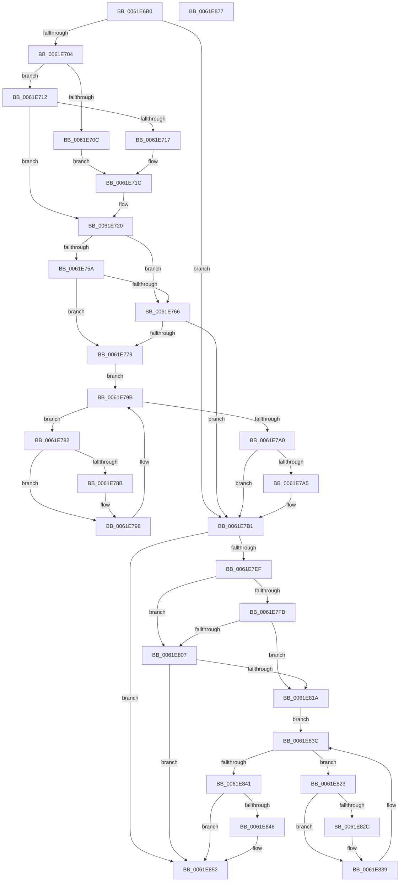

# DifExAllocatePoolWithQuotaTagWrapper

- RVA: `0x0061E6B0`–`0x0061E878` (길이 `456` bytes)
- VA: `0x000000014061E6B0`
- 실행 섹션: `.text`
- PDB 이름 있음: `예`; PDB Function 태그: `아니요`
- unwind 정보 RVA: `0x000D2CDC`
- 디코드: `128`개 명령, `456/456` bytes 표시
- 미해석 바이트: `0` (있으면 어셈블리에 `.byte`로 보존)

> 이 문서는 커널 이미지의 기계어와 PDB 기호를 분석해 생성했습니다. 4번과 5번은 함수 원형과 자료형을 바이너리 사용 방식에서 추정한 C 해석이며 원본 소스 복구 결과는 아닙니다.

## 1. Dependencies

- 직접 호출 지점: **10**; 고유 호출 대상: **6**
- 직접 호출자로 확인된 함수: **0**
- RIP 상대 이미지 참조: **3**

### Outgoing calls
- `0x0061E6E9` → [memset](../6C/memset_function_006C6C40.md) (function, `0x006C6C40`)
- `0x0061E6F3` → [DifGetAPIThunkContextById](../49/DifGetAPIThunkContextById_function_00495A34.md) (function, `0x00495A34`)
- `0x0061E717` → [DifGetReturnAddressForWrappers](../4D/DifGetReturnAddressForWrappers_function_004D3C08.md) (function, `0x004D3C08`)
- `0x0061E76D` → [ExAcquireRundownProtection](../21/ExAcquireRundownProtection_function_00216620.md) (function, `0x00216620`)
- `0x0061E793` → [guard_dispatch_icall](../6B/guard_dispatch_icall_function_006BAAD0.md) (function, `0x006BAAD0`)
- `0x0061E7AC` → [ExReleaseRundownProtection](../34/ExReleaseRundownProtection_function_00349E80.md) (function, `0x00349E80`)
- `0x0061E7E1` → [guard_dispatch_icall](../6B/guard_dispatch_icall_function_006BAAD0.md) (function, `0x006BAAD0`)
- `0x0061E80E` → [ExAcquireRundownProtection](../21/ExAcquireRundownProtection_function_00216620.md) (function, `0x00216620`)
- `0x0061E834` → [guard_dispatch_icall](../6B/guard_dispatch_icall_function_006BAAD0.md) (function, `0x006BAAD0`)
- `0x0061E84D` → [ExReleaseRundownProtection](../34/ExReleaseRundownProtection_function_00349E80.md) (function, `0x00349E80`)

### Direct callers
- 이 함수 시작 RVA로 연결되는 직접 call은 확인되지 않았습니다. 간접 호출은 완전히 역산할 수 없습니다.

### Static image references
- `0x0061E726` → RVA `0x00F048B8` (`.data`; read)
- `0x0061E75A` → RVA `0x00F04980` (`.data`; read)
- `0x0061E766` → RVA `0x00F03E80` (`.data`; read)

## 2. Other-region calls and transfers

- 다른 실행 섹션으로 향하는 call: **0**
- 별도 외부 분기/꼬리 이동을 확인하지 못했습니다.

## 3. Assembly (complete function range)

```asm
0061E6B0  48 8B C4                        mov rax, rsp
0061E6B3  48 89 58 10                     mov qword ptr [rax + 0x10], rbx
0061E6B7  48 89 70 18                     mov qword ptr [rax + 0x18], rsi
0061E6BB  48 89 78 20                     mov qword ptr [rax + 0x20], rdi
0061E6BF  89 48 08                        mov dword ptr [rax + 8], ecx
0061E6C2  55                              push rbp
0061E6C3  41 54                           push r12
0061E6C5  41 55                           push r13
0061E6C7  41 56                           push r14
0061E6C9  41 57                           push r15
0061E6CB  48 8D 68 C9                     lea rbp, [rax - 0x37]
0061E6CF  48 81 EC A0 00 00 00            sub rsp, 0xa0
0061E6D6  4C 8B EA                        mov r13, rdx
0061E6D9  48 8D 4D BF                     lea rcx, [rbp - 0x41]
0061E6DD  33 D2                           xor edx, edx
0061E6DF  4D 8B E0                        mov r12, r8
0061E6E2  45 8B F9                        mov r15d, r9d
0061E6E5  44 8D 42 48                     lea r8d, [rdx + 0x48]
0061E6E9  E8 52 85 0A 00                  call 0x1406c6c40
0061E6EE  B9 A1 01 00 00                  mov ecx, 0x1a1
0061E6F3  E8 3C 73 E7 FF                  call 0x140495a34
0061E6F8  4C 8B F0                        mov r14, rax
0061E6FB  48 85 C0                        test rax, rax
0061E6FE  0F 84 AD 00 00 00               je 0x14061e7b1
0061E704  8B 48 0C                        mov ecx, dword ptr [rax + 0xc]
0061E707  F6 C1 18                        test cl, 0x18
0061E70A  74 06                           je 0x14061e712
0061E70C  48 8B 45 37                     mov rax, qword ptr [rbp + 0x37]
0061E710  EB 0A                           jmp 0x14061e71c
0061E712  F6 C1 04                        test cl, 4
0061E715  74 09                           je 0x14061e720
0061E717  E8 EC 54 EB FF                  call 0x1404d3c08
0061E71C  48 89 45 BF                     mov qword ptr [rbp - 0x41], rax
0061E720  8B 45 3F                        mov eax, dword ptr [rbp + 0x3f]
0061E723  40 32 F6                        xor sil, sil
0061E726  40 38 35 8B 61 8E 00            cmp byte ptr [rip + 0x8e618b], sil
0061E72D  89 45 F7                        mov dword ptr [rbp - 9], eax
0061E730  8B 45 5F                        mov eax, dword ptr [rbp + 0x5f]
0061E733  89 45 DF                        mov dword ptr [rbp - 0x21], eax
0061E736  48 8B 45 67                     mov rax, qword ptr [rbp + 0x67]
0061E73A  48 89 45 D7                     mov qword ptr [rbp - 0x29], rax
0061E73E  8B 45 6F                        mov eax, dword ptr [rbp + 0x6f]
0061E741  89 45 CF                        mov dword ptr [rbp - 0x31], eax
0061E744  48 8B 45 77                     mov rax, qword ptr [rbp + 0x77]
0061E748  48 89 45 C7                     mov qword ptr [rbp - 0x39], rax
0061E74C  4C 89 6D EF                     mov qword ptr [rbp - 0x11], r13
0061E750  4C 89 65 E7                     mov qword ptr [rbp - 0x19], r12
0061E754  44 89 7D E3                     mov dword ptr [rbp - 0x1d], r15d
0061E758  75 0C                           jne 0x14061e766
0061E75A  F7 05 1C 62 8E 00 00 08 00 00   test dword ptr [rip + 0x8e621c], 0x800
0061E764  74 13                           je 0x14061e779
0061E766  48 8D 0D 13 57 8E 00            lea rcx, [rip + 0x8e5713]
0061E76D  E8 AE 7E BF FF                  call 0x140216620
0061E772  40 8A F0                        mov sil, al
0061E775  84 C0                           test al, al
0061E777  74 38                           je 0x14061e7b1
0061E779  49 8D 7E 20                     lea rdi, [r14 + 0x20]
0061E77D  48 8B 1F                        mov rbx, qword ptr [rdi]
0061E780  EB 19                           jmp 0x14061e79b
0061E782  48 8D 43 F0                     lea rax, [rbx - 0x10]
0061E786  48 85 C0                        test rax, rax
0061E789  74 0D                           je 0x14061e798
0061E78B  48 8B 40 08                     mov rax, qword ptr [rax + 8]
0061E78F  48 8D 4D BF                     lea rcx, [rbp - 0x41]
0061E793  E8 38 C3 09 00                  call 0x1406baad0
0061E798  48 8B 1B                        mov rbx, qword ptr [rbx]
0061E79B  48 3B DF                        cmp rbx, rdi
0061E79E  75 E2                           jne 0x14061e782
0061E7A0  40 84 F6                        test sil, sil
0061E7A3  74 0C                           je 0x14061e7b1
0061E7A5  48 8D 0D D4 56 8E 00            lea rcx, [rip + 0x8e56d4]
0061E7AC  E8 CF B6 D2 FF                  call 0x140349e80
0061E7B1  48 8B 45 77                     mov rax, qword ptr [rbp + 0x77]
0061E7B5  45 8B CF                        mov r9d, r15d
0061E7B8  8B 4D 3F                        mov ecx, dword ptr [rbp + 0x3f]
0061E7BB  4D 8B C4                        mov r8, r12
0061E7BE  48 89 44 24 38                  mov qword ptr [rsp + 0x38], rax
0061E7C3  49 8B D5                        mov rdx, r13
0061E7C6  8B 45 6F                        mov eax, dword ptr [rbp + 0x6f]
0061E7C9  89 44 24 30                     mov dword ptr [rsp + 0x30], eax
0061E7CD  48 8B 45 67                     mov rax, qword ptr [rbp + 0x67]
0061E7D1  48 89 44 24 28                  mov qword ptr [rsp + 0x28], rax
0061E7D6  8B 45 5F                        mov eax, dword ptr [rbp + 0x5f]
0061E7D9  89 44 24 20                     mov dword ptr [rsp + 0x20], eax
0061E7DD  48 8B 45 7F                     mov rax, qword ptr [rbp + 0x7f]
0061E7E1  E8 EA C2 09 00                  call 0x1406baad0
0061E7E6  48 89 45 FF                     mov qword ptr [rbp - 1], rax
0061E7EA  4D 85 F6                        test r14, r14
0061E7ED  74 63                           je 0x14061e852
0061E7EF  40 32 FF                        xor dil, dil
0061E7F2  40 38 3D BF 60 8E 00            cmp byte ptr [rip + 0x8e60bf], dil
0061E7F9  75 0C                           jne 0x14061e807
0061E7FB  F7 05 7B 61 8E 00 00 08 00 00   test dword ptr [rip + 0x8e617b], 0x800
0061E805  74 13                           je 0x14061e81a
0061E807  48 8D 0D 72 56 8E 00            lea rcx, [rip + 0x8e5672]
0061E80E  E8 0D 7E BF FF                  call 0x140216620
0061E813  40 8A F8                        mov dil, al
0061E816  84 C0                           test al, al
0061E818  74 38                           je 0x14061e852
0061E81A  49 8D 76 30                     lea rsi, [r14 + 0x30]
0061E81E  48 8B 1E                        mov rbx, qword ptr [rsi]
0061E821  EB 19                           jmp 0x14061e83c
0061E823  48 8D 43 F0                     lea rax, [rbx - 0x10]
0061E827  48 85 C0                        test rax, rax
0061E82A  74 0D                           je 0x14061e839
0061E82C  48 8B 40 08                     mov rax, qword ptr [rax + 8]
0061E830  48 8D 4D BF                     lea rcx, [rbp - 0x41]
0061E834  E8 97 C2 09 00                  call 0x1406baad0
0061E839  48 8B 1B                        mov rbx, qword ptr [rbx]
0061E83C  48 3B DE                        cmp rbx, rsi
0061E83F  75 E2                           jne 0x14061e823
0061E841  40 84 FF                        test dil, dil
0061E844  74 0C                           je 0x14061e852
0061E846  48 8D 0D 33 56 8E 00            lea rcx, [rip + 0x8e5633]
0061E84D  E8 2E B6 D2 FF                  call 0x140349e80
0061E852  48 8B 45 FF                     mov rax, qword ptr [rbp - 1]
0061E856  4C 8D 9C 24 A0 00 00 00         lea r11, [rsp + 0xa0]
0061E85E  49 8B 5B 38                     mov rbx, qword ptr [r11 + 0x38]
0061E862  49 8B 73 40                     mov rsi, qword ptr [r11 + 0x40]
0061E866  49 8B 7B 48                     mov rdi, qword ptr [r11 + 0x48]
0061E86A  49 8B E3                        mov rsp, r11
0061E86D  41 5F                           pop r15
0061E86F  41 5E                           pop r14
0061E871  41 5D                           pop r13
0061E873  41 5C                           pop r12
0061E875  5D                              pop rbp
0061E876  C3                              ret
0061E877  CC                              int3
```

## 4. C-style interpretation (structured pseudocode)

```c
__int64 __fastcall DifExAllocatePoolWithQuotaTagWrapper(int a1, __int64 a2, __int64 a3, int a4)
{
    __int64 result;
    __int64 v_rdi;
    __int64 v_rsi;
    __int64 v_rsp;
    unsigned __int64 v_stack_m28;
    unsigned __int64 v_stack_m90;
    unsigned int v_stack_m98;
    unsigned __int64 v_stack_mA0;
    unsigned int v_stack_mA8;

    *(unsigned __int64 *)(v_rsp + 16) = v_rbx;
    *(unsigned __int64 *)(v_rsp + 24) = v_rsi;
    *(unsigned __int64 *)(v_rsp + 32) = v_rdi;
    *(unsigned int *)(v_rsp + 8) = a1;
    v_rsp = (v_rsp) - (160);
    a2 = 0;
    result = memset(v_rsp - 55 - 65, a2, a2 + 72, a4);
    result = DifGetAPIThunkContextById(417, a2, a2 + 72, a4);
    if (result == 0) goto loc_0061E7B1;
    if ((((unsigned __int8)((unsigned int)(*(unsigned int *)(result + 12)))) & (24)) == 0) goto loc_0061E712;
    goto loc_0061E71C;
loc_0061E712:
    if ((((unsigned __int8)((unsigned int)(*(unsigned int *)(result + 12)))) & (4)) == 0) goto loc_0061E720;
    result = DifGetReturnAddressForWrappers((unsigned int)(*(unsigned int *)(result + 12)), a2, a2 + 72, a4);
loc_0061E71C:
    *(unsigned __int64 *)(v_rsp - 55 - 65) = result;
loc_0061E720:
    v_rsi = 0;
    *(unsigned int *)(v_rsp - 55 - 9) = (unsigned int)((unsigned int)(*(unsigned int *)(v_rsp - 55 + 63)));
    *(unsigned int *)(v_rsp - 55 - 33) = (unsigned int)((unsigned int)(*(unsigned int *)(v_rsp - 55 + 95)));
    *(unsigned __int64 *)(v_rsp - 55 - 41) = *(unsigned __int64 *)(v_rsp - 55 + 103);
    *(unsigned int *)(v_rsp - 55 - 49) = (unsigned int)((unsigned int)(*(unsigned int *)(v_rsp - 55 + 111)));
    *(unsigned __int64 *)(v_rsp - 55 - 57) = *(unsigned __int64 *)(v_rsp - 55 + 119);
    *(unsigned __int64 *)(v_rsp - 55 - 17) = 0;
    *(unsigned __int64 *)(v_rsp - 55 - 25) = a3;
    *(unsigned int *)(v_rsp - 55 - 29) = (unsigned int)((unsigned int)(a4));
    if ((*(unsigned __int8 *)(v_rip + 9331083)) != 0) goto loc_0061E766;
    if (((*(unsigned int *)(v_rip + 9331228)) & (0x800ULL)) == 0) goto loc_0061E779;
loc_0061E766:
    result = ExAcquireRundownProtection(v_rip + 9328403, a2, a2 + 72, a4);
    if ((unsigned __int8)(result) == 0) goto loc_0061E7B1;
loc_0061E779:
    goto loc_0061E79B;
loc_0061E782:
    result = *(unsigned __int64 *)(result + 32) - 16;
    if (*(unsigned __int64 *)(result + 32) - 16 != 0) {
        result = *(unsigned __int64 *)(*(unsigned __int64 *)(result + 32) - 16 + 8);
        a1 = v_rsp - 55 - 65;
        result = guard_dispatch_icall(a1, a2, a2 + 72, a4);
    }
loc_0061E79B:
    if ((*(unsigned __int64 *)(*(unsigned __int64 *)(result + 32))) != (result + 32)) goto loc_0061E782;
    if ((unsigned __int8)((unsigned __int8)(result)) != 0) {
        a1 = v_rip + 9328340;
        result = ExReleaseRundownProtection(a1, a2, a2 + 72, a4);
    }
    v_stack_m90 = *(unsigned __int64 *)(v_rsp - 55 + 119);
    v_stack_m98 = (unsigned int)((unsigned int)(*(unsigned int *)(v_rsp - 55 + 111)));
    v_stack_mA0 = *(unsigned __int64 *)(v_rsp - 55 + 103);
    v_stack_mA8 = (unsigned int)((unsigned int)(*(unsigned int *)(v_rsp - 55 + 95)));
    result = guard_dispatch_icall((unsigned int)(*(unsigned int *)(v_rsp - 55 + 63)), 0, a3, (unsigned int)((unsigned int)((unsigned int)(a4))));
    *(unsigned __int64 *)(v_rsp - 55 - 1) = result;
    if (result == 0) goto loc_0061E852;
    v_rdi = 0;
    if ((*(unsigned __int8 *)(v_rip + 9330879)) != 0) goto loc_0061E807;
    if (((*(unsigned int *)(v_rip + 9331067)) & (0x800ULL)) == 0) goto loc_0061E81A;
loc_0061E807:
    result = ExAcquireRundownProtection(v_rip + 9328242, 0, a3, (unsigned int)((unsigned int)((unsigned int)(a4))));
    if ((unsigned __int8)(result) == 0) goto loc_0061E852;
loc_0061E81A:
    goto loc_0061E83C;
loc_0061E823:
    result = *(unsigned __int64 *)(result + 48) - 16;
    if (*(unsigned __int64 *)(result + 48) - 16 != 0) {
        result = *(unsigned __int64 *)(*(unsigned __int64 *)(result + 48) - 16 + 8);
        a1 = v_rsp - 55 - 65;
        result = guard_dispatch_icall(a1, 0, a3, (unsigned int)((unsigned int)((unsigned int)(a4))));
    }
loc_0061E83C:
    if ((*(unsigned __int64 *)(*(unsigned __int64 *)(result + 48))) != (result + 48)) goto loc_0061E823;
    if ((unsigned __int8)((unsigned __int8)(result)) != 0) {
        a1 = v_rip + 9328179;
        result = ExReleaseRundownProtection(a1, 0, a3, (unsigned int)((unsigned int)((unsigned int)(a4))));
    }
    return *(unsigned __int64 *)(v_rsp - 55 - 1);
}
```

## 5. (Beta) C Style

```c
int64_t DifExAllocatePoolWithQuotaTagWrapper(int32_t Arg1, int64_t Arg2, int64_t Arg3, int32_t Arg4)
{
    int64_t result;
    int64_t local_rdi;
    int64_t local_rsi;
    int64_t local_rsp;
    uint64_t v_stack_m28;
    uint64_t v_stack_m90;
    uint32_t v_stack_m98;
    uint64_t v_stack_mA0;
    uint32_t v_stack_mA8;

    *(uint64_t *)(local_rsp + 0x10) = local_rbx;
    *(uint64_t *)(local_rsp + 0x18) = local_rsi;
    *(uint64_t *)(local_rsp + 0x20) = local_rdi;
    *(uint32_t *)(local_rsp + 0x8) = Arg1;
    local_rsp = (local_rsp) - (160);
    Arg2 = 0;
    result = memset(local_rsp - 55 - 65, Arg2, Arg2 + 72, Arg4);
    result = DifGetAPIThunkContextById(417, Arg2, Arg2 + 72, Arg4);
    if (result == 0) goto loc_0061E7B1;
    if ((((uint8_t)((uint32_t)(*(uint32_t *)(result + 0xC)))) & (24)) == 0) goto loc_0061E712;
    goto loc_0061E71C;
loc_0061E712:
    if ((((uint8_t)((uint32_t)(*(uint32_t *)(result + 0xC)))) & (4)) == 0) goto loc_0061E720;
    result = DifGetReturnAddressForWrappers((uint32_t)(*(uint32_t *)(result + 0xC)), Arg2, Arg2 + 72, Arg4);
loc_0061E71C:
    *(uint64_t *)(local_rsp - 0x37 - 0x41) = result;
loc_0061E720:
    local_rsi = 0;
    *(uint32_t *)(local_rsp - 0x37 - 0x9) = (uint32_t)((uint32_t)(*(uint32_t *)(local_rsp - 0x37 + 0x3F)));
    *(uint32_t *)(local_rsp - 0x37 - 0x21) = (uint32_t)((uint32_t)(*(uint32_t *)(local_rsp - 0x37 + 0x5F)));
    *(uint64_t *)(local_rsp - 0x37 - 0x29) = *(uint64_t *)(local_rsp - 0x37 + 0x67);
    *(uint32_t *)(local_rsp - 0x37 - 0x31) = (uint32_t)((uint32_t)(*(uint32_t *)(local_rsp - 0x37 + 0x6F)));
    *(uint64_t *)(local_rsp - 0x37 - 0x39) = *(uint64_t *)(local_rsp - 0x37 + 0x77);
    *(uint64_t *)(local_rsp - 0x37 - 0x11) = 0;
    *(uint64_t *)(local_rsp - 0x37 - 0x19) = Arg3;
    *(uint32_t *)(local_rsp - 0x37 - 0x1D) = (uint32_t)((uint32_t)(Arg4));
    if ((*(uint8_t *)(v_rip + 0x8E618B)) != 0) goto loc_0061E766;
    if (((*(uint32_t *)(v_rip + 0x8E621C)) & (0x800ULL)) == 0) goto loc_0061E779;
loc_0061E766:
    result = ExAcquireRundownProtection(v_rip + 9328403, Arg2, Arg2 + 72, Arg4);
    if ((uint8_t)(result) == 0) goto loc_0061E7B1;
loc_0061E779:
    goto loc_0061E79B;
loc_0061E782:
    result = *(uint64_t *)(result + 0x20) - 16;
    if (*(uint64_t *)(result + 0x20) - 16 != 0) {
        result = *(uint64_t *)(*(uint64_t *)(result + 0x20) - 0x10 + 0x8);
        Arg1 = local_rsp - 55 - 65;
        result = guard_dispatch_icall(Arg1, Arg2, Arg2 + 72, Arg4);
    }
loc_0061E79B:
    if ((*(uint64_t *)(*(uint64_t *)(result + 0x20))) != (result + 32)) goto loc_0061E782;
    if ((uint8_t)((uint8_t)(result)) != 0) {
        Arg1 = v_rip + 9328340;
        result = ExReleaseRundownProtection(Arg1, Arg2, Arg2 + 72, Arg4);
    }
    v_stack_m90 = *(uint64_t *)(local_rsp - 0x37 + 0x77);
    v_stack_m98 = (uint32_t)((uint32_t)(*(uint32_t *)(local_rsp - 0x37 + 0x6F)));
    v_stack_mA0 = *(uint64_t *)(local_rsp - 0x37 + 0x67);
    v_stack_mA8 = (uint32_t)((uint32_t)(*(uint32_t *)(local_rsp - 0x37 + 0x5F)));
    result = guard_dispatch_icall((uint32_t)(*(uint32_t *)(local_rsp - 0x37 + 0x3F)), 0, Arg3, (uint32_t)((uint32_t)((uint32_t)(Arg4))));
    *(uint64_t *)(local_rsp - 0x37 - 0x1) = result;
    if (result == 0) goto loc_0061E852;
    local_rdi = 0;
    if ((*(uint8_t *)(v_rip + 0x8E60BF)) != 0) goto loc_0061E807;
    if (((*(uint32_t *)(v_rip + 0x8E617B)) & (0x800ULL)) == 0) goto loc_0061E81A;
loc_0061E807:
    result = ExAcquireRundownProtection(v_rip + 9328242, 0, Arg3, (uint32_t)((uint32_t)((uint32_t)(Arg4))));
    if ((uint8_t)(result) == 0) goto loc_0061E852;
loc_0061E81A:
    goto loc_0061E83C;
loc_0061E823:
    result = *(uint64_t *)(result + 0x30) - 16;
    if (*(uint64_t *)(result + 0x30) - 16 != 0) {
        result = *(uint64_t *)(*(uint64_t *)(result + 0x30) - 0x10 + 0x8);
        Arg1 = local_rsp - 55 - 65;
        result = guard_dispatch_icall(Arg1, 0, Arg3, (uint32_t)((uint32_t)((uint32_t)(Arg4))));
    }
loc_0061E83C:
    if ((*(uint64_t *)(*(uint64_t *)(result + 0x30))) != (result + 48)) goto loc_0061E823;
    if ((uint8_t)((uint8_t)(result)) != 0) {
        Arg1 = v_rip + 9328179;
        result = ExReleaseRundownProtection(Arg1, 0, Arg3, (uint32_t)((uint32_t)((uint32_t)(Arg4))));
    }
    return *(uint64_t *)(local_rsp - 0x37 - 0x1);
}
```

## 6. Execution-region graph

[열기: 2D/3D 그래프와 함수 탐색 컨트롤 패널](../../../control-panel.html?section=text&rva=0x0061E6B0&view=graph)

- 2D 그래프는 위에서 아래로 흐르고, 3D 그래프는 빈 공간을 드래그해 회전합니다. Shift+드래그는 이동, 휠은 확대·축소, 함수 노드 선택은 대상 보고서 이동입니다.

### Static fallback


