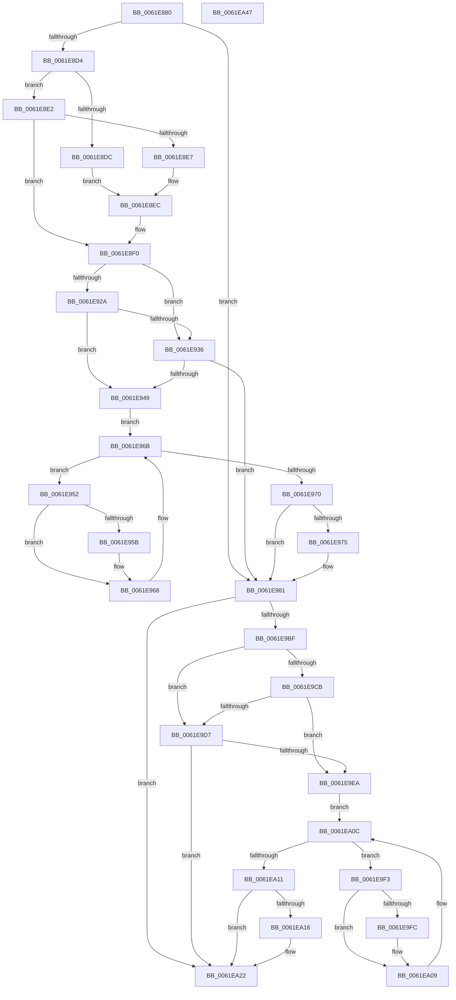

# DifExAllocatePoolWithQuotaWrapper

- RVA: `0x0061E880`–`0x0061EA48` (길이 `456` bytes)
- VA: `0x000000014061E880`
- 실행 섹션: `.text`
- PDB 이름 있음: `예`; PDB Function 태그: `아니요`
- unwind 정보 RVA: `0x000D2CDC`
- 디코드: `128`개 명령, `456/456` bytes 표시
- 미해석 바이트: `0` (있으면 어셈블리에 `.byte`로 보존)

> 이 문서는 커널 이미지의 기계어와 PDB 기호를 분석해 생성했습니다. 4번과 5번은 함수 원형과 자료형을 바이너리 사용 방식에서 추정한 C 해석이며 원본 소스 복구 결과는 아닙니다.

## 1. Dependencies

- 직접 호출 지점: **10**; 고유 호출 대상: **6**
- 직접 호출자로 확인된 함수: **0**
- RIP 상대 이미지 참조: **3**

### Outgoing calls
- `0x0061E8B9` → [memset](../6C/memset_function_006C6C40.md) (function, `0x006C6C40`)
- `0x0061E8C3` → [DifGetAPIThunkContextById](../49/DifGetAPIThunkContextById_function_00495A34.md) (function, `0x00495A34`)
- `0x0061E8E7` → [DifGetReturnAddressForWrappers](../4D/DifGetReturnAddressForWrappers_function_004D3C08.md) (function, `0x004D3C08`)
- `0x0061E93D` → [ExAcquireRundownProtection](../21/ExAcquireRundownProtection_function_00216620.md) (function, `0x00216620`)
- `0x0061E963` → [guard_dispatch_icall](../6B/guard_dispatch_icall_function_006BAAD0.md) (function, `0x006BAAD0`)
- `0x0061E97C` → [ExReleaseRundownProtection](../34/ExReleaseRundownProtection_function_00349E80.md) (function, `0x00349E80`)
- `0x0061E9B1` → [guard_dispatch_icall](../6B/guard_dispatch_icall_function_006BAAD0.md) (function, `0x006BAAD0`)
- `0x0061E9DE` → [ExAcquireRundownProtection](../21/ExAcquireRundownProtection_function_00216620.md) (function, `0x00216620`)
- `0x0061EA04` → [guard_dispatch_icall](../6B/guard_dispatch_icall_function_006BAAD0.md) (function, `0x006BAAD0`)
- `0x0061EA1D` → [ExReleaseRundownProtection](../34/ExReleaseRundownProtection_function_00349E80.md) (function, `0x00349E80`)

### Direct callers
- 이 함수 시작 RVA로 연결되는 직접 call은 확인되지 않았습니다. 간접 호출은 완전히 역산할 수 없습니다.

### Static image references
- `0x0061E8F6` → RVA `0x00F048B8` (`.data`; read)
- `0x0061E92A` → RVA `0x00F04980` (`.data`; read)
- `0x0061E936` → RVA `0x00F03E80` (`.data`; read)

## 2. Other-region calls and transfers

- 다른 실행 섹션으로 향하는 call: **0**
- 별도 외부 분기/꼬리 이동을 확인하지 못했습니다.

## 3. Assembly (complete function range)

```asm
0061E880  48 8B C4                        mov rax, rsp
0061E883  48 89 58 10                     mov qword ptr [rax + 0x10], rbx
0061E887  48 89 70 18                     mov qword ptr [rax + 0x18], rsi
0061E88B  48 89 78 20                     mov qword ptr [rax + 0x20], rdi
0061E88F  89 48 08                        mov dword ptr [rax + 8], ecx
0061E892  55                              push rbp
0061E893  41 54                           push r12
0061E895  41 55                           push r13
0061E897  41 56                           push r14
0061E899  41 57                           push r15
0061E89B  48 8D 68 C9                     lea rbp, [rax - 0x37]
0061E89F  48 81 EC A0 00 00 00            sub rsp, 0xa0
0061E8A6  4C 8B EA                        mov r13, rdx
0061E8A9  48 8D 4D BF                     lea rcx, [rbp - 0x41]
0061E8AD  33 D2                           xor edx, edx
0061E8AF  4D 8B E0                        mov r12, r8
0061E8B2  45 8B F9                        mov r15d, r9d
0061E8B5  44 8D 42 48                     lea r8d, [rdx + 0x48]
0061E8B9  E8 82 83 0A 00                  call 0x1406c6c40
0061E8BE  B9 A0 01 00 00                  mov ecx, 0x1a0
0061E8C3  E8 6C 71 E7 FF                  call 0x140495a34
0061E8C8  4C 8B F0                        mov r14, rax
0061E8CB  48 85 C0                        test rax, rax
0061E8CE  0F 84 AD 00 00 00               je 0x14061e981
0061E8D4  8B 48 0C                        mov ecx, dword ptr [rax + 0xc]
0061E8D7  F6 C1 18                        test cl, 0x18
0061E8DA  74 06                           je 0x14061e8e2
0061E8DC  48 8B 45 37                     mov rax, qword ptr [rbp + 0x37]
0061E8E0  EB 0A                           jmp 0x14061e8ec
0061E8E2  F6 C1 04                        test cl, 4
0061E8E5  74 09                           je 0x14061e8f0
0061E8E7  E8 1C 53 EB FF                  call 0x1404d3c08
0061E8EC  48 89 45 BF                     mov qword ptr [rbp - 0x41], rax
0061E8F0  8B 45 3F                        mov eax, dword ptr [rbp + 0x3f]
0061E8F3  40 32 F6                        xor sil, sil
0061E8F6  40 38 35 BB 5F 8E 00            cmp byte ptr [rip + 0x8e5fbb], sil
0061E8FD  89 45 F7                        mov dword ptr [rbp - 9], eax
0061E900  8B 45 5F                        mov eax, dword ptr [rbp + 0x5f]
0061E903  89 45 DF                        mov dword ptr [rbp - 0x21], eax
0061E906  48 8B 45 67                     mov rax, qword ptr [rbp + 0x67]
0061E90A  48 89 45 D7                     mov qword ptr [rbp - 0x29], rax
0061E90E  8B 45 6F                        mov eax, dword ptr [rbp + 0x6f]
0061E911  89 45 CF                        mov dword ptr [rbp - 0x31], eax
0061E914  48 8B 45 77                     mov rax, qword ptr [rbp + 0x77]
0061E918  48 89 45 C7                     mov qword ptr [rbp - 0x39], rax
0061E91C  4C 89 6D EF                     mov qword ptr [rbp - 0x11], r13
0061E920  4C 89 65 E7                     mov qword ptr [rbp - 0x19], r12
0061E924  44 89 7D E3                     mov dword ptr [rbp - 0x1d], r15d
0061E928  75 0C                           jne 0x14061e936
0061E92A  F7 05 4C 60 8E 00 00 08 00 00   test dword ptr [rip + 0x8e604c], 0x800
0061E934  74 13                           je 0x14061e949
0061E936  48 8D 0D 43 55 8E 00            lea rcx, [rip + 0x8e5543]
0061E93D  E8 DE 7C BF FF                  call 0x140216620
0061E942  40 8A F0                        mov sil, al
0061E945  84 C0                           test al, al
0061E947  74 38                           je 0x14061e981
0061E949  49 8D 7E 20                     lea rdi, [r14 + 0x20]
0061E94D  48 8B 1F                        mov rbx, qword ptr [rdi]
0061E950  EB 19                           jmp 0x14061e96b
0061E952  48 8D 43 F0                     lea rax, [rbx - 0x10]
0061E956  48 85 C0                        test rax, rax
0061E959  74 0D                           je 0x14061e968
0061E95B  48 8B 40 08                     mov rax, qword ptr [rax + 8]
0061E95F  48 8D 4D BF                     lea rcx, [rbp - 0x41]
0061E963  E8 68 C1 09 00                  call 0x1406baad0
0061E968  48 8B 1B                        mov rbx, qword ptr [rbx]
0061E96B  48 3B DF                        cmp rbx, rdi
0061E96E  75 E2                           jne 0x14061e952
0061E970  40 84 F6                        test sil, sil
0061E973  74 0C                           je 0x14061e981
0061E975  48 8D 0D 04 55 8E 00            lea rcx, [rip + 0x8e5504]
0061E97C  E8 FF B4 D2 FF                  call 0x140349e80
0061E981  48 8B 45 77                     mov rax, qword ptr [rbp + 0x77]
0061E985  45 8B CF                        mov r9d, r15d
0061E988  8B 4D 3F                        mov ecx, dword ptr [rbp + 0x3f]
0061E98B  4D 8B C4                        mov r8, r12
0061E98E  48 89 44 24 38                  mov qword ptr [rsp + 0x38], rax
0061E993  49 8B D5                        mov rdx, r13
0061E996  8B 45 6F                        mov eax, dword ptr [rbp + 0x6f]
0061E999  89 44 24 30                     mov dword ptr [rsp + 0x30], eax
0061E99D  48 8B 45 67                     mov rax, qword ptr [rbp + 0x67]
0061E9A1  48 89 44 24 28                  mov qword ptr [rsp + 0x28], rax
0061E9A6  8B 45 5F                        mov eax, dword ptr [rbp + 0x5f]
0061E9A9  89 44 24 20                     mov dword ptr [rsp + 0x20], eax
0061E9AD  48 8B 45 7F                     mov rax, qword ptr [rbp + 0x7f]
0061E9B1  E8 1A C1 09 00                  call 0x1406baad0
0061E9B6  48 89 45 FF                     mov qword ptr [rbp - 1], rax
0061E9BA  4D 85 F6                        test r14, r14
0061E9BD  74 63                           je 0x14061ea22
0061E9BF  40 32 FF                        xor dil, dil
0061E9C2  40 38 3D EF 5E 8E 00            cmp byte ptr [rip + 0x8e5eef], dil
0061E9C9  75 0C                           jne 0x14061e9d7
0061E9CB  F7 05 AB 5F 8E 00 00 08 00 00   test dword ptr [rip + 0x8e5fab], 0x800
0061E9D5  74 13                           je 0x14061e9ea
0061E9D7  48 8D 0D A2 54 8E 00            lea rcx, [rip + 0x8e54a2]
0061E9DE  E8 3D 7C BF FF                  call 0x140216620
0061E9E3  40 8A F8                        mov dil, al
0061E9E6  84 C0                           test al, al
0061E9E8  74 38                           je 0x14061ea22
0061E9EA  49 8D 76 30                     lea rsi, [r14 + 0x30]
0061E9EE  48 8B 1E                        mov rbx, qword ptr [rsi]
0061E9F1  EB 19                           jmp 0x14061ea0c
0061E9F3  48 8D 43 F0                     lea rax, [rbx - 0x10]
0061E9F7  48 85 C0                        test rax, rax
0061E9FA  74 0D                           je 0x14061ea09
0061E9FC  48 8B 40 08                     mov rax, qword ptr [rax + 8]
0061EA00  48 8D 4D BF                     lea rcx, [rbp - 0x41]
0061EA04  E8 C7 C0 09 00                  call 0x1406baad0
0061EA09  48 8B 1B                        mov rbx, qword ptr [rbx]
0061EA0C  48 3B DE                        cmp rbx, rsi
0061EA0F  75 E2                           jne 0x14061e9f3
0061EA11  40 84 FF                        test dil, dil
0061EA14  74 0C                           je 0x14061ea22
0061EA16  48 8D 0D 63 54 8E 00            lea rcx, [rip + 0x8e5463]
0061EA1D  E8 5E B4 D2 FF                  call 0x140349e80
0061EA22  48 8B 45 FF                     mov rax, qword ptr [rbp - 1]
0061EA26  4C 8D 9C 24 A0 00 00 00         lea r11, [rsp + 0xa0]
0061EA2E  49 8B 5B 38                     mov rbx, qword ptr [r11 + 0x38]
0061EA32  49 8B 73 40                     mov rsi, qword ptr [r11 + 0x40]
0061EA36  49 8B 7B 48                     mov rdi, qword ptr [r11 + 0x48]
0061EA3A  49 8B E3                        mov rsp, r11
0061EA3D  41 5F                           pop r15
0061EA3F  41 5E                           pop r14
0061EA41  41 5D                           pop r13
0061EA43  41 5C                           pop r12
0061EA45  5D                              pop rbp
0061EA46  C3                              ret
0061EA47  CC                              int3
```

## 4. C-style interpretation (structured pseudocode)

```c
__int64 __fastcall DifExAllocatePoolWithQuotaWrapper(int a1, __int64 a2, __int64 a3, int a4)
{
    __int64 result;
    __int64 v_rdi;
    __int64 v_rsi;
    __int64 v_rsp;
    unsigned __int64 v_stack_m28;
    unsigned __int64 v_stack_m90;
    unsigned int v_stack_m98;
    unsigned __int64 v_stack_mA0;
    unsigned int v_stack_mA8;

    *(unsigned __int64 *)(v_rsp + 16) = v_rbx;
    *(unsigned __int64 *)(v_rsp + 24) = v_rsi;
    *(unsigned __int64 *)(v_rsp + 32) = v_rdi;
    *(unsigned int *)(v_rsp + 8) = a1;
    v_rsp = (v_rsp) - (160);
    a2 = 0;
    result = memset(v_rsp - 55 - 65, a2, a2 + 72, a4);
    result = DifGetAPIThunkContextById(416, a2, a2 + 72, a4);
    if (result == 0) goto loc_0061E981;
    if ((((unsigned __int8)((unsigned int)(*(unsigned int *)(result + 12)))) & (24)) == 0) goto loc_0061E8E2;
    goto loc_0061E8EC;
loc_0061E8E2:
    if ((((unsigned __int8)((unsigned int)(*(unsigned int *)(result + 12)))) & (4)) == 0) goto loc_0061E8F0;
    result = DifGetReturnAddressForWrappers((unsigned int)(*(unsigned int *)(result + 12)), a2, a2 + 72, a4);
loc_0061E8EC:
    *(unsigned __int64 *)(v_rsp - 55 - 65) = result;
loc_0061E8F0:
    v_rsi = 0;
    *(unsigned int *)(v_rsp - 55 - 9) = (unsigned int)((unsigned int)(*(unsigned int *)(v_rsp - 55 + 63)));
    *(unsigned int *)(v_rsp - 55 - 33) = (unsigned int)((unsigned int)(*(unsigned int *)(v_rsp - 55 + 95)));
    *(unsigned __int64 *)(v_rsp - 55 - 41) = *(unsigned __int64 *)(v_rsp - 55 + 103);
    *(unsigned int *)(v_rsp - 55 - 49) = (unsigned int)((unsigned int)(*(unsigned int *)(v_rsp - 55 + 111)));
    *(unsigned __int64 *)(v_rsp - 55 - 57) = *(unsigned __int64 *)(v_rsp - 55 + 119);
    *(unsigned __int64 *)(v_rsp - 55 - 17) = 0;
    *(unsigned __int64 *)(v_rsp - 55 - 25) = a3;
    *(unsigned int *)(v_rsp - 55 - 29) = (unsigned int)((unsigned int)(a4));
    if ((*(unsigned __int8 *)(v_rip + 9330619)) != 0) goto loc_0061E936;
    if (((*(unsigned int *)(v_rip + 9330764)) & (0x800ULL)) == 0) goto loc_0061E949;
loc_0061E936:
    result = ExAcquireRundownProtection(v_rip + 9327939, a2, a2 + 72, a4);
    if ((unsigned __int8)(result) == 0) goto loc_0061E981;
loc_0061E949:
    goto loc_0061E96B;
loc_0061E952:
    result = *(unsigned __int64 *)(result + 32) - 16;
    if (*(unsigned __int64 *)(result + 32) - 16 != 0) {
        result = *(unsigned __int64 *)(*(unsigned __int64 *)(result + 32) - 16 + 8);
        a1 = v_rsp - 55 - 65;
        result = guard_dispatch_icall(a1, a2, a2 + 72, a4);
    }
loc_0061E96B:
    if ((*(unsigned __int64 *)(*(unsigned __int64 *)(result + 32))) != (result + 32)) goto loc_0061E952;
    if ((unsigned __int8)((unsigned __int8)(result)) != 0) {
        a1 = v_rip + 9327876;
        result = ExReleaseRundownProtection(a1, a2, a2 + 72, a4);
    }
    v_stack_m90 = *(unsigned __int64 *)(v_rsp - 55 + 119);
    v_stack_m98 = (unsigned int)((unsigned int)(*(unsigned int *)(v_rsp - 55 + 111)));
    v_stack_mA0 = *(unsigned __int64 *)(v_rsp - 55 + 103);
    v_stack_mA8 = (unsigned int)((unsigned int)(*(unsigned int *)(v_rsp - 55 + 95)));
    result = guard_dispatch_icall((unsigned int)(*(unsigned int *)(v_rsp - 55 + 63)), 0, a3, (unsigned int)((unsigned int)((unsigned int)(a4))));
    *(unsigned __int64 *)(v_rsp - 55 - 1) = result;
    if (result == 0) goto loc_0061EA22;
    v_rdi = 0;
    if ((*(unsigned __int8 *)(v_rip + 9330415)) != 0) goto loc_0061E9D7;
    if (((*(unsigned int *)(v_rip + 9330603)) & (0x800ULL)) == 0) goto loc_0061E9EA;
loc_0061E9D7:
    result = ExAcquireRundownProtection(v_rip + 9327778, 0, a3, (unsigned int)((unsigned int)((unsigned int)(a4))));
    if ((unsigned __int8)(result) == 0) goto loc_0061EA22;
loc_0061E9EA:
    goto loc_0061EA0C;
loc_0061E9F3:
    result = *(unsigned __int64 *)(result + 48) - 16;
    if (*(unsigned __int64 *)(result + 48) - 16 != 0) {
        result = *(unsigned __int64 *)(*(unsigned __int64 *)(result + 48) - 16 + 8);
        a1 = v_rsp - 55 - 65;
        result = guard_dispatch_icall(a1, 0, a3, (unsigned int)((unsigned int)((unsigned int)(a4))));
    }
loc_0061EA0C:
    if ((*(unsigned __int64 *)(*(unsigned __int64 *)(result + 48))) != (result + 48)) goto loc_0061E9F3;
    if ((unsigned __int8)((unsigned __int8)(result)) != 0) {
        a1 = v_rip + 9327715;
        result = ExReleaseRundownProtection(a1, 0, a3, (unsigned int)((unsigned int)((unsigned int)(a4))));
    }
    return *(unsigned __int64 *)(v_rsp - 55 - 1);
}
```

## 5. (Beta) C Style

```c
int64_t DifExAllocatePoolWithQuotaWrapper(int32_t Arg1, int64_t Arg2, int64_t Arg3, int32_t Arg4)
{
    int64_t result;
    int64_t local_rdi;
    int64_t local_rsi;
    int64_t local_rsp;
    uint64_t v_stack_m28;
    uint64_t v_stack_m90;
    uint32_t v_stack_m98;
    uint64_t v_stack_mA0;
    uint32_t v_stack_mA8;

    *(uint64_t *)(local_rsp + 0x10) = local_rbx;
    *(uint64_t *)(local_rsp + 0x18) = local_rsi;
    *(uint64_t *)(local_rsp + 0x20) = local_rdi;
    *(uint32_t *)(local_rsp + 0x8) = Arg1;
    local_rsp = (local_rsp) - (160);
    Arg2 = 0;
    result = memset(local_rsp - 55 - 65, Arg2, Arg2 + 72, Arg4);
    result = DifGetAPIThunkContextById(416, Arg2, Arg2 + 72, Arg4);
    if (result == 0) goto loc_0061E981;
    if ((((uint8_t)((uint32_t)(*(uint32_t *)(result + 0xC)))) & (24)) == 0) goto loc_0061E8E2;
    goto loc_0061E8EC;
loc_0061E8E2:
    if ((((uint8_t)((uint32_t)(*(uint32_t *)(result + 0xC)))) & (4)) == 0) goto loc_0061E8F0;
    result = DifGetReturnAddressForWrappers((uint32_t)(*(uint32_t *)(result + 0xC)), Arg2, Arg2 + 72, Arg4);
loc_0061E8EC:
    *(uint64_t *)(local_rsp - 0x37 - 0x41) = result;
loc_0061E8F0:
    local_rsi = 0;
    *(uint32_t *)(local_rsp - 0x37 - 0x9) = (uint32_t)((uint32_t)(*(uint32_t *)(local_rsp - 0x37 + 0x3F)));
    *(uint32_t *)(local_rsp - 0x37 - 0x21) = (uint32_t)((uint32_t)(*(uint32_t *)(local_rsp - 0x37 + 0x5F)));
    *(uint64_t *)(local_rsp - 0x37 - 0x29) = *(uint64_t *)(local_rsp - 0x37 + 0x67);
    *(uint32_t *)(local_rsp - 0x37 - 0x31) = (uint32_t)((uint32_t)(*(uint32_t *)(local_rsp - 0x37 + 0x6F)));
    *(uint64_t *)(local_rsp - 0x37 - 0x39) = *(uint64_t *)(local_rsp - 0x37 + 0x77);
    *(uint64_t *)(local_rsp - 0x37 - 0x11) = 0;
    *(uint64_t *)(local_rsp - 0x37 - 0x19) = Arg3;
    *(uint32_t *)(local_rsp - 0x37 - 0x1D) = (uint32_t)((uint32_t)(Arg4));
    if ((*(uint8_t *)(v_rip + 0x8E5FBB)) != 0) goto loc_0061E936;
    if (((*(uint32_t *)(v_rip + 0x8E604C)) & (0x800ULL)) == 0) goto loc_0061E949;
loc_0061E936:
    result = ExAcquireRundownProtection(v_rip + 9327939, Arg2, Arg2 + 72, Arg4);
    if ((uint8_t)(result) == 0) goto loc_0061E981;
loc_0061E949:
    goto loc_0061E96B;
loc_0061E952:
    result = *(uint64_t *)(result + 0x20) - 16;
    if (*(uint64_t *)(result + 0x20) - 16 != 0) {
        result = *(uint64_t *)(*(uint64_t *)(result + 0x20) - 0x10 + 0x8);
        Arg1 = local_rsp - 55 - 65;
        result = guard_dispatch_icall(Arg1, Arg2, Arg2 + 72, Arg4);
    }
loc_0061E96B:
    if ((*(uint64_t *)(*(uint64_t *)(result + 0x20))) != (result + 32)) goto loc_0061E952;
    if ((uint8_t)((uint8_t)(result)) != 0) {
        Arg1 = v_rip + 9327876;
        result = ExReleaseRundownProtection(Arg1, Arg2, Arg2 + 72, Arg4);
    }
    v_stack_m90 = *(uint64_t *)(local_rsp - 0x37 + 0x77);
    v_stack_m98 = (uint32_t)((uint32_t)(*(uint32_t *)(local_rsp - 0x37 + 0x6F)));
    v_stack_mA0 = *(uint64_t *)(local_rsp - 0x37 + 0x67);
    v_stack_mA8 = (uint32_t)((uint32_t)(*(uint32_t *)(local_rsp - 0x37 + 0x5F)));
    result = guard_dispatch_icall((uint32_t)(*(uint32_t *)(local_rsp - 0x37 + 0x3F)), 0, Arg3, (uint32_t)((uint32_t)((uint32_t)(Arg4))));
    *(uint64_t *)(local_rsp - 0x37 - 0x1) = result;
    if (result == 0) goto loc_0061EA22;
    local_rdi = 0;
    if ((*(uint8_t *)(v_rip + 0x8E5EEF)) != 0) goto loc_0061E9D7;
    if (((*(uint32_t *)(v_rip + 0x8E5FAB)) & (0x800ULL)) == 0) goto loc_0061E9EA;
loc_0061E9D7:
    result = ExAcquireRundownProtection(v_rip + 9327778, 0, Arg3, (uint32_t)((uint32_t)((uint32_t)(Arg4))));
    if ((uint8_t)(result) == 0) goto loc_0061EA22;
loc_0061E9EA:
    goto loc_0061EA0C;
loc_0061E9F3:
    result = *(uint64_t *)(result + 0x30) - 16;
    if (*(uint64_t *)(result + 0x30) - 16 != 0) {
        result = *(uint64_t *)(*(uint64_t *)(result + 0x30) - 0x10 + 0x8);
        Arg1 = local_rsp - 55 - 65;
        result = guard_dispatch_icall(Arg1, 0, Arg3, (uint32_t)((uint32_t)((uint32_t)(Arg4))));
    }
loc_0061EA0C:
    if ((*(uint64_t *)(*(uint64_t *)(result + 0x30))) != (result + 48)) goto loc_0061E9F3;
    if ((uint8_t)((uint8_t)(result)) != 0) {
        Arg1 = v_rip + 9327715;
        result = ExReleaseRundownProtection(Arg1, 0, Arg3, (uint32_t)((uint32_t)((uint32_t)(Arg4))));
    }
    return *(uint64_t *)(local_rsp - 0x37 - 0x1);
}
```

## 6. Execution-region graph

[열기: 2D/3D 그래프와 함수 탐색 컨트롤 패널](../../../control-panel.html?section=text&rva=0x0061E880&view=graph)

- 2D 그래프는 위에서 아래로 흐르고, 3D 그래프는 빈 공간을 드래그해 회전합니다. Shift+드래그는 이동, 휠은 확대·축소, 함수 노드 선택은 대상 보고서 이동입니다.

### Static fallback


