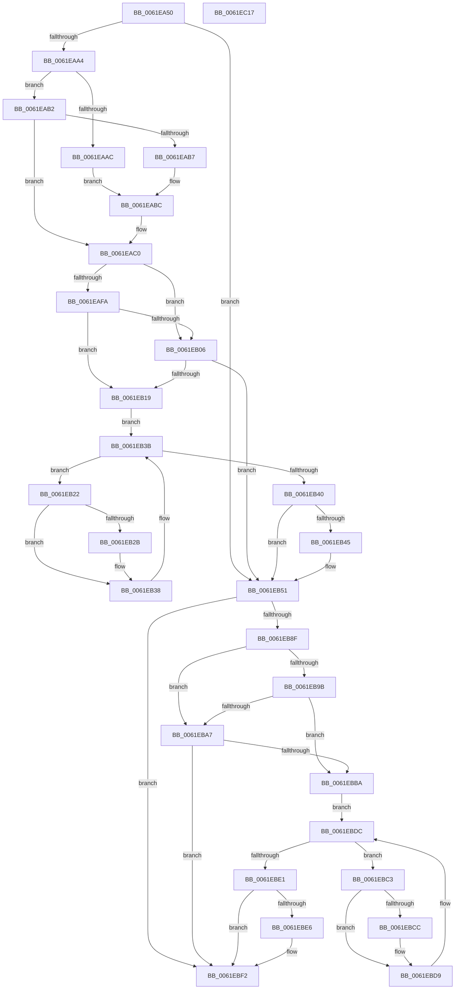

# DifExAllocatePoolWithTagPriorityWrapper

- RVA: `0x0061EA50`–`0x0061EC18` (길이 `456` bytes)
- VA: `0x000000014061EA50`
- 실행 섹션: `.text`
- PDB 이름 있음: `예`; PDB Function 태그: `아니요`
- unwind 정보 RVA: `0x000D2CDC`
- 디코드: `128`개 명령, `456/456` bytes 표시
- 미해석 바이트: `0` (있으면 어셈블리에 `.byte`로 보존)

> 이 문서는 커널 이미지의 기계어와 PDB 기호를 분석해 생성했습니다. 4번과 5번은 함수 원형과 자료형을 바이너리 사용 방식에서 추정한 C 해석이며 원본 소스 복구 결과는 아닙니다.

## 1. Dependencies

- 직접 호출 지점: **10**; 고유 호출 대상: **6**
- 직접 호출자로 확인된 함수: **0**
- RIP 상대 이미지 참조: **3**

### Outgoing calls
- `0x0061EA89` → [memset](../6C/memset_function_006C6C40.md) (function, `0x006C6C40`)
- `0x0061EA93` → [DifGetAPIThunkContextById](../49/DifGetAPIThunkContextById_function_00495A34.md) (function, `0x00495A34`)
- `0x0061EAB7` → [DifGetReturnAddressForWrappers](../4D/DifGetReturnAddressForWrappers_function_004D3C08.md) (function, `0x004D3C08`)
- `0x0061EB0D` → [ExAcquireRundownProtection](../21/ExAcquireRundownProtection_function_00216620.md) (function, `0x00216620`)
- `0x0061EB33` → [guard_dispatch_icall](../6B/guard_dispatch_icall_function_006BAAD0.md) (function, `0x006BAAD0`)
- `0x0061EB4C` → [ExReleaseRundownProtection](../34/ExReleaseRundownProtection_function_00349E80.md) (function, `0x00349E80`)
- `0x0061EB81` → [guard_dispatch_icall](../6B/guard_dispatch_icall_function_006BAAD0.md) (function, `0x006BAAD0`)
- `0x0061EBAE` → [ExAcquireRundownProtection](../21/ExAcquireRundownProtection_function_00216620.md) (function, `0x00216620`)
- `0x0061EBD4` → [guard_dispatch_icall](../6B/guard_dispatch_icall_function_006BAAD0.md) (function, `0x006BAAD0`)
- `0x0061EBED` → [ExReleaseRundownProtection](../34/ExReleaseRundownProtection_function_00349E80.md) (function, `0x00349E80`)

### Direct callers
- 이 함수 시작 RVA로 연결되는 직접 call은 확인되지 않았습니다. 간접 호출은 완전히 역산할 수 없습니다.

### Static image references
- `0x0061EAC6` → RVA `0x00F048B8` (`.data`; read)
- `0x0061EAFA` → RVA `0x00F04980` (`.data`; read)
- `0x0061EB06` → RVA `0x00F03E80` (`.data`; read)

## 2. Other-region calls and transfers

- 다른 실행 섹션으로 향하는 call: **0**
- 별도 외부 분기/꼬리 이동을 확인하지 못했습니다.

## 3. Assembly (complete function range)

```asm
0061EA50  48 8B C4                        mov rax, rsp
0061EA53  48 89 58 10                     mov qword ptr [rax + 0x10], rbx
0061EA57  48 89 70 18                     mov qword ptr [rax + 0x18], rsi
0061EA5B  48 89 78 20                     mov qword ptr [rax + 0x20], rdi
0061EA5F  89 48 08                        mov dword ptr [rax + 8], ecx
0061EA62  55                              push rbp
0061EA63  41 54                           push r12
0061EA65  41 55                           push r13
0061EA67  41 56                           push r14
0061EA69  41 57                           push r15
0061EA6B  48 8D 68 C9                     lea rbp, [rax - 0x37]
0061EA6F  48 81 EC A0 00 00 00            sub rsp, 0xa0
0061EA76  4C 8B EA                        mov r13, rdx
0061EA79  48 8D 4D BF                     lea rcx, [rbp - 0x41]
0061EA7D  33 D2                           xor edx, edx
0061EA7F  4D 8B E0                        mov r12, r8
0061EA82  45 8B F9                        mov r15d, r9d
0061EA85  44 8D 42 48                     lea r8d, [rdx + 0x48]
0061EA89  E8 B2 81 0A 00                  call 0x1406c6c40
0061EA8E  B9 9F 01 00 00                  mov ecx, 0x19f
0061EA93  E8 9C 6F E7 FF                  call 0x140495a34
0061EA98  4C 8B F0                        mov r14, rax
0061EA9B  48 85 C0                        test rax, rax
0061EA9E  0F 84 AD 00 00 00               je 0x14061eb51
0061EAA4  8B 48 0C                        mov ecx, dword ptr [rax + 0xc]
0061EAA7  F6 C1 18                        test cl, 0x18
0061EAAA  74 06                           je 0x14061eab2
0061EAAC  48 8B 45 37                     mov rax, qword ptr [rbp + 0x37]
0061EAB0  EB 0A                           jmp 0x14061eabc
0061EAB2  F6 C1 04                        test cl, 4
0061EAB5  74 09                           je 0x14061eac0
0061EAB7  E8 4C 51 EB FF                  call 0x1404d3c08
0061EABC  48 89 45 BF                     mov qword ptr [rbp - 0x41], rax
0061EAC0  8B 45 3F                        mov eax, dword ptr [rbp + 0x3f]
0061EAC3  40 32 F6                        xor sil, sil
0061EAC6  40 38 35 EB 5D 8E 00            cmp byte ptr [rip + 0x8e5deb], sil
0061EACD  89 45 F7                        mov dword ptr [rbp - 9], eax
0061EAD0  8B 45 5F                        mov eax, dword ptr [rbp + 0x5f]
0061EAD3  89 45 DF                        mov dword ptr [rbp - 0x21], eax
0061EAD6  48 8B 45 67                     mov rax, qword ptr [rbp + 0x67]
0061EADA  48 89 45 D7                     mov qword ptr [rbp - 0x29], rax
0061EADE  8B 45 6F                        mov eax, dword ptr [rbp + 0x6f]
0061EAE1  89 45 CF                        mov dword ptr [rbp - 0x31], eax
0061EAE4  48 8B 45 77                     mov rax, qword ptr [rbp + 0x77]
0061EAE8  48 89 45 C7                     mov qword ptr [rbp - 0x39], rax
0061EAEC  4C 89 6D EF                     mov qword ptr [rbp - 0x11], r13
0061EAF0  4C 89 65 E7                     mov qword ptr [rbp - 0x19], r12
0061EAF4  44 89 7D E3                     mov dword ptr [rbp - 0x1d], r15d
0061EAF8  75 0C                           jne 0x14061eb06
0061EAFA  F7 05 7C 5E 8E 00 00 08 00 00   test dword ptr [rip + 0x8e5e7c], 0x800
0061EB04  74 13                           je 0x14061eb19
0061EB06  48 8D 0D 73 53 8E 00            lea rcx, [rip + 0x8e5373]
0061EB0D  E8 0E 7B BF FF                  call 0x140216620
0061EB12  40 8A F0                        mov sil, al
0061EB15  84 C0                           test al, al
0061EB17  74 38                           je 0x14061eb51
0061EB19  49 8D 7E 20                     lea rdi, [r14 + 0x20]
0061EB1D  48 8B 1F                        mov rbx, qword ptr [rdi]
0061EB20  EB 19                           jmp 0x14061eb3b
0061EB22  48 8D 43 F0                     lea rax, [rbx - 0x10]
0061EB26  48 85 C0                        test rax, rax
0061EB29  74 0D                           je 0x14061eb38
0061EB2B  48 8B 40 08                     mov rax, qword ptr [rax + 8]
0061EB2F  48 8D 4D BF                     lea rcx, [rbp - 0x41]
0061EB33  E8 98 BF 09 00                  call 0x1406baad0
0061EB38  48 8B 1B                        mov rbx, qword ptr [rbx]
0061EB3B  48 3B DF                        cmp rbx, rdi
0061EB3E  75 E2                           jne 0x14061eb22
0061EB40  40 84 F6                        test sil, sil
0061EB43  74 0C                           je 0x14061eb51
0061EB45  48 8D 0D 34 53 8E 00            lea rcx, [rip + 0x8e5334]
0061EB4C  E8 2F B3 D2 FF                  call 0x140349e80
0061EB51  48 8B 45 77                     mov rax, qword ptr [rbp + 0x77]
0061EB55  45 8B CF                        mov r9d, r15d
0061EB58  8B 4D 3F                        mov ecx, dword ptr [rbp + 0x3f]
0061EB5B  4D 8B C4                        mov r8, r12
0061EB5E  48 89 44 24 38                  mov qword ptr [rsp + 0x38], rax
0061EB63  49 8B D5                        mov rdx, r13
0061EB66  8B 45 6F                        mov eax, dword ptr [rbp + 0x6f]
0061EB69  89 44 24 30                     mov dword ptr [rsp + 0x30], eax
0061EB6D  48 8B 45 67                     mov rax, qword ptr [rbp + 0x67]
0061EB71  48 89 44 24 28                  mov qword ptr [rsp + 0x28], rax
0061EB76  8B 45 5F                        mov eax, dword ptr [rbp + 0x5f]
0061EB79  89 44 24 20                     mov dword ptr [rsp + 0x20], eax
0061EB7D  48 8B 45 7F                     mov rax, qword ptr [rbp + 0x7f]
0061EB81  E8 4A BF 09 00                  call 0x1406baad0
0061EB86  48 89 45 FF                     mov qword ptr [rbp - 1], rax
0061EB8A  4D 85 F6                        test r14, r14
0061EB8D  74 63                           je 0x14061ebf2
0061EB8F  40 32 FF                        xor dil, dil
0061EB92  40 38 3D 1F 5D 8E 00            cmp byte ptr [rip + 0x8e5d1f], dil
0061EB99  75 0C                           jne 0x14061eba7
0061EB9B  F7 05 DB 5D 8E 00 00 08 00 00   test dword ptr [rip + 0x8e5ddb], 0x800
0061EBA5  74 13                           je 0x14061ebba
0061EBA7  48 8D 0D D2 52 8E 00            lea rcx, [rip + 0x8e52d2]
0061EBAE  E8 6D 7A BF FF                  call 0x140216620
0061EBB3  40 8A F8                        mov dil, al
0061EBB6  84 C0                           test al, al
0061EBB8  74 38                           je 0x14061ebf2
0061EBBA  49 8D 76 30                     lea rsi, [r14 + 0x30]
0061EBBE  48 8B 1E                        mov rbx, qword ptr [rsi]
0061EBC1  EB 19                           jmp 0x14061ebdc
0061EBC3  48 8D 43 F0                     lea rax, [rbx - 0x10]
0061EBC7  48 85 C0                        test rax, rax
0061EBCA  74 0D                           je 0x14061ebd9
0061EBCC  48 8B 40 08                     mov rax, qword ptr [rax + 8]
0061EBD0  48 8D 4D BF                     lea rcx, [rbp - 0x41]
0061EBD4  E8 F7 BE 09 00                  call 0x1406baad0
0061EBD9  48 8B 1B                        mov rbx, qword ptr [rbx]
0061EBDC  48 3B DE                        cmp rbx, rsi
0061EBDF  75 E2                           jne 0x14061ebc3
0061EBE1  40 84 FF                        test dil, dil
0061EBE4  74 0C                           je 0x14061ebf2
0061EBE6  48 8D 0D 93 52 8E 00            lea rcx, [rip + 0x8e5293]
0061EBED  E8 8E B2 D2 FF                  call 0x140349e80
0061EBF2  48 8B 45 FF                     mov rax, qword ptr [rbp - 1]
0061EBF6  4C 8D 9C 24 A0 00 00 00         lea r11, [rsp + 0xa0]
0061EBFE  49 8B 5B 38                     mov rbx, qword ptr [r11 + 0x38]
0061EC02  49 8B 73 40                     mov rsi, qword ptr [r11 + 0x40]
0061EC06  49 8B 7B 48                     mov rdi, qword ptr [r11 + 0x48]
0061EC0A  49 8B E3                        mov rsp, r11
0061EC0D  41 5F                           pop r15
0061EC0F  41 5E                           pop r14
0061EC11  41 5D                           pop r13
0061EC13  41 5C                           pop r12
0061EC15  5D                              pop rbp
0061EC16  C3                              ret
0061EC17  CC                              int3
```

## 4. C-style interpretation (structured pseudocode)

```c
__int64 __fastcall DifExAllocatePoolWithTagPriorityWrapper(int a1, __int64 a2, __int64 a3, int a4)
{
    __int64 result;
    __int64 v_rdi;
    __int64 v_rsi;
    __int64 v_rsp;
    unsigned __int64 v_stack_m28;
    unsigned __int64 v_stack_m90;
    unsigned int v_stack_m98;
    unsigned __int64 v_stack_mA0;
    unsigned int v_stack_mA8;

    *(unsigned __int64 *)(v_rsp + 16) = v_rbx;
    *(unsigned __int64 *)(v_rsp + 24) = v_rsi;
    *(unsigned __int64 *)(v_rsp + 32) = v_rdi;
    *(unsigned int *)(v_rsp + 8) = a1;
    v_rsp = (v_rsp) - (160);
    a2 = 0;
    result = memset(v_rsp - 55 - 65, a2, a2 + 72, a4);
    result = DifGetAPIThunkContextById(415, a2, a2 + 72, a4);
    if (result == 0) goto loc_0061EB51;
    if ((((unsigned __int8)((unsigned int)(*(unsigned int *)(result + 12)))) & (24)) == 0) goto loc_0061EAB2;
    goto loc_0061EABC;
loc_0061EAB2:
    if ((((unsigned __int8)((unsigned int)(*(unsigned int *)(result + 12)))) & (4)) == 0) goto loc_0061EAC0;
    result = DifGetReturnAddressForWrappers((unsigned int)(*(unsigned int *)(result + 12)), a2, a2 + 72, a4);
loc_0061EABC:
    *(unsigned __int64 *)(v_rsp - 55 - 65) = result;
loc_0061EAC0:
    v_rsi = 0;
    *(unsigned int *)(v_rsp - 55 - 9) = (unsigned int)((unsigned int)(*(unsigned int *)(v_rsp - 55 + 63)));
    *(unsigned int *)(v_rsp - 55 - 33) = (unsigned int)((unsigned int)(*(unsigned int *)(v_rsp - 55 + 95)));
    *(unsigned __int64 *)(v_rsp - 55 - 41) = *(unsigned __int64 *)(v_rsp - 55 + 103);
    *(unsigned int *)(v_rsp - 55 - 49) = (unsigned int)((unsigned int)(*(unsigned int *)(v_rsp - 55 + 111)));
    *(unsigned __int64 *)(v_rsp - 55 - 57) = *(unsigned __int64 *)(v_rsp - 55 + 119);
    *(unsigned __int64 *)(v_rsp - 55 - 17) = 0;
    *(unsigned __int64 *)(v_rsp - 55 - 25) = a3;
    *(unsigned int *)(v_rsp - 55 - 29) = (unsigned int)((unsigned int)(a4));
    if ((*(unsigned __int8 *)(v_rip + 9330155)) != 0) goto loc_0061EB06;
    if (((*(unsigned int *)(v_rip + 9330300)) & (0x800ULL)) == 0) goto loc_0061EB19;
loc_0061EB06:
    result = ExAcquireRundownProtection(v_rip + 9327475, a2, a2 + 72, a4);
    if ((unsigned __int8)(result) == 0) goto loc_0061EB51;
loc_0061EB19:
    goto loc_0061EB3B;
loc_0061EB22:
    result = *(unsigned __int64 *)(result + 32) - 16;
    if (*(unsigned __int64 *)(result + 32) - 16 != 0) {
        result = *(unsigned __int64 *)(*(unsigned __int64 *)(result + 32) - 16 + 8);
        a1 = v_rsp - 55 - 65;
        result = guard_dispatch_icall(a1, a2, a2 + 72, a4);
    }
loc_0061EB3B:
    if ((*(unsigned __int64 *)(*(unsigned __int64 *)(result + 32))) != (result + 32)) goto loc_0061EB22;
    if ((unsigned __int8)((unsigned __int8)(result)) != 0) {
        a1 = v_rip + 9327412;
        result = ExReleaseRundownProtection(a1, a2, a2 + 72, a4);
    }
    v_stack_m90 = *(unsigned __int64 *)(v_rsp - 55 + 119);
    v_stack_m98 = (unsigned int)((unsigned int)(*(unsigned int *)(v_rsp - 55 + 111)));
    v_stack_mA0 = *(unsigned __int64 *)(v_rsp - 55 + 103);
    v_stack_mA8 = (unsigned int)((unsigned int)(*(unsigned int *)(v_rsp - 55 + 95)));
    result = guard_dispatch_icall((unsigned int)(*(unsigned int *)(v_rsp - 55 + 63)), 0, a3, (unsigned int)((unsigned int)((unsigned int)(a4))));
    *(unsigned __int64 *)(v_rsp - 55 - 1) = result;
    if (result == 0) goto loc_0061EBF2;
    v_rdi = 0;
    if ((*(unsigned __int8 *)(v_rip + 9329951)) != 0) goto loc_0061EBA7;
    if (((*(unsigned int *)(v_rip + 9330139)) & (0x800ULL)) == 0) goto loc_0061EBBA;
loc_0061EBA7:
    result = ExAcquireRundownProtection(v_rip + 9327314, 0, a3, (unsigned int)((unsigned int)((unsigned int)(a4))));
    if ((unsigned __int8)(result) == 0) goto loc_0061EBF2;
loc_0061EBBA:
    goto loc_0061EBDC;
loc_0061EBC3:
    result = *(unsigned __int64 *)(result + 48) - 16;
    if (*(unsigned __int64 *)(result + 48) - 16 != 0) {
        result = *(unsigned __int64 *)(*(unsigned __int64 *)(result + 48) - 16 + 8);
        a1 = v_rsp - 55 - 65;
        result = guard_dispatch_icall(a1, 0, a3, (unsigned int)((unsigned int)((unsigned int)(a4))));
    }
loc_0061EBDC:
    if ((*(unsigned __int64 *)(*(unsigned __int64 *)(result + 48))) != (result + 48)) goto loc_0061EBC3;
    if ((unsigned __int8)((unsigned __int8)(result)) != 0) {
        a1 = v_rip + 9327251;
        result = ExReleaseRundownProtection(a1, 0, a3, (unsigned int)((unsigned int)((unsigned int)(a4))));
    }
    return *(unsigned __int64 *)(v_rsp - 55 - 1);
}
```

## 5. (Beta) C Style

```c
int64_t DifExAllocatePoolWithTagPriorityWrapper(int32_t Arg1, int64_t Arg2, int64_t Arg3, int32_t Arg4)
{
    int64_t result;
    int64_t local_rdi;
    int64_t local_rsi;
    int64_t local_rsp;
    uint64_t v_stack_m28;
    uint64_t v_stack_m90;
    uint32_t v_stack_m98;
    uint64_t v_stack_mA0;
    uint32_t v_stack_mA8;

    *(uint64_t *)(local_rsp + 0x10) = local_rbx;
    *(uint64_t *)(local_rsp + 0x18) = local_rsi;
    *(uint64_t *)(local_rsp + 0x20) = local_rdi;
    *(uint32_t *)(local_rsp + 0x8) = Arg1;
    local_rsp = (local_rsp) - (160);
    Arg2 = 0;
    result = memset(local_rsp - 55 - 65, Arg2, Arg2 + 72, Arg4);
    result = DifGetAPIThunkContextById(415, Arg2, Arg2 + 72, Arg4);
    if (result == 0) goto loc_0061EB51;
    if ((((uint8_t)((uint32_t)(*(uint32_t *)(result + 0xC)))) & (24)) == 0) goto loc_0061EAB2;
    goto loc_0061EABC;
loc_0061EAB2:
    if ((((uint8_t)((uint32_t)(*(uint32_t *)(result + 0xC)))) & (4)) == 0) goto loc_0061EAC0;
    result = DifGetReturnAddressForWrappers((uint32_t)(*(uint32_t *)(result + 0xC)), Arg2, Arg2 + 72, Arg4);
loc_0061EABC:
    *(uint64_t *)(local_rsp - 0x37 - 0x41) = result;
loc_0061EAC0:
    local_rsi = 0;
    *(uint32_t *)(local_rsp - 0x37 - 0x9) = (uint32_t)((uint32_t)(*(uint32_t *)(local_rsp - 0x37 + 0x3F)));
    *(uint32_t *)(local_rsp - 0x37 - 0x21) = (uint32_t)((uint32_t)(*(uint32_t *)(local_rsp - 0x37 + 0x5F)));
    *(uint64_t *)(local_rsp - 0x37 - 0x29) = *(uint64_t *)(local_rsp - 0x37 + 0x67);
    *(uint32_t *)(local_rsp - 0x37 - 0x31) = (uint32_t)((uint32_t)(*(uint32_t *)(local_rsp - 0x37 + 0x6F)));
    *(uint64_t *)(local_rsp - 0x37 - 0x39) = *(uint64_t *)(local_rsp - 0x37 + 0x77);
    *(uint64_t *)(local_rsp - 0x37 - 0x11) = 0;
    *(uint64_t *)(local_rsp - 0x37 - 0x19) = Arg3;
    *(uint32_t *)(local_rsp - 0x37 - 0x1D) = (uint32_t)((uint32_t)(Arg4));
    if ((*(uint8_t *)(v_rip + 0x8E5DEB)) != 0) goto loc_0061EB06;
    if (((*(uint32_t *)(v_rip + 0x8E5E7C)) & (0x800ULL)) == 0) goto loc_0061EB19;
loc_0061EB06:
    result = ExAcquireRundownProtection(v_rip + 9327475, Arg2, Arg2 + 72, Arg4);
    if ((uint8_t)(result) == 0) goto loc_0061EB51;
loc_0061EB19:
    goto loc_0061EB3B;
loc_0061EB22:
    result = *(uint64_t *)(result + 0x20) - 16;
    if (*(uint64_t *)(result + 0x20) - 16 != 0) {
        result = *(uint64_t *)(*(uint64_t *)(result + 0x20) - 0x10 + 0x8);
        Arg1 = local_rsp - 55 - 65;
        result = guard_dispatch_icall(Arg1, Arg2, Arg2 + 72, Arg4);
    }
loc_0061EB3B:
    if ((*(uint64_t *)(*(uint64_t *)(result + 0x20))) != (result + 32)) goto loc_0061EB22;
    if ((uint8_t)((uint8_t)(result)) != 0) {
        Arg1 = v_rip + 9327412;
        result = ExReleaseRundownProtection(Arg1, Arg2, Arg2 + 72, Arg4);
    }
    v_stack_m90 = *(uint64_t *)(local_rsp - 0x37 + 0x77);
    v_stack_m98 = (uint32_t)((uint32_t)(*(uint32_t *)(local_rsp - 0x37 + 0x6F)));
    v_stack_mA0 = *(uint64_t *)(local_rsp - 0x37 + 0x67);
    v_stack_mA8 = (uint32_t)((uint32_t)(*(uint32_t *)(local_rsp - 0x37 + 0x5F)));
    result = guard_dispatch_icall((uint32_t)(*(uint32_t *)(local_rsp - 0x37 + 0x3F)), 0, Arg3, (uint32_t)((uint32_t)((uint32_t)(Arg4))));
    *(uint64_t *)(local_rsp - 0x37 - 0x1) = result;
    if (result == 0) goto loc_0061EBF2;
    local_rdi = 0;
    if ((*(uint8_t *)(v_rip + 0x8E5D1F)) != 0) goto loc_0061EBA7;
    if (((*(uint32_t *)(v_rip + 0x8E5DDB)) & (0x800ULL)) == 0) goto loc_0061EBBA;
loc_0061EBA7:
    result = ExAcquireRundownProtection(v_rip + 9327314, 0, Arg3, (uint32_t)((uint32_t)((uint32_t)(Arg4))));
    if ((uint8_t)(result) == 0) goto loc_0061EBF2;
loc_0061EBBA:
    goto loc_0061EBDC;
loc_0061EBC3:
    result = *(uint64_t *)(result + 0x30) - 16;
    if (*(uint64_t *)(result + 0x30) - 16 != 0) {
        result = *(uint64_t *)(*(uint64_t *)(result + 0x30) - 0x10 + 0x8);
        Arg1 = local_rsp - 55 - 65;
        result = guard_dispatch_icall(Arg1, 0, Arg3, (uint32_t)((uint32_t)((uint32_t)(Arg4))));
    }
loc_0061EBDC:
    if ((*(uint64_t *)(*(uint64_t *)(result + 0x30))) != (result + 48)) goto loc_0061EBC3;
    if ((uint8_t)((uint8_t)(result)) != 0) {
        Arg1 = v_rip + 9327251;
        result = ExReleaseRundownProtection(Arg1, 0, Arg3, (uint32_t)((uint32_t)((uint32_t)(Arg4))));
    }
    return *(uint64_t *)(local_rsp - 0x37 - 0x1);
}
```

## 6. Execution-region graph

[열기: 2D/3D 그래프와 함수 탐색 컨트롤 패널](../../../control-panel.html?section=text&rva=0x0061EA50&view=graph)

- 2D 그래프는 위에서 아래로 흐르고, 3D 그래프는 빈 공간을 드래그해 회전합니다. Shift+드래그는 이동, 휠은 확대·축소, 함수 노드 선택은 대상 보고서 이동입니다.

### Static fallback


