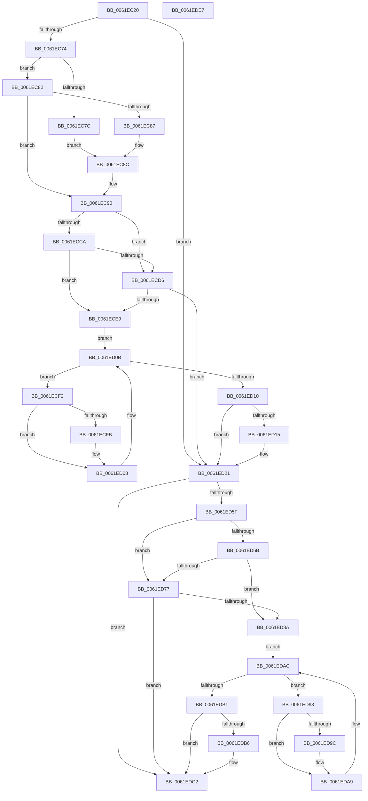

# DifExAllocatePoolWithTagWrapper

- RVA: `0x0061EC20`–`0x0061EDE8` (길이 `456` bytes)
- VA: `0x000000014061EC20`
- 실행 섹션: `.text`
- PDB 이름 있음: `예`; PDB Function 태그: `아니요`
- unwind 정보 RVA: `0x000D2CDC`
- 디코드: `128`개 명령, `456/456` bytes 표시
- 미해석 바이트: `0` (있으면 어셈블리에 `.byte`로 보존)

> 이 문서는 커널 이미지의 기계어와 PDB 기호를 분석해 생성했습니다. 4번과 5번은 함수 원형과 자료형을 바이너리 사용 방식에서 추정한 C 해석이며 원본 소스 복구 결과는 아닙니다.

## 1. Dependencies

- 직접 호출 지점: **10**; 고유 호출 대상: **6**
- 직접 호출자로 확인된 함수: **0**
- RIP 상대 이미지 참조: **3**

### Outgoing calls
- `0x0061EC59` → [memset](../6C/memset_function_006C6C40.md) (function, `0x006C6C40`)
- `0x0061EC63` → [DifGetAPIThunkContextById](../49/DifGetAPIThunkContextById_function_00495A34.md) (function, `0x00495A34`)
- `0x0061EC87` → [DifGetReturnAddressForWrappers](../4D/DifGetReturnAddressForWrappers_function_004D3C08.md) (function, `0x004D3C08`)
- `0x0061ECDD` → [ExAcquireRundownProtection](../21/ExAcquireRundownProtection_function_00216620.md) (function, `0x00216620`)
- `0x0061ED03` → [guard_dispatch_icall](../6B/guard_dispatch_icall_function_006BAAD0.md) (function, `0x006BAAD0`)
- `0x0061ED1C` → [ExReleaseRundownProtection](../34/ExReleaseRundownProtection_function_00349E80.md) (function, `0x00349E80`)
- `0x0061ED51` → [guard_dispatch_icall](../6B/guard_dispatch_icall_function_006BAAD0.md) (function, `0x006BAAD0`)
- `0x0061ED7E` → [ExAcquireRundownProtection](../21/ExAcquireRundownProtection_function_00216620.md) (function, `0x00216620`)
- `0x0061EDA4` → [guard_dispatch_icall](../6B/guard_dispatch_icall_function_006BAAD0.md) (function, `0x006BAAD0`)
- `0x0061EDBD` → [ExReleaseRundownProtection](../34/ExReleaseRundownProtection_function_00349E80.md) (function, `0x00349E80`)

### Direct callers
- 이 함수 시작 RVA로 연결되는 직접 call은 확인되지 않았습니다. 간접 호출은 완전히 역산할 수 없습니다.

### Static image references
- `0x0061EC96` → RVA `0x00F048B8` (`.data`; read)
- `0x0061ECCA` → RVA `0x00F04980` (`.data`; read)
- `0x0061ECD6` → RVA `0x00F03E80` (`.data`; read)

## 2. Other-region calls and transfers

- 다른 실행 섹션으로 향하는 call: **0**
- 별도 외부 분기/꼬리 이동을 확인하지 못했습니다.

## 3. Assembly (complete function range)

```asm
0061EC20  48 8B C4                        mov rax, rsp
0061EC23  48 89 58 10                     mov qword ptr [rax + 0x10], rbx
0061EC27  48 89 70 18                     mov qword ptr [rax + 0x18], rsi
0061EC2B  48 89 78 20                     mov qword ptr [rax + 0x20], rdi
0061EC2F  89 48 08                        mov dword ptr [rax + 8], ecx
0061EC32  55                              push rbp
0061EC33  41 54                           push r12
0061EC35  41 55                           push r13
0061EC37  41 56                           push r14
0061EC39  41 57                           push r15
0061EC3B  48 8D 68 C9                     lea rbp, [rax - 0x37]
0061EC3F  48 81 EC A0 00 00 00            sub rsp, 0xa0
0061EC46  4C 8B EA                        mov r13, rdx
0061EC49  48 8D 4D BF                     lea rcx, [rbp - 0x41]
0061EC4D  33 D2                           xor edx, edx
0061EC4F  4D 8B E0                        mov r12, r8
0061EC52  45 8B F9                        mov r15d, r9d
0061EC55  44 8D 42 48                     lea r8d, [rdx + 0x48]
0061EC59  E8 E2 7F 0A 00                  call 0x1406c6c40
0061EC5E  B9 9E 01 00 00                  mov ecx, 0x19e
0061EC63  E8 CC 6D E7 FF                  call 0x140495a34
0061EC68  4C 8B F0                        mov r14, rax
0061EC6B  48 85 C0                        test rax, rax
0061EC6E  0F 84 AD 00 00 00               je 0x14061ed21
0061EC74  8B 48 0C                        mov ecx, dword ptr [rax + 0xc]
0061EC77  F6 C1 18                        test cl, 0x18
0061EC7A  74 06                           je 0x14061ec82
0061EC7C  48 8B 45 37                     mov rax, qword ptr [rbp + 0x37]
0061EC80  EB 0A                           jmp 0x14061ec8c
0061EC82  F6 C1 04                        test cl, 4
0061EC85  74 09                           je 0x14061ec90
0061EC87  E8 7C 4F EB FF                  call 0x1404d3c08
0061EC8C  48 89 45 BF                     mov qword ptr [rbp - 0x41], rax
0061EC90  8B 45 3F                        mov eax, dword ptr [rbp + 0x3f]
0061EC93  40 32 F6                        xor sil, sil
0061EC96  40 38 35 1B 5C 8E 00            cmp byte ptr [rip + 0x8e5c1b], sil
0061EC9D  89 45 F7                        mov dword ptr [rbp - 9], eax
0061ECA0  8B 45 5F                        mov eax, dword ptr [rbp + 0x5f]
0061ECA3  89 45 DF                        mov dword ptr [rbp - 0x21], eax
0061ECA6  48 8B 45 67                     mov rax, qword ptr [rbp + 0x67]
0061ECAA  48 89 45 D7                     mov qword ptr [rbp - 0x29], rax
0061ECAE  8B 45 6F                        mov eax, dword ptr [rbp + 0x6f]
0061ECB1  89 45 CF                        mov dword ptr [rbp - 0x31], eax
0061ECB4  48 8B 45 77                     mov rax, qword ptr [rbp + 0x77]
0061ECB8  48 89 45 C7                     mov qword ptr [rbp - 0x39], rax
0061ECBC  4C 89 6D EF                     mov qword ptr [rbp - 0x11], r13
0061ECC0  4C 89 65 E7                     mov qword ptr [rbp - 0x19], r12
0061ECC4  44 89 7D E3                     mov dword ptr [rbp - 0x1d], r15d
0061ECC8  75 0C                           jne 0x14061ecd6
0061ECCA  F7 05 AC 5C 8E 00 00 08 00 00   test dword ptr [rip + 0x8e5cac], 0x800
0061ECD4  74 13                           je 0x14061ece9
0061ECD6  48 8D 0D A3 51 8E 00            lea rcx, [rip + 0x8e51a3]
0061ECDD  E8 3E 79 BF FF                  call 0x140216620
0061ECE2  40 8A F0                        mov sil, al
0061ECE5  84 C0                           test al, al
0061ECE7  74 38                           je 0x14061ed21
0061ECE9  49 8D 7E 20                     lea rdi, [r14 + 0x20]
0061ECED  48 8B 1F                        mov rbx, qword ptr [rdi]
0061ECF0  EB 19                           jmp 0x14061ed0b
0061ECF2  48 8D 43 F0                     lea rax, [rbx - 0x10]
0061ECF6  48 85 C0                        test rax, rax
0061ECF9  74 0D                           je 0x14061ed08
0061ECFB  48 8B 40 08                     mov rax, qword ptr [rax + 8]
0061ECFF  48 8D 4D BF                     lea rcx, [rbp - 0x41]
0061ED03  E8 C8 BD 09 00                  call 0x1406baad0
0061ED08  48 8B 1B                        mov rbx, qword ptr [rbx]
0061ED0B  48 3B DF                        cmp rbx, rdi
0061ED0E  75 E2                           jne 0x14061ecf2
0061ED10  40 84 F6                        test sil, sil
0061ED13  74 0C                           je 0x14061ed21
0061ED15  48 8D 0D 64 51 8E 00            lea rcx, [rip + 0x8e5164]
0061ED1C  E8 5F B1 D2 FF                  call 0x140349e80
0061ED21  48 8B 45 77                     mov rax, qword ptr [rbp + 0x77]
0061ED25  45 8B CF                        mov r9d, r15d
0061ED28  8B 4D 3F                        mov ecx, dword ptr [rbp + 0x3f]
0061ED2B  4D 8B C4                        mov r8, r12
0061ED2E  48 89 44 24 38                  mov qword ptr [rsp + 0x38], rax
0061ED33  49 8B D5                        mov rdx, r13
0061ED36  8B 45 6F                        mov eax, dword ptr [rbp + 0x6f]
0061ED39  89 44 24 30                     mov dword ptr [rsp + 0x30], eax
0061ED3D  48 8B 45 67                     mov rax, qword ptr [rbp + 0x67]
0061ED41  48 89 44 24 28                  mov qword ptr [rsp + 0x28], rax
0061ED46  8B 45 5F                        mov eax, dword ptr [rbp + 0x5f]
0061ED49  89 44 24 20                     mov dword ptr [rsp + 0x20], eax
0061ED4D  48 8B 45 7F                     mov rax, qword ptr [rbp + 0x7f]
0061ED51  E8 7A BD 09 00                  call 0x1406baad0
0061ED56  48 89 45 FF                     mov qword ptr [rbp - 1], rax
0061ED5A  4D 85 F6                        test r14, r14
0061ED5D  74 63                           je 0x14061edc2
0061ED5F  40 32 FF                        xor dil, dil
0061ED62  40 38 3D 4F 5B 8E 00            cmp byte ptr [rip + 0x8e5b4f], dil
0061ED69  75 0C                           jne 0x14061ed77
0061ED6B  F7 05 0B 5C 8E 00 00 08 00 00   test dword ptr [rip + 0x8e5c0b], 0x800
0061ED75  74 13                           je 0x14061ed8a
0061ED77  48 8D 0D 02 51 8E 00            lea rcx, [rip + 0x8e5102]
0061ED7E  E8 9D 78 BF FF                  call 0x140216620
0061ED83  40 8A F8                        mov dil, al
0061ED86  84 C0                           test al, al
0061ED88  74 38                           je 0x14061edc2
0061ED8A  49 8D 76 30                     lea rsi, [r14 + 0x30]
0061ED8E  48 8B 1E                        mov rbx, qword ptr [rsi]
0061ED91  EB 19                           jmp 0x14061edac
0061ED93  48 8D 43 F0                     lea rax, [rbx - 0x10]
0061ED97  48 85 C0                        test rax, rax
0061ED9A  74 0D                           je 0x14061eda9
0061ED9C  48 8B 40 08                     mov rax, qword ptr [rax + 8]
0061EDA0  48 8D 4D BF                     lea rcx, [rbp - 0x41]
0061EDA4  E8 27 BD 09 00                  call 0x1406baad0
0061EDA9  48 8B 1B                        mov rbx, qword ptr [rbx]
0061EDAC  48 3B DE                        cmp rbx, rsi
0061EDAF  75 E2                           jne 0x14061ed93
0061EDB1  40 84 FF                        test dil, dil
0061EDB4  74 0C                           je 0x14061edc2
0061EDB6  48 8D 0D C3 50 8E 00            lea rcx, [rip + 0x8e50c3]
0061EDBD  E8 BE B0 D2 FF                  call 0x140349e80
0061EDC2  48 8B 45 FF                     mov rax, qword ptr [rbp - 1]
0061EDC6  4C 8D 9C 24 A0 00 00 00         lea r11, [rsp + 0xa0]
0061EDCE  49 8B 5B 38                     mov rbx, qword ptr [r11 + 0x38]
0061EDD2  49 8B 73 40                     mov rsi, qword ptr [r11 + 0x40]
0061EDD6  49 8B 7B 48                     mov rdi, qword ptr [r11 + 0x48]
0061EDDA  49 8B E3                        mov rsp, r11
0061EDDD  41 5F                           pop r15
0061EDDF  41 5E                           pop r14
0061EDE1  41 5D                           pop r13
0061EDE3  41 5C                           pop r12
0061EDE5  5D                              pop rbp
0061EDE6  C3                              ret
0061EDE7  CC                              int3
```

## 4. C-style interpretation (structured pseudocode)

```c
__int64 __fastcall DifExAllocatePoolWithTagWrapper(int a1, __int64 a2, __int64 a3, int a4)
{
    __int64 result;
    __int64 v_rdi;
    __int64 v_rsi;
    __int64 v_rsp;
    unsigned __int64 v_stack_m28;
    unsigned __int64 v_stack_m90;
    unsigned int v_stack_m98;
    unsigned __int64 v_stack_mA0;
    unsigned int v_stack_mA8;

    *(unsigned __int64 *)(v_rsp + 16) = v_rbx;
    *(unsigned __int64 *)(v_rsp + 24) = v_rsi;
    *(unsigned __int64 *)(v_rsp + 32) = v_rdi;
    *(unsigned int *)(v_rsp + 8) = a1;
    v_rsp = (v_rsp) - (160);
    a2 = 0;
    result = memset(v_rsp - 55 - 65, a2, a2 + 72, a4);
    result = DifGetAPIThunkContextById(414, a2, a2 + 72, a4);
    if (result == 0) goto loc_0061ED21;
    if ((((unsigned __int8)((unsigned int)(*(unsigned int *)(result + 12)))) & (24)) == 0) goto loc_0061EC82;
    goto loc_0061EC8C;
loc_0061EC82:
    if ((((unsigned __int8)((unsigned int)(*(unsigned int *)(result + 12)))) & (4)) == 0) goto loc_0061EC90;
    result = DifGetReturnAddressForWrappers((unsigned int)(*(unsigned int *)(result + 12)), a2, a2 + 72, a4);
loc_0061EC8C:
    *(unsigned __int64 *)(v_rsp - 55 - 65) = result;
loc_0061EC90:
    v_rsi = 0;
    *(unsigned int *)(v_rsp - 55 - 9) = (unsigned int)((unsigned int)(*(unsigned int *)(v_rsp - 55 + 63)));
    *(unsigned int *)(v_rsp - 55 - 33) = (unsigned int)((unsigned int)(*(unsigned int *)(v_rsp - 55 + 95)));
    *(unsigned __int64 *)(v_rsp - 55 - 41) = *(unsigned __int64 *)(v_rsp - 55 + 103);
    *(unsigned int *)(v_rsp - 55 - 49) = (unsigned int)((unsigned int)(*(unsigned int *)(v_rsp - 55 + 111)));
    *(unsigned __int64 *)(v_rsp - 55 - 57) = *(unsigned __int64 *)(v_rsp - 55 + 119);
    *(unsigned __int64 *)(v_rsp - 55 - 17) = 0;
    *(unsigned __int64 *)(v_rsp - 55 - 25) = a3;
    *(unsigned int *)(v_rsp - 55 - 29) = (unsigned int)((unsigned int)(a4));
    if ((*(unsigned __int8 *)(v_rip + 9329691)) != 0) goto loc_0061ECD6;
    if (((*(unsigned int *)(v_rip + 9329836)) & (0x800ULL)) == 0) goto loc_0061ECE9;
loc_0061ECD6:
    result = ExAcquireRundownProtection(v_rip + 9327011, a2, a2 + 72, a4);
    if ((unsigned __int8)(result) == 0) goto loc_0061ED21;
loc_0061ECE9:
    goto loc_0061ED0B;
loc_0061ECF2:
    result = *(unsigned __int64 *)(result + 32) - 16;
    if (*(unsigned __int64 *)(result + 32) - 16 != 0) {
        result = *(unsigned __int64 *)(*(unsigned __int64 *)(result + 32) - 16 + 8);
        a1 = v_rsp - 55 - 65;
        result = guard_dispatch_icall(a1, a2, a2 + 72, a4);
    }
loc_0061ED0B:
    if ((*(unsigned __int64 *)(*(unsigned __int64 *)(result + 32))) != (result + 32)) goto loc_0061ECF2;
    if ((unsigned __int8)((unsigned __int8)(result)) != 0) {
        a1 = v_rip + 9326948;
        result = ExReleaseRundownProtection(a1, a2, a2 + 72, a4);
    }
    v_stack_m90 = *(unsigned __int64 *)(v_rsp - 55 + 119);
    v_stack_m98 = (unsigned int)((unsigned int)(*(unsigned int *)(v_rsp - 55 + 111)));
    v_stack_mA0 = *(unsigned __int64 *)(v_rsp - 55 + 103);
    v_stack_mA8 = (unsigned int)((unsigned int)(*(unsigned int *)(v_rsp - 55 + 95)));
    result = guard_dispatch_icall((unsigned int)(*(unsigned int *)(v_rsp - 55 + 63)), 0, a3, (unsigned int)((unsigned int)((unsigned int)(a4))));
    *(unsigned __int64 *)(v_rsp - 55 - 1) = result;
    if (result == 0) goto loc_0061EDC2;
    v_rdi = 0;
    if ((*(unsigned __int8 *)(v_rip + 9329487)) != 0) goto loc_0061ED77;
    if (((*(unsigned int *)(v_rip + 9329675)) & (0x800ULL)) == 0) goto loc_0061ED8A;
loc_0061ED77:
    result = ExAcquireRundownProtection(v_rip + 9326850, 0, a3, (unsigned int)((unsigned int)((unsigned int)(a4))));
    if ((unsigned __int8)(result) == 0) goto loc_0061EDC2;
loc_0061ED8A:
    goto loc_0061EDAC;
loc_0061ED93:
    result = *(unsigned __int64 *)(result + 48) - 16;
    if (*(unsigned __int64 *)(result + 48) - 16 != 0) {
        result = *(unsigned __int64 *)(*(unsigned __int64 *)(result + 48) - 16 + 8);
        a1 = v_rsp - 55 - 65;
        result = guard_dispatch_icall(a1, 0, a3, (unsigned int)((unsigned int)((unsigned int)(a4))));
    }
loc_0061EDAC:
    if ((*(unsigned __int64 *)(*(unsigned __int64 *)(result + 48))) != (result + 48)) goto loc_0061ED93;
    if ((unsigned __int8)((unsigned __int8)(result)) != 0) {
        a1 = v_rip + 9326787;
        result = ExReleaseRundownProtection(a1, 0, a3, (unsigned int)((unsigned int)((unsigned int)(a4))));
    }
    return *(unsigned __int64 *)(v_rsp - 55 - 1);
}
```

## 5. (Beta) C Style

```c
int64_t DifExAllocatePoolWithTagWrapper(int32_t Arg1, int64_t Arg2, int64_t Arg3, int32_t Arg4)
{
    int64_t result;
    int64_t local_rdi;
    int64_t local_rsi;
    int64_t local_rsp;
    uint64_t v_stack_m28;
    uint64_t v_stack_m90;
    uint32_t v_stack_m98;
    uint64_t v_stack_mA0;
    uint32_t v_stack_mA8;

    *(uint64_t *)(local_rsp + 0x10) = local_rbx;
    *(uint64_t *)(local_rsp + 0x18) = local_rsi;
    *(uint64_t *)(local_rsp + 0x20) = local_rdi;
    *(uint32_t *)(local_rsp + 0x8) = Arg1;
    local_rsp = (local_rsp) - (160);
    Arg2 = 0;
    result = memset(local_rsp - 55 - 65, Arg2, Arg2 + 72, Arg4);
    result = DifGetAPIThunkContextById(414, Arg2, Arg2 + 72, Arg4);
    if (result == 0) goto loc_0061ED21;
    if ((((uint8_t)((uint32_t)(*(uint32_t *)(result + 0xC)))) & (24)) == 0) goto loc_0061EC82;
    goto loc_0061EC8C;
loc_0061EC82:
    if ((((uint8_t)((uint32_t)(*(uint32_t *)(result + 0xC)))) & (4)) == 0) goto loc_0061EC90;
    result = DifGetReturnAddressForWrappers((uint32_t)(*(uint32_t *)(result + 0xC)), Arg2, Arg2 + 72, Arg4);
loc_0061EC8C:
    *(uint64_t *)(local_rsp - 0x37 - 0x41) = result;
loc_0061EC90:
    local_rsi = 0;
    *(uint32_t *)(local_rsp - 0x37 - 0x9) = (uint32_t)((uint32_t)(*(uint32_t *)(local_rsp - 0x37 + 0x3F)));
    *(uint32_t *)(local_rsp - 0x37 - 0x21) = (uint32_t)((uint32_t)(*(uint32_t *)(local_rsp - 0x37 + 0x5F)));
    *(uint64_t *)(local_rsp - 0x37 - 0x29) = *(uint64_t *)(local_rsp - 0x37 + 0x67);
    *(uint32_t *)(local_rsp - 0x37 - 0x31) = (uint32_t)((uint32_t)(*(uint32_t *)(local_rsp - 0x37 + 0x6F)));
    *(uint64_t *)(local_rsp - 0x37 - 0x39) = *(uint64_t *)(local_rsp - 0x37 + 0x77);
    *(uint64_t *)(local_rsp - 0x37 - 0x11) = 0;
    *(uint64_t *)(local_rsp - 0x37 - 0x19) = Arg3;
    *(uint32_t *)(local_rsp - 0x37 - 0x1D) = (uint32_t)((uint32_t)(Arg4));
    if ((*(uint8_t *)(v_rip + 0x8E5C1B)) != 0) goto loc_0061ECD6;
    if (((*(uint32_t *)(v_rip + 0x8E5CAC)) & (0x800ULL)) == 0) goto loc_0061ECE9;
loc_0061ECD6:
    result = ExAcquireRundownProtection(v_rip + 9327011, Arg2, Arg2 + 72, Arg4);
    if ((uint8_t)(result) == 0) goto loc_0061ED21;
loc_0061ECE9:
    goto loc_0061ED0B;
loc_0061ECF2:
    result = *(uint64_t *)(result + 0x20) - 16;
    if (*(uint64_t *)(result + 0x20) - 16 != 0) {
        result = *(uint64_t *)(*(uint64_t *)(result + 0x20) - 0x10 + 0x8);
        Arg1 = local_rsp - 55 - 65;
        result = guard_dispatch_icall(Arg1, Arg2, Arg2 + 72, Arg4);
    }
loc_0061ED0B:
    if ((*(uint64_t *)(*(uint64_t *)(result + 0x20))) != (result + 32)) goto loc_0061ECF2;
    if ((uint8_t)((uint8_t)(result)) != 0) {
        Arg1 = v_rip + 9326948;
        result = ExReleaseRundownProtection(Arg1, Arg2, Arg2 + 72, Arg4);
    }
    v_stack_m90 = *(uint64_t *)(local_rsp - 0x37 + 0x77);
    v_stack_m98 = (uint32_t)((uint32_t)(*(uint32_t *)(local_rsp - 0x37 + 0x6F)));
    v_stack_mA0 = *(uint64_t *)(local_rsp - 0x37 + 0x67);
    v_stack_mA8 = (uint32_t)((uint32_t)(*(uint32_t *)(local_rsp - 0x37 + 0x5F)));
    result = guard_dispatch_icall((uint32_t)(*(uint32_t *)(local_rsp - 0x37 + 0x3F)), 0, Arg3, (uint32_t)((uint32_t)((uint32_t)(Arg4))));
    *(uint64_t *)(local_rsp - 0x37 - 0x1) = result;
    if (result == 0) goto loc_0061EDC2;
    local_rdi = 0;
    if ((*(uint8_t *)(v_rip + 0x8E5B4F)) != 0) goto loc_0061ED77;
    if (((*(uint32_t *)(v_rip + 0x8E5C0B)) & (0x800ULL)) == 0) goto loc_0061ED8A;
loc_0061ED77:
    result = ExAcquireRundownProtection(v_rip + 9326850, 0, Arg3, (uint32_t)((uint32_t)((uint32_t)(Arg4))));
    if ((uint8_t)(result) == 0) goto loc_0061EDC2;
loc_0061ED8A:
    goto loc_0061EDAC;
loc_0061ED93:
    result = *(uint64_t *)(result + 0x30) - 16;
    if (*(uint64_t *)(result + 0x30) - 16 != 0) {
        result = *(uint64_t *)(*(uint64_t *)(result + 0x30) - 0x10 + 0x8);
        Arg1 = local_rsp - 55 - 65;
        result = guard_dispatch_icall(Arg1, 0, Arg3, (uint32_t)((uint32_t)((uint32_t)(Arg4))));
    }
loc_0061EDAC:
    if ((*(uint64_t *)(*(uint64_t *)(result + 0x30))) != (result + 48)) goto loc_0061ED93;
    if ((uint8_t)((uint8_t)(result)) != 0) {
        Arg1 = v_rip + 9326787;
        result = ExReleaseRundownProtection(Arg1, 0, Arg3, (uint32_t)((uint32_t)((uint32_t)(Arg4))));
    }
    return *(uint64_t *)(local_rsp - 0x37 - 0x1);
}
```

## 6. Execution-region graph

[열기: 2D/3D 그래프와 함수 탐색 컨트롤 패널](../../../control-panel.html?section=text&rva=0x0061EC20&view=graph)

- 2D 그래프는 위에서 아래로 흐르고, 3D 그래프는 빈 공간을 드래그해 회전합니다. Shift+드래그는 이동, 휠은 확대·축소, 함수 노드 선택은 대상 보고서 이동입니다.

### Static fallback


