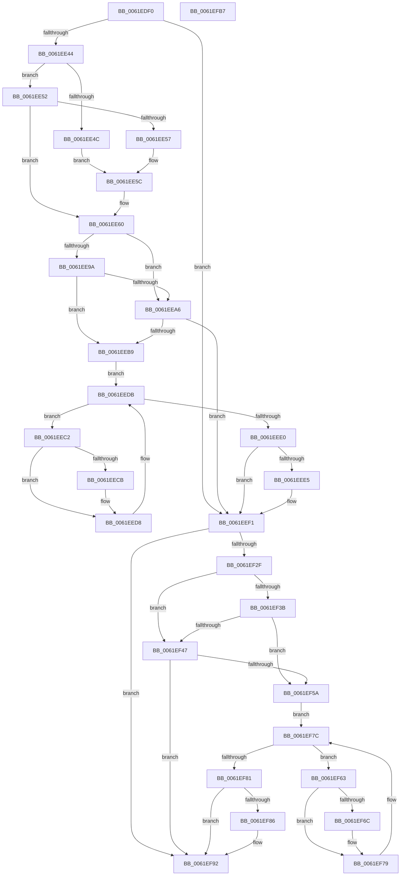

# DifExAllocatePoolWrapper

- RVA: `0x0061EDF0`–`0x0061EFB8` (길이 `456` bytes)
- VA: `0x000000014061EDF0`
- 실행 섹션: `.text`
- PDB 이름 있음: `예`; PDB Function 태그: `아니요`
- unwind 정보 RVA: `0x000D2CDC`
- 디코드: `128`개 명령, `456/456` bytes 표시
- 미해석 바이트: `0` (있으면 어셈블리에 `.byte`로 보존)

> 이 문서는 커널 이미지의 기계어와 PDB 기호를 분석해 생성했습니다. 4번과 5번은 함수 원형과 자료형을 바이너리 사용 방식에서 추정한 C 해석이며 원본 소스 복구 결과는 아닙니다.

## 1. Dependencies

- 직접 호출 지점: **10**; 고유 호출 대상: **6**
- 직접 호출자로 확인된 함수: **0**
- RIP 상대 이미지 참조: **3**

### Outgoing calls
- `0x0061EE29` → [memset](../6C/memset_function_006C6C40.md) (function, `0x006C6C40`)
- `0x0061EE33` → [DifGetAPIThunkContextById](../49/DifGetAPIThunkContextById_function_00495A34.md) (function, `0x00495A34`)
- `0x0061EE57` → [DifGetReturnAddressForWrappers](../4D/DifGetReturnAddressForWrappers_function_004D3C08.md) (function, `0x004D3C08`)
- `0x0061EEAD` → [ExAcquireRundownProtection](../21/ExAcquireRundownProtection_function_00216620.md) (function, `0x00216620`)
- `0x0061EED3` → [guard_dispatch_icall](../6B/guard_dispatch_icall_function_006BAAD0.md) (function, `0x006BAAD0`)
- `0x0061EEEC` → [ExReleaseRundownProtection](../34/ExReleaseRundownProtection_function_00349E80.md) (function, `0x00349E80`)
- `0x0061EF21` → [guard_dispatch_icall](../6B/guard_dispatch_icall_function_006BAAD0.md) (function, `0x006BAAD0`)
- `0x0061EF4E` → [ExAcquireRundownProtection](../21/ExAcquireRundownProtection_function_00216620.md) (function, `0x00216620`)
- `0x0061EF74` → [guard_dispatch_icall](../6B/guard_dispatch_icall_function_006BAAD0.md) (function, `0x006BAAD0`)
- `0x0061EF8D` → [ExReleaseRundownProtection](../34/ExReleaseRundownProtection_function_00349E80.md) (function, `0x00349E80`)

### Direct callers
- 이 함수 시작 RVA로 연결되는 직접 call은 확인되지 않았습니다. 간접 호출은 완전히 역산할 수 없습니다.

### Static image references
- `0x0061EE66` → RVA `0x00F048B8` (`.data`; read)
- `0x0061EE9A` → RVA `0x00F04980` (`.data`; read)
- `0x0061EEA6` → RVA `0x00F03E80` (`.data`; read)

## 2. Other-region calls and transfers

- 다른 실행 섹션으로 향하는 call: **0**
- 별도 외부 분기/꼬리 이동을 확인하지 못했습니다.

## 3. Assembly (complete function range)

```asm
0061EDF0  48 8B C4                        mov rax, rsp
0061EDF3  48 89 58 10                     mov qword ptr [rax + 0x10], rbx
0061EDF7  48 89 70 18                     mov qword ptr [rax + 0x18], rsi
0061EDFB  48 89 78 20                     mov qword ptr [rax + 0x20], rdi
0061EDFF  89 48 08                        mov dword ptr [rax + 8], ecx
0061EE02  55                              push rbp
0061EE03  41 54                           push r12
0061EE05  41 55                           push r13
0061EE07  41 56                           push r14
0061EE09  41 57                           push r15
0061EE0B  48 8D 68 C9                     lea rbp, [rax - 0x37]
0061EE0F  48 81 EC A0 00 00 00            sub rsp, 0xa0
0061EE16  4C 8B EA                        mov r13, rdx
0061EE19  48 8D 4D BF                     lea rcx, [rbp - 0x41]
0061EE1D  33 D2                           xor edx, edx
0061EE1F  4D 8B E0                        mov r12, r8
0061EE22  45 8B F9                        mov r15d, r9d
0061EE25  44 8D 42 48                     lea r8d, [rdx + 0x48]
0061EE29  E8 12 7E 0A 00                  call 0x1406c6c40
0061EE2E  B9 9D 01 00 00                  mov ecx, 0x19d
0061EE33  E8 FC 6B E7 FF                  call 0x140495a34
0061EE38  4C 8B F0                        mov r14, rax
0061EE3B  48 85 C0                        test rax, rax
0061EE3E  0F 84 AD 00 00 00               je 0x14061eef1
0061EE44  8B 48 0C                        mov ecx, dword ptr [rax + 0xc]
0061EE47  F6 C1 18                        test cl, 0x18
0061EE4A  74 06                           je 0x14061ee52
0061EE4C  48 8B 45 37                     mov rax, qword ptr [rbp + 0x37]
0061EE50  EB 0A                           jmp 0x14061ee5c
0061EE52  F6 C1 04                        test cl, 4
0061EE55  74 09                           je 0x14061ee60
0061EE57  E8 AC 4D EB FF                  call 0x1404d3c08
0061EE5C  48 89 45 BF                     mov qword ptr [rbp - 0x41], rax
0061EE60  8B 45 3F                        mov eax, dword ptr [rbp + 0x3f]
0061EE63  40 32 F6                        xor sil, sil
0061EE66  40 38 35 4B 5A 8E 00            cmp byte ptr [rip + 0x8e5a4b], sil
0061EE6D  89 45 F7                        mov dword ptr [rbp - 9], eax
0061EE70  8B 45 5F                        mov eax, dword ptr [rbp + 0x5f]
0061EE73  89 45 DF                        mov dword ptr [rbp - 0x21], eax
0061EE76  48 8B 45 67                     mov rax, qword ptr [rbp + 0x67]
0061EE7A  48 89 45 D7                     mov qword ptr [rbp - 0x29], rax
0061EE7E  8B 45 6F                        mov eax, dword ptr [rbp + 0x6f]
0061EE81  89 45 CF                        mov dword ptr [rbp - 0x31], eax
0061EE84  48 8B 45 77                     mov rax, qword ptr [rbp + 0x77]
0061EE88  48 89 45 C7                     mov qword ptr [rbp - 0x39], rax
0061EE8C  4C 89 6D EF                     mov qword ptr [rbp - 0x11], r13
0061EE90  4C 89 65 E7                     mov qword ptr [rbp - 0x19], r12
0061EE94  44 89 7D E3                     mov dword ptr [rbp - 0x1d], r15d
0061EE98  75 0C                           jne 0x14061eea6
0061EE9A  F7 05 DC 5A 8E 00 00 08 00 00   test dword ptr [rip + 0x8e5adc], 0x800
0061EEA4  74 13                           je 0x14061eeb9
0061EEA6  48 8D 0D D3 4F 8E 00            lea rcx, [rip + 0x8e4fd3]
0061EEAD  E8 6E 77 BF FF                  call 0x140216620
0061EEB2  40 8A F0                        mov sil, al
0061EEB5  84 C0                           test al, al
0061EEB7  74 38                           je 0x14061eef1
0061EEB9  49 8D 7E 20                     lea rdi, [r14 + 0x20]
0061EEBD  48 8B 1F                        mov rbx, qword ptr [rdi]
0061EEC0  EB 19                           jmp 0x14061eedb
0061EEC2  48 8D 43 F0                     lea rax, [rbx - 0x10]
0061EEC6  48 85 C0                        test rax, rax
0061EEC9  74 0D                           je 0x14061eed8
0061EECB  48 8B 40 08                     mov rax, qword ptr [rax + 8]
0061EECF  48 8D 4D BF                     lea rcx, [rbp - 0x41]
0061EED3  E8 F8 BB 09 00                  call 0x1406baad0
0061EED8  48 8B 1B                        mov rbx, qword ptr [rbx]
0061EEDB  48 3B DF                        cmp rbx, rdi
0061EEDE  75 E2                           jne 0x14061eec2
0061EEE0  40 84 F6                        test sil, sil
0061EEE3  74 0C                           je 0x14061eef1
0061EEE5  48 8D 0D 94 4F 8E 00            lea rcx, [rip + 0x8e4f94]
0061EEEC  E8 8F AF D2 FF                  call 0x140349e80
0061EEF1  48 8B 45 77                     mov rax, qword ptr [rbp + 0x77]
0061EEF5  45 8B CF                        mov r9d, r15d
0061EEF8  8B 4D 3F                        mov ecx, dword ptr [rbp + 0x3f]
0061EEFB  4D 8B C4                        mov r8, r12
0061EEFE  48 89 44 24 38                  mov qword ptr [rsp + 0x38], rax
0061EF03  49 8B D5                        mov rdx, r13
0061EF06  8B 45 6F                        mov eax, dword ptr [rbp + 0x6f]
0061EF09  89 44 24 30                     mov dword ptr [rsp + 0x30], eax
0061EF0D  48 8B 45 67                     mov rax, qword ptr [rbp + 0x67]
0061EF11  48 89 44 24 28                  mov qword ptr [rsp + 0x28], rax
0061EF16  8B 45 5F                        mov eax, dword ptr [rbp + 0x5f]
0061EF19  89 44 24 20                     mov dword ptr [rsp + 0x20], eax
0061EF1D  48 8B 45 7F                     mov rax, qword ptr [rbp + 0x7f]
0061EF21  E8 AA BB 09 00                  call 0x1406baad0
0061EF26  48 89 45 FF                     mov qword ptr [rbp - 1], rax
0061EF2A  4D 85 F6                        test r14, r14
0061EF2D  74 63                           je 0x14061ef92
0061EF2F  40 32 FF                        xor dil, dil
0061EF32  40 38 3D 7F 59 8E 00            cmp byte ptr [rip + 0x8e597f], dil
0061EF39  75 0C                           jne 0x14061ef47
0061EF3B  F7 05 3B 5A 8E 00 00 08 00 00   test dword ptr [rip + 0x8e5a3b], 0x800
0061EF45  74 13                           je 0x14061ef5a
0061EF47  48 8D 0D 32 4F 8E 00            lea rcx, [rip + 0x8e4f32]
0061EF4E  E8 CD 76 BF FF                  call 0x140216620
0061EF53  40 8A F8                        mov dil, al
0061EF56  84 C0                           test al, al
0061EF58  74 38                           je 0x14061ef92
0061EF5A  49 8D 76 30                     lea rsi, [r14 + 0x30]
0061EF5E  48 8B 1E                        mov rbx, qword ptr [rsi]
0061EF61  EB 19                           jmp 0x14061ef7c
0061EF63  48 8D 43 F0                     lea rax, [rbx - 0x10]
0061EF67  48 85 C0                        test rax, rax
0061EF6A  74 0D                           je 0x14061ef79
0061EF6C  48 8B 40 08                     mov rax, qword ptr [rax + 8]
0061EF70  48 8D 4D BF                     lea rcx, [rbp - 0x41]
0061EF74  E8 57 BB 09 00                  call 0x1406baad0
0061EF79  48 8B 1B                        mov rbx, qword ptr [rbx]
0061EF7C  48 3B DE                        cmp rbx, rsi
0061EF7F  75 E2                           jne 0x14061ef63
0061EF81  40 84 FF                        test dil, dil
0061EF84  74 0C                           je 0x14061ef92
0061EF86  48 8D 0D F3 4E 8E 00            lea rcx, [rip + 0x8e4ef3]
0061EF8D  E8 EE AE D2 FF                  call 0x140349e80
0061EF92  48 8B 45 FF                     mov rax, qword ptr [rbp - 1]
0061EF96  4C 8D 9C 24 A0 00 00 00         lea r11, [rsp + 0xa0]
0061EF9E  49 8B 5B 38                     mov rbx, qword ptr [r11 + 0x38]
0061EFA2  49 8B 73 40                     mov rsi, qword ptr [r11 + 0x40]
0061EFA6  49 8B 7B 48                     mov rdi, qword ptr [r11 + 0x48]
0061EFAA  49 8B E3                        mov rsp, r11
0061EFAD  41 5F                           pop r15
0061EFAF  41 5E                           pop r14
0061EFB1  41 5D                           pop r13
0061EFB3  41 5C                           pop r12
0061EFB5  5D                              pop rbp
0061EFB6  C3                              ret
0061EFB7  CC                              int3
```

## 4. C-style interpretation (structured pseudocode)

```c
__int64 __fastcall DifExAllocatePoolWrapper(int a1, __int64 a2, __int64 a3, int a4)
{
    __int64 result;
    __int64 v_rdi;
    __int64 v_rsi;
    __int64 v_rsp;
    unsigned __int64 v_stack_m28;
    unsigned __int64 v_stack_m90;
    unsigned int v_stack_m98;
    unsigned __int64 v_stack_mA0;
    unsigned int v_stack_mA8;

    *(unsigned __int64 *)(v_rsp + 16) = v_rbx;
    *(unsigned __int64 *)(v_rsp + 24) = v_rsi;
    *(unsigned __int64 *)(v_rsp + 32) = v_rdi;
    *(unsigned int *)(v_rsp + 8) = a1;
    v_rsp = (v_rsp) - (160);
    a2 = 0;
    result = memset(v_rsp - 55 - 65, a2, a2 + 72, a4);
    result = DifGetAPIThunkContextById(413, a2, a2 + 72, a4);
    if (result == 0) goto loc_0061EEF1;
    if ((((unsigned __int8)((unsigned int)(*(unsigned int *)(result + 12)))) & (24)) == 0) goto loc_0061EE52;
    goto loc_0061EE5C;
loc_0061EE52:
    if ((((unsigned __int8)((unsigned int)(*(unsigned int *)(result + 12)))) & (4)) == 0) goto loc_0061EE60;
    result = DifGetReturnAddressForWrappers((unsigned int)(*(unsigned int *)(result + 12)), a2, a2 + 72, a4);
loc_0061EE5C:
    *(unsigned __int64 *)(v_rsp - 55 - 65) = result;
loc_0061EE60:
    v_rsi = 0;
    *(unsigned int *)(v_rsp - 55 - 9) = (unsigned int)((unsigned int)(*(unsigned int *)(v_rsp - 55 + 63)));
    *(unsigned int *)(v_rsp - 55 - 33) = (unsigned int)((unsigned int)(*(unsigned int *)(v_rsp - 55 + 95)));
    *(unsigned __int64 *)(v_rsp - 55 - 41) = *(unsigned __int64 *)(v_rsp - 55 + 103);
    *(unsigned int *)(v_rsp - 55 - 49) = (unsigned int)((unsigned int)(*(unsigned int *)(v_rsp - 55 + 111)));
    *(unsigned __int64 *)(v_rsp - 55 - 57) = *(unsigned __int64 *)(v_rsp - 55 + 119);
    *(unsigned __int64 *)(v_rsp - 55 - 17) = 0;
    *(unsigned __int64 *)(v_rsp - 55 - 25) = a3;
    *(unsigned int *)(v_rsp - 55 - 29) = (unsigned int)((unsigned int)(a4));
    if ((*(unsigned __int8 *)(v_rip + 9329227)) != 0) goto loc_0061EEA6;
    if (((*(unsigned int *)(v_rip + 9329372)) & (0x800ULL)) == 0) goto loc_0061EEB9;
loc_0061EEA6:
    result = ExAcquireRundownProtection(v_rip + 9326547, a2, a2 + 72, a4);
    if ((unsigned __int8)(result) == 0) goto loc_0061EEF1;
loc_0061EEB9:
    goto loc_0061EEDB;
loc_0061EEC2:
    result = *(unsigned __int64 *)(result + 32) - 16;
    if (*(unsigned __int64 *)(result + 32) - 16 != 0) {
        result = *(unsigned __int64 *)(*(unsigned __int64 *)(result + 32) - 16 + 8);
        a1 = v_rsp - 55 - 65;
        result = guard_dispatch_icall(a1, a2, a2 + 72, a4);
    }
loc_0061EEDB:
    if ((*(unsigned __int64 *)(*(unsigned __int64 *)(result + 32))) != (result + 32)) goto loc_0061EEC2;
    if ((unsigned __int8)((unsigned __int8)(result)) != 0) {
        a1 = v_rip + 9326484;
        result = ExReleaseRundownProtection(a1, a2, a2 + 72, a4);
    }
    v_stack_m90 = *(unsigned __int64 *)(v_rsp - 55 + 119);
    v_stack_m98 = (unsigned int)((unsigned int)(*(unsigned int *)(v_rsp - 55 + 111)));
    v_stack_mA0 = *(unsigned __int64 *)(v_rsp - 55 + 103);
    v_stack_mA8 = (unsigned int)((unsigned int)(*(unsigned int *)(v_rsp - 55 + 95)));
    result = guard_dispatch_icall((unsigned int)(*(unsigned int *)(v_rsp - 55 + 63)), 0, a3, (unsigned int)((unsigned int)((unsigned int)(a4))));
    *(unsigned __int64 *)(v_rsp - 55 - 1) = result;
    if (result == 0) goto loc_0061EF92;
    v_rdi = 0;
    if ((*(unsigned __int8 *)(v_rip + 9329023)) != 0) goto loc_0061EF47;
    if (((*(unsigned int *)(v_rip + 9329211)) & (0x800ULL)) == 0) goto loc_0061EF5A;
loc_0061EF47:
    result = ExAcquireRundownProtection(v_rip + 9326386, 0, a3, (unsigned int)((unsigned int)((unsigned int)(a4))));
    if ((unsigned __int8)(result) == 0) goto loc_0061EF92;
loc_0061EF5A:
    goto loc_0061EF7C;
loc_0061EF63:
    result = *(unsigned __int64 *)(result + 48) - 16;
    if (*(unsigned __int64 *)(result + 48) - 16 != 0) {
        result = *(unsigned __int64 *)(*(unsigned __int64 *)(result + 48) - 16 + 8);
        a1 = v_rsp - 55 - 65;
        result = guard_dispatch_icall(a1, 0, a3, (unsigned int)((unsigned int)((unsigned int)(a4))));
    }
loc_0061EF7C:
    if ((*(unsigned __int64 *)(*(unsigned __int64 *)(result + 48))) != (result + 48)) goto loc_0061EF63;
    if ((unsigned __int8)((unsigned __int8)(result)) != 0) {
        a1 = v_rip + 9326323;
        result = ExReleaseRundownProtection(a1, 0, a3, (unsigned int)((unsigned int)((unsigned int)(a4))));
    }
    return *(unsigned __int64 *)(v_rsp - 55 - 1);
}
```

## 5. (Beta) C Style

```c
int64_t DifExAllocatePoolWrapper(int32_t Arg1, int64_t Arg2, int64_t Arg3, int32_t Arg4)
{
    int64_t result;
    int64_t local_rdi;
    int64_t local_rsi;
    int64_t local_rsp;
    uint64_t v_stack_m28;
    uint64_t v_stack_m90;
    uint32_t v_stack_m98;
    uint64_t v_stack_mA0;
    uint32_t v_stack_mA8;

    *(uint64_t *)(local_rsp + 0x10) = local_rbx;
    *(uint64_t *)(local_rsp + 0x18) = local_rsi;
    *(uint64_t *)(local_rsp + 0x20) = local_rdi;
    *(uint32_t *)(local_rsp + 0x8) = Arg1;
    local_rsp = (local_rsp) - (160);
    Arg2 = 0;
    result = memset(local_rsp - 55 - 65, Arg2, Arg2 + 72, Arg4);
    result = DifGetAPIThunkContextById(413, Arg2, Arg2 + 72, Arg4);
    if (result == 0) goto loc_0061EEF1;
    if ((((uint8_t)((uint32_t)(*(uint32_t *)(result + 0xC)))) & (24)) == 0) goto loc_0061EE52;
    goto loc_0061EE5C;
loc_0061EE52:
    if ((((uint8_t)((uint32_t)(*(uint32_t *)(result + 0xC)))) & (4)) == 0) goto loc_0061EE60;
    result = DifGetReturnAddressForWrappers((uint32_t)(*(uint32_t *)(result + 0xC)), Arg2, Arg2 + 72, Arg4);
loc_0061EE5C:
    *(uint64_t *)(local_rsp - 0x37 - 0x41) = result;
loc_0061EE60:
    local_rsi = 0;
    *(uint32_t *)(local_rsp - 0x37 - 0x9) = (uint32_t)((uint32_t)(*(uint32_t *)(local_rsp - 0x37 + 0x3F)));
    *(uint32_t *)(local_rsp - 0x37 - 0x21) = (uint32_t)((uint32_t)(*(uint32_t *)(local_rsp - 0x37 + 0x5F)));
    *(uint64_t *)(local_rsp - 0x37 - 0x29) = *(uint64_t *)(local_rsp - 0x37 + 0x67);
    *(uint32_t *)(local_rsp - 0x37 - 0x31) = (uint32_t)((uint32_t)(*(uint32_t *)(local_rsp - 0x37 + 0x6F)));
    *(uint64_t *)(local_rsp - 0x37 - 0x39) = *(uint64_t *)(local_rsp - 0x37 + 0x77);
    *(uint64_t *)(local_rsp - 0x37 - 0x11) = 0;
    *(uint64_t *)(local_rsp - 0x37 - 0x19) = Arg3;
    *(uint32_t *)(local_rsp - 0x37 - 0x1D) = (uint32_t)((uint32_t)(Arg4));
    if ((*(uint8_t *)(v_rip + 0x8E5A4B)) != 0) goto loc_0061EEA6;
    if (((*(uint32_t *)(v_rip + 0x8E5ADC)) & (0x800ULL)) == 0) goto loc_0061EEB9;
loc_0061EEA6:
    result = ExAcquireRundownProtection(v_rip + 9326547, Arg2, Arg2 + 72, Arg4);
    if ((uint8_t)(result) == 0) goto loc_0061EEF1;
loc_0061EEB9:
    goto loc_0061EEDB;
loc_0061EEC2:
    result = *(uint64_t *)(result + 0x20) - 16;
    if (*(uint64_t *)(result + 0x20) - 16 != 0) {
        result = *(uint64_t *)(*(uint64_t *)(result + 0x20) - 0x10 + 0x8);
        Arg1 = local_rsp - 55 - 65;
        result = guard_dispatch_icall(Arg1, Arg2, Arg2 + 72, Arg4);
    }
loc_0061EEDB:
    if ((*(uint64_t *)(*(uint64_t *)(result + 0x20))) != (result + 32)) goto loc_0061EEC2;
    if ((uint8_t)((uint8_t)(result)) != 0) {
        Arg1 = v_rip + 9326484;
        result = ExReleaseRundownProtection(Arg1, Arg2, Arg2 + 72, Arg4);
    }
    v_stack_m90 = *(uint64_t *)(local_rsp - 0x37 + 0x77);
    v_stack_m98 = (uint32_t)((uint32_t)(*(uint32_t *)(local_rsp - 0x37 + 0x6F)));
    v_stack_mA0 = *(uint64_t *)(local_rsp - 0x37 + 0x67);
    v_stack_mA8 = (uint32_t)((uint32_t)(*(uint32_t *)(local_rsp - 0x37 + 0x5F)));
    result = guard_dispatch_icall((uint32_t)(*(uint32_t *)(local_rsp - 0x37 + 0x3F)), 0, Arg3, (uint32_t)((uint32_t)((uint32_t)(Arg4))));
    *(uint64_t *)(local_rsp - 0x37 - 0x1) = result;
    if (result == 0) goto loc_0061EF92;
    local_rdi = 0;
    if ((*(uint8_t *)(v_rip + 0x8E597F)) != 0) goto loc_0061EF47;
    if (((*(uint32_t *)(v_rip + 0x8E5A3B)) & (0x800ULL)) == 0) goto loc_0061EF5A;
loc_0061EF47:
    result = ExAcquireRundownProtection(v_rip + 9326386, 0, Arg3, (uint32_t)((uint32_t)((uint32_t)(Arg4))));
    if ((uint8_t)(result) == 0) goto loc_0061EF92;
loc_0061EF5A:
    goto loc_0061EF7C;
loc_0061EF63:
    result = *(uint64_t *)(result + 0x30) - 16;
    if (*(uint64_t *)(result + 0x30) - 16 != 0) {
        result = *(uint64_t *)(*(uint64_t *)(result + 0x30) - 0x10 + 0x8);
        Arg1 = local_rsp - 55 - 65;
        result = guard_dispatch_icall(Arg1, 0, Arg3, (uint32_t)((uint32_t)((uint32_t)(Arg4))));
    }
loc_0061EF7C:
    if ((*(uint64_t *)(*(uint64_t *)(result + 0x30))) != (result + 48)) goto loc_0061EF63;
    if ((uint8_t)((uint8_t)(result)) != 0) {
        Arg1 = v_rip + 9326323;
        result = ExReleaseRundownProtection(Arg1, 0, Arg3, (uint32_t)((uint32_t)((uint32_t)(Arg4))));
    }
    return *(uint64_t *)(local_rsp - 0x37 - 0x1);
}
```

## 6. Execution-region graph

[열기: 2D/3D 그래프와 함수 탐색 컨트롤 패널](../../../control-panel.html?section=text&rva=0x0061EDF0&view=graph)

- 2D 그래프는 위에서 아래로 흐르고, 3D 그래프는 빈 공간을 드래그해 회전합니다. Shift+드래그는 이동, 휠은 확대·축소, 함수 노드 선택은 대상 보고서 이동입니다.

### Static fallback


