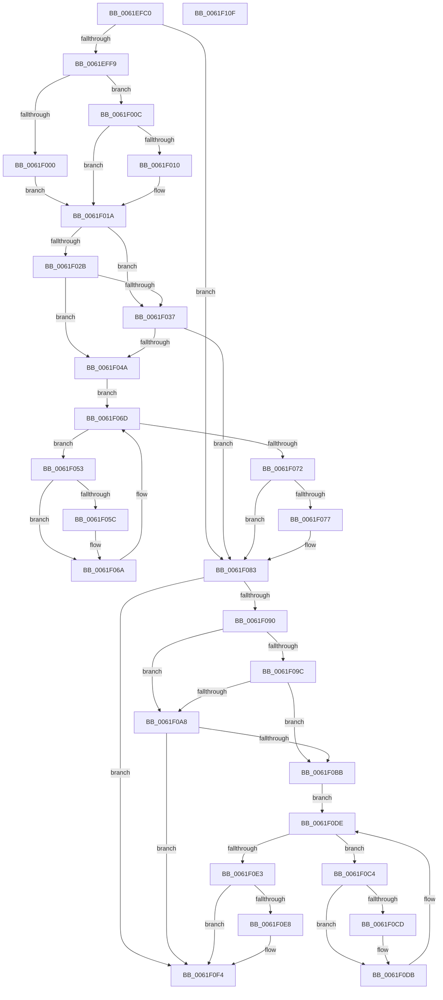

# DifExConvertExclusiveToSharedLiteWrapper

- RVA: `0x0061EFC0`–`0x0061F110` (길이 `336` bytes)
- VA: `0x000000014061EFC0`
- 실행 섹션: `.text`
- PDB 이름 있음: `예`; PDB Function 태그: `아니요`
- unwind 정보 RVA: `0x0005D7BC`
- 디코드: `90`개 명령, `336/336` bytes 표시
- 미해석 바이트: `0` (있으면 어셈블리에 `.byte`로 보존)

> 이 문서는 커널 이미지의 기계어와 PDB 기호를 분석해 생성했습니다. 4번과 5번은 함수 원형과 자료형을 바이너리 사용 방식에서 추정한 C 해석이며 원본 소스 복구 결과는 아닙니다.

## 1. Dependencies

- 직접 호출 지점: **9**; 고유 호출 대상: **6**
- 직접 호출자로 확인된 함수: **0**
- RIP 상대 이미지 참조: **3**

### Outgoing calls
- `0x0061EFE8` → [DifGetAPIThunkContextById](../49/DifGetAPIThunkContextById_function_00495A34.md) (function, `0x00495A34`)
- `0x0061F010` → [DifGetReturnAddressForWrappers](../4D/DifGetReturnAddressForWrappers_function_004D3C08.md) (function, `0x004D3C08`)
- `0x0061F03E` → [ExAcquireRundownProtection](../21/ExAcquireRundownProtection_function_00216620.md) (function, `0x00216620`)
- `0x0061F065` → [guard_dispatch_icall](../6B/guard_dispatch_icall_function_006BAAD0.md) (function, `0x006BAAD0`)
- `0x0061F07E` → [ExReleaseRundownProtection](../34/ExReleaseRundownProtection_function_00349E80.md) (function, `0x00349E80`)
- `0x0061F086` → [ExConvertExclusiveToSharedLite](../34/ExConvertExclusiveToSharedLite_function_0034F700.md) (function, `0x0034F700`)
- `0x0061F0AF` → [ExAcquireRundownProtection](../21/ExAcquireRundownProtection_function_00216620.md) (function, `0x00216620`)
- `0x0061F0D6` → [guard_dispatch_icall](../6B/guard_dispatch_icall_function_006BAAD0.md) (function, `0x006BAAD0`)
- `0x0061F0EF` → [ExReleaseRundownProtection](../34/ExReleaseRundownProtection_function_00349E80.md) (function, `0x00349E80`)

### Direct callers
- 이 함수 시작 RVA로 연결되는 직접 call은 확인되지 않았습니다. 간접 호출은 완전히 역산할 수 없습니다.

### Static image references
- `0x0061F022` → RVA `0x00F048B8` (`.data`; read)
- `0x0061F02B` → RVA `0x00F04980` (`.data`; read)
- `0x0061F037` → RVA `0x00F03E80` (`.data`; read)

## 2. Other-region calls and transfers

- 다른 실행 섹션으로 향하는 call: **0**
- 별도 외부 분기/꼬리 이동을 확인하지 못했습니다.

## 3. Assembly (complete function range)

```asm
0061EFC0  48 8B C4                        mov rax, rsp
0061EFC3  48 89 58 08                     mov qword ptr [rax + 8], rbx
0061EFC7  48 89 68 10                     mov qword ptr [rax + 0x10], rbp
0061EFCB  48 89 70 18                     mov qword ptr [rax + 0x18], rsi
0061EFCF  48 89 78 20                     mov qword ptr [rax + 0x20], rdi
0061EFD3  41 56                           push r14
0061EFD5  48 83 EC 30                     sub rsp, 0x30
0061EFD9  48 8B E9                        mov rbp, rcx
0061EFDC  0F 57 C0                        xorps xmm0, xmm0
0061EFDF  B9 9C 01 00 00                  mov ecx, 0x19c
0061EFE4  0F 11 40 E8                     movups xmmword ptr [rax - 0x18], xmm0
0061EFE8  E8 47 6A E7 FF                  call 0x140495a34
0061EFED  48 8B F8                        mov rdi, rax
0061EFF0  48 85 C0                        test rax, rax
0061EFF3  0F 84 8A 00 00 00               je 0x14061f083
0061EFF9  8B 40 0C                        mov eax, dword ptr [rax + 0xc]
0061EFFC  A8 18                           test al, 0x18
0061EFFE  74 0C                           je 0x14061f00c
0061F000  48 8B 4C 24 38                  mov rcx, qword ptr [rsp + 0x38]
0061F005  48 89 4C 24 20                  mov qword ptr [rsp + 0x20], rcx
0061F00A  EB 0E                           jmp 0x14061f01a
0061F00C  A8 04                           test al, 4
0061F00E  74 0A                           je 0x14061f01a
0061F010  E8 F3 4B EB FF                  call 0x1404d3c08
0061F015  48 89 44 24 20                  mov qword ptr [rsp + 0x20], rax
0061F01A  40 32 F6                        xor sil, sil
0061F01D  48 89 6C 24 28                  mov qword ptr [rsp + 0x28], rbp
0061F022  40 38 35 8F 58 8E 00            cmp byte ptr [rip + 0x8e588f], sil
0061F029  75 0C                           jne 0x14061f037
0061F02B  F7 05 4B 59 8E 00 00 08 00 00   test dword ptr [rip + 0x8e594b], 0x800
0061F035  74 13                           je 0x14061f04a
0061F037  48 8D 0D 42 4E 8E 00            lea rcx, [rip + 0x8e4e42]
0061F03E  E8 DD 75 BF FF                  call 0x140216620
0061F043  40 8A F0                        mov sil, al
0061F046  84 C0                           test al, al
0061F048  74 39                           je 0x14061f083
0061F04A  4C 8D 77 20                     lea r14, [rdi + 0x20]
0061F04E  49 8B 1E                        mov rbx, qword ptr [r14]
0061F051  EB 1A                           jmp 0x14061f06d
0061F053  48 8D 43 F0                     lea rax, [rbx - 0x10]
0061F057  48 85 C0                        test rax, rax
0061F05A  74 0E                           je 0x14061f06a
0061F05C  48 8B 40 08                     mov rax, qword ptr [rax + 8]
0061F060  48 8D 4C 24 20                  lea rcx, [rsp + 0x20]
0061F065  E8 66 BA 09 00                  call 0x1406baad0
0061F06A  48 8B 1B                        mov rbx, qword ptr [rbx]
0061F06D  49 3B DE                        cmp rbx, r14
0061F070  75 E1                           jne 0x14061f053
0061F072  40 84 F6                        test sil, sil
0061F075  74 0C                           je 0x14061f083
0061F077  48 8D 0D 02 4E 8E 00            lea rcx, [rip + 0x8e4e02]
0061F07E  E8 FD AD D2 FF                  call 0x140349e80
0061F083  48 8B CD                        mov rcx, rbp
0061F086  E8 75 06 D3 FF                  call 0x14034f700
0061F08B  48 85 FF                        test rdi, rdi
0061F08E  74 64                           je 0x14061f0f4
0061F090  40 32 F6                        xor sil, sil
0061F093  40 38 35 1E 58 8E 00            cmp byte ptr [rip + 0x8e581e], sil
0061F09A  75 0C                           jne 0x14061f0a8
0061F09C  F7 05 DA 58 8E 00 00 08 00 00   test dword ptr [rip + 0x8e58da], 0x800
0061F0A6  74 13                           je 0x14061f0bb
0061F0A8  48 8D 0D D1 4D 8E 00            lea rcx, [rip + 0x8e4dd1]
0061F0AF  E8 6C 75 BF FF                  call 0x140216620
0061F0B4  40 8A F0                        mov sil, al
0061F0B7  84 C0                           test al, al
0061F0B9  74 39                           je 0x14061f0f4
0061F0BB  48 83 C7 30                     add rdi, 0x30
0061F0BF  48 8B 1F                        mov rbx, qword ptr [rdi]
0061F0C2  EB 1A                           jmp 0x14061f0de
0061F0C4  48 8D 43 F0                     lea rax, [rbx - 0x10]
0061F0C8  48 85 C0                        test rax, rax
0061F0CB  74 0E                           je 0x14061f0db
0061F0CD  48 8B 40 08                     mov rax, qword ptr [rax + 8]
0061F0D1  48 8D 4C 24 20                  lea rcx, [rsp + 0x20]
0061F0D6  E8 F5 B9 09 00                  call 0x1406baad0
0061F0DB  48 8B 1B                        mov rbx, qword ptr [rbx]
0061F0DE  48 3B DF                        cmp rbx, rdi
0061F0E1  75 E1                           jne 0x14061f0c4
0061F0E3  40 84 F6                        test sil, sil
0061F0E6  74 0C                           je 0x14061f0f4
0061F0E8  48 8D 0D 91 4D 8E 00            lea rcx, [rip + 0x8e4d91]
0061F0EF  E8 8C AD D2 FF                  call 0x140349e80
0061F0F4  48 8B 5C 24 40                  mov rbx, qword ptr [rsp + 0x40]
0061F0F9  48 8B 6C 24 48                  mov rbp, qword ptr [rsp + 0x48]
0061F0FE  48 8B 74 24 50                  mov rsi, qword ptr [rsp + 0x50]
0061F103  48 8B 7C 24 58                  mov rdi, qword ptr [rsp + 0x58]
0061F108  48 83 C4 30                     add rsp, 0x30
0061F10C  41 5E                           pop r14
0061F10E  C3                              ret
0061F10F  CC                              int3
```

## 4. C-style interpretation (structured pseudocode)

```c
__int64 __fastcall DifExConvertExclusiveToSharedLiteWrapper(__int64 a1)
{
    __int64 result;
    __int64 v_rdi;
    __int64 v_rsi;
    __int64 v_rsp;
    unsigned __int64 v_stack_m10;
    unsigned __int64 v_stack_m18;
    unsigned __int64 v_stack_p0;
    unsigned __int64 v_stack_p10;
    unsigned __int64 v_stack_p18;
    unsigned __int64 v_stack_p20;
    unsigned __int64 v_stack_p8;

    *(unsigned __int64 *)(v_rsp + 8) = v_rbx;
    *(unsigned __int64 *)(v_rsp + 16) = v_rbp;
    *(unsigned __int64 *)(v_rsp + 24) = v_rsi;
    *(unsigned __int64 *)(v_rsp + 32) = v_rdi;
    v_rsp = (v_rsp) - (48);
    *(unsigned __int64 *)(v_rsp - 24) = v_xmm0;
    result = DifGetAPIThunkContextById(412, a2, a3, a4);
    if (result == 0) goto loc_0061F083;
    if ((((unsigned __int8)((unsigned int)(*(unsigned int *)(result + 12)))) & (24)) == 0) goto loc_0061F00C;
    v_stack_m18 = v_stack_p0;
    goto loc_0061F01A;
loc_0061F00C:
    result = (unsigned int)(*(unsigned int *)(result + 12));
    if ((((unsigned __int8)((unsigned int)(*(unsigned int *)(result + 12)))) & (4)) != 0) {
        result = DifGetReturnAddressForWrappers(v_stack_p0, a2, a3, a4);
        v_stack_m18 = result;
    }
    v_rsi = 0;
    v_stack_m10 = a1;
    if ((*(unsigned __int8 *)(v_rip + 9328783)) != 0) goto loc_0061F037;
    if (((*(unsigned int *)(v_rip + 9328971)) & (0x800ULL)) == 0) goto loc_0061F04A;
loc_0061F037:
    result = ExAcquireRundownProtection(v_rip + 9326146, a2, a3, a4);
    if ((unsigned __int8)(result) == 0) goto loc_0061F083;
loc_0061F04A:
    goto loc_0061F06D;
loc_0061F053:
    result = *(unsigned __int64 *)(result + 32) - 16;
    if (*(unsigned __int64 *)(result + 32) - 16 != 0) {
        result = *(unsigned __int64 *)(*(unsigned __int64 *)(result + 32) - 16 + 8);
        a1 = v_stack_m18;
        result = guard_dispatch_icall(a1, a2, a3, a4);
    }
loc_0061F06D:
    if ((*(unsigned __int64 *)(*(unsigned __int64 *)(result + 32))) != (result + 32)) goto loc_0061F053;
    if ((unsigned __int8)((unsigned __int8)(result)) != 0) {
        a1 = v_rip + 9326082;
        result = ExReleaseRundownProtection(a1, a2, a3, a4);
    }
    result = ExConvertExclusiveToSharedLite(a1, a2, a3, a4);
    if (result == 0) goto loc_0061F0F4;
    v_rsi = 0;
    if ((*(unsigned __int8 *)(v_rip + 9328670)) != 0) goto loc_0061F0A8;
    if (((*(unsigned int *)(v_rip + 9328858)) & (0x800ULL)) == 0) goto loc_0061F0BB;
loc_0061F0A8:
    result = ExAcquireRundownProtection(v_rip + 9326033, a2, a3, a4);
    if ((unsigned __int8)(result) == 0) goto loc_0061F0F4;
loc_0061F0BB:
    v_rdi = (result) + (48);
    goto loc_0061F0DE;
loc_0061F0C4:
    result = *(unsigned __int64 *)(v_rdi) - 16;
    if (*(unsigned __int64 *)(v_rdi) - 16 != 0) {
        result = *(unsigned __int64 *)(*(unsigned __int64 *)(v_rdi) - 16 + 8);
        a1 = v_stack_m18;
        result = guard_dispatch_icall(a1, a2, a3, a4);
    }
loc_0061F0DE:
    if ((*(unsigned __int64 *)(*(unsigned __int64 *)(v_rdi))) != v_rdi) goto loc_0061F0C4;
    if ((unsigned __int8)((unsigned __int8)(result)) != 0) {
        a1 = v_rip + 9325969;
        result = ExReleaseRundownProtection(a1, a2, a3, a4);
    }
    v_rsp = (v_rsp) + (48);
    return result;
}
```

## 5. (Beta) C Style

```c
int64_t DifExConvertExclusiveToSharedLiteWrapper(int64_t Arg1)
{
    int64_t result;
    int64_t local_rdi;
    int64_t local_rsi;
    int64_t local_rsp;
    uint64_t v_stack_m10;
    uint64_t v_stack_m18;
    uint64_t v_stack_p0;
    uint64_t v_stack_p10;
    uint64_t v_stack_p18;
    uint64_t v_stack_p20;
    uint64_t v_stack_p8;

    *(uint64_t *)(local_rsp + 0x8) = local_rbx;
    *(uint64_t *)(local_rsp + 0x10) = local_rbp;
    *(uint64_t *)(local_rsp + 0x18) = local_rsi;
    *(uint64_t *)(local_rsp + 0x20) = local_rdi;
    local_rsp = (local_rsp) - (48);
    *(uint64_t *)(local_rsp - 0x18) = v_xmm0;
    result = DifGetAPIThunkContextById(412, a2, a3, a4);
    if (result == 0) goto loc_0061F083;
    if ((((uint8_t)((uint32_t)(*(uint32_t *)(result + 0xC)))) & (24)) == 0) goto loc_0061F00C;
    v_stack_m18 = v_stack_p0;
    goto loc_0061F01A;
loc_0061F00C:
    result = (uint32_t)(*(uint32_t *)(result + 0xC));
    if ((((uint8_t)((uint32_t)(*(uint32_t *)(result + 0xC)))) & (4)) != 0) {
        result = DifGetReturnAddressForWrappers(v_stack_p0, a2, a3, a4);
        v_stack_m18 = result;
    }
    local_rsi = 0;
    v_stack_m10 = Arg1;
    if ((*(uint8_t *)(v_rip + 0x8E588F)) != 0) goto loc_0061F037;
    if (((*(uint32_t *)(v_rip + 0x8E594B)) & (0x800ULL)) == 0) goto loc_0061F04A;
loc_0061F037:
    result = ExAcquireRundownProtection(v_rip + 9326146, a2, a3, a4);
    if ((uint8_t)(result) == 0) goto loc_0061F083;
loc_0061F04A:
    goto loc_0061F06D;
loc_0061F053:
    result = *(uint64_t *)(result + 0x20) - 16;
    if (*(uint64_t *)(result + 0x20) - 16 != 0) {
        result = *(uint64_t *)(*(uint64_t *)(result + 0x20) - 0x10 + 0x8);
        Arg1 = v_stack_m18;
        result = guard_dispatch_icall(Arg1, a2, a3, a4);
    }
loc_0061F06D:
    if ((*(uint64_t *)(*(uint64_t *)(result + 0x20))) != (result + 32)) goto loc_0061F053;
    if ((uint8_t)((uint8_t)(result)) != 0) {
        Arg1 = v_rip + 9326082;
        result = ExReleaseRundownProtection(Arg1, a2, a3, a4);
    }
    result = ExConvertExclusiveToSharedLite(Arg1, a2, a3, a4);
    if (result == 0) goto loc_0061F0F4;
    local_rsi = 0;
    if ((*(uint8_t *)(v_rip + 0x8E581E)) != 0) goto loc_0061F0A8;
    if (((*(uint32_t *)(v_rip + 0x8E58DA)) & (0x800ULL)) == 0) goto loc_0061F0BB;
loc_0061F0A8:
    result = ExAcquireRundownProtection(v_rip + 9326033, a2, a3, a4);
    if ((uint8_t)(result) == 0) goto loc_0061F0F4;
loc_0061F0BB:
    local_rdi = (result) + (48);
    goto loc_0061F0DE;
loc_0061F0C4:
    result = *(uint64_t *)(local_rdi) - 16;
    if (*(uint64_t *)(local_rdi) - 16 != 0) {
        result = *(uint64_t *)(*(uint64_t *)(local_rdi) - 0x10 + 0x8);
        Arg1 = v_stack_m18;
        result = guard_dispatch_icall(Arg1, a2, a3, a4);
    }
loc_0061F0DE:
    if ((*(uint64_t *)(*(uint64_t *)(local_rdi))) != local_rdi) goto loc_0061F0C4;
    if ((uint8_t)((uint8_t)(result)) != 0) {
        Arg1 = v_rip + 9325969;
        result = ExReleaseRundownProtection(Arg1, a2, a3, a4);
    }
    local_rsp = (local_rsp) + (48);
    return result;
}
```

## 6. Execution-region graph

[열기: 2D/3D 그래프와 함수 탐색 컨트롤 패널](../../../control-panel.html?section=text&rva=0x0061EFC0&view=graph)

- 2D 그래프는 위에서 아래로 흐르고, 3D 그래프는 빈 공간을 드래그해 회전합니다. Shift+드래그는 이동, 휠은 확대·축소, 함수 노드 선택은 대상 보고서 이동입니다.

### Static fallback


